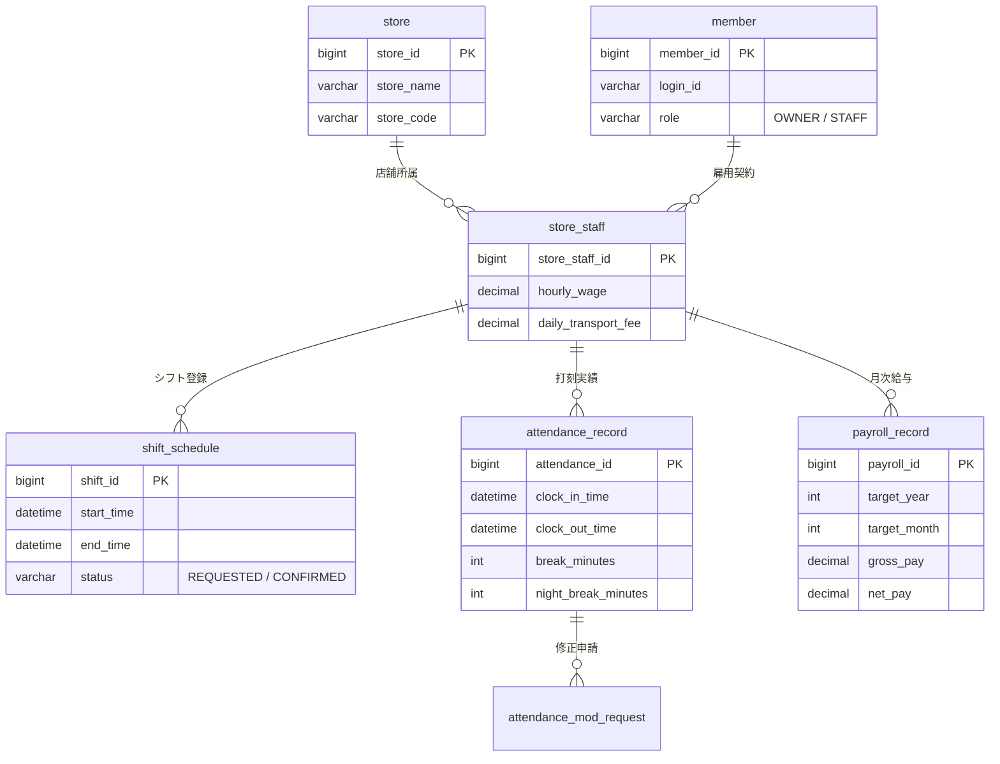

# 勤怠・シフト・給与管理システム (Kintai Management System)
> 日本向けのシフト・勤怠・月次給与管理アプリです。動作・計算の主張は記録されたテスト範囲に限ります。
> 現行SRSが定めるMVPの範囲を提供します。日本の労働法全体への適合や未検証の本番運用条件を保証しません。
> 検証範囲と残作業は `docs/final-portfolio/README_KO.md` およびRTMを参照してください。

---

## 📌 プロジェクト概要 (Project Overview)

本リポジトリは、シフト・勤怠・月次給与機能のMVPです。動作・計算・画面表示については、ポートフォリオに記載した実行記録の範囲を確認してください。未検証の法令要件や運用条件を保証する資料ではありません。

1. **割増賃金計算（現行SRSで定義する時間外・深夜の範囲）**:
   - `深夜労働 (22:00 ~ 翌05:00, +25%)`
   - `時間外労働 (1日8時間超過, +25%)`
   - `深夜かつ時間外の重複労働 (+50%)`
   - 対象の計算ケースはテストで検証しています。計算対象・境界・端数処理の詳細は技術証跡を参照してください。
2. **シフト・給与データの整合性**:
   - 対象の更新処理にはトランザクションと行ロックを使用します。検証した経路は技術証跡とRTMに記載しています。
3. **勤怠・休憩記録**:
   - 打刻と休憩の記録を保持し、対象ケースの時間計算をテストで確認しています。
4. **検証結果と制約**:
   - 未検証の機能・法令要件は完了済みとして扱いません。最新の実行結果は `docs/final-portfolio/README_KO.md` と技術証跡を参照してください。

---

## 🛠 技術スタック (Tech Stack)

| カテゴリ | 採用技術 | 選定理由・役割 |
| :--- | :--- | :--- |
| **Backend** | Java 17, Spring Boot 4.0.8 | 高い型安全性、堅牢なエンタープライズバックエンド構築 |
| **ORM / Mapper**| MyBatis 3.x | 複雑な労働時間集計クエリおよび排他ロック（FOR UPDATE）の制御最適化 |
| **Database** | MySQL（検証実績: ローカル 26.7.0 Innovation。MySQL 8.4は未検証） | トランザクション分離（InnoDB）、インデックス最適化 |
| **Security** | Spring Security（正確なバージョンはビルド設定を参照） | セッションベースのロール制御（管理者: `OWNER`, 従業員: `STAFF`） |
| **Frontend** | Thymeleaf, Bootstrap 5.3 | サーバーサイドレンダリング、レスポンシブな店舗端末UI |
| **Calendar** | FullCalendar 6.x | 直感的な月間・週間シフトスケジュール視覚化 |
| **Office/Export**| Apache POI 5.2 | 税理士・社労士提出用の公式給与台帳（Excel）一括生成 |
| **Build Tool** | Gradle | 高速なマルチモジュール対応ビルド管理 |

---

## 🏛 アーキテクチャと主要機能 (Key Features & Architecture)

### 1. シフト管理エンジン (Shift Management Engine)
- **月間・週間カレンダー表示**: スタッフ別の希望シフト提出および店長による確定処理。
- **排他制御（悲観的ロック）**:
  - シフト確定・更新トランザクション時に `SELECT ... FOR UPDATE` を発行。
  - 複数管理者による同時変更や競合更新をトランザクションレベルで遮断。

### 2. 4打刻勤怠トラッキング (4-Punch Attendance Tracking)
- 出勤（Clock-In）、休憩開始（Break-Start）、休憩終了（Break-End）、退勤（Clock-Out）の4ステータス管理。
- 休憩時間帯を記録することで、**「深夜時間帯（22:00 ~ 05:00）に取得された休憩時間を深夜割増手当の対象から正確に控除」** するアルゴリズムを実装。

### 3. 改ざん防止・打刻修正ワークフロー (Audit Trail)
- 打刻修正申請テーブル（`attendance_mod_request`）による二重承認フロー。
- 過去データの直接書き換えを防止し、労働基準監督署の監査に対応可能な履歴追跡を担保。

### 4. 労働基準法第37条準拠 給与計算コア (Payroll Core Engine)

日本の労働法規に完全に準拠した給与ロジックをサービス層にカプセル化：

```
【計算ルール定義】
・基本給       = 所定労働時間 (8時間以内) × 基本時給
・時間外手当   = 実労働時間のうち1日8時間を超える時間 × 基本時給 × 1.25
・深夜手当     = 22:00 ~ 翌05:00 の実労働時間 × 基本時給 × 1.25
・深夜時間外   = 1日8時間を超え、かつ 22:00 ~ 翌05:00 に行われた労働 × 基本時給 × 1.50
・交通費       = MIN(出勤日数 × 日額交通費, 月額非課税限度額)
```

- **高精度金融演算**:
  - `double` / `float` 型の浮動小数点数誤差を排除するため、すべての通貨・手当計算に `BigDecimal` を採用。
  - 法定の端数処理（50銭未満切り捨て、50銭以上1円未満切り上げ）を厳密に制御。

### 5. 給与台帳 Excel 出力 (Apache POI Integration)
- 締め日にワンクリックで当月勤務実績および支給内訳を公式レイアウトの Excel シートとしてエクスポート。

---

## 📊 データベース設計 (Database Schema Overview)



---

## 🚀 クイックスタート (Local Setup)

### 前提条件
- **Java**: JDK 17
- **Database**: ローカルMySQL。検証済み環境は26.7.0 Innovationです。MySQL 8.4は未検証です。

### 分離デモDBで起動
運用DB `kintai_db` を使わず、必ず新しいデモ用分離DBを準備してください。パスワードは `KINTAI_DB_PASSWORD` 環境変数で渡します。

```powershell
$env:KINTAI_DB_PASSWORD = "<ローカルDBパスワード>"
.\scripts\prepare_local_demo_db.ps1
```

スクリプト出力の `APPLICATION_DB_OVERRIDE` を使ってアプリを起動し、ブラウザー手順と期待値は [ローカルデモガイド](docs/final-portfolio/demo_guide.md) を参照してください。テストは `docs/workflow/isolated_test_operation.md` の新規allowlisted DB手順を使います。

---

## 👨‍💻 技術的アピールポイント (Engineering Highlights)

- **実務に直結するドメインモデリング**:
  - 勤怠・給与の要件と対応範囲は現行SRSおよび技術証跡に記載しています。未検証の法令範囲への適合は主張しません。
- **データ整合性と堅牢性の担保**:
  - 対象処理にトランザクションと悲観的ロックを適用し、同時実行テストで確認した範囲をRTMに記録。
- **金融水準の計算精度**:
  - 金額計算には `BigDecimal` を用い、記録されたテストで端数境界を検証しています。
- **保守性と拡張性を意識したレイヤード設計**:
  - Controller - Service - Mapper (MyBatis) の構成を採用。変更時は関連する層とテストを確認してください。