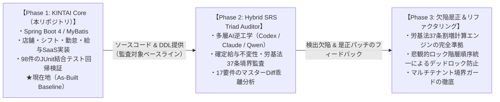
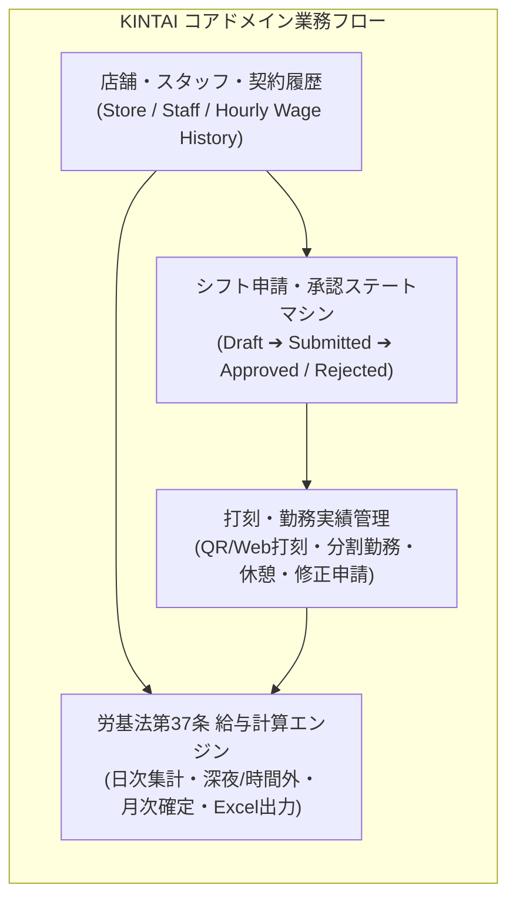

# KINTAI — アルバイト勤怠・シフト・給与管理 SaaS バックエンド

日本の店舗・飲食・小売現場向けに、スタッフ管理、シフト申請・承認ワークフロー、出退勤打刻（分割勤務対応）、労働基準法第37条に基づく割増給与計算、および月次Excel給与台帳出力を統合実装したWebアプリケーションです。

> **【免責事項 / 検証スコープ】**  
> 本リポジトリで確認できる動作・計算・検証結果は、記録された98件の単体・結合テストおよび初期監査の範囲に限られます。記録された98/98件のテスト通過実績は定められた検証シナリオの通過を証明するものであり、あらゆる商用運用条件下での無条件の品質保証を意味するものではありません。日本の労働基準法全体の完全な準拠、税務・社会保険計算、および本番環境における無欠陥を保証するものではなく、検出された境界計算欠陥や並行性制御の検証経緯は、後続のPhase 2（多層AI監査）およびPhase 3（是正・リファクタリング）の証跡にて詳細を公開しています。

---

## 3段階エンジニアリング連携（3-Phase Engineering Journey）

本リポジトリは、**「実務システム初期実装 ➔ 多層AIによるSRS逆工学・要件Diff分析 ➔ 検出欠陥の是正およびリファクタリング」**と続く3段階エンジニアリング連携の第1段階（Phase 1: As-Built Baseline）として位置づけられています。



### 3段階プロジェクト連携概要

| プロジェクト | リポジトリ / 状態 | 役割とエンジニアリングの目的 |
|---|---|---|
| **Phase 1: KINTAI Core** | **本リポジトリ** ([KBG183/kintai-management](https://github.com/KBG183/kintai-management))<br>`Active / Baseline` | **初期バックエンド実装・As-Builtベースライン**<br>・Spring Boot / MyBatis による勤怠・シフト・給与ドメインの基本実装<br>・98件のJUnit結合テストによる機能担保と初期動作実績の確立 |
| **Phase 2: Hybrid SRS Triad Auditor** | [KBG183/Hybrid-srs-triad-auditor](https://github.com/KBG183/Hybrid-srs-triad-auditor)<br>`Completed / Evidence` | **多層AI交差検証・SRS逆工学・マスターDiff分析**<br>・Codex, Claude, Qwen 27B, C#静的リンターによる多層監査網<br>・Phase 1コードからSRSを逆生成し、全17要件のギャップおよび境界条件の欠陥を摘発 |
| **Phase 3: Refactoring & Convergence** | [KBG183/kintai-saas-refactored](https://github.com/KBG183/kintai-saas-refactored)<br>`In Progress / Active Refactoring` | **多層AI監査に基づく是正・リファクタリング工程（進行中）**<br>・Phase 2監査で摘発された労基法第37条の境界計算欠陥（法定休日割増・分割勤務等）の完全是正<br>・悲観的ロック階層順序統一によるデッドロック防止およびマルチテナント境界ガードの徹底<br>・別リポジトリにてリファクタリングと追加検証を継続推進中 |

> [!NOTE]
> **本リポジトリ（Phase 1）の位置づけについて**  
> 本リポジトリのソースコードは、Phase 2における厳格な逆工学監査の「監査対象ベースライン（As-Built）」として当時の実装状態を正確に保存しています。Phase 2で検出された設計課題・要件差分は、Phase 3リファクタリング工程で包括的に改修されます。

---

## コア業務ドメインとアーキテクチャ

飲食・小売店舗の実務フローに即した4大業務ドメインを設計・実装しています。



### 1. 店舗・スタッフ管理（テナント基盤）
- オーナー（`ROLE_OWNER`）による店舗開設、スタッフ（`ROLE_STAFF`）の所属管理。
- 昇給や時給改定に対応するための「時給契約履歴テーブル（`store_staff_contract_history`）」を保持し、過去の勤務実績に対する給与計算の再現性を担保。

### 2. シフト申請・承認ステートマシン
- スタッフによる希望シフト提出、店舗オーナーによる確定・差戻しを状態遷移モデルで管理。
- 状態：`DRAFT`（下書き） ➔ `SUBMITTED`（申請済） ➔ `APPROVED`（承認済） / `REJECTED`（却下）。
- 承認済みシフトを基準とした予実管理（予定労働時間と実労働時間の対比）の基盤を提供。

### 3. QR / ボタン打刻および分割勤務（スプリットシフト）対応
- 現場の打刻機（QRコード）および個人端末からのWeb打刻をサポート。
- 1日4状態のタイムスタンプ管理（`CLOCK_IN` / `BREAK_START` / `BREAK_END` / `CLOCK_OUT`）。
- **分割勤務（スプリットシフト）の残業通算**: 1日に昼シフト（例: 11:00\~15:00）と夜シフト（例: 18:00\~23:00）のように間隔を空けて複数回勤務した場合でも、同一日の実労働時間を合算して1日8時間超の法定時間外割増を通算集計。

### 4. 労働基準法第37条に基づく給与計算エンジン
- **法定内労働 / 法定時間外労働（25%割増） / 深夜労働（22:00\~翌05:00、25%割増）** の時間帯分解アルゴリズム。
- 時間外かつ深夜に及ぶ重複区間の割増計算（150%）。
- 金額計算における丸め誤差を排除するための `BigDecimal` 演算。
- Apache POI による店舗別・月次給与台帳（`.xlsx`）の自動生成とダウンロード。

---

## システムアーキテクチャ

レイヤードアーキテクチャを採用し、ビジネスロジックの分離とトランザクション境界を構築しています。

```
ブラウザ / 打刻端末 (Thymeleaf / HTML5 / JavaScript)
      │
      ▼
Spring Security フィルタチェーン (認証・CSRF・ロール認可)
      │
      ▼
Controller レイヤ (リクエスト検証・画面遷移制御)
      │
      ▼
Service レイヤ (@Transactional・ドメイン計算・排他ロック制御)
      │
      ▼
MyBatis Mapper レイヤ (SQL・悲観的ロック構文)
      │
      ▼
MySQL 8.4 / InnoDB (ACIDトランザクション・行レベルロック)
      │
      ▼
Apache POI (月次給与台帳 Excelバイナリ生成)
```

### 主要データベーステーブル構成

| テーブル名 | 用途・役割 |
|---|---|
| `member` | 認証アカウント（ログインID、パスワードハッシュ、システム権限） |
| `store` | 店舗マスタ（店舗名、オーナーID、営業時間設定） |
| `store_staff` | 店舗所属マッピングおよび基本設定 |
| `store_staff_contract_history` | スタッフごとの適用開始日付き時給・手当契約履歴 |
| `shift_schedule` | シフト希望・確定スケジュールおよびステートマシン状態 |
| `attendance` | 日次勤怠実績（出退勤時刻、総労働時間、総休憩時間） |
| `attendance_break` | 勤怠に紐づく複数回の休憩実績記録 |
| `attendance_mod_request` | 打刻漏れ・修正申請ワークフロー（申請・承認・却下） |
| `payroll` | 月次給与確定レコード（総支給額、基本給、割増手当） |
| `payroll_daily_detail` | 日次ごとの詳細計算内訳（通常時間、時間外時間、深夜時間、日給） |

---

## 技術スタック

| レイヤ / 分類 | 採用技術 | バージョン / 詳細 |
|---|---|---|
| **言語** | Java | OpenJDK 17 (LTS) |
| **フレームワーク** | Spring Boot | 4.0.8 (Spring Framework 7系) |
| **セキュリティ** | Spring Security | ロールベース認可 (`ROLE_OWNER`, `ROLE_STAFF`)、CSRFトークン保護 |
| **データアクセス** | MyBatis | 4.0.1 (`mybatis-spring-boot-starter`)、動的SQLマッパー |
| **データベース** | MySQL / InnoDB | 8.4 LTS / Innovation (行レベルロック、外部キー制約) |
| **テンプレート** | Thymeleaf | サーバーサイドレンダリング、`thymeleaf-extras-springsecurity6` |
| **帳票出力** | Apache POI | 5.2.5 (OOXML / Excel `.xlsx` レポーティング) |
| **ビルドツール** | Gradle | Gradle Wrapper |
| **テスト** | JUnit 5 / Spring Test | 98件の単体・結合テスト、隔離データベース回帰自動化 |

---

## 本リポジトリで確認・検証した技術課題

### 1. 悲観的ロックとデッドロック解析
- 給与一括確定処理と個別給与再計算が同時に実行された際、行ロックの取得順序差によって発生する `MySQL Error 1213 (Deadlock)` を検出し、親レコード（`store_staff`）をキー順に事前ロックする排他制御を検証。

### 2. IDOR（安全でない直接オブジェクト参照）脆弱性の対策
- リクエストパラメータで送信された `staffId` を信用せず、Spring Security セッションコンテキストの本人識別子および店舗所有権（`store.owner_id == principal.id`）を二重検証する認可ガードを実装。

### 3. 同時打刻レースコンディションの直列化
- 同一スタッフによる連続打刻や二重送信に対し、DB行レベルロック（`SELECT ... FOR UPDATE`）を適用。並行テストにおいて「1件成功・1件排他拒否」となる直列化動作を確認。

### 4. 隔離データベースによる全回帰テスト実績
- 独立したテスト専用データベース環境において、全テストスイートの自動実行を実施。
- **検証実績**: **98 / 98 Tests PASS**（Failure: 0, Error: 0, Skipped: 0）

---

## ローカル実行手順

### 1. 前提条件
- JDK 17 以上
- MySQL 8.0 以上（検証環境：MySQL 8.4 LTS / Innovation）
- Git

### 2. デモ環境用データベースの自動構築
本リポジトリには、検証用デモDBを構築するスクリプトが同梱されています。

```powershell
# MySQLルートパスワードを設定して初期化スクリプトを実行
$env:KINTAI_DB_PASSWORD = "<ローカルMySQLパスワード>"
.\scripts\prepare_local_demo_db.ps1
```

※ 手動構築の場合は、MySQLで新規データベースを作成後、以下のSQLを順に実行してください：
1. `src/main/resources/db/schema.sql`（テーブル定義）
2. `src/main/resources/db/data.sql`（初期マスタ）
3. `scripts/local_demo_attendance.sql`（打刻デモデータ）
4. `scripts/local_video_demo_seed.sql`（検証シナリオデータ）

### 3. アプリケーションの起動
```powershell
./gradlew bootRun
```
起動完了後、ブラウザで `http://localhost:8080` にアクセスしてください。

---

## 検証ドキュメント・関連資料

| ドキュメント | 概要 |
|---|---|
| [Phase 2: Hybrid SRS Triad Auditor](https://github.com/KBG183/Hybrid-srs-triad-auditor) | 多層AIとリンターによる本コードの逆工学・要件Diff分析リポジトリ |
| [ソフトウェア要件定義書 (SRS)](kintai_requirements_specification.md) | 本システムが実装の基準とした17要件の仕様書 |
| [要件追跡マトリクス (RTM)](docs/rtm_ledger.md) | 各要件とソースコード・テスト・監査証跡の対応表 |
| [デモ操作ガイド](docs/final-portfolio/demo_guide_ja.md) | 画面ごとのシナリオ確認手順書 |
| [デモ動画 (YouTube)](https://youtu.be/LepOoQU8LgI) | 打刻から給与確定・Excel出力までの一連の動作デモ |
