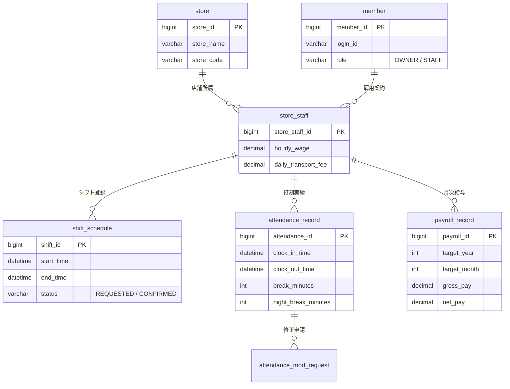

# SOURCE: AGENTS.md
# Kintai 프로젝트 운영 지침

## 작업 기준

- 프로젝트 기준 경로는 `C:\dev\kintai`다. 사용자 지시와 적용 가능한 상위 지침을 우선하며, 기존 변경과 증적을 보존한다.
- Day별 SRS, 설계서, RTM 및 작업 기록을 확인하여 점진적으로 진행한다. 과거 일정표의 완료 표시는 실제 검증의 근거가 아니다.
- 사용자에게 전달하는 모든 진행 메시지와 최종 답변은 한국어 존댓말로 작성한다. 파일명, 명령어, 로그와 오류의 원문은 정확성을 위해 원어를 유지할 수 있으며 필요한 설명은 한국어로 제공한다. 물결표와 취소선은 사용하지 않는다. 사실, 추정, 미검증 사항을 구분한다.
- 코드 주석, UI와 일본어 포트폴리오 기술 산출물은 기존 일본어 방침을 따른다. 한국어 보고와 한국어 증적서는 함께 유지한다.
- 인코딩과 BOM을 확인하여 보존한다. 기존 파일 이동이나 삭제는 대상과 복구 가능성을 확인한다.

## 역할

- Antigravity는 사용자 지시에 따라 구현, 테스트와 기존 Hermes를 이용한 Qwen 감사를 수행한다. Qwen 27B는 입력에 대한 독립 검토를 수행한다.
- Codex는 사용자가 요청한 때에만 작업한다. AI 사이의 자동 호출이나 작업 전환은 하지 않으며 사용자가 작업자를 선택한다. 동일 파일은 한 번에 한 작업자만 수정한다.
- 사용자가 작업 범위와 결과 수용 여부를 결정한다. 사용자 요청 범위를 벗어나는 외부 반영은 명시적 지시를 받는다.
- 저장소 기록 및 원격 반영은 사용자의 명시적 지시 없이 수행하지 않는다. 원래 규칙에 따라 실행 전에 일본어 메시지와 한국어 번역을 제시한다. 하나의 지시를 다른 외부 반영에 대한 포괄적 허가로 해석하지 않는다.
- 사용자가 원격 Git 작업(예: push)을 명시적으로 요청한 경우, 이 환경의 기본 네트워크 DNS 제한으로 반복 실패하는 일을 줄이기 위해 첫 시도부터 네트워크 권한을 요청한다. 이는 원격 작업 자체의 사전 승인을 대신하지 않으며, 관련 없는 로컬 작업에 네트워크 권한을 사용하지 않는다.

## 검증과 증적

- 기능·보안·급여·동시성 변경은 관련 테스트와 Qwen 독립 감사를 수행한다. 저위험 문서 정리는 변경 범위에 맞게 확인한다. 감사가 실행되지 않았으면 이유와 미검증 범위를 기록한다.
- 관련 기능의 계층과 테스트를 감사 입력에 포함하고, 지적사항의 근거, 위험, 조치와 재검수 결과를 기록한다. 모델의 PASS는 실행 테스트를 대신하지 않는다.
- 검증 상태의 정의는 `docs/workflow/evidence_status_policy.md`를 따른다. 실행 환경을 구분하고 원본 로그, 해당 결과와 실패 이력을 보존한다.
- 한·일 증적서를 기존 규격에 맞춰 병행 갱신한다. 모델 태그, 실행 환경, 입력·결과 해시 및 토큰·시간은 실제 확인한 경우에만 기록한다.
- Qwen 입력 검증기는 매니페스트를 지정할 때만 실행된다. 자동 검사가 의미적 완전성이나 감사의 정확성을 보장한다고 판단하지 않는다.

## 기준 문서

| 용도 | 경로 |
|---|---|
| 운영 절차 | `docs/workflow/operating_policy_v2.md` |
| 상태 및 증적 판정 | `docs/workflow/evidence_status_policy.md` |
| 프로젝트 경로 | `docs/workflow/project_paths.md` |
| Day 작업 양식 | `docs/workflow/day_task_template.md` |
| Qwen 입력 점검 | `docs/workflow/qwen_audit_input_checklist.md` |
| 기존 규칙 원문 및 이관표 | `docs/workflow/AGENTS_legacy_20261113.md`, `docs/workflow/AGENTS_migration_map.md` |

실행 대상, 모델 태그와 엔드포인트는 현재 설정 및 실제 실행 결과로 확인한다. 과거 경로, 일정, 성능 수치는 보존 문서에 남기되 현재 상태로 단정하지 않는다. 해결되지 않은 정책 충돌은 기록하고 사용자에게 설명한다.
## 프로젝트 완료 후 증적서 정리 원칙

- 프로젝트가 모든 Day 작업과 전체 회귀 검증을 마치기 전에는 기존 한국어·일본어 증적서의 누적 구조를 최종본으로 재편집하지 않는다.
- 현재 작업 중에는 실행 로그·JUnit XML·SHA-256과 실패·보정 이력을 원본 경로에 보존한다.
- 프로젝트 전체가 완료된 뒤에만 한국어·일본어 증적서를 함께 재분류하고, 구현·로컬 Qwen 감사·Codex 검수·사용자 판정을 분리한다.
- 실제 실행 증적이 없는 GPT·Claude·기타 상용 AI 사용을 사실처럼 기록하지 않는다.
- 로컬 MySQL, MySQL 8.4 Testcontainers, Qwen 감사 결과를 서로 혼합하지 않는다. 확인되지 않은 환경은 `미검증` 또는 `BLOCKED`로 기록한다.
- 최종 정리 전까지는 기존 `docs/portfolio_audit_evidence_KO.md`와 `docs/portfolio_audit_evidence.md`를 작업 중인 누적 증적서로 취급한다.
## 개선 작업 완료 시 자동 증적 갱신 규칙

- 개선 작업은 코드·테스트 결과만으로 완료 처리하지 않는다. 적용 가능한 증적과 인수인계 파일을 모두 갱신한 뒤 완료 보고한다.
- 실행·성공·실패·보정 원본은 `docs/audit_runs/<run-id>/`에 저장한다.
- 한국어 사실 기록은 `docs/portfolio_audit_evidence_KO.md`에 누적한다.
- 일본어 사실 기록은 `docs/portfolio_audit_evidence.md`에 동일한 사실·상태·경로로 병행 반영한다.
- 요구사항·판정 상태는 `docs/rtm_ledger.md`에 갱신한다.
- 세션 목표·완료·실패·결정·실제 경로·다음 단계는 `docs/handoff/YYYYMMDD_HHmm_<operator>_handoff.md`에 기록한다.
- 운영 규칙 변경은 `AGENTS.md`와 관련 `docs/workflow/*.md`에 반영한다.
- 실행하지 않은 AI·환경·모델을 사용한 것처럼 기록하지 않는다.
- 검증하지 못한 항목은 `미검증` 또는 `BLOCKED`로 유지한다.
- 한국어·일본어 증적의 수치·상태·경로가 일치하는지 확인한 뒤 보고한다.
- 격리 테스트 표준 실행기는 `scripts/run_isolated_regression.ps1`을 우선 사용한다. 기존 실행기는 호환성을 위해 유지한다.
- 격리 DB는 생성 규칙을 검증하고 `SELECT DATABASE()`로 대상 DB를 확인한 뒤 사용한다.
- 격리 DB 정리는 `scripts/cleanup_isolated_databases.ps1`의 조회 모드가 기본이며, 삭제는 명시적 `-Apply`가 있을 때만 수행한다. 운영 DB는 삭제 대상에 포함하지 않는다.
- DB 비밀번호는 `KINTAI_DB_PASSWORD` 환경변수를 우선 사용하고, 로그·매니페스트·증적서에는 기록하지 않는다.
- 로컬 MySQL과 MySQL 8.4 Testcontainers 결과는 분리 기록하며, Docker 부재는 `BLOCKED`로 유지한다.


---

# SOURCE: current audit config
{
  "$schema": "./audit_config.schema.json",
  "primary_auditor": {
    "network_type": "Tailscale Overlay Network",
    "endpoint": "http://100.111.193.94:11434",
    "model_tag": "qwen27b:latest",
    "model_digest": "23c3820b0d9326b73e97191b9fb7e16b53f6e24bb3449d2a17037c5f2b6179a1",
    "think": false,
    "options": {
      "temperature": 0.1,
      "num_ctx": 24576,
      "seed": 42
    },
    "verdict_authority": "AUDIT_PASSED"
  },
  "fallback_auditor": {
    "enabled": false,
    "network_type": "Tailscale Overlay Network",
    "endpoint": "http://100.111.193.94:11434",
    "model_tag": "qwen27b:latest",
    "model_digest": "23c3820b0d9326b73e97191b9fb7e16b53f6e24bb3449d2a17037c5f2b6179a1",
    "think": false,
    "options": {
      "temperature": 0.1
    },
    "verdict_authority": "PRELIMINARY_AUDIT"
  },
  "runtime_environment": {
    "script_path": "%USERPROFILE%\\.gemini\\scripts\\audit_with_hermes.ps1",
    "timeout_ms": 600000,
    "sync_wait_ms": 10000,
    "heartbeat_interval_sec": 5
  }
}


---

# SOURCE: active audit script defaults
param(
    [string]$TargetFile,
    [string]$CustomPrompt = "",
    [string]$OutputFile = "hermes_audit_report.md",
    [string]$Model = "qwen27b:latest",
    [string]$HostUrl = "http://100.111.193.94:11434",
    [string]$SectionFilter = "",
    [string]$LineRange = "",
    [string]$InputManifestPath = "",
    [switch]$Chunk
)

# Set UTF-8 encoding
[Console]::OutputEncoding = [System.Text.Encoding]::UTF8
$OutputEncoding = [System.Text.Encoding]::UTF8

if (-not [string]::IsNullOrWhiteSpace($InputManifestPath)) {
    $validatorPath = Join-Path $PSScriptRoot 'validate_qwen_audit_input.ps1'
    if (-not (Test-Path -LiteralPath $validatorPath -PathType Leaf)) {
        throw "QWEN_INPUT_VALIDATOR_MISSING: $validatorPath"
    }

    & $validatorPath -BundlePath $TargetFile -ManifestPath $InputManifestPath -EmitJson
    if ($LASTEXITCODE -ne 0) {
        throw "QWEN_INPUT_BLOCKED: audit input manifest is incomplete. ExitCode=$LASTEXITCODE"
    }
}

$systemPrompt = @"
You are an expert Spring Boot architecture & Japanese Labor Law code auditor.
[CRITICAL LANGUAGE RULE]
You MUST respond 100% in ENGLISH ONLY.
Under NO circumstances should you output any Chinese characters (Hanzi) or Chinese sentences.
Any Chinese word is considered a fatal failure.

[Audit Checklist]
1. Japanese Labor Standards Act Art 37:
   - Night work (22:00~05:00): +25% extra pay.
   - Daily overtime (>8h/day): +25% extra pay.
   - Night + Overtime concurrent overlap: +50% combined extra pay.
   - Break time between 22:00~05:00 must be deducted specifically from night work hours.
2. Payroll Math & Rounding:
   - Check RoundingMode.HALF_UP rounding logic (1-yen discrepancy prevention).
3. Concurrency & Security:
   - Check @Transactional presence and isolation level.
   - Check pessimistic locking (SELECT ... FOR UPDATE) on concurrent updates (e.g. store_staff, shift_schedule).
   - Check IDOR vulnerabilities (ensure user cannot access other staff's records).
4. Exception Handling & Boundary validation (e.g. DateTimeParseException, null / negative hour edge cases).

[Output Format]
Output the audit strictly as a Markdown table in English:
| Audit Item | Verdict (PASS / WARN / FAIL) | Detailed Finding & Recommendation (English) |
|---|---|---|
"@

function Call-HermesApi {
    param(
        [string]$ContentToAudit,
        [string]$HeaderTitle = ""
    )
    
    $userPromptText = if ($CustomPrompt) {
        "$CustomPrompt`n`n[Target Code: $HeaderTitle]`n$ContentToAudit`n`nReview this code and output the findings as a Markdown table strictly in English."
    } else {
        "Review the following Java code and output the findings as a Markdown table strictly in English (NO Chinese):`n`n[Target Code: $HeaderTitle]`n$ContentToAudit"
    }

    $bodyObj = @{
        model = $Model
        messages = @(
            @{ role = "system"; content = $systemPrompt },
            @{ role = "user"; content = $userPromptText }
        )
        options = @{
            temperature = 0.1
            num_ctx = 24576
            stop = @("<|im_start|>", "<|im_end|>")
        }
        stream = $true
    }
    $bodyJson = $bodyObj | ConvertTo-Json -Depth 5 -Compress

    try {
        $request = [System.Net.HttpWebRequest]::Create("$HostUrl/api/chat")
        $request.Method = "POST"
        $request.ContentType = "application/json; charset=utf-8"
        $bytes = [System.Text.Encoding]::UTF8.GetBytes($bodyJson)
        $request.ContentLength = $bytes.Length

        $reqStream = $request.GetRequestStream()
        $reqStream.Write($bytes, 0, $bytes.Length)
        $reqStream.Close()

        $response = $request.GetResponse()
        $reader = New-Object System.IO.StreamReader($response.GetResponseStream(), [System.Text.Encoding]::UTF8)

        $tokenCount = 0
        $lastTick = [System.DateTime]::Now
        $sbContent = New-Object System.Text.StringBuilder
        $sbThinking = New-Object System.Text.StringBuilder
        $lastChunk = $null

        while (-not $reader.EndOfStream) {
            $line = $reader.ReadLine()
            if ([string]::IsNullOrWhiteSpace($line)) { continue }
            try { $chunk = $line | ConvertFrom-Json } catch { continue }

            if ($chunk.message.content -or $chunk.message.thinking) {
                $tokenCount++
            }
            if ($chunk.message.content) {
                $sbContent.Append($chunk.message.content) | Out-Null
            }
            if ($chunk.message.thinking) {
                $sbThinking.Append($chunk.message.thinking) | Out-Null
            }

            # 5-second interval heartbeat
            $now = [System.DateTime]::Now
            if (($now - $lastTick).TotalSeconds -ge 5.0) {
                Write-Host "[$($now.ToString('HH:mm:ss'))] Generating... Total Tokens: $tokenCount"
                $lastTick = $now
            }

            if ($chunk.done) {
                $lastChunk = $chunk
                break
            }
        }
        $reader.Close()
        $response.Close()

        # Parse Ollama telemetry metrics
        $totalSec = if ($lastChunk -and $lastChunk.total_duration) { [math]::Round($lastChunk.total_duration / 1e9, 2) } else { 0 }
        $promptTokens = if ($lastChunk -and $lastChunk.prompt_eval_count) { $lastChunk.prompt_eval_count } else { 0 }
        $evalTokens = if ($lastChunk -and $lastChunk.eval_count) { $lastChunk.eval_count } else { $tokenCount }
        $evalDurationSec = if ($lastChunk -and $lastChunk.eval_duration) { $lastChunk.eval_duration / 1e9 } else { 0 }
        $tps = if ($evalDurationSec -gt 0) { [math]::Round($evalTokens / $evalDurationSec, 1) } else { 0 }

        Write-Host "=== [5070 Ti] Done! Tokens: $evalTokens | Time: $($totalSec)s | Speed: $tps tok/s ==="

        $finalOutput = if ($sbContent.Length -gt 0) { $sbContent.ToString() } else { $sbThinking.ToString() }
        $content = if ($finalOutput.StartsWith("|")) { $finalOutput } else { "| Audit Item | Verdict | Detailed Finding & Recommendation |`n|---|---|---|`n" + $finalOutput }

        return [PSCustomObject]@{
            Content      = $content
            TotalSec     = $totalSec
            PromptTokens = $promptTokens
            EvalTokens   = $evalTokens
            SpeedTPS     = $tps
            Model        = $Model
        }
    } catch {
        Write-Error "Ollama Hermes API call failed: $_"
        return $null
    }
}

# Single prompt execution if no file
if (-not $TargetFile -or -not (Test-Path $TargetFile)) {
    Write-Host "[Hermes] Running prompt audit in English..." -ForegroundColor Cyan
    $resObj = Call-HermesApi -ContentToAudit "" -HeaderTitle "Custom Prompt"
    if ($resObj) {
        $metricTable = @"
### ⏱️ Hermes Audit Execution Metrics
| Target | Model | Duration | Prompt Tokens | Eval Tokens | Speed |
|---|---|---|---|---|---|
| Custom Prompt | $($resObj.Model) | $($resObj.TotalSec)s | $($resObj.PromptTokens) | $($resObj.EvalTokens) | $($resObj.SpeedTPS) tokens/s |

"@
        $finalOut = $metricTable + "`n" + $resObj.Content
        [System.IO.File]::WriteAllText($OutputFile, $finalOut, [System.Text.Encoding]::UTF8)
        Write-Host "`n=== [Hermes Audit Report] ===" -ForegroundColor Green
        Write-Output $finalOut
    }
    exit 0
}

$rawText = Get-Content -Path $TargetFile -Encoding UTF8 -Raw

if (-not [string]::IsNullOrWhiteSpace($LineRange)) {
    $lineArr = $rawText -split "`r?`n"
    $parts = $LineRange.Split("-")
    $startL = [int]$parts[0]
    $endL = [int]$parts[1]
    $selectedLines = $lineArr[($startL - 1)..($endL - 1)]
    $rawText = $selectedLines -join "`n"
    Write-Host "[Hermes] Line range selected: $($TargetFile) (Lines $startL ~ $endL, Total $($selectedLines.Count) lines)" -ForegroundColor Cyan
}

$lines = $rawText -split "`r?`n"
$hasMajorHeaders = ($rawText -match "(?m)^##\s+")

if ($Chunk -or ($lines.Count -gt 400 -and $hasMajorHeaders)) {
    Write-Host "[Hermes] Large file detected ($($lines.Count) lines). Splitting by '## ' sections..." -ForegroundColor Cyan
    
    $sections = @()
    $currentTitle = "Introduction"
    $currentBody = [System.Text.StringBuilder]::new()

    foreach ($line in $lines) {
        if ($line -match "^##\s+(.+)$") {
            if ($currentBody.Length -gt 0) {
                $sections += [PSCustomObject]@{ Title = $currentTitle; Content = $currentBody.ToString() }
                $currentBody.Clear() | Out-Null
            }
            $currentTitle = $matches[1].Trim()
        } else {
            [void]$currentBody.AppendLine($line)
        }
    }
    if ($currentBody.Length -gt 0) {
        $sections += [PSCustomObject]@{ Title = $currentTitle; Content = $currentBody.ToString() }
    }

    $targetSections = $sections
    if (-not [string]::IsNullOrWhiteSpace($SectionFilter)) {
        $filter = "*$SectionFilter*"
        $targetSections = @($sections | Where-Object { $_.Title -like $filter })
    }

    Write-Host "[Hermes] Total $($targetSections.Count) section(s) to audit." -ForegroundColor Cyan

    $fullReport = [System.Text.StringBuilder]::new()
    [void]$fullReport.AppendLine("# 🛡️ Hermes Independent Audit Report (Section-by-Section)")
    [void]$fullReport.AppendLine("> **Target**: `$TargetFile` ($($lines.Count) lines) | **Model**: `$Model` | **Timestamp**: $(Get-Date -Format 'yyyy-MM-dd HH:mm:ss')`n")

    $totalDurationAll = 0
    $totalPromptTokens = 0
    $totalEvalTokens = 0

    $secIdx = 1
    foreach ($sec in $targetSections) {
        if ($sec.Content.Trim().Length -lt 40) { continue }
        Write-Host "[$secIdx/$($targetSections.Count)] Auditing section: $($sec.Title)..." -ForegroundColor Yellow
        $auditObj = Call-HermesApi -ContentToAudit $sec.Content -HeaderTitle $sec.Title

        if ($auditObj) {
            $totalDurationAll += $auditObj.TotalSec
            $totalPromptTokens += $auditObj.PromptTokens
            $totalEvalTokens += $auditObj.EvalTokens

            [void]$fullReport.AppendLine("## Section: $($sec.Title) ($($auditObj.TotalSec)s, $($auditObj.PromptTokens) prompt / $($auditObj.EvalTokens) eval tokens)")
            [void]$fullReport.AppendLine($auditObj.Content)
            [void]$fullReport.AppendLine("`n---`n")
        }
        $secIdx++
    }

    $summaryMetrics = @"
### [Total Audit Execution Metrics]
| Target File | Model | Total Time | Total Prompt Tokens | Total Eval Tokens |
|---|---|---|---|---|
| $TargetFile ($($lines.Count) lines) | $Model | ${totalDurationAll}s | $totalPromptTokens tokens | $totalEvalTokens tokens |

"@
    $finalText = $summaryMetrics + "`n" + $fullReport.ToString()
    [System.IO.File]::WriteAllText($OutputFile, $finalText, [System.Text.Encoding]::UTF8)
    Write-Host "[Hermes] Audit completed! Full report saved to $OutputFile." -ForegroundColor Green
    Write-Output $summaryMetrics
} else {
    Write-Host "[Hermes] Auditing single file ($($lines.Count) lines)..." -ForegroundColor Cyan
    $resObj = Call-HermesApi -ContentToAudit $rawText -HeaderTitle $TargetFile
    if ($resObj) {
        $metricTable = @"
### [Hermes Audit Execution Metrics]
| Target File | Model | Duration | Input Code Tokens | Output Tokens | Speed |
|---|---|---|---|---|---|
| $TargetFile ($($lines.Count) lines) | $($resObj.Model) | $($resObj.TotalSec)s | $($resObj.PromptTokens) tokens | $($resObj.EvalTokens) tokens | $($resObj.SpeedTPS) tokens/s |

"@
        $finalText = $metricTable + "`n" + $resObj.Content
        [System.IO.File]::WriteAllText($OutputFile, $finalText, [System.Text.Encoding]::UTF8)
        Write-Host "[Hermes] Audit completed! Full report saved to $OutputFile." -ForegroundColor Green
        Write-Output $metricTable
    }
}


---

# SOURCE: root README
# 勤怠・シフト・給与管理システム (Kintai Management System)
> 日本向けのシフト・勤怠・月次給与管理アプリです。動作・計算の主張は記録されたテスト範囲に限ります。
> 現行SRSが定めるMVPの範囲を提供します。日本の労働法全体への適合や未検証の本番運用条件を保証しません。
> 検証範囲と残作業は `docs/final-portfolio/README_KO.md` およびRTMを参照してください。

---

## 📌 プロジェクト概要 (Project Overview)

本リポジトリは、シフト・勤怠・月次給与機能のMVPです。動作・計算・画面表示については、ポートフォリオに記載した実行記録の範囲を確認してください。未検証の法令要件や運用条件を保証する資料ではありません。

1. **割増賃金計算（現行SRSで定義する時間外・深夜の範囲）**:
   - `深夜労働 (22:00 ~ 翌05:00, +25%)`
   - `時間外労働 (1日8時間超過, +25%)`
   - `深夜かつ時間外の重複労働 (+50%)`
   - 対象の計算ケースはテストで検証しています。計算対象・境界・端数処理の詳細は技術証跡を参照してください。
2. **シフト・給与データの整合性**:
   - 対象の更新処理にはトランザクションと行ロックを使用します。検証した経路は技術証跡とRTMに記載しています。
3. **勤怠・休憩記録**:
   - 打刻と休憩の記録を保持し、対象ケースの時間計算をテストで確認しています。
4. **検証結果と制約**:
   - 未検証の機能・法令要件は完了済みとして扱いません。最新の実行結果は `docs/final-portfolio/README_KO.md` と技術証跡を参照してください。

---

## 🛠 技術スタック (Tech Stack)

| カテゴリ | 採用技術 | 選定理由・役割 |
| :--- | :--- | :--- |
| **Backend** | Java 17, Spring Boot 4.0.8 | 高い型安全性、堅牢なエンタープライズバックエンド構築 |
| **ORM / Mapper**| MyBatis 3.x | 複雑な労働時間集計クエリおよび排他ロック（FOR UPDATE）の制御最適化 |
| **Database** | MySQL（検証実績: ローカル 26.7.0 Innovation。MySQL 8.4は未検証） | トランザクション分離（InnoDB）、インデックス最適化 |
| **Security** | Spring Security（正確なバージョンはビルド設定を参照） | セッションベースのロール制御（管理者: `OWNER`, 従業員: `STAFF`） |
| **Frontend** | Thymeleaf, Bootstrap 5.3 | サーバーサイドレンダリング、レスポンシブな店舗端末UI |
| **Calendar** | FullCalendar 6.x | 直感的な月間・週間シフトスケジュール視覚化 |
| **Office/Export**| Apache POI 5.2 | 税理士・社労士提出用の公式給与台帳（Excel）一括生成 |
| **Build Tool** | Gradle | 高速なマルチモジュール対応ビルド管理 |

---

## 🏛 アーキテクチャと主要機能 (Key Features & Architecture)

### 1. シフト管理エンジン (Shift Management Engine)
- **月間・週間カレンダー表示**: スタッフ別の希望シフト提出および店長による確定処理。
- **排他制御（悲観的ロック）**:
  - シフト確定・更新トランザクション時に `SELECT ... FOR UPDATE` を発行。
  - 複数管理者による同時変更や競合更新をトランザクションレベルで遮断。

### 2. 4打刻勤怠トラッキング (4-Punch Attendance Tracking)
- 出勤（Clock-In）、休憩開始（Break-Start）、休憩終了（Break-End）、退勤（Clock-Out）の4ステータス管理。
- 休憩時間帯を記録することで、**「深夜時間帯（22:00 ~ 05:00）に取得された休憩時間を深夜割増手当の対象から正確に控除」** するアルゴリズムを実装。

### 3. 改ざん防止・打刻修正ワークフロー (Audit Trail)
- 打刻修正申請テーブル（`attendance_mod_request`）による二重承認フロー。
- 過去データの直接書き換えを防止し、労働基準監督署の監査に対応可能な履歴追跡を担保。

### 4. 労働基準法第37条準拠 給与計算コア (Payroll Core Engine)

日本の労働法規に完全に準拠した給与ロジックをサービス層にカプセル化：

```
【計算ルール定義】
・基本給       = 所定労働時間 (8時間以内) × 基本時給
・時間外手当   = 実労働時間のうち1日8時間を超える時間 × 基本時給 × 1.25
・深夜手当     = 22:00 ~ 翌05:00 の実労働時間 × 基本時給 × 1.25
・深夜時間外   = 1日8時間を超え、かつ 22:00 ~ 翌05:00 に行われた労働 × 基本時給 × 1.50
・交通費       = MIN(出勤日数 × 日額交通費, 月額非課税限度額)
```

- **高精度金融演算**:
  - `double` / `float` 型の浮動小数点数誤差を排除するため、すべての通貨・手当計算に `BigDecimal` を採用。
  - 法定の端数処理（50銭未満切り捨て、50銭以上1円未満切り上げ）を厳密に制御。

### 5. 給与台帳 Excel 出力 (Apache POI Integration)
- 締め日にワンクリックで当月勤務実績および支給内訳を公式レイアウトの Excel シートとしてエクスポート。

---

## 📊 データベース設計 (Database Schema Overview)



---

## 🚀 クイックスタート (Local Setup)

### 前提条件
- **Java**: JDK 17
- **Database**: ローカルMySQL。検証済み環境は26.7.0 Innovationです。MySQL 8.4は未検証です。

### 分離デモDBで起動
運用DB `kintai_db` を使わず、必ず新しいデモ用分離DBを準備してください。パスワードは `KINTAI_DB_PASSWORD` 環境変数で渡します。

```powershell
$env:KINTAI_DB_PASSWORD = "<ローカルDBパスワード>"
.\scripts\prepare_local_demo_db.ps1
```

スクリプト出力の `APPLICATION_DB_OVERRIDE` を使ってアプリを起動し、ブラウザー手順と期待値は [ローカルデモガイド](docs/final-portfolio/demo_guide.md) を参照してください。テストは `docs/workflow/isolated_test_operation.md` の新規allowlisted DB手順を使います。

---

## 👨‍💻 技術的アピールポイント (Engineering Highlights)

- **実務に直結するドメインモデリング**:
  - 勤怠・給与の要件と対応範囲は現行SRSおよび技術証跡に記載しています。未検証の法令範囲への適合は主張しません。
- **データ整合性と堅牢性の担保**:
  - 対象処理にトランザクションと悲観的ロックを適用し、同時実行テストで確認した範囲をRTMに記録。
- **金融水準の計算精度**:
  - 金額計算には `BigDecimal` を用い、記録されたテストで端数境界を検証しています。
- **保守性と拡張性を意識したレイヤード設計**:
  - Controller - Service - Mapper (MyBatis) の構成を採用。変更時は関連する層とテストを確認してください。

---

# SOURCE: current RTM
# Requirements Traceability Matrix (RTM) - F-04 Residual Audit

| ID | 요구사항 원문 및 의미 | 수행할 작업 | 완료 조건 (DoD) | 필요 증거 | 관련 코드/위치 | 상태 | 검증 명령 / 비고 |
|:---:|---|---|---|---|---|:---:|---|
| **R-01** | `confirmMonthlyPayroll` 실제 단일 DB 트랜잭션/커넥션 경계 확인 | 선별, 부모락, 재조회, 검증, UPDATE가 단일 Connection 및 활성 트랜잭션 내에서 실행됨을 입증 | `TransactionSynchronizationManager.isActualTransactionActive() == true` 및 단일 `CONNECTION_ID()` 확인 | 테스트 로그, Connection ID 출력 | `PayrollService.java` (`confirmMonthlyPayroll`) | **VERIFIED** | 통합 테스트 실측 완료 (`BUILD SUCCESSFUL in 29s`) |
| **R-02** | 최종 재조회 이후 신규 DRAFT 경쟁 조건 재현 및 격리 검증과 업무 정책 채택 | T1/T2 경쟁의 기술적 격리 실측, 경계 시 롤백 정책 문서화 및 사용자 채택 결정 기록 | 신규 DRAFT의 자동 확정 방지 및 fail-fast 전체 롤백 실측, 업무 정책 승인 상태 추적 | JUnit XML, DB 상태 증거, `docs/f04_evidence/r02_business_policy.md` | `PayrollService.java`, `PayrollMapper.xml`, `PayrollMonthlyConfirmPostQueryRaceConditionIntegrationTest.java` | **VERIFIED (기술 검증 및 정책 채택)** | 사용자께서 2026-11-14 스냅샷 고정 및 신규 DRAFT 경계 감지 시 전체 롤백 정책을 채택했습니다. 최신 전체 회귀에서 R-02 통합 테스트 2/2 PASS, 실패·오류 0. 정책 채택·제외 범위 정합성 Qwen Run `20261114_010419_130b40f4` 8/8 PASS. 격리 DB `kintai_full_test_d4124a317ed0`; 운영 DB 미사용. |
| **R-03** | Mapper SQL 및 상태 필터(DRAFT 전용, 갱신 건수 대조) 전수 조사 | `findDraftStaffIdsByStoreAndMonth`, `lockStoreStaffForUpdate`, `lockStorePayrollsForUpdate`, `updateAllPayrollStatusConfirm` SQL 및 파라미터 수록 | 4개 쿼리의 DRAFT 필터 조건 및 affected rows 일치 검증 확인 | SQL 원문, XML 라인 번호, 파라미터 매핑표 | `PayrollMapper.xml` | **VERIFIED** | 정적 분석 및 DDL 대조 완료 |
| **R-04** | 실제 락 대기 및 5단계 타임라인 추적 | 상호 역순 락 획득으로 인한 InnoDB 데드락 재현 실측 및 실제 락 대기(waiting) 관계 입증 | Trx 4266/4267 간 상호 `waiting` 물리적 증거 확인. (수정된 2단계 잠금의 실시간 5단계 직렬화 타임라인과는 구분 보존) | `show_engine_innodb_status_deadlock.txt` | `docs/f04_evidence/` | **VERIFIED (데드락 입증)** | 데드락 재현 및 상호 대기 교착 관계 입증 완료 |
| **R-05** | MySQL 8.4 LTS 최종 검증 및 26.7 분리 | 로컬 `MySQL 26.7.0 Innovation` 결과와 `MySQL 8.4 LTS` 결과를 혼합하지 않고 각각 분리 기록 | `SELECT VERSION()` 실측치 명시 및 8.4 LTS 전용 검증 분리 | DB 버전 출력, EXPLAIN 결과 분리 파일 | `docs/f04_evidence/` | **DEFERRED (2027-01)** | MySQL 8.4/Testcontainers는 사용자 지시에 따라 현재 작업 범위에서 제외. Docker/Podman 부재로 미실행 상태를 보존하고 예정된 재검토일에 다시 판단 |
| **R-06** | 테스트 픽스처 독립성 및 반복 실행 안정성 검증 | 고정 ID 충돌 제거(동적 추적 ID), 대상 통합 테스트 반복 실행 안정성 검증 | 대상 통합 테스트 3회 연속 실행 성공 (마지막 `--rerun-tasks`). 전체 테스트 스위트의 순서 독립성은 별도 미검증 | `build/test-results/test/` | `PayrollMonthlyConfirmPostQueryRaceConditionIntegrationTest` | **VERIFIED (대상 반복 검증)** | 대상 테스트 3회 연속 실행 통과 확인 완료 |
| **R-07** | 최종 독립 감사 및 11대 포맷 종합 보고 | R-01~R-06 결과를 대조하여 누락 없는지 독립 검수 후 11대 규격 보고서 출력 | 11개 항목을 누락 없이 순서대로 팩트 기술 | 최종 보고서 본문 | 본 세션 응답 | **VERIFIED** | 11대 표준 보고서 출력 완료 |
| **R-08** | 출퇴근 CLOCK_IN 동시 요청 중복 생성 차단 및 비관적 락 정합성 실측 | 동일 직원 동시 CLOCK_IN에서 성공 1건·업무 거부 1건 및 중복 미생성을 검증한다. | 2개 스레드 결과, DB 상태, 격리 DB 증거와 반복 로그 | `AttendanceService.java`; `AttendanceMapper.xml`; `AttendanceServiceConcurrencyIntegrationTest.java`; `docs/audit_runs/day10_isolated_regression_20261114_093404/` | **VERIFIED (로컬 MySQL 26.7)** | 최종 소스에서 신규 격리 DB 3개 각각 2건 테스트, 총 6건 PASS, 실패·오류 0. 요약과 JUnit SHA-256은 run 폴더 `summary.json`. 최신 전체 회귀(2026-11-14)는 92 PASS. 운영 DB 미사용. |
| **R-09** | 출퇴근 CLOCK_OUT 동시 요청 완료 상태 보존 및 중복 퇴근 거부 실측 | 동일 직원 진행 근태의 동시 CLOCK_OUT에서 성공 1건·거부 1건, 최종 COMPLETED를 검증한다. | 2개 스레드 결과, DB 최종 상태, 격리 DB 증거와 반복 로그 | `AttendanceService.java`; `AttendanceMapper.xml`; `AttendanceServiceConcurrencyIntegrationTest.java`; `docs/audit_runs/day10_isolated_regression_20261114_093404/` | **VERIFIED (로컬 MySQL 26.7)** | 최종 소스에서 신규 격리 DB 3개 각각 CLOCK_OUT 테스트 포함 2건 PASS, 총 6건 PASS, 실패·오류 0. 최신 전체 회귀(2026-11-14)는 92 PASS. 운영 DB 미사용. |
| **R-10** | Day 10 출퇴근 동시성 독립 Qwen 감사 및 감사관 지적 해소 | 최신 근태 타각·인증·입력 경계 구현과 반복 검증을 독립 감사한다. | 현행 소스 번들, 실행 결과, A-05/A-06 및 재검수 결과 보존 | `docs/audit_runs/prior_residuals_20261114/qwen_day10_final/hermes_final/`; bundle SHA-256 `dd991d3ca2ab013943b9f6e7f5b676524b4e77df34d67fe77e881586f03aa7c8` | **VERIFIED (로컬 MySQL 26.7 범위)** | 원격 `http://100.111.193.94:11434`, `qwen27b:latest`, Run `20261114_003657_dd991d3c`. 10 findings 중 PASS 9, N/A 1(급여 계산은 Day10 근태 타각 감사 범위 밖), WARN/FAIL 0. 기존 A-05/A-06을 세션 ID 강제 바인딩/소유권 검사, 실제 필터 미인증 요청 테스트, 입력 거부 및 Mapper 무호출로 해소. report SHA-256 `31e8e18609ec458e8e589888646a05502f1f37c269bc4820b25df6bdb62bf430`. |
| **R-11** | Day 11 12개월 급여 계산 시나리오 및 계약 유효기간 | 월별 근무 분포, 계약 이력, API/Service 경로와 급여를 대조하고 독립 연간 합계를 검증한다. | 12개월×3근무일, 계약 임금 변경, 독립 연간 oracle, 타각 HTTP/API 경로, JUnit 및 격리 DB 로그 | `AnnualPayrollScenarioIntegrationTest.java`; `AttendancePunchApiIntegrationTest.java`; `docs/audit_runs/isolated_day11_20261114_093228_kintai_day11_test_3a25e5513c4f/`; `docs/audit_runs/isolated_all_20261114_094427_kintai_full_test_d4124a317ed0/`; remote Qwen Run `20261114_004900_46049b14` | **VERIFIED (로컬 MySQL 26.7)** | 12개월 각각 3일의 근태 및 독립 연간 oracle 대조 PASS, 계약 경계 6/30·7/1 PASS. 실제 Spring Security 필터→Controller→Service→DB 타각 API spoofed ID 차단·저장 검증 PASS(전용 통합 테스트 및 R-10 재감사 증적 참조). 최신 전체 회귀 92 PASS. Qwen R-11/R-12 소스 감사 12/12 PASS, WARN/FAIL 0. |
| **R-12** | Day 11 경계·결함 시나리오 | 야간·다회 휴게·계약 경계·동일일 분할 근무 8시간 누적·월마감·반올림을 독립 기대값으로 검증한다. | 각 경계의 통합/단위 테스트, 저장된 실행 및 JUnit | `AnnualPayrollScenarioIntegrationTest.java`; `LaborCalculationEngineTest.java`; `SplitShiftOvertimeDefectTest.java`; `PayrollCalculatorStatutoryRoundingTest.java`; `docs/audit_runs/isolated_day11_20261114_094349_kintai_day11_test_01f4cb1439e6/`; `docs/audit_runs/isolated_all_20261114_094427_kintai_full_test_d4124a317ed0/` | **VERIFIED (로컬 MySQL 26.7)** | 4h+5h 분할근무 후 CLOCK_OUT service에서 60분 초과 산출 및 월 급여 반영 PASS. 20:00~05:00 야간 420분 중 연장 60분 중첩의 25%+25%=50% 프리미엄 및 급여 합계 PASS. 1/31 포함·2/1 제외, 계약·자정·다회휴게·야간휴게 차감·HALF_UP 경계 PASS. Qwen Run `20261114_004900_46049b14` 12 findings PASS, WARN/FAIL 0. 전체 회귀 92 PASS. |
| **R-13** | Day 11 격리 실행 및 회귀 증거 무결성 | 새 격리 DB에서 대상 테스트와 전체 회귀를 실행하고 로그·JUnit·요약·해시를 보존한다. | 대상 테스트 및 전체 회귀 종료 코드 0, 격리 DB 및 매니페스트 대조 | `docs/audit_runs/isolated_day11_20261114_094349_kintai_day11_test_01f4cb1439e6/`; `docs/audit_runs/isolated_all_20261114_094427_kintai_full_test_d4124a317ed0/` | **VERIFIED (로컬 MySQL 26.7)** | 최신 대상 연간·경계 테스트 6 PASS, 전체 회귀 92 PASS, 실패·오류·스킵 0, Gradle exit 0. 이전 81건 결과는 당시 스냅샷으로 보존. MySQL 8.4 Testcontainers 결과로 일반화하지 않음. |
| **R-14** | Day 11 독립 검수 및 추적 문서 정합성 | Qwen 입력·결과를 보존하고 지적사항 및 한계를 한·일 증적·RTM·인수인계에 반영한다. | Run ID·입력 해시·결과·지적별 대조와 일치 문서 | `docs/audit_runs/preflight_1e3b8fba040b4197aed07afbde9334f2/`; final document audit `docs/audit_runs/preflight_9c8fda322194453ba642d56325a31d10/`; 한·일 portfolio evidence; `docs/handoff/20261114_residuals_handoff.md` | **VERIFIED (2026-11-14 source/document scope)** | Qwen 27B 원격 Run `20261114_004900_46049b14`, 입력 bundle SHA-256 `46049b14578b32462a6f105966643d658919d5ed658faaf885796e2e1cd2c4b8`, report SHA-256 `b1ae1c9d7844d92b6ab4b47bf5e5c66dbb0f1f3f916549688e3c83ea56798f10`. 12/12 PASS, WARN/FAIL 0. 기존 결함 F-03 중첩 프리미엄 경고에 통합 단언 추가 후 새 격리 DB 대상 6/6 PASS 및 전체 92/92 PASS. 한·일 증적과 RTM/인수인계 수치 대조 완료. 최종 고정 문서 독립 감사 Run `20261114_005527_76dc1c9f`: 10/10 PASS, WARN/FAIL 0. 앞선 2개 문서 경고의 수정 확인. bundle SHA-256 `76dc1c9f5b3750c9b38d0777bd302893d4ea4dbe3783a0b8ef107edf37312d93`, report SHA-256 `dee296cda885e4bdc8208c9145ab61757d6a5323ecd6f7c9b21016b2cfc6b124`. |
| **R-15** | Day 13 격리 데모 데이터 생성 및 연간 분포 | 2026년 synthetic schedule/attendance fixture를 신규 격리 demo DB에 적재하고 DB 식별자·기간·행 수·UTF-8 샘플명을 대조한다. | `SELECT DATABASE()` 및 기간/건수/문자 인코딩 확인, 화면에서 해당 데이터 조회 | `scripts/prepare_local_demo_db.ps1`; `scripts/local_demo_attendance.sql`; `docs/audit_runs/day13_calendar_20261114/` | **VERIFIED (로컬 MySQL 26.7)** | 최종 DB `kintai_demo_9f3f8487bc42`: confirmed shift 313건과 attendance 313건, 2026-01-01~2026-12-31, owner-name UTF-8 HEX 확인. 초기 DB의 손상된 이름은 보존하고 새 DB로 대체. 운영 DB 사용 안 함. |
| **R-16** | Day 13 캘린더 API DTO와 브라우저 표시·상세 정합성 | CalendarEventDto 응답을 그대로 표시하고 상세/확정 모달에서 이벤트 기간·휴게 시간을 사용한다. | 독립 API 응답과 브라우저 월간 이벤트·상세 모달 실측, 전체 회귀 | `calendar.html`; `CalendarEventDto.java`; `docs/audit_runs/isolated_all_20261114_074456_kintai_full_test_3df696be0820/` | **VERIFIED (로컬 브라우저·MySQL 26.7)** | API 필드명과 화면 매핑 불일치를 수정. November 2026 confirmed events 및 11/02 상세 모달(09:00~18:00, 60분) 화면 확인. |
| **R-17** | Day 13 급여 데모 및 Excel 다운로드 확인 | 격리 데이터에서 급여 계산과 UI 표시를 확인하고 Excel 산출을 검증한다. | 화면 급여 값·이름·상태, API/XLSX 산출, 실제 브라우저 다운로드 이벤트 및 저장 파일 검사, 회귀 | `docs/audit_runs/day13_calendar_20261114/ui_review_record.md`; `payroll_api_list.json`; `payroll_2026-01_browser_download.xlsx`; `excel_browser_download.json`; `payroll_excel_validation.json` | **VERIFIED (로컬 MySQL 26.7)** | 격리 DB 급여 UI에서 두 DRAFT 행과 급여액을 확인하고 Excel 출력을 실행했다. 브라우저 다운로드 이벤트가 완료되어 5,092-byte 파일을 확보, OOXML·월·¥141,700·¥164,332를 검증했다. 파일 SHA-256 `ba127f65f193f8289c2b4e445efc09a06e1590e2230ed0b1ad603d839cfdcd98`. Chrome 과거 차단은 이력으로 보존한다.
| **R-18** | Day 13 독립 Qwen 감사 및 증적 추적 | 갱신된 번들·실행 결과·UI 증거를 포함해 Hermes Qwen 27B 독립 감사를 수행하고 지적을 반영한다. | 유효 입력 manifest, 독립 결과 원문/해시, 지적과 조치·재검수 일치 | `docs/audit_runs/day13_calendar_20261114/qwen27b_day13_final/report.md`; `qwen27b_day13_final/audit_run.json`; bundle SHA-256 `d69a9b63c9a6a79043a38fb9c8942ab9c3fd0f9936087ffe5865d778f6817379` | **VERIFIED (로컬 MySQL 26.7 범위)** | 원격 `http://100.111.193.94:11434`, `qwen27b:latest` IQ3_M 27.3B, digest `23c3820b0d9326b73e97191b9fb7e16b53f6e24bb3449d2a17037c5f2b6179a1`; Run ID `20261113_234922_d69a9b63`; report SHA-256 `0dc324150a75bb8a1d3035f7ee770a03ec2bffd8241a3a041ffd9ee2066fbf32`. 최신 번들 15개 감사 finding 모두 PASS, WARN/FAIL 0. R-17 브라우저 다운로드 이벤트와 저장 XLSX 내용 검증을 포함한다. MySQL 8.4는 2027-01 DEFERRED.
| **R-19** | Day 13 최종 포트폴리오 패키지 | 기술 증적, 아키텍처 그림, 데모 안내 및 한·일 요약을 실제 결과에 맞게 작성한다. | 문서·링크·상태·수치를 RTM/원본 증거와 대조하고 로컬 문서 검사 및 독립 감사를 보존한다. | `docs/final-portfolio/`; `docs/audit_runs/day13_calendar_20261114/final_portfolio_review/hermes_final_snapshot/` | **VERIFIED** | 상대 Markdown 링크 검사 PASS. 원격 Qwen 27B Run `20261114_000458_4af20cd9`, 15 finding PASS, WARN/FAIL 0. 번들 SHA-256 `4af20cd936e1a70c91ca8d6b905f0d6f948d108b1c09fd226958a2a6c2b3b543`; report SHA-256 `4876963e92a4cb197596d02fb5d172a50db4a13b7b382930c312e433337d1d28`. 최초 감사 WARN는 Mapper/Service 잠금 증거를 추가해 해소하고 재검수 PASS. |

> **R-08부터 R-10 후속 증적 재평가 (2026-11-13):** 위 상태는 당시 기록을 보존한다. 현재 XML은 동시성 2건 실패 0건이나, 과거 3회 각각의 로그와 기존 기록의 JUnit 해시에 일치하는 원본은 미확인이다. 감사 원문 A-05와 A-06은 WARN이므로 R-10의 지적 해소 전체는 `PARTIALLY_VERIFIED`로 재평가한다. A-05는 직원 세션 ID 바인딩과 점주 소유권 검사가 코드에 있으나 해당 보안 테스트의 이번 재실행은 Gradle 환경 제한으로 미실행이다. A-06은 입력 경계 검증이 남았다. `/punch`의 인증 객체 부재는 컨트롤러 자체 차단이 아니라 보안 필터 설정에 의존하므로 실제 경계 검증이 필요하다. 격리 DB 부재와 소켓 권한 제한으로 동시성 재실행은 `BLOCKED`, MySQL 8.4는 별도로 `BLOCKED`를 유지한다. 당시 감사 번들은 `docs/audit_runs/20261113_030041_19b587c7/reconstructed_input_bundle.md`에 해시 일치 재구성본을 보존한다.
> **이후 상태 정정 (2026-11-14):** 아래 2026-11-13 R-08~R-10 BLOCKED/PARTIALLY_VERIFIED 문장은 당시 증거 재평가 스냅샷입니다. 최신 격리 반복 결과와 Qwen 재감사로 R-08/R-09/R-10은 위 RTM 표에서 제한된 로컬 MySQL 26.7 범위로 VERIFIED 처리했습니다. 최신 전체 회귀는 92건 PASS입니다. 과거 로그는 삭제하거나 최신 상태로 오인하지 마세요.

> **Day 10 개선·반복 검증 추가 기록(2026-11-13):** 기존 RTM 구조를 유지하고 오늘의 실행 사실만 추가한다. 정식 rev.3 스키마 기반 신규 격리 DB 3개에서 `AttendanceServiceConcurrencyIntegrationTest`를 강제 재실행했다. 총 6건 성공, 실패 0건, 오류 0건, Gradle 종료 코드 0이다. 구형 스키마의 `break_id`와 현재 Mapper의 `attendance_break_id` 불일치, JDBC URL 전달 오류, `UP-TO-DATE` 오판 가능성은 실패·보정 이력으로 보존했다. 원본: `docs/audit_runs/day10_isolated_regression_20261113_154029/summary.json`. 이 기록은 MySQL 8.4 Testcontainers 성공이나 이번 Qwen 재감사를 의미하지 않는다.
> **전체 회귀 진단 기록(2026-11-13):** Day 10 최소 fixture DB에서 전체 Gradle 테스트 79건을 실행한 결과 65건 성공, 14건 실패, 종료 코드 1이다. 실패는 급여 fixture 부족, 락·performance_schema 선행조건, CSRF 인증 흐름으로 분류했다. Day 10 전용 동시성 테스트의 3회·총 6건 성공 판정과 전체 회귀 결과를 혼합하지 않는다. 상세: `docs/audit_runs/day10_isolated_20261113_155735_kintai_day10_test_c7bd2380a226/full_regression_triage_KO.md`.

> **전체 Gradle 회귀 재검증 정밀 기록 (2026-11-13):** 신규 rev.3 스키마 및 전체 Fixture(member 3, store 1, staff 2, contract 2)가 적재된 격리 DB kintai_full_test_b769142733d1에서 .\gradlew.bat test --rerun-tasks --no-daemon --console plain을 재실행함. 총 79건 중 **78건 성공(PASS), 실패 1건, 오류 0건, 종료 코드 1**. 기존 14건 실패 중 13건(급여 FK 10건, CSRF 로그인 인증 2건 등)은 Fixture 부재로 인한 환경적 실패였음이 물리적으로 입증되어 전원 PASS로 회복됨. 잔여 1건(PerformanceSchemaDataLocksIntegrationTest)은 테스트 코드 내부의 WHERE OBJECT_SCHEMA = 'kintai_db' 하드코딩으로 인한 격리 DB명 불일치 환경 이슈로 확인됨. 운영 DB kintai_db는 일체 접촉하지 않음. 상세 증적: docs/audit_runs/full_regression_20261113_160744_kintai_full_test_b769142733d1/.
> **PerformanceSchemaDataLocks テスト 보정(2026-11-13):** `OBJECT_SCHEMA = 'kintai_db'` 하드코딩을 제거하고 테스트 연결의 `SELECT DATABASE()` 결과를 파라미터로 사용하도록 테스트 코드만 수정했다. 기능 코드는 변경하지 않았다. 전체 회귀 재실행 전 상태는 `REVALIDATION_PENDING`이다.

> **PerformanceSchemaDataLocks 보정 후 전체 Gradle 회귀 최종 판정 (2026-11-13):** PerformanceSchemaDataLocksIntegrationTest의 동적 DB 스키마 바인딩 보정 후 신규 격리 DB kintai_full_test_a65c3d18271f에서 .\gradlew.bat test --rerun-tasks --no-daemon --console plain을 재실행함. 총 79건 중 **79건 전수 성공(PASS, 100%), 실패 0건, 오류 0건, Gradle 종료 코드 0 (BUILD SUCCESSFUL)** 달성. PerformanceSchemaDataLocksIntegrationTest PASS 확인. 운영 DB kintai_db 미접촉. 전체 회귀 테스트 최종 상태: **VERIFIED**. 상세 증적: docs/audit_runs/full_regression_20261113_161616_kintai_full_test_a65c3d18271f/.

> **Day 11 실행 및 Qwen 독립 검수 갱신 (2026-11-13):** 신규 격리 DB `kintai_full_test_cf0fbbd96042`에서 전체 회귀 81건, 실패·오류·스킵 0건, Gradle 종료 코드 0을 확인했고 Day 11 테스트 클래스 2건도 JUnit PASS다. Qwen `qwen27b:latest` 독립 검수는 Run ID `20261113_113749_a39493e5`로 실행 완료했다. 보고서 F-03의 정수 나눗셈 경고는 실제 `PayrollCalculator`의 `BigDecimal`/`HALF_UP` 구현과 불일치하여 오탐으로 판정한다. F-07은 테스트가 `attendance` 데이터를 직접 INSERT하므로 타각 API부터의 E2E PASS라는 설명이 부정확하다. 급여 상세·연간 합계 통합 시나리오는 통과했지만 실제 타각 경로는 이 테스트에서 검증하지 않았다. 검수 원문과 지적 대조: `docs/audit_runs/day11_local_final_review_20261113/`; 전체 대조표: `review_reconciliation_KO.md`. 상세 인수인계: `docs/handoff/20261113_2045_codex_day11_review_handoff.md`.
> **스키마 정본 통합 및 재검증 완료 기록(2026-11-13):** `src/main/resources/db/schema.sql` rev.3를 유일 정본으로 지정하고 DB 생성·선택 구문을 제거했다. 구형 `src/main/resources/schema.sql`은 `docs/legacy_audit_reports/schema.sql_legacy_20261113.sql`로 이동해 SHA-256을 보존했다. 이후 신규 격리 DB `kintai_full_test_d90b040155e0`에서 `.\gradlew.bat test --rerun-tasks --no-daemon --console plain`을 재실행하여 79건 전수 통과(0 failures, 0 errors, 종료 코드 0)를 실측 검증 완료함에 따라 `SCHEMA_REVALIDATION_PENDING` 상태를 **VERIFIED**로 갱신함. 상세 증적: `docs/audit_runs/full_regression_20261113_162950_kintai_full_test_d90b040155e0/`.
- 2026-11-13 안정화 운영 보완: 공용 격리 테스트 실행기와 허용 목록 기반 DB 정리기를 추가했다. 실행기 정적 반영은 완료했으나 현재 Codex 환경의 MySQL 포트 접근은 BLOCKED이다. 기존 로컬 MySQL 전체 회귀 79/79 PASS는 별도 실측으로 유지한다.
- 2026-11-13 공용 격리 실행기 기존 산출물 사후 확인: `isolated_all_20261113_164156_kintai_full_test_52bbea674f8d`의 보존된 실행 로그에서 Gradle 종료 코드 0을 확인하고, JUnit XML 33개를 사후 집계해 79 PASS, 실패·오류·스킵 0건을 확인했다. 실행기 상세 집계·SHA-256 자동 생성 수정 전의 실행이므로 수정 후 실행기의 E2E 검증 완료로 판정하지 않는다. 기존 로그와 XML의 매니페스트는 사후 생성해 해시 일치를 확인했다. 새 실행기의 종단 간 검증은 로컬 MySQL 접근 가능한 환경에서 대기 중이다. 로그 SHA-256 `7EE458FEDA4EC5915565FB18DF6C3B46C9E7DAB20AFF18D41BD7EE2CB62F1996`.


---

# SOURCE: backlog
# Pipeline Improvement Backlog (범용 AI 개발·감사 파이프라인 개선 원장)

> **운영 철칙**:
> 1. 지금 발견한 문제를 수정하면, `kintai`뿐 아니라 **전혀 다른 신규 프로젝트에서도 같은 문제가 예방되는가?**를 기준으로 분류한다.
> 2. **치명적 신뢰성 훼손**(잘못된 PASS 판정, 증거 유실/오염, 실패인데 정상 종료)만 즉시 수정한다.
> 3. 단순 가독성, 효율성, 프롬프트 문구 개선은 즉시 수정하지 않고 본 백로그에 기록 후 마일스톤 종료 시 모아서 일괄 검토한다.
> 4. 공통 시스템 개선 착수 전에는 반드시 정량적인 **완료 기준(Exit Criteria)**을 먼저 정의한다.

---

## 1. 개선 백로그 목록 (Backlog Items)

| ID | 발생 작업 | 문제 및 현상 | 분류 | 영향 | 발생 횟수 | 증거 파일/경로 | 조치 방향 | 완료 기준 (DoD) | 상태 |
|:---:|---|---|:---:|:---:|:---:|---|:---:|---|:---:|
| **B-01** | Day 8 F-01, F-02 | Qwen 27B가 일본 노동기준법 제37조 할증률(심야 25%, 연장 25%)을 50%, 75%로 환각 오판함 | **공통 시스템** | 정확성 | 2회 (반복) | `docs/temp_audit_day8_bundle.java`<br>`docs/audit_ledger.csv` | 추후 개선 (프롬프트/도메인 지식 팩 주입) | 법률/수치 감사 시 조문 출처 없는 환각 주장을 0건으로 억제하고 정답 케이스 5건 100% 통과 | 대기 (마일스톤 시 검토) |
| **B-02** | Day 8 F-04 | `confirmPayroll`과 `calculatePayrollForStaff` 간 락 획득 순서 역전으로 인한 MySQL 1213 데드락 | **프로젝트 결함** | 정확성, 안정성 | 1회 (재현) | `docs/f04_evidence/show_engine_innodb_status_deadlock.txt` | **즉시 수정 완료** | `confirmPayroll` 전역 락 순서 일치 및 동시 실행 시 1213 데드락 0건 실측 | **완료 (PASS-VERIFIED)** |
| **B-03** | Day 8 F-04 증적 | 디버깅 중 transient Thread ID(1114)가 공식 보존 로그(1112/1113)와 혼선될 뻔함 | **공통 시스템** | 재현성, 신뢰성 | 1회 | `docs/f04_evidence/deadlock_execution_ledger.md` | **즉시 수정 완료** | 공식 실행 번호, SHA-256, Connection ID를 원본과 1:1 매핑 분리 기록 | **완료 (해소됨)** |
| **B-04** | Day 8 F-04 배치 | `confirmMonthlyPayroll` 일괄 확정 시 다중 행 물리적 락 순서 미보장 (`ORDER BY`의 락 순서 불일치) | **프로젝트 결함** | 안정성 | 1회 (설계) | `docs/f04_evidence/lock_architecture_analysis.md`, `docs/rtm_ledger.md`, 최신 전체 회귀 증적 | 대상 DRAFT 직원만 동적 추출 후 ID 오름차순 2단계 선점 잠금 구현 및 다건 동시성 테스트 통과 | **완료 (VERIFIED)** |
| **B-05** | Day 8 F-07 | YearMonth 파라미터 유효성 검증 부재 및 HTTP 400 예외 매핑 미비 | **프로젝트 결함** | 안정성 | 1회 | `PayrollApiController.java` | 추후 개선 | 올바르지 않은 YYYY-MM 입력 시 400 Bad Request 반환 컨트롤러 단위 테스트 3건 통과 | 대기 |
| **B-06** | Day 8 F-10 | 급여 명세 상세 응답 DTO에서 민감정보(계좌번호, 마이넘버) 노출 위험 방어 | **프로젝트 결함** | 보안성 | 1회 | `PayrollDetailResponseDto.java` | 추후 개선 | 응답 JSON 직렬화 패킷 검증 테스트에서 민감 필드 누락/미포함 확인 | 대기 |
| **B-07** | 감사 파이프라인 | 로컬 감사 스크립트 실행 메트릭의 수동 마크다운 표 변환 공수 발생 | **개선 아이디어** | 시간, 편의성 | 다수 | `audit_with_hermes.ps1` | 추후 개선 | 스크립트 출력 결과에 한글 마크다운 표 블록을 자동 생성 옵션으로 내장 | 대기 (마일스톤 시 검토) |
| **B-08** | 파이프라인 헌법 준수 | 개발자 셀프 판정 오류(로컬 27B 감사 생략 후 외부 제출 시도) 발생 | **공통 시스템** | 신뢰성, 절차 무결성 | 1회 | 대화 로그 및 `qwen_final_audit_report.md` | **즉시 해결 완료** | 사용자의 지적 즉시 Qwen 27B 독립 감사 번들 투입 ➔ 공식 PASS 획득 후 외부에 보고하는 정석 순서 복원 및 `daily_audit_temp.log`에 실측치 누적 | **완료 (운영 규칙 확립)** |

---

## 2. 운영 주기 및 규칙
1. **개발 중 (In Sprint)**: 새로운 결함/아이디어 발견 시 즉시 코드를 고치지 않고 위 표에 한 줄 추가(기록)하고 본래 기능 개발에 집중한다.
2. **기능 검증 후 (Post Feature)**: 치명적 결함(감사 신뢰성 훼손) 여부만 즉시 판단하여 조치한다.
3. **주간 마일스톤 종료 시 (Milestone Review)**: `공통 시스템` 분류 항목들을 모아서 완료 기준(DoD)에 맞춰 일괄 개선한다.

## 3. 2026-11-13 후속 과제와 확인 범위

- 감사 입력 보존: 프로젝트 사전검증 래퍼는 실행별 입력 복사본, 매니페스트, 검증 결과 및 해시를 보존한다. 성공 시 기본 출력도 실행 폴더에 저장한다. 실제 Qwen 성공 경로의 변경 후 종단 간 검증은 네트워크 접근 제약으로 대기한다.
- 호출 경로: 래퍼 사용은 운영 지침이며 사용자 계정 Hermes 직접 호출로 우회 가능하다. 전역 스크립트 변경 없이 자동 강제되었다고 판단하지 않는다.
- 모델 설정: Day 10 기록은 사용자 계정 Hermes와 `qwen27b:latest`를 사용했다. 프로젝트 내 동명 스크립트와 설정은 다른 기본값을 포함하므로 용도 확인 전 삭제·통합하지 않는다. 7B 설정의 실제 자동 폴백 경로는 미확인이다.
- 감사 품질: 독립적으로 만든 정상·결함 사례와 정답 기준을 사전 고정하고, Qwen의 탐지·오탐 및 미탐을 기록하는 소규모 벤치마크를 준비한다. 현재 실행 및 측정은 하지 않았다. 테스트 성공과 모델 판정은 별도로 기록한다.
- MySQL 8.4: Docker 명령을 찾지 못하여 Testcontainers 재실행은 대기한다. 기존 MySQL 26.7 증거와 분리한다.
- 원본 규칙 이관: `AGENTS_migration_map.md`는 대분류 기준 검토표이며, 기존 세부 조항별 이관의 완전성은 아직 검증되지 않았다.
- 한·일 증적 이력 대조: 아이치 노동국의 끝수 처리 자료는 1988년 3월 14일, 후생노동성 Q&A는 1987년 3월 14일을 표기한다. 일반 해석례 1988년 통달은 후생노동성 개정 통달에서 확인된다. 동일 원전 여부와 Q&A 연도 차이의 원인은 미확정이며 한·일 증적서 상단에 출처와 주의사항을 병행 기록했다.


### B-04 상태 정정 (2026-11-14)

구현과 동시성 회귀는 완료되어 RTM 및 최신 전체 회귀에 증거가 있습니다. PayrollMonthlyConfirmPostQueryRaceConditionIntegrationTest 2건을 포함한 최신 격리 전체 회귀 92/92 PASS (docs/audit_runs/isolated_all_20261114_094427_kintai_full_test_d4124a317ed0/). 과거 상태 문구를 완료로 정정했습니다.


---

# SOURCE: Day 11 work sheet current/historical status
# Day 11 작업표: 연간 가상 근태 시나리오 급여 E2E 검증

> 이 작업표는 기존 Day 11 로드맵을 현재 기준 문서와 대조해 작성했다. 기존 계획의 핵심은 연간 가상 근태 시나리오에 대한 E2E 검증이다. 다만 과거 로드맵의 36협정 한도·월 60시간 초과 할증 검증은 현재 SRS가 MVP 비지원으로 명시하므로 이번 범위에서 구현하거나 지원한다고 주장하지 않는다.

## 1. 작업 식별

- Day: 11
- 작업명: 연간 가상 근태 시나리오 기반 급여 산정 E2E 정합성 검증
- 작업일: 실제 착수일 기록
- 작업 주체: Antigravity
- 독립 감사: Hermes 경유 Qwen 27B
- Codex 검수: 사용자 요청 시
- 기존 로드맵 위치: `docs/bridge_reports/claude_pipeline_system_review.md` Day 11, `docs/study_guides/constitution_4layer_specification.md` 제7조 Day 11

## 2. 기준 문서

- 운영 지침: `AGENTS.md`
- 현행 SRS: `kintai_requirements_specification_revised.md`
- RTM: `docs/rtm_ledger.md`
- 기존 Day 11 로드맵: 위 두 문서의 Day 11 항목
- 상태·증적 정책: `docs/workflow/evidence_status_policy.md`
- 테스트 실행 규격: `docs/workflow/isolated_test_operation.md`
- Day 10 인수인계: `docs/handoff/20261113_1650_codex_stability_improvements_handoff.md`
- Day 작업 양식: `docs/workflow/day_task_template.md`

## 3. 기존 계획과 현행 범위 대조

### 기존 Day 11 계획

- 1년 치 가상 근태 시나리오를 사용한 노동법 제37조·36협정 한도 E2E 정합성 검증
- 월 60시간 초과 할증 및 36협정 상한 알림 등 경계 사례를 테스트

### 현행 SRS와의 충돌 및 처리

- 현행 SRS 0.3 및 제5장·제6장은 MVP에서 일별 8시간 초과 시간외와 22:00부터 05:00까지의 야간 할증을 구분해 다룬다. 겹치는 구간은 기본급 100%에 두 할증분을 더하는 모델이다.
- 현행 SRS는 주 40시간 초과, 법정휴일, 월 60시간 초과 시간외, 36협정 한도 및 관련 법률상 예외를 MVP의 완전 지원 범위로 선언하지 않는다.
- 따라서 Day 11의 연간 데이터 검증 목표는 유지하되, 검증 규칙은 **현재 SRS가 실제 지원한다고 선언한 계산 범위에 한정**한다. 월 60시간·36협정·미구현 법정 규칙은 새 기능으로 확장하지 않는다. 별도 Phase 2 요구사항과 근거가 승인되기 전에는 해당 결과를 PASS로 보고하지 않는다.

## 4. 시작 기준과 사전 확인

- Day 10 전체 회귀는 기존 기록상 79 PASS, 실패 0, 오류 0, 스킵 0으로 확인되어 있다. 해당 결과는 Day 11 실행 결과로 재사용하지 않는다.
- 실행 전 현행 `src/test`와 `docs/audit_runs`의 테스트·증거를 조사해 중복 검증을 피한다.
- 입력 시나리오의 기대 결과는 구현 코드에서 역산하지 않는다. 독립 계산표 또는 수기 검산으로 사전 고정하고, 사용한 SRS 규칙과 계산 예를 함께 보존한다.
- 모든 테스트 데이터는 새 격리 DB 및 고유 식별자를 사용한다. 운영 DB `kintai_db`는 건드리지 않는다.
- MySQL 8.4 Testcontainers는 로컬 MySQL 회귀와 별도의 환경 호환성 검증이다. Day 11 프로젝트 완성의 현재 차단 요인에서 제외하고 **2027년 1월 재검토 예정(DEFERRED)** 으로 관리한다. 실제 실행 전까지 검증 상태는 미완료이며, 로컬 MySQL 결과를 MySQL 8.4 결과로 간주하지 않는다.

## 4.1 이력서 제출 일정에 따른 범위 조정

- 2026-11-17 이력서 제출 전 완료 목표는 현행 MVP, Day 11 검증, 테스트 증거 및 포트폴리오 설명 준비다.
- 기존 Day 12의 Docker Compose·Redis·웹 배포는 이번 완료 조건에서 제외하고 **DEFERRED**로 관리한다. 작업을 취소하거나 완료한 것으로 기록하지 않는다.
- Docker·AWS·클라우드 배포는 사용자가 계획한 2027년 1~2월 AWS 학습 시점에 별도 작업으로 재개한다. MySQL 8.4 Testcontainers는 **2027년 1월** 별도 재검토 항목으로 등록하되, Docker 설치·환경 준비와 실제 검증 완료를 미리 가정하지 않는다.
- 이력서·면접 자료에는 현재 실제 상태를 “로컬 MVP 구현 및 테스트 검증, 클라우드 배포는 후속 계획”으로 구분해 적는다. 배포 완료 또는 공개 URL이 있는 것처럼 표현하지 않는다.
- 가까운 시일 내 면접이 잡히는 경우를 대비해, 현재 환경에서 재현 가능한 로컬 실행 방법과 데모 데이터·시연 순서를 정리한다. 실제 화면 구동을 확인하지 못한 항목은 준비 완료로 주장하지 않는다.

## 5. 요구사항과 완료 기준

> 아래 상태·완료 기준은 초기 Day 11 시점 기록입니다. 최신 상태는 §13 및 `docs/rtm_ledger.md`를 기준으로 확인하십시오.

| Requirement ID | 요구사항 | 완료 기준 | 상태 |
|---|---|---|---|
| R-11 | 12개월 합성 근태·급여 입력으로 현행 SRS 범위의 월별 및 연간 산정 결과를 검증한다. | 12개월 서비스 통합 시나리오와 독립 연간 산식 대조는 실행 증거로 확인했다. 타각 API 경로와 통상적인 여러 근무일을 포함하는 월별 운영 형태는 이 테스트에서 검증하지 않았다. | PARTIALLY_VERIFIED |
| R-12 | 현행 SRS 범위의 경계·결함 사례를 검증한다. | 자정 통과, 다회 휴게, 계약 유효기간 경계는 확인했다. 분할 근무의 일 8시간 누적 경계, 월 마감 경계, 반올림 경계는 이 번들에서 입증되지 않았다. | PARTIALLY_VERIFIED |
| R-13 | 격리 회귀 실행 결과와 무결성 증거를 확보한다. | 격리 DB `kintai_full_test_cf0fbbd96042`에서 전체 81건, 실패·오류·스킵 0건, 종료 코드 0 및 로그·JUnit·요약·SHA-256 증거를 확인했다. 적용 범위는 로컬 MySQL 26.7이며 MySQL 8.4는 별도 미검증이다. | VERIFIED (로컬 MySQL) |
| R-14 | Day 11 결과와 감사·추적 문서를 일치시킨다. | Qwen 리뷰 및 한·일 증적 대조를 완료했다. 다만 최종 소스의 계약 경계·통근비 상한 단언 일부가 리뷰 번들 이후 추가되어, 최종 소스 전체에 대한 독립 리뷰는 부분 검증으로 남긴다. | PARTIALLY_VERIFIED |

상태 판정은 `docs/workflow/evidence_status_policy.md`를 따른다. 계획은 `NOT_STARTED`, 파일 작성만 확인된 상태는 `IMPLEMENTED`, 독립 감사만 수행한 상태는 `REVIEWED`다. 실제 일치 환경의 테스트 로그와 결과물이 갖춰져야 `VERIFIED`로 승격할 수 있다.

## 6. 테스트 설계 지침

### 연간 시나리오

- 단일 점포·직원 기준의 12개 월별 정산 기간을 생성한다. 필요한 경우 여러 직원은 데이터 격리와 결과 대조가 명확할 때만 추가한다.
- 각 기간의 출퇴근·휴게 기록과 계약 유효기간을 명시하고, 월별 기대 분·금액과 누적 합계를 독립적으로 산출한다.
- 월중 시급 변경, 다른 마감일, 야간과 일별 시간외 중첩, 다회 휴게 등 SRS가 지원하는 규칙을 조합하되, 모든 기능을 억지로 넣기보다 실제 구현과 요구사항에 맞춘다.
- 기대 결과표에는 원시 근태, 제외 휴게, 실근무, 야간 분, 시간외 분, 적용 시급, 반올림 전후 금액을 포함한다.

### 범위 밖 사례

- 주 40시간 초과, 법정휴일 할증, 월 60시간 초과 추가 할증, 36협정 한도 판정·알림, 세금·사회보험·통근수당 과세 판정은 이번 합격 기준에 포함하지 않는다.
- 과거 Day 11 로드맵의 위 항목은 역사적 계획으로 남기되, 현재 구현 완료 또는 현행 MVP 검증 항목으로 옮기지 않는다.
- Docker Compose·Redis·웹 배포·AWS 배포는 이번 제출 전 완료 조건에서 제외하고 후속 계획으로 남긴다.

### 품질 기준

- 테스트는 독립 오라클과 비교하며, 계산기와 서비스가 같은 잘못된 로직을 공유해 양쪽 결과가 일치하는 것을 정답으로 오인하지 않는다.
- 실패 케이스는 삭제하거나 덮어쓰지 않고 원본 로그와 실패 데이터를 보존한다.
- 전체 12개월 E2E 결과와 개별 단위 테스트 결과를 구분해 보고한다.

## 7. 작업 순서

1. 운영 지침, 현행 SRS, RTM 및 두 기존 Day 11 계획 문서의 실제 내용을 확인한다.
2. 기존 구현·테스트·증거를 조사하고 요구사항 ID와 테스트 케이스 간 추적표를 만든다.
3. 독립 오라클의 연간 입력 데이터와 기대 결과를 사전에 고정한다. SRS 밖의 규칙은 기대값에 포함하지 않는다.
4. 부족한 테스트만 추가한다. 기능 결함이 드러나면 원인·영향·최소 수정안을 기록하고, 정책 또는 범위 확대가 필요하면 먼저 사용자 판단 대상으로 분리한다.
5. 고유 격리 DB를 확인하고 대상 E2E 및 관련 테스트를 실행한다.
6. `scripts/run_isolated_regression.ps1`로 전체 회귀를 실행한다. 자동 집계, Exit Code, 성공 토큰, JUnit XML, 실제 DB명, SHA-256을 서로 대조한다.
7. 기능·급여 변경이 있으면 Hermes 자동 backlog를 통한 Qwen 27B 독립 감사를 수행한다. 모델을 호출하지 못했으면 결과를 만들지 말고 미검증으로 기록한다.
8. 필요 조치와 재감사·재시험을 수행한다. 모든 실패·수정 전후 결과를 보존한다.
9. RTM과 한국어·일본어 증적서를 같은 판정으로 갱신한다.
10. 인수인계서를 작성하고 실제 파일 경로, 명령, 환경, 잔여 위험과 다음 담당자 실행 단계를 남긴다.

## 8. 수정 범위와 금지 항목

### 수정 가능 후보

- 기존 테스트와 대조 후 확인된 누락에 대한 테스트 파일
- 테스트가 실제 결함을 입증한 경우 필요한 최소 기능 파일
- `docs/rtm_ledger.md`, 한·일 증적서, 새 실행 결과 폴더, Day 11 인수인계서

### 지시 없이 하지 않을 항목

- 36협정·월 60시간 초과 추가할증 등 SRS 밖 정책의 기능 구현이나 PASS 주장
- 운영 DB 접속을 테스트 대상으로 사용하거나 운영 데이터 변경
- 기존 로그·실패 증거 삭제 또는 덮어쓰기
- 격리 DB 삭제, Git commit/push, 외부 서비스로의 공유
- 실행하지 않은 Qwen, MySQL 버전 또는 테스트를 실행 완료로 서술

## 9. 실행 증적

| 구분 | 명령 또는 산출물 | 결과 | Exit Code | 증적 경로 |
|---|---|---|---:|---|
| 요구사항 대조 | SRS·RTM·Day 11 테스트 추적표 | 착수 후 기록 |  |  |
| 독립 오라클 | 연간 입력과 기대 결과표 | 착수 후 기록 |  |  |
| 대상 E2E | 실제 실행 명령과 JUnit XML | 착수 후 기록 |  |  |
| 전체 회귀 | `scripts/run_isolated_regression.ps1` | 착수 후 기록 |  |  |
| DB 환경 | `SELECT DATABASE()` 및 `SELECT VERSION()` | 착수 후 기록 |  |  |
| 자동 요약 | `exit_summary.json` | 착수 후 기록 |  |  |
| 무결성 | `sha256_manifest.json` 및 해시 재검산 | 착수 후 기록 |  |  |
| Qwen 독립 감사 | Hermes Run ID, 입력·결과·해시 | 실제 수행 시 기록 |  |  |
| MySQL 8.4 별도 검증 | Testcontainers 실행 결과 | **2027년 1월 재검토 예정(DEFERRED); 실행 전까지 미검증** |  |  |

## 10. 종료 체크리스트와 최종 보고

- [x] 기존 Day 11 목표를 현재 SRS와 대조하고 범위 충돌을 문서화
- [x] SRS와 RTM 요구사항의 양방향 추적을 정리하고 현재 상태를 반영
- [ ] 독립 오라클 기대값을 구현 전에 고정했다는 별도 증거 확보
- [x] 12개월 결과와 연간 합계를 실행 결과와 대조 (서비스 통합 시나리오 범위)
- [x] 36협정·월 60시간 등 제외 범위가 구현 완료로 기록되지 않도록 명시
- [x] 격리 DB명·로컬 DB 버전과 실행 로그 확인; 운영 DB를 테스트 대상으로 사용하지 않음
- [x] 대상 테스트 및 전체 회귀의 종료 코드·JUnit 결과 대조
- [x] 자동 요약·로그·XML·SHA-256 증거 보존 및 대조
- [x] Qwen 감사 결과와 검수 범위 제한 기록
- [x] RTM, 한·일 증적서, 인수인계서의 상태·수치·경로 정합성 반영
- [x] Docker·웹 배포와 MySQL 8.4 검증을 후속 일정으로 구분

최종 판정 보고에는 전체 상태(`VERIFIED`, `PARTIALLY_VERIFIED`, `BLOCKED`, `FAILED` 중 근거에 맞는 값), 실행 환경, 월별·누적 결과, 독립 오라클, Qwen 결과, 제외 범위, 잔여 위험, 모든 증적 경로를 포함한다.

## 11. 최초 실행 차단 기록 (2026-11-13, 당시 상태 보존)

> 아래 BLOCKED 기록은 최초 시도의 실행 환경을 보존한다. 이후 분리 DB 실행과 전체 회귀 결과로 현재 판정은 §12에서 갱신한다.
> 이어지는 Qwen v1-v3 미완료 메모와 Codex 실행기 제한 설명도 당시 상태 기록이며, 최종 판정은 §12를 따른다.

- 상태: **구현 준비 완료, 런타임 검증 BLOCKED**. 아직 Day 11 테스트 실행 PASS 또는 VERIFIED로 판정하지 않는다.
- 상세 근무 계산용 시급 조회가 고정 직원 시급을 사용하던 문제를 확인해, `AttendanceMapper.xml`을 계약 이력의 유효기간 조회로 수정했다. 시작일은 포함하고 종료일은 제외한다. 7월 1일 변경 경계를 테스트 자료에 포함했다.
- `AnnualPayrollScenarioIntegrationTest.java`는 2026년 월별 12개 근무자료, 주간/초과/야간/복수휴게 형태, 7월 시급 변경, 월 교통비 한도, 월별 급여 명세 및 독립 연간 합계를 검증하도록 작성했다.
- `prepare_day11_isolated_db.ps1` 및 `run_isolated_regression.ps1 -Scope Day11` 경로를 준비했다. 격리 DB 이름은 `kintai_day11_test_<12자리 16진수>`만 허용한다.
- 실제 시도 결과: MySQL 격리 DB 생성은 `127.0.0.1:3306` 연결 오류 10013으로 시작 전 차단. Gradle Wrapper는 사용자 홈의 배포판 잠금 파일 접근 거부. 설치된 Gradle 직접 실행도 로컬 데몬 통신 제한으로 컴파일 전에 실패했다. 운영 DB 우회는 하지 않았다. JUnit XML 및 실행 DB는 생성되지 않았다.
- 실행 기록: `docs/audit_runs/day11_20261113_codex/execution_blockers.md`. 테스트 번들 Qwen 요청 ID: `codex_day11_annual_payroll_audit_20261113`.
- 다음 완료 기준: 사용자 PC에서 격리 DB 준비와 테스트 컴파일/단위 통합 시나리오 실행, 전체 회귀, 로그/JUnit/DB 버전/해시 보존, Qwen 결과 검토 및 RTM·한/일 증적 일치.
Qwen requests v1-v3 completed, but none produced the required findings table and final verdict. They remain recorded as raw attempts, not accepted review sign-off. The final source also includes explicit June 30 / July 1 contract-boundary checks and a contract transport-limit assertion added after the last submitted Qwen bundle. R-14 remains BLOCKED pending a usable independent review.

This Codex session's executor denied host loopback access. The error does not establish whether the executor host is local or cloud. Run the isolated DB commands in a Codex execution profile permitted to access localhost and the local Gradle cache/daemon, or use the Antigravity host runner. See `docs/handoff/20261113_1955_codex_day11_handoff.md`.

## 12. 최종 실행·검수 판정 (2026-11-13)

### 판정

- 전체 상태: **PARTIALLY_VERIFIED**.
- 대상 Day 11 통합 테스트 2건과 전체 회귀 81건은 로컬 MySQL 26.7 격리 DB에서 통과했다. 전체 회귀는 실패 0, 오류 0, 스킵 0, Gradle 종료 코드 0이다.
- 전체 결과: `docs/audit_runs/isolated_all_20261113_203209_kintai_full_test_cf0fbbd96042/`.
- Day 11 대상 실행: `docs/audit_runs/isolated_day11_20261113_202210_kintai_day11_test_769aa826e376/`.
- Qwen 27B 리뷰 및 대조: Run ID `20261113_113749_a39493e5`; `docs/audit_runs/day11_local_final_review_20261113/`.
- MySQL 8.4 Testcontainers는 Docker 미사용 결정에 따라 2027년 1월 재검토로 연기했다. 실행 전까지 **미검증**이다.

### 검증 범위와 잔여 항목

- 테스트는 근태·휴게 행을 DB에 직접 입력하고 노동 계산·급여 서비스를 호출한다. 타각 API/컨트롤러/화면 경로를 검증하지 않았으므로 API부터의 E2E로 표현하지 않는다.
- 시나리오는 월 1건씩 12개 근태를 사용한다. 야간·초과·복수 휴게·계약 경계는 다루지만, 동일일 분할 근무 누적 8시간, 월중 다일 통근비 누적 상한, 월 마감 경계 및 반올림 경계는 이 시나리오에서 입증하지 않았다.
- 테스트 클래스는 연결 DB명을 자체 확인하지 않고 `DataSource`에 직접 데이터를 쓴다. 기록된 실행은 격리 DB에서 수행됐으나, IDE 등에서 단독 실행할 경우를 막는 DB 허용 목록 검사는 후속 보완 대상이다.
- Qwen 입력 이후 추가된 계약 경계·통근비 상한 단언은 Qwen 리뷰 입력에 포함되지 않았다. 따라서 최신 소스 전체의 독립 리뷰는 추가 확인이 필요하다.
- 달력 화면 및 현실적인 브라우저 데모 데이터 검수는 Day 11 급여 서비스 통합 테스트 범위 밖이다. 포트폴리오 영상 준비를 위해 Day 13 완료 범위에 추가했으며, 브라우저에서 실제 확인하기 전까지 미검증이다.

## 13. 2026-11-14 최신 상태 (이전 §12 판정을 대체)

§12는 2026-11-13 당시의 역사적 실행 스냅샷이며 최신 판정으로 사용하지 않습니다. 본 절은 실행 증거 기준으로 갱신한 현재 상태입니다.

- 최신 격리 전체 회귀: 92 PASS, 실패 0, 오류 0, 스킵 0, Gradle 종료 코드 0. DB `kintai_full_test_d4124a317ed0`; 증거 `docs/audit_runs/isolated_all_20261114_094427_kintai_full_test_d4124a317ed0/`.
- 최신 연간·경계 대상 실행: 6/6 PASS, 격리 DB `kintai_day11_test_01f4cb1439e6`; 증거 `docs/audit_runs/isolated_day11_20261114_094349_kintai_day11_test_01f4cb1439e6/`.
- R-11/R-12/R-14는 RTM의 제한된 로컬 MySQL 26.7 범위에서 VERIFIED. Qwen 27B 소스 감사 Run `20261114_004900_46049b14` 12/12 PASS, WARN/FAIL 0. 최종 문서 정합성 Run `20261114_005527_76dc1c9f` 10/10 PASS.
- R-02는 사용자께서 스냅샷 범위와 경계 감지 시 전체 롤백 정책을 채택했습니다. 관련 통합 테스트 2/2는 최신 전체 회귀에 포함되어 PASS입니다.
- R-05(MySQL 8.4)와 Day 12는 사용자 지시에 따라 일정일까지 현재 범위에서 제외합니다. 기존 §12의 미완료 당시 수치는 삭제하지 않고 이력으로 보존합니다.
- 전체 프로젝트에는 아직 B-05(급여 API의 YearMonth 형식 검증/HTTP 400 테스트)와 B-06(안전한 급여 상세 DTO의 민감 필드 미포함 JSON 직렬화 회귀 테스트) 잔여가 있습니다. 구현에서 민감정보 노출이 확인된 것은 아니며, B-06은 방어 검증 테스트가 없는 상태입니다. Antigravity 인수인계 `docs/handoff/20261114_antigravity_project_wide_handoff.md`에서 범위와 순서를 확인하십시오.

이 판정은 전체 제품 요구 완료나 일본 노동법 전체 준수를 뜻하지 않습니다. RTM과 각 증거 파일의 범위를 따릅니다.

---

# SOURCE: Korean portfolio index
# Kintai 최종 포트폴리오 안내

- [기술 증적 v2.1](technical_evidence_v2.1.md): 현재 검증 범위, 수치와 제한
- [아키텍처](architecture.md): 웹 애플리케이션과 검토 역할 구성
- [시연 가이드](demo_guide.md): 격리 로컬 DB 시연 절차
- [일본어 기술 증적 v2.1](technical_evidence_v2.1_ja.md)

## 현재 판정

최신 전체 회귀는 로컬 MySQL 26.7의 신규 격리 DB에서 92/92 PASS입니다. Day 13 당시의 83건 회귀는 그 시점의 체크포인트로 보존합니다. R-02는 사용자 정책 채택 및 기술 검증 완료, R-11/R-12/R-14는 명시한 로컬 검증 범위에서 VERIFIED입니다. 원격 Qwen 소스 감사는 12/12 PASS, 문서 일관성 감사는 10/10 PASS입니다.

이는 프로젝트의 모든 요구사항 완료나 일본 노동법 전체 준수를 뜻하지 않습니다. MySQL 8.4 검증(R-05)과 Day 12 작업은 사용자 지시에 따라 현재 범위에서 제외되어 있습니다. 주 40시간, 법정휴일, 월 60시간 초과·세무 등은 현행 SRS의 MVP 보장 범위가 아닙니다.

전체 프로젝트 인수인계와 다음 작업 순서는 [Antigravity 인수인계](../handoff/20261114_antigravity_project_wide_handoff.md)를 확인해 주세요. 남은 범위는 B-05(YearMonth 입력의 400 검증)와 B-06(급여 상세 JSON 민감 필드 제외 회귀 테스트)입니다. B-04는 완료로 정정했습니다. 세부 수치와 증거는 [기술 증적 v2.1](technical_evidence_v2.1.md)을 기준으로 확인해 주세요.


---

# SOURCE: Japanese portfolio index
# Kintai Final Portfolio (Day 13 + 残存検証更新)

## 成果物

- [技術証跡 v2.1（日本語）](technical_evidence_v2.1_ja.md): 現在の検証範囲、実測値、制約
- [Technical evidence v2.1 (English)](technical_evidence_v2.1.md)
- [アーキテクチャ](architecture_ja.md)
- [ローカルデモ手順](demo_guide_ja.md)、[한국어 요약](README_KO.md)

## 現在の状態

最新の全回帰は分離ローカルMySQL 26.7で92/92 PASSです。83件の結果はDay 13時点のチェックポイントとして保持しています。R-02の方針採用と技術検証は完了し、R-11/R-12/R-14は記載したローカル検証範囲でVERIFIEDです。最新の独立ソース監査は12/12 PASS、最終文書整合監査は10/10 PASSでした。

これは全要求の完了や日本の労働法全体への適合を示しません。MySQL 8.4検証（R-05）とDay 12はユーザーの指示により現在の範囲から除外しています。週40時間、法定休日、月60時間超の時間外労働、税務などの全対応も現行SRSの保証範囲ではありません。

次の作業はB-05（YearMonth入力の400検証）とB-06（給与詳細JSONの機微フィールド除外テスト）です。B-04は完了へ訂正しました。次の担当者は[Antigravity引き継ぎ](../handoff/20261114_antigravity_project_wide_handoff.md)を先に確認してください。根拠と制約は[技術証跡 v2.1](technical_evidence_v2.1_ja.md)を参照してください。v2.0とその監査記録は当時のレビュー済みスナップショットとして保持します。


---

# SOURCE: English current evidence
# Kintai technical evidence v2.1

**Snapshot date:** 2026-11-14 (KST, residual update)  
**Status:** Residual verification snapshot; latest full local regression PASS, limited to the measured local MySQL 26.7 scope.

## 1. Product scope

Kintai is a Japanese shift, attendance, and monthly payroll application. The verified workflow includes confirmed-shift calendar display, attendance and break records, monthly payroll calculation, and payroll-ledger Excel export. The application stack recorded for the review is Spring Boot 4.0.8, Java 17.0.12, MyBatis, Thymeleaf/JavaScript, MySQL, and Apache POI.

## 2. Review workflow

The portfolio's “three-tier AI cooperation” describes three decision roles, not three web-service tiers:

1. **Implementation agent:** Antigravity performs implementation and prepares test evidence under the project instructions.
2. **Independent AI reviewer:** Hermes invokes the remote `qwen27b:latest` model at `http://100.111.193.94:11434` to review a frozen evidence bundle. The audit is advisory and cannot replace execution tests or human acceptance.
3. **Human decision owner:** the user determines scope, accepts or rejects recommendations, and owns final product decisions.

Codex is a user-directed collaborator in this workflow; it is not silently substituted for the implementation or independent review role. No local Qwen fallback or model download was used for the final Day 13 audit.

## 3. Architecture and integrity boundaries

The application uses a browser-rendered Thymeleaf UI and JSON endpoints, service-layer business operations, MyBatis SQL mappers, and a relational MySQL database. Payroll export builds an XLSX workbook through Apache POI. See [architecture diagram](architecture.md).

The current canonical attendance DDL in `src/main/resources/db/schema.sql` defines indexes on `(store_id, work_date)` and `(store_staff_id, work_date)`, plus foreign keys and checks. It does **not** define the historical `uq_att_open_per_staff` generated-column unique constraint described in older cumulative portfolio passages. Do not present that historical statement as current schema fact. Payroll has a unique `(store_staff_id, target_year_month)` constraint; payroll details have an attendance uniqueness constraint. Critical service paths use transactions and mapper row locks as documented in source and tests.

## 4. Day 13 measured results

| Check | Result | Evidence |
|---|---|---|
| Isolated demo database | `kintai_demo_9f3f8487bc42`; 313 confirmed shifts and 313 attendance rows over 2026-01-01 through 2026-12-31; Japanese sample name UTF-8 verified | `docs/audit_runs/day13_calendar_20261114/day13_completion_checklist.json`, `demo_prepare_retry1.log` |
| Calendar UI | November 2026 events shown; 2026-11-02 detail showed 09:00–18:00 and 60-minute break | `docs/audit_runs/day13_calendar_20261114/ui_review_record.md` |
| Payroll UI/API | January 2026 DRAFT totals ¥141,700 and ¥164,332; UI values matched authenticated API | `docs/audit_runs/day13_calendar_20261114/payroll_api_list.json`, `ui_review_record.md` |
| Browser XLSX download | Completed; 5,092 bytes; workbook month and both totals verified; SHA-256 `ba127f65f193f8289c2b4e445efc09a06e1590e2230ed0b1ad603d839cfdcd98` | `docs/audit_runs/day13_calendar_20261114/excel_browser_download.json`, `payroll_excel_validation.json` |
| Day 13 checkpoint regression | 83 passed; failures 0, errors 0, skipped 0; Gradle exit 0 | `docs/audit_runs/isolated_all_20261114_081141_kintai_full_test_9f4b67f66b64/exit_summary.json` |
| Latest full regression after residual fixes | 92 passed; failures 0, errors 0, skipped 0; Gradle exit 0; isolated DB `kintai_full_test_d4124a317ed0` | `docs/audit_runs/isolated_all_20261114_094427_kintai_full_test_d4124a317ed0/exit_summary.json` |
| Independent Qwen audit | 15 findings PASS; WARN/FAIL 0; Run `20261113_234922_d69a9b63`; input SHA-256 `d69a9b63c9a6a79043a38fb9c8942ab9c3fd0f9936087ffe5865d778f6817379`; report SHA-256 `0dc324150a75bb8a1d3035f7ee770a03ec2bffd8241a3a041ffd9ee2066fbf32` | `docs/audit_runs/day13_calendar_20261114/qwen27b_day13_final/report.md`, `audit_run.json` |

Representative calculation and authorization evidence includes `LaborCalculationEngineTest` (13:00 to 01:00, 180 minutes of night/overtime overlap at 150% total pay), `PayrollCalculatorStatutoryRoundingTest` (HALF_UP boundaries including 324.49 to 324 and 324.50 to 325), `StoreAuthorizationServicePayrollOwnershipTest`, and `AttendanceApiSecurityTest`. Relevant implementations are `AttendanceTimeCalculator.java` and `PayrollCalculator.java`; mapper lock statements are in the attendance, payroll, and shift mapper XML files. These are examples of tested paths, not proof that every path is covered.

The browser check used the existing app on port 8082, whose process chain was verified to target the isolated demo database. An earlier boot attempt on occupied port 8081 failed and its logs were preserved. The final evidence and the historical failure are both retained.

## 5. Requirement status and limits

- Day 13 RTM R-15 through R-18: VERIFIED for the local MySQL 26.7 scope.
- RTM R-11, R-12, and R-14: VERIFIED for the tested local MySQL 26.7 scope. The latest source audit is remote Qwen 27B Run `20261114_004900_46049b14` (12/12 PASS, WARN/FAIL 0); evidence and limits remain scoped to listed paths and cases.
- RTM R-02: the user accepted the snapshot/fail-fast late-DRAFT policy on 2026-11-14; its isolated race integration tests passed 2/2 in the latest full regression.
- Backlog B-04: complete; the ordered two-phase lock implementation is covered by the latest regression evidence. B-05 (YearMonth validation/HTTP 400 tests) and B-06 (sensitive-field JSON exclusion regression test) remain open for the next implementation cycle. No direct sensitive-data exposure was found in the reviewed DTO.
- RTM R-05: excluded from current work per user direction; Docker/Podman are unavailable, and no MySQL 8.4 result is claimed. Revisit only at its scheduled review.
- Day 12 Compose/Redis/cloud work is excluded until its scheduled work date per user direction. No deployment is claimed.
- The UI demo and either regression run do not establish that every labor boundary, API path, or concurrency condition was verified. Representative overlap and rounding unit cases exist, while the documented RTM R-11/R-12/R-14 coverage limits remain. This evidence does not certify complete compliance with all Japanese labor law or every production deployment condition. It establishes only the listed code paths and recorded tests.

## 6. Reproduction and source records

Use the isolated database and regression procedures described in `AGENTS.md` and the linked run records. Do not point demo or test commands at the operating database. The Day 13 source record is [the completion checklist](../audit_runs/day13_calendar_20261114/day13_completion_checklist.json); requirement state is [the RTM](../rtm_ledger.md); operator handoff is [the Day 13 handoff](../handoff/20261114_0746_codex_day13_handoff.md).


---

# SOURCE: Japanese current evidence
# Kintai 技術証跡 v2.1

**基準日:** 2026-11-14 (KST、残存検証反映)　**判定:** Day 13のローカルMySQL 26.7検証範囲のみPASS

## 対象と構成

Kintaiは日本向けシフト・勤怠・月次給与アプリです。確認した流れは確定シフトのカレンダー表示、勤怠・休憩記録、月次給与計算、給与台帳Excel出力です。レビュー記録上の構成はSpring Boot 4.0.8、Java 17.0.12、MyBatis、Thymeleaf/JavaScript、MySQL、Apache POIです。詳細図は[アーキテクチャ](architecture_ja.md)を参照してください。

## AI監査と判断の役割

1. **実装担当:** Antigravityが指示に従い実装とテスト証跡を準備。
2. **独立AIレビュー担当:** Hermesが凍結した証跡バンドルを、リモート`qwen27b:latest`でレビュー。監査は助言であり、実行テスト・人間の受入判断を代替しません。
3. **人間の決定者:** ユーザーが範囲、提案の採否、最終判断を決定。

最終Day 13監査先は `http://100.111.193.94:11434`。ローカルQwenへの代替やモデルのダウンロードはしていません。これはアプリの3層構造ではなく、監査・判断の役割分担です。

## 実測結果

| 項目 | 結果 | 主な証跡 |
|---|---|---|
| 分離デモDB | `kintai_demo_9f3f8487bc42`。2026年の確定シフト313件、勤怠313件。日本語名UTF-8確認 | `docs/audit_runs/day13_calendar_20261114/day13_completion_checklist.json` |
| カレンダー | 2026年11月のイベントを表示。11月2日は09:00〜18:00、休憩60分 | `docs/audit_runs/day13_calendar_20261114/ui_review_record.md` |
| 給与画面/API | 2026年1月のDRAFT総額は佐藤 花子 ¥141,700、鈴木 一郎 ¥164,332。画面と認証APIが一致 | `payroll_api_list.json`, `ui_review_record.md` |
| ブラウザーExcel | ダウンロード完了、5,092 bytes。月と2総額を検査。SHA-256 `ba127f65f193f8289c2b4e445efc09a06e1590e2230ed0b1ad603d839cfdcd98` | `excel_browser_download.json`, `payroll_excel_validation.json` |
| Day 13チェックポイント回帰 | 83件PASS、失敗・エラー・スキップ0、Gradle終了コード0 | `docs/audit_runs/isolated_all_20261114_081141_kintai_full_test_9f4b67f66b64/exit_summary.json` |
| 残存修正後の最新全回帰 | 92件PASS、失敗・エラー・スキップ0、Gradle exit 0。分離DB `kintai_full_test_d4124a317ed0` | `docs/audit_runs/isolated_all_20261114_094427_kintai_full_test_d4124a317ed0/exit_summary.json` |
| Day 13 Qwen監査 | 15件PASS、WARN/FAIL 0。Run `20261113_234922_d69a9b63` | `docs/audit_runs/day13_calendar_20261114/qwen27b_day13_final/report.md` |

給与計算の代表的な根拠は、`LaborCalculationEngineTest`における13:00〜翌01:00勤務の深夜・時間外重複180分と、150%の総支給検証です。`PayrollCalculatorStatutoryRoundingTest`はHALF_UP境界（324.49→324、324.50→325）を検証します。実装は`AttendanceTimeCalculator.java`、`PayrollCalculator.java`です。認可の例は`StoreAuthorizationServicePayrollOwnershipTest`、`AttendanceApiSecurityTest`、行ロックSQLはattendance/payroll/shiftのMapper XMLにあります。代表例であり、全経路の検証を意味しません。

ブラウザー確認は、プロセス系譜から分離DBを使用していると確認した既存の8082アプリで行いました。8081は使用中だったため別起動に失敗し、元ログを保存しています。

## 요구사항 상태와 미검증 경계

- RTM R-15〜R-18: ローカルMySQL 26.7の範囲でVERIFIED。
- R-11、R-12、R-14: 記載したローカルMySQL 26.7範囲でVERIFIED。最新ソース監査はリモートQwen 27B Run `20261114_004900_46049b14`（12/12 PASS、WARN/FAIL 0）。全経路・全境界の網羅を意味しません。
- R-02: ユーザーが2026-11-14にスナップショット/Fail-Fast方針を採用し、統合テスト2件が最新全回帰でPASSしました。
- B-04は完了です。B-05（YearMonth形式検証/HTTP 400テスト）とB-06（機微フィールドがJSONに含まれない回帰テスト）は次の実装サイクルに残っています。確認したDTOに機微情報の直接露出は見つかっていません。
- R-05: ユーザーの指示により現在の作業から除外。Docker/Podmanがなく、MySQL 8.4の検証結果はありません。予定されたレビュー時に再確認します。
- Day 12のCompose/Redis/クラウド作業は、ユーザーの指示により予定日まで除外しています。デプロイ済みとは主張しません。
- Day 13の83件PASSと後続の92件PASSはいずれも未実行の境界・経路まで通過したことを意味しません。本証跡は日本の労働法全体または本番環境への完全適合を認証しません。

데모는 반드시 새 분리 DB에서 실행하고 운영 DB를 사용하지 마십시오. 기준 기록: [완료 체크리스트](../audit_runs/day13_calendar_20261114/day13_completion_checklist.json), [RTM](../rtm_ledger.md), [인수인계](../handoff/20261114_0746_codex_day13_handoff.md).


---

# SOURCE: English demo guide
# Local demo guide

## Safety and preparation

Use only a newly created isolated demo database, never the operating database. Follow `AGENTS.md` and `scripts/prepare_local_demo_db.ps1`; confirm the selected schema with `SELECT DATABASE()`. The verified DB was `kintai_demo_9f3f8487bc42`. Supply the database password through `KINTAI_DB_PASSWORD` and do not record it in commands or evidence.

## Walkthrough

1. Create the isolated demo database with the repository script and verify its name.
2. Start the app with datasource settings explicitly targeting that database. The recorded review used `http://127.0.0.1:8082`.
3. Sign in with the seeded demo owner, open the 2026 calendar, and inspect confirmed events. Open 2026-11-02; expected time is 09:00–18:00 with a 60-minute break.
4. Open payroll, select `2026-01`, and display the DRAFT rows. Expected gross totals: 佐藤 花子 ¥141,700 and 鈴木 一郎 ¥164,332.
5. Click Excel output. The recorded browser download was 5,092 bytes. Verify the month and both totals using `excel_browser_download.json` and `payroll_excel_validation.json`.

## Expected data and limits

The isolated demo contains 313 confirmed shifts and 313 attendance rows over 2026. The Day 13 checkpoint recorded 83 passes, zero failures/errors/skips. The later full regression after residual fixes recorded 92 passes, zero failures/errors/skips, on isolated DB `kintai_full_test_d4124a317ed0`; see `docs/audit_runs/isolated_all_20261114_094427_kintai_full_test_d4124a317ed0/`. Day 13-specific UI/demo records remain in `docs/audit_runs/day13_calendar_20261114/`.

The demo password is intentionally omitted. Use the locally seeded demo credential and discard or rotate it after the demo. This is a local demonstration, not production deployment guidance.


---

# SOURCE: Japanese demo guide
# ローカルデモ手順

## 準備と安全条件

必ず新規の分離デモDBを使い、運用DBは使用しないでください。`AGENTS.md`と`scripts/prepare_local_demo_db.ps1`に従って作成し、`SELECT DATABASE()`で選択DBを確認します。実測DB名は`kintai_demo_9f3f8487bc42`です。パスワードは`KINTAI_DB_PASSWORD`環境変数から渡し、コマンドや証跡に保存しません。

## デモの流れ

1. 準備スクリプトで分離DBを作成し、DB名を照合します。
2. datasourceをそのDBに明示してアプリを起動します。記録上の確認先は`http://127.0.0.1:8082`です。
3. シード済みデモオーナーでログインし、2026年カレンダーを開きます。2026-11-02の詳細は09:00〜18:00、休憩60分です。
4. 給与画面で`2026-01`を表示します。DRAFT総額の期待値は佐藤 花子 ¥141,700、鈴木 一郎 ¥164,332です。
5. Excel出力を押し、5,092 bytesのファイルを確認します。月と2件の総額を`excel_browser_download.json`、`payroll_excel_validation.json`と照合します。

## 検証データと範囲

分離DBには2026年の確定シフト313件、勤怠313件があります。Day 13時点のチェックポイント回帰は83 PASS、失敗・エラー・スキップ0件です。その後、残存修正後の全回帰は新規分離DB `kintai_full_test_d4124a317ed0` で92 PASS、失敗・エラー・スキップ0件でした。証跡は`docs/audit_runs/isolated_all_20261114_094427_kintai_full_test_d4124a317ed0/`です。Day 13固有のUI・デモ記録は`docs/audit_runs/day13_calendar_20261114/`に保持しています。

デモ用パスワードは文書に載せていません。ローカルのシード済み認証情報を使い、デモ後に破棄または変更してください。本手順はローカルデモ専用で、本番デプロイ手順ではありません。


---

# SOURCE: current handoff
# Antigravity project-wide handoff (2026-11-14)

## 목적과 기준 상태

Codex가 2026-11-14 기준 저장소·증적·잔여 작업을 대조한 인수인계입니다. Antigravity에서 아래 남은 작업을 순서대로 수행해 주세요. 저장소에는 사용자 및 이전 작업자의 미커밋 변경과 감사 증적이 많습니다. 기존 변경을 보존하고 reset/revert/clean을 하지 마세요.

- 최신 격리 전체 회귀: 92 PASS, 실패 0, 오류 0, 스킵 0, Gradle exit 0. DB `kintai_full_test_d4124a317ed0`; `docs/audit_runs/isolated_all_20261114_094427_kintai_full_test_d4124a317ed0/`.
- Day 11 연간·경계 대상 실행: 6/6 PASS, 격리 DB `kintai_day11_test_01f4cb1439e6`; `docs/audit_runs/isolated_day11_20261114_094349_kintai_day11_test_01f4cb1439e6/`.
- R-02 정책 채택 및 기술 검증 완료. R-11/R-12/R-14는 명시된 로컬 MySQL 26.7 범위에서 VERIFIED.
- 독립 감사: Qwen 27B Run `20261114_004900_46049b14` 12/12 PASS; 문서 정합성 Run `20261114_005527_76dc1c9f` 10/10 PASS. 이 문서 업데이트 이후 감사는 이력으로 유지하며 새 소스 변경은 새 번들로 감사하세요.

## 고정 범위와 실행 제한

1. R-05(MySQL 8.4 Testcontainers) 및 Day 12 작업은 사용자 지시에 따라 예정일까지 제외합니다. 지금 실행하지 마세요.
2. 운영 DB는 사용 금지. 대상/전체 테스트와 시연마다 새 allowlisted 격리 DB를 사용하고 DB명을 증거로 확인하세요. 기존 격리 DB도 삭제하지 마세요.
3. 원격 Qwen 감사는 `http://100.111.193.94:11434`, `qwen27b:latest`만 사용하세요. `scripts/audit_config.json` 및 `scripts/audit_with_hermes.ps1`을 확인하세요. 로컬 7B 대체, 다른 IP, 모델 pull/download/install 금지. 연결 실패 시 원본 주소와 오류를 보존하고 미검증으로 남기세요.
4. 외부 배포, 원격 Git 반영, 메시지 전송은 하지 마세요. 해당 작업은 사용자 지시가 별도로 필요합니다.
5. 기존 실패 로그와 증거는 덮어쓰거나 삭제하지 말고 새 실행 디렉터리에 보존하세요.

## 실행 순서

### 1. B-05: YearMonth 입력 경계

- `PayrollApiController.java`의 급여 `/list`, `/calculate`, `/confirm-month` 입력 검증을 확인하세요. 현재 원장은 이 라우트들의 엄격한 `YYYY-MM` 검사와 HTTP 400 컨트롤러 테스트가 남았다고 기록합니다. `/excel`의 현재 검증과 응답 동작을 먼저 대조하세요.
- 잘못된 달(예: `2026-13`, `2026-1`, `not-a-month`)이 계산/확정으로 진행되지 않고 일관된 400 응답을 반환하는지 테스트하세요. 기존 API 계약과 오류 형식은 보존하세요.
- 요청 바인딩 수준을 포함하는 controller/API 통합 테스트로 입증하세요. 코드 변경 시 관련 테스트, 격리 타깃 실행, 전체 격리 회귀를 실행합니다.

### 2. B-06: 급여 상세 응답의 데이터 최소화 증거

- `PayrollDetailResponseDto.java`와 직렬화 경로를 확인하세요. 현재 조사에서는 필요한 필드만 가진 명시적 DTO로 확인되어 계좌번호/마이넘버 노출의 직접 증거는 없습니다.
- 민감 필드가 JSON 응답에 포함되지 않는 serializer/controller 회귀 테스트를 추가하세요. 테스트는 DTO 선언만 보지 말고 실제 JSON 직렬화 결과를 확인해야 합니다.
- 노출이 확인될 경우에만 근본 원인과 최소 수정을 수행하고, 데이터베이스 실데이터/운영 DB는 사용하지 마세요.

### 3. 증적과 범위 동기화

- B-04는 ID 오름차순 2단계 잠금과 동시성 테스트가 끝났으므로 완료로 기록하세요. 이 handoff 작성 시 `docs/workflow/pipeline_improvement_backlog.md`에서 완료로 정정했으며 RTM/92건 회귀 증거를 연결했습니다.
- B-05/B-06의 구현·테스트·상태를 RTM 또는 적절한 프로젝트 추적 문서, 한국어/일본어 누적 증적, 작업표와 인수인계서에서 동일하게 반영하세요.
- Day 13의 83건은 과거 체크포인트입니다. 최신 92건 결과를 최신값으로 쓰고 과거 원본은 수정하지 마세요. MySQL 버전, DB명, 실행 결과, 감사 run ID는 원본 증거와 대조하세요.
- 범위를 넘어 법률 완전 준수를 주장하지 마세요. SRS가 제외한 주 40시간, 법정휴일, 월 60시간 초과·세무 영역을 PASS로 표시하지 마세요.

### 4. 독립 Qwen 27B 감사 및 최종 확인

- 최종 변경 파일과 관련 테스트/증거를 동결해 Qwen 번들을 만들고 실제 원격 감사를 수행하세요. 감사 미실행·연결 실패는 PASS로 기록하지 마세요.
- 지적사항이 있으면 구현과 분리된 검수 결과를 보존하고, 필요한 수정 후 관련 테스트와 동일 범위 감사를 재실행하세요.
- 최종 회귀 실행 결과, Qwen 결과, UI 검수가 요청된 경우 실제 브라우저 흐름, 한·일 문서 수치·상태·경로 및 작업 트리를 대조한 뒤 완료를 보고하세요.

## 문서 우선순위와 역사 자료

- 현재 작업 기준은 루트 `AGENTS.md`, `scripts/audit_config.json`, 최신 RTM/백로그/증적과 이 인수인계입니다. `docs/workflow/AGENTS_legacy_20261113.md`, Day 8 학습·과거 브리지 보고서, 날짜가 지난 인수인계는 스냅샷으로만 취급하세요. 그 안의 모델명·주소·완료 상태를 현재 지시로 재사용하지 마세요.

## 다음 담당자가 우선 읽을 파일

`AGENTS.md`; `docs/workflow/operating_policy_v2.md`; `docs/workflow/evidence_status_policy.md`; `docs/workflow/isolated_test_operation.md`; `docs/rtm_ledger.md`; `docs/workflow/pipeline_improvement_backlog.md`; `docs/working/day11_task.md`; `docs/final-portfolio/README_KO.md`; `docs/final-portfolio/README.md`; `docs/study_guides/audit_prompt_spec.md`; `docs/workflow/AGENTS_review.md`.

---

# SOURCE: Korean cumulative evidence recent addendum
### 잔여 검증 최종 갱신 (2026-11-14 KST)

- RTM R-08/R-09/R-10/R-11/R-12/R-14는 이 날짜 최종 증거 기준으로 VERIFIED입니다. 이전 날짜의 `PARTIALLY_VERIFIED` 및 테스트 개수는 당시 이력으로 보존하며, 현재 상태는 `docs/rtm_ledger.md`를 따릅니다.
- 급여 통합 경계 테스트에서 20:00~다음 날 05:00 근무(총 540분), 야간 420분, 일일 연장 60분을 구성했습니다. 급여에 야간 25%와 연장 25%가 각각 가산되어 겹친 시간의 합산 50% 프리미엄이 반영되는 것을 확인했습니다. 야간 휴게 차감은 `LaborCalculationEngineTest`의 야간 시간대 휴게 사례로 검증했습니다.
- 새 격리 DB `kintai_day11_test_01f4cb1439e6`에서 `AnnualPayrollScenarioIntegrationTest` 6/6 PASS. 이후 전체 회귀는 새 격리 DB `kintai_full_test_d4124a317ed0`에서 92/92 PASS, 실패·오류·스킵 0, Gradle exit 0입니다. 운영 DB `kintai_db`에는 연결하거나 데이터를 변경하지 않았습니다.
- 수정 뒤 원격 독립 검수는 지정 주소 `http://100.111.193.94:11434`, `qwen27b:latest` (27.3B, IQ3_M)에서 실행했습니다. Run `20261114_004900_46049b14`; 12 findings PASS, WARN/FAIL 0. 입력 SHA-256 `46049b14578b32462a6f105966643d658919d5ed658faaf885796e2e1cd2c4b8`; 결과 SHA-256 `b1ae1c9d7844d92b6ab4b47bf5e5c66dbb0f1f3f916549688e3c83ea56798f10`. 실행 증거는 `docs/audit_runs/preflight_1e3b8fba040b4197aed07afbde9334f2/hermes/`입니다.
- R-05 MySQL 8.4/Testcontainers는 사용자 지시에 따라 예정된 검토일까지 이번 업무에서 제외합니다. Docker/Podman 미설치 확인 기록은 보존했으며 소프트웨어를 설치·다운로드하지 않았습니다.
- R-02 업무정책은 사용자가 2026-11-14 채택했습니다. 정책 문서와 RTM에 반영했고 기술 검증은 격리 전체 회귀에서 통과했습니다. Day12는 예정일 전까지 제외하며 외부 AWS/클라우드 변경은 실행하지 않았습니다.
- 체크리스트 및 실행 요약: `docs/audit_runs/prior_residuals_20261114/completion_checklist.json`; 인수인계: `docs/handoff/20261114_residuals_handoff.md`.

- 최종 문서 독립 검수: Qwen Run `20261114_005527_76dc1c9f`, 10/10 PASS, WARN/FAIL 0. 최초 문서 감사에서 나온 R-14 상태 불일치와 Day 13 83건 체크포인트 표기 모호성을 수정하고 재검수했습니다. 번들 SHA-256 `76dc1c9f5b3750c9b38d0777bd302893d4ea4dbe3783a0b8ef107edf37312d93`; 보고서 SHA-256 `dee296cda885e4bdc8208c9145ab61757d6a5323ecd6f7c9b21016b2cfc6b124`. 상세: `docs/audit_runs/preflight_b53be98f3682498f9de6243735ce89d2/hermes/`.

### R-02 업무 정책 채택 결정 (2026-11-14)

- 사용자께서 스냅샷 고정 범위 및 신규 DRAFT 감지 시 일괄 확정 전체 롤백 정책을 채택했습니다. 이를 RTM과 정책 문서에 반영했습니다.
- 구현은 변경하지 않았습니다. 최신 격리 전체 회귀의 `PayrollMonthlyConfirmPostQueryRaceConditionIntegrationTest` 2건 PASS로 기술 동작을 확인했습니다. 전체 실행 증거: `docs/audit_runs/isolated_all_20261114_094427_kintai_full_test_d4124a317ed0/`.


### 적용 범위 최종 지시 (2026-11-14)

- 사용자 지시에 따라 R-05(MySQL 8.4)와 Day 12 업무는 예정된 검토/시행일 전까지 현재 작업에서 제외했습니다. 실행하지 않으며, Docker/Podman 미설치 기록은 참고 증거로 보존합니다.
- R-02 채택 기록 독립 검수: 원격 Qwen Run `20261114_010419_130b40f4`, 8/8 PASS, WARN/FAIL 0. 번들 SHA-256 `130b40f43ce1955a36a1c17e50c9e1336021948106dca6b5bfc069888a10dd23`; 보고서 SHA-256 `b2e25feef3dad944738d2209f6b7b1e17ce6f501c0533930ddc9e0a2145d1a99`.

### Antigravity 인수인계 정리 (2026-11-14)

- 전체 프로젝트 대조 결과, B-04 상태를 완료로 정정하고 RTM R-13과 Day 11 작업표의 최신 실행 수치를 92건 회귀 증거로 갱신했습니다. Day 13의 83건은 과거 체크포인트로 구분했습니다.
- 루트 README의 법률 전체 준수 과장 문구를 MVP 검증 범위 안내로 바로잡고, 한국어·일본어 포트폴리오 및 시연 가이드에 현재 범위를 반영했습니다.
- 남은 프로젝트 코드 과제는 B-05 급여 API YearMonth HTTP 400 검증과 B-06 안전한 급여 상세 JSON의 민감 필드 미포함 회귀 테스트입니다. B-06에서 실제 정보 노출은 확인되지 않았습니다.
- Antigravity 실행 순서, 분리 DB 금지선, Qwen 원격 주소와 제외 작업은 `docs/handoff/20261114_antigravity_project_wide_handoff.md`에 정리했습니다.
### 원격 감사 모델 표기 정정 (2026-11-14)

- 과거 부록의 `qwen3.8:27b` 태그 표기와 `100.91` 마스킹 주소는 현재 실행 설정이 아닙니다. 실제 사용 태그는 `qwen27b:latest`, 주소는 `http://100.111.193.94:11434`입니다. 과거 기록은 감사 이력으로 보존하되 현재 실행 설정으로 재사용하지 않습니다. 정본: `scripts/audit_config.json`, `scripts/audit_with_hermes.ps1`.

---

# SOURCE: Japanese cumulative evidence recent addendum

### 残存検証の最終更新 (2026-11-14 KST)

- RTM R-08/R-09/R-10/R-11/R-12/R-14は、この日付の最終証拠に基づきVERIFIEDです。過去日の`PARTIALLY_VERIFIED`およびテスト件数は当時の履歴として保持し、現在の状態は`docs/rtm_ledger.md`に従います。
- 給与統合境界テストで20:00から翌05:00までの勤務（合計540分）、深夜420分、日次時間外60分を設定しました。深夜25%と時間外25%が個別に加算され、重複時間に合計50%の割増が反映されることを確認しました。深夜休憩の控除は`LaborCalculationEngineTest`の深夜帯休憩ケースで検証しました。
- 新規隔離DB `kintai_day11_test_01f4cb1439e6`で`AnnualPayrollScenarioIntegrationTest`は6/6 PASS。その後、新規隔離DB `kintai_full_test_d4124a317ed0`で全回帰92/92 PASS、失敗・エラー・スキップ0、Gradle exit 0です。運用DB `kintai_db`には接続せず、データ変更もしていません。
- 修正後のリモート独立監査は指定先`http://100.111.193.94:11434`、`qwen27b:latest`（27.3B、IQ3_M）で実行しました。Run `20261114_004900_46049b14`、12 findings PASS、WARN/FAIL 0。入力SHA-256 `46049b14578b32462a6f105966643d658919d5ed658faaf885796e2e1cd2c4b8`、結果SHA-256 `b1ae1c9d7844d92b6ab4b47bf5e5c66dbb0f1f3f916549688e3c83ea56798f10`。実行証拠は`docs/audit_runs/preflight_1e3b8fba040b4197aed07afbde9334f2/hermes/`です。
- R-05 MySQL 8.4/Testcontainersはユーザーの指示により、予定されたレビュー日まで今回の作業対象から除外します。Docker/Podman未導入の確認記録を保持し、ソフトウェアのインストール・ダウンロードは行っていません。
- R-02業務方針はユーザーが2026-11-14に採用しました。方針文書とRTMに反映し、隔離全回帰で技術検証済みです。Day12は予定日まで対象外とし、AWS/クラウド変更は実施していません。
- チェックリストと実行サマリー: `docs/audit_runs/prior_residuals_20261114/completion_checklist.json`; 引継ぎ: `docs/handoff/20261114_residuals_handoff.md`。

- 最終文書独立監査: Qwen Run `20261114_005527_76dc1c9f`、10/10 PASS、WARN/FAIL 0。初回文書監査のR-14状態不一致とDay 13の83件チェックポイント表記の曖昧さを修正し、再監査しました。バンドルSHA-256 `76dc1c9f5b3750c9b38d0777bd302893d4ea4dbe3783a0b8ef107edf37312d93`、報告書SHA-256 `dee296cda885e4bdc8208c9145ab61757d6a5323ecd6f7c9b21016b2cfc6b124`。詳細: `docs/audit_runs/preflight_b53be98f3682498f9de6243735ce89d2/hermes/`。

### R-02 業務方針の採用決定 (2026-11-14)

- ユーザーがスナップショット固定範囲と、新規DRAFT検知時に月次一括確定全体をロールバックする方針を採用しました。RTMと方針文書に反映しました。
- 実装変更はありません。最新の隔離全回帰でPayrollMonthlyConfirmPostQueryRaceConditionIntegrationTest 2件PASSにより、技術動作を確認済みです。証拠: docs/audit_runs/isolated_all_20261114_094427_kintai_full_test_d4124a317ed0/。

### 最終スコープ指示 (2026-11-14)

- ユーザーの指示により、R-05（MySQL 8.4）とDay 12業務は予定されたレビュー日・実施日まで現在の作業対象から除外しました。実行せず、Docker/Podman未導入の記録は参考証拠として保持します。
- R-02採用記録の独立監査: リモートQwen Run `20261114_010419_130b40f4`、8/8 PASS、WARN/FAIL 0。バンドルSHA-256 `130b40f43ce1955a36a1c17e50c9e1336021948106dca6b5bfc069888a10dd23`、報告書SHA-256 `b2e25feef3dad944738d2209f6b7b1e17ce6f501c0533930ddc9e0a2145d1a99`。

### Antigravity引き継ぎの整理 (2026-11-14)

- プロジェクト全体を照合し、B-04を完了に修正しました。RTM R-13とDay 11作業表の最新実行値を92件回帰証跡に合わせ、Day 13の83件は過去チェックポイントとして区別しました。
- ルートREADMEの法令全体への適合をうたう表現をMVPの検証範囲案内に修正し、韓国語・日本語ポートフォリオとデモ手順の状態を更新しました。
- 残るプロジェクトコード課題はB-05給与APIのYearMonth HTTP 400検証と、B-06給与詳細JSONに機微フィールドが含まれないことを確認する回帰テストです。B-06で実際の情報露出は確認されていません。
- Antigravityの実行順、分離DBの安全条件、Qwenの指定先と除外作業は`docs/handoff/20261114_antigravity_project_wide_handoff.md`に記載しました。
### リモート監査モデル表記の訂正 (2026-11-14)

- 過去の付録にある`qwen3.8:27b`タグおよび`100.91`のマスク済みアドレスは、現在の実行設定ではありません。現在のモデルタグは`qwen27b:latest`、接続先は`http://100.111.193.94:11434`です。過去の記録は監査履歴として保持し、現行設定として再利用しません。正本は`scripts/audit_config.json`と`scripts/audit_with_hermes.ps1`です。

---

# SOURCE: legacy audit prompt current correction
# ローカルAI監査プロンプトおよび点検基準仕様書 (Audit Prompt & Checklist Spec)

本書は旧監査プロンプト仕様のスナップショットです。現在の実行時モデルと接続先は `scripts/audit_config.json` および実際の監査実行記録を正本とし、本書に残る旧モデル名・接続先は使用しないでください。現行基準はリモート `http://100.111.193.94:11434` の `qwen27b:latest` です。

---

## 1. システムプロンプト全文 (System Prompt)

```text
You are an expert Spring Boot architecture & Japanese Labor Law code auditor.
[CRITICAL LANGUAGE RULE]
You MUST respond 100% in ENGLISH ONLY.
Under NO circumstances should you output any Chinese characters (Hanzi) or Chinese sentences.
Any Chinese word is considered a fatal failure.

[Audit Checklist]
1. Japanese Labor Standards Act Art 37:
   - Night work (22:00~05:00): +25% extra pay.
   - Daily overtime (>8h/day): +25% extra pay.
   - Night + Overtime concurrent overlap: +50% combined extra pay.
   - Break time between 22:00~05:00 must be deducted specifically from night work hours.
2. Payroll Math & Rounding:
   - Check RoundingMode.HALF_UP rounding logic (1-yen discrepancy prevention).
3. Concurrency & Security:
   - Check @Transactional presence and isolation level.
   - Check pessimistic locking (SELECT ... FOR UPDATE) on concurrent updates (e.g. store_staff, shift_schedule).
   - Check IDOR vulnerabilities (ensure user cannot access other staff's records).
4. Exception Handling & Boundary validation (e.g. DateTimeParseException, null / negative hour edge cases).

[Output Format]
Output the audit strictly as a Markdown table in English:
| Audit Item | Verdict (PASS / WARN / FAIL) | Detailed Finding & Recommendation (English) |
|---|---|---|
```

---

## 2. API呼び出しおよび推論パラメータ仕様

| パラメータ | 設定値 | 技術的選定理由 |
|---|---|---|
| **Endpoint (current)** | `POST http://100.111.193.94:11434/api/chat` | 現在のプロジェクト設定。監査ごとの実使用先は実行記録で確認 |
| **Model (current)** | `qwen27b:latest` | `scripts/audit_config.json` の実行タグ。確認済みDigestは実行証跡を参照 |
| **Temperature** | `0.1` | 確率的揺らぎを抑制し、決定的・定型的なチェックリスト判定を固定化 |
| **Context Length (`num_ctx`)** | `24576` | 数千行のJavaソースコードおよびDDLを全文コンテキストに一度に収容 |
| **Stop Tokens** | `<\|im_start\|>`, `<\|im_end\|>` | Qwen ChatMLテンプレートの終端トークン制御 |
| **Streaming** | `true` (5초 단위 진행률 출력) | 長時間推論時のタイムアウト防止およびリアルタイムトークン生成監視 |

---

## 3. 全45項目 ドメイン・セキュリティ点検基準一覧 (Target Checklist v2.0)

付録Aに収録されている全45項目（Phase 1 コア監査 1〜17番、Phase 2 拡張監査 18〜45番）を点検対象とする。
詳細な点検内容およびシステム反映状況は `docs/portfolio_audit_evidence.md` 付録Aを参照のこと。


---

# SOURCE: AGENTS review current correction
| Excessive process overhead | Mandatory audits for every text edit slow Day work. | Use a risk matrix: high-risk code and security/payroll changes require independent audit; document-only and low-risk changes require proportional checks. |
| Optional Codex role becomes ambiguous | Another agent may invoke Codex or a queue worker automatically. | State once in AGENTS.md and operating policy: Codex is user-requested only; no automatic cross-agent routing. |
| Migration breaks an existing automation | Deleting paths or renaming instructions can invalidate scripts. | Preserve the original file until the replacement passes link/path checks; change references in a separate, reviewable pass. |

## Safe execution sequence

1. Freeze `AGENTS.md` as the source snapshot and keep this review beside it.
2. Create a compact replacement draft without changing runtime scripts.
3. Reconcile model host, model tag, and canonical Hermes script location using
   a direct read-only environment check.
4. Move mutable Day roadmap and detailed procedures out of the replacement;
   leave links to their canonical workflow files.
5. Make `evidence_status_policy.md` the single source for status definitions.
6. Search all active documents for superseded paths, model tags, and old
   workflow assertions; update only confirmed stale references.
7. Validate UTF-8, Markdown links, JSON templates, and PowerShell parser
   results. Do not run remote model calls merely to validate documentation.
8. Present the replacement and a migration diff for user review before
   replacing `AGENTS.md`.

## Completion criteria for the next phase

- No Java version, script path, model policy, endpoint, role, or status rule
  contradicts its canonical source.
- The replacement contains stable rules only and points to mutable procedures.
- All active workflow documents name a single authority for status definitions.
- The original `AGENTS.md` remains recoverable until the user accepts the
  replacement.

## Current-state correction (2026-11-14)

F-03 records a historical source snapshot and is superseded: the active project script `scripts/audit_with_hermes.ps1` now defaults to `http://100.111.193.94:11434`, matching `scripts/audit_config.json`; both specify `qwen27b:latest`. This was confirmed by direct file inspection. Do not use the obsolete 100.91 address from this report. F-01/F-02 and the remaining recommendations above are review findings from the original snapshot and are not assertions that current configuration remains unchanged; compare against current files before acting.

---

