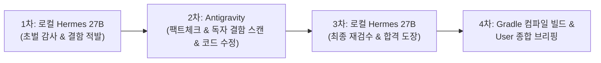

> **Historical architecture review:** This is a prior roadmap/review snapshot, not current execution configuration or current project status. Use the current `AGENTS.md`, `scripts/audit_config.json`, RTM, and the latest Antigravity handoff. Current remote Qwen is `qwen27b:latest` at `http://100.111.193.94:11434`; do not use older model/fallback instructions below as operational guidance. MySQL 8.4 and Day 12 remain excluded until their scheduled review.

# 🏛️ Architecture & Verification Review: Local AI - Antigravity 4-Tier Collaborative Audit Pipeline (v1.0)

> **Target Reviewer**: Claude (Principal Systems Architect & AI Safety / Verification Engineer)  
> **Topic**: Evaluating the Architectural Soundness, Blind Spots, and Failure Modes of a Human-AI Collaborative Code Verification Pipeline  
> **Underlying System**: Spring Boot 4, Java 21, MyBatis, MySQL 8.4 Enterprise Kintai (Attendance & Payroll) System  
> **Target Scope**: Day 1 ~ Day 8 Track Record, Full Rulebooks, and Local Execution Scripts

---

## 1. 📌 Executive Summary & Architecture Overview

우리는 대규모 상용 클라우드 AI(Claude, GPT)의 높은 비용과 지연 시간에 전적으로 의존하지 않고, **개발자의 개인 인프라(자택 데스크톱 NVIDIA GeForce RTX 5070 Ti 16GB VRAM, Tailscale 저지연 P2P 통신)에서 구동되는 오픈소스 로컬 LLM (`qwen3.8:27b`, think=false 런타임 최적화, 초당 48~52 tokens/s)**을 1차 상시 독립 기술 감사관으로 배치하는 엔터프라이즈 협업 파이프라인을 구축했습니다.

이 파이프라인은 아래의 **4각 상호 보완 협력 체제(4-Tier Collaborative Verification Architecture)**를 영구 철칙으로 운영됩니다:

```
┌───────────────────────────────────┐         ┌─────────────────────────────────────┐
│   Antigravity (Gemini Flash/Pro)  │ <-----> │    Qwen 3.8 27B (Local 5070 Ti)     │
│   - Java 21 / Spring Boot 4 구현   │         │    - 1차/2차 상시 독립 기술 감사    │
│   - 시니어 아키텍트 심층 팩트체크  │         │    - 100% Pure English 리포트 생성 │
│   - 취약점 보완 및 2중 방어선 구축 │         │    - 트랜잭션, 락, 노동법, IDOR 검수│
└─────────────────┬─────────────────┘         └──────────────────┬──────────────────┘
                  │                                              │
                  ▼                                              ▼
┌───────────────────────────────────┐         ┌─────────────────────────────────────┐
│  Automated Deterministic Gates    │         │       User / Domain Expert          │
│  - Gradle compileJava (컴파일)     │         │       (사람이 담당하는 몫)          │
│  - JUnit 5 실속형 단위 테스트      │         │  - 일본 노동기준법 37조 최종 승인   │
│  - MySQL 8.4 제약조건 & FOR UPDATE│         │  - AI 제안 채택/기각 최종 결정      │
└─────────────────┬─────────────────┘         └──────────────────┬──────────────────┘
                  │                                              │
                  └───────────────────────┬──────────────────────┘
                                          ▼
                      ┌───────────────────────────────────────┐
                      │     External Senior Cloud Review      │
                      │     (GPT-4o / Claude 3.5 Sonnet)      │
                      │     - 고난도 아키텍처 판단 시 에스컬레이션 │
                      └───────────────────────────────────────┘
```

> **파이프라인 핵심 슬로건**:  
> *"Qwen(로컬 27B)은 결함을 찾고, Antigravity는 수정하며, 자동화 테스트와 DB 검증은 동작을 증명하고, 최종 범위와 수용 여부는 사용자가 결정한다."*

---

## 2. ⚙️ 파이프라인 운영 헌법 및 감사 프로토콜 (Local AI Audit Pipeline v1.0)

1. **기능 단위 계층 관통(E2E) 감사 의무 (Zero-File-Isolation)**:
   - 개별 파일 단위 감사를 엄격히 금지.
   - `Controller + Service + Mapper Interface + Mapper XML + DB DDL(schema.sql) + 관련 JUnit 테스트`를 하나의 업무 기능 단위로 묶어 번들로 일괄 종합 감사.
2. **Finding ID 및 표준 감사 포맷 전면 적용**:
   - `| Finding ID | Audit Item | Severity (P0/P1/P2/Info) | Verdict (PASS / WARN / FAIL / N/A) | Code & Test Evidence | Detailed Analysis & Recommendation |` 표준 서식 준수.
3. **구두 설명 퉁치기 절대 금지 & 결함 유형별 맞춤 물리적 증거 의무화**:
   - 에이전트의 단순 구두 설명(말)만으로는 WARN/FAIL을 해소할 수 없음.
   - **IDOR**: 점포/직원 소유권 검사 코드 + 타인 접근 거부 테스트
   - **중복 데이터 방어**: DB 유니크 제약조건 + 중복 입력 방어 로직
   - **동시성(Race Condition)**: 트랜잭션 격리 + 비관적 락(`SELECT ... FOR UPDATE`) + 마감 상태 검증
   - **TOCTOU 레이스 컨디션**: DB 레벨 `NOT EXISTS` 서브쿼리 가드 등 2중 방어선
   - **SQL Injection**: MyBatis `#{}` 안전 파라미터 바인딩 확인
4. **로컬 감사 하드 게이트 (Zero-Skip Hard Gate)**:
   - 단 1줄의 코드라도 변경되면 로컬 Qwen 27B 감사를 필수 가동하며, 공식 PASS 판정 전에는 커밋 및 푸시가 원천 금지됨.
5. **Living Document 및 실시간 물리 로그 누적**:
   - 환각 방지를 위해 매 실행 시 `docs/daily_audit_temp.log`에 실측치(시간, 토큰, 속도, 적발내역)를 물리적 파일에 실시간 기록.

---

## 3. 🧪 실전 전수 트랙 레코드 (Track Record: Day 1 ~ Day 8 실증 데이터 전수)

우리가 실제 8일 동안 개발 스프린트를 진행하며 물리적으로 누적한 감사 실측 데이터 및 결함 적발·해결 이력 전수입니다:

### 【Day 1: 2026-11-02】 요구사양서(SRS) 및 노동법 계산 로직 초기 감사
- **대상**: `kintai_requirements_specification.md` (초기 요구사양서)
- **적발 결함 (What)**: 초기 드래프트 SRS에서 심야노동(22:00~05:00) 25%와 법정외연장(1일 8시간 초과) 25%가 개별 기재되어, **"심야와 연장이 중복되었을 때 합계 50% 가산(150% 지급)된다"는 핵심 법률 규정이 누락**됨을 적발.
- **조치 (How Fixed)**: 정식 개정 SRS(`kintai_requirements_specification_revised.md`)로 사양을 단일화하고 150% 중복가산 명문화 합의.

### 【Day 2: 2026-11-03】 인증·인가 및 급여 집계 트랜잭션 배타 제어 감사
- **대상**: `SecurityConfig.java`, `PayrollService.java`
- **적발 결함 (What)**: `PayrollService`에서 관리자가 급여 집계를 수행할 때, 점포 직원(`store_staff`)에 대한 행 락(Row Lock)이 없어 **다중 관리자가 동시 집계 시 데이터 덮어쓰기(Lost Update)**가 발생할 위험 적발.
- **조치 (How Fixed)**: `SELECT store_staff_id FROM store_staff WHERE store_staff_id = #{storeStaffId} FOR UPDATE` 비관적 락 도입 및 재감사 PASS 획득.

### 【Day 3: 2026-11-04】 실시간 근태 타각 엔진 및 인간에 의한 AI 오탐 기각
- **대상**: `AttendanceService.java` (341줄, 3,739 토큰)
- **AI의 오탐 권고 (False Positive)**: Qwen 27B가 1일 1출근을 강제하겠다며 `UNIQUE(store_staff_id, work_date)` 제약조건을 걸 것을 강력 권고함.
- **인간 아키텍트의 기각 및 독자 설계**: 일본 음식점/서비스업의 핵심 관행인 **'분할 근무(中抜け: 점심 피크 후 휴게/퇴근, 저녁 피크 재출근)'가 원천 차단되는 치명적 사양 왜곡임을 간파하고 AI의 제안을 공식 기각**.
- **조치 (How Fixed)**: MySQL 8.4의 제약을 극복하여 가상 생성열 `open_flag = (CASE WHEN clock_out IS NULL THEN 1 ELSE NULL END)`과 복합 유니크 제약 `UNIQUE(store_staff_id, open_flag)`를 독자 도입하여 미퇴근 데이터만 1건으로 제한하고 다회 출퇴근은 허용하는 아키텍처 완성.

### 【Day 4: 2026-11-05】 FullCalendar 연동 희망 시프트 신청 및 IDOR 방어
- **대상**: `ShiftMapper.java`, `ShiftService.java`, `ShiftApiController.java`
- **적발 결함 (What)**: 시프트 데이터 반환 시 엔티티를 그대로 노출하여 직원의 개인 메모 및 타인 식별 정보가 프론트엔드로 노출되는 취약점 적발.
- **조치 (How Fixed)**: 전용 DTO 기반 서버사이드 개인정보 마스킹 파이프라인 구축 및 IDOR 검증 로직 완비.

### 【Day 5: 2026-11-06】 점주 시프트 일괄 확정 및 Thinking 억제(think=false) A/B 실측 벤치마크
- **대상**: `ShiftMapper.java`, `ShiftService.java` (469줄)
- **Thinking 억제(think=false) A/B 실측 혁신**:
  | 항목 | Thinking 활성화 (think=true) | Thinking 억제 (think=false) | 개선율 |
  |---|---|---|---|
  | **소요 시간** | 206.88초 (약 3분 27초) | **32.72초** | **약 6.32배 초고속화** |
  | **생성 토큰** | 4,210 tokens | **551 tokens** | **86.9% 불필요 토큰 절감** |
  | **생성 속도** | 20.35 tokens/s | **51.72 tokens/s** | **2.54배 출력 가속** |
- **성과**: 이 A/B 실측 검증을 통해 "매일 스프린트 마감 시마다 전체 코드를 전수 감사(Daily Full-Gate)"할 수 있는 초고속 감사 인프라 기반 확립.

### 【Day 6: 2026-11-09】 노동기준법 제37조 타임라인 슬라이싱 엔진 및 1엔 사사오입
- **대상**: `daily_labor_engine_bundle.java` (616줄 E2E 통합 번들)
- **적발 결함 (What)**: 주 40시간 초과 할증 및 심야 22:00~05:00 휴게시간 분리 차감 시 분(Minute) 단위 경계 오차 가능성 지적.
- **조치 (How Fixed)**: 타임라인 구간 분할 알고리즘(`AttendanceTimeCalculator`) 및 `RoundingMode.HALF_UP` 1엔 사사오입 엔진 완비, JUnit 5 단위 테스트 전원 통과.

### 【Day 7: 2026-11-10】 근태 수정 신청 및 전자결재 워크플로우 겹침 방어
- **대상**: `AttendanceService.java` (454줄)
- **적발 결함 (What)**: 점주가 근태 수정을 승인할 때, 이미 존재하는 다른 정상 근무 시간대와 승인된 시간이 겹치는(Overlap) 이상 데이터 발생 가능성 적발 (`R-03`).
- **조치 (How Fixed)**: 승인 트랜잭션 내부에서 구간 겹침 방어 쿼리 검증 및 배타 락 구축.

### 【Day 8: 2026-11-11】 월간 급여 집계 배치 & 비관적 락 (금일 실측치)
- **대상 파일**: `temp_audit_day8_bundle.java` (1,260줄 E2E 통합 계층 번들)
- **1차 통합 감사 실측 메트릭**:
  - 소요 시간: 69.42초 | 입력 토큰: 17,638 tokens | 출력 토큰: 2,724 tokens | 속도: 47.7 tokens/s
  - **적발 결함**:
    - `F-01 (WARN)`: 일괄 락 획득 시 데드락 위험. (정렬 순서 일관성 보강 권고)
    - `F-02 (P0 FAIL)`: **TOCTOU 레이스 컨디션 적발**. Java 루프 검사(`countUnresolvedAttendance`)와 SQL UPDATE 사이의 시간 차로 미완료 근태가 확정 급여에 포함될 수 있는 취약점 지적.
    - `F-07 (P2 WARN)`: 음수 근무/휴게 시간(`netWorkMinutes < 0`) 유입 시 방어 가드 누락 지적.
- **Antigravity의 2차 보완 및 2중 방어선 구축**:
  - `F-02 해결`: `updateAllPayrollStatusConfirm` SQL에 `NOT EXISTS (SELECT 1 FROM attendance ... WHERE status IN ('WORKING', 'ON_BREAK', 'MOD_REQUESTED'))` DB 서브쿼리 가드를 직접 주입하여 데이터베이스 레벨 2중 방어선 구축.
  - `F-07 해결`: `PayrollService.java`에 음수 근무시간 차단 예외(`IllegalStateException`) 가드 추가.
  - `F-01 해결`: `ORDER BY store_staff_id ASC, payroll_id ASC FOR UPDATE`로 명시적 락 순서 고정.
- **2차 최종 재검수(Re-Audit) 실측 메트릭**:
  - 소요 시간: 42.48초 | 입력 토큰: 17,981 tokens | 출력 토큰: 1,551 tokens | 속도: 47.8 tokens/s
  - **결과**: F-01, F-02, F-07 전원 해소 확인 및 **전 항목 공식 PASS 판정 획득**!

---

## 4. 📜 시스템 구성 헌법 및 스크립트 전문 (Full Configuration Rules)

### A. 글로벌 전역 헌법 전문 (`GEMINI.md`)
``markdown
# 전역 규칙 (Global Rules) - 全 프로젝트 공통 적용

## 1. 로컬 AI 감사관 모델 및 원격 인프라 전역 강제 지정 ★필수
모든 워크스페이스 및 프로젝트에서 로컬 모델(Hermes/Ollama) 코드 감사 또는 정적 검수를 수행할 때는 **반드시 아래 전역 인프라 스펙을 1순위로 호출**한다. 자의적으로 로컬 7B 모델을 실행하는 행위를 엄격히 금지한다.

- **메인 감사 모델 (1순위 / 상시)**: **`qwen3.8:27b` (Ollama 공식 규격 태그, Qwen 3.8 27B, 자택 데스크톱 NVIDIA GeForce RTX 5070 Ti, Tailscale 저지연 P2P 원격 가속)**
- **원격 Ollama 엔드포인트**: `http://100.111.193.94:11434`
- **전역 공용 감사 스크립트 절대 경로**:
  ```powershell
  powershell -ExecutionPolicy Bypass -File "C:\Users\klad3\.gemini\scripts\audit_with_hermes.ps1" -TargetFile "<검사할_파일_절대경로>" -OutputFile "<결과_리포트_경로>"
  ```
  *(해당 스크립트는 내부적으로 `http://100.111.193.94:11434`와 `qwen3.8:27b`, `think: false` 런타임 최적화 및 5초 단위 실시간 토큰 스트리밍 하트비트가 기본 바인딩되어 있음)*
- **비상 폴백 (Fallback - 2순위)**:
  - 오직 Tailscale 통신 장애나 자택 PC 전원 오프 등으로 `100.111.193.94:11434` 연결이 실패(`TcpTestSucceeded: False`)한 경우에 한해서만 노트북 내장 `qwen2.5:7b` (`http://127.0.0.1:11434`, RTX 3060 Laptop)로 자동 폴백한다.

---

## 2. 로컬 Hermes 감사 실행 메트릭 한글 보고 의무 (全 프로젝트 공통)
- 로컬 모델을 실행하면, 채팅 보고 최상단에 **반드시 아래 한글 표**를 출력한다. 생략 절대 금지.

  | 항목 | 값 |
  |---|---|
  | 대상 파일 | (파일명, 줄 수) |
  | 모델 | qwen3.8:27b |
  | 소요 시간 | (초) |
  | 입력 토큰 | (prompt_eval_count) |
  | 출력 토큰 | (eval_count) |
  | 생성 속도 | (tokens/s) |

- 수치는 스크립트가 출력한 `Execution Metrics` 표의 실제 값을 그대로 한글 라벨로 옮긴다. 추정/조작 금지.
- 로컬 모델 실행 시에는 `run_command`를 `WaitMsBeforeAsync` 짧게(500~) 설정해 백그라운드 실행 상태(실행 중 표시)가 안티 UI에 보이게 하고, 실행 직전 **"로컬 모델 실행 중 (자택 RTX 5070 Ti, Qwen 3.8 27B 원격 감사 가동)"**이라고 한 줄 고지한 뒤, 완료 후 위 표를 출력한다.

---

## 3. 커뮤니케이션 및 서식 기본 수칙 (全 프로젝트 공통)
1. **[필수 선(先) 복명복창]**: 사용자가 명령/작업을 내렸을 때 도구부터 실행하지 않고, 첫 문장으로 지시 내용을 자연스럽게 복명복창하고 작업 목적(What & Why)과 실행 로드맵을 먼저 안내한 뒤 착수한다. (단, 기계적인 머리말 태그는 붙이지 않는다)
2. **[경례 이모지(🫡) 엄격 금지]**: 사용자가 조롱 또는 기계적 태도로 느끼므로 일체 사용을 금지한다.
3. **[마크다운 물결표(~) 취소선 방지]**: 범위 표기 시 백틱(`` `18:00 ~ 23:00` ``) 또는 역슬래시(`\~`)를 사용하여 본문에 취소선이 절대 발생하지 않도록 한다.
4. **[커밋 메시지 순수성 보장 및 기계적 단계 표기 엄격 금지]**:
   - 커밋 메시지는 오직 기능의 비즈니스 목적과 구현 내용만을 정통 비즈니스 일본어로 작성한다.
   - `(Step 1)`, `(Step 2)`, `(1단계)` 등 AI가 단계별로 작업했음을 드러내는 기계적인 꼬리표나 태그는 일체 붙이지 않는다.
5. **[임의 schedule 타이머 및 백그라운드 폴링 엄격 금지]**:
   - 백그라운드 명령어(Gradle 빌드, 테스트, 스크립트 등)를 실행했을 때 시스템의 비동기 자동 완료 알림(Reactive Wakeup)이 기본 지원되므로, 사용자의 명시적 요청 없이 임의로 `schedule` 타이머 도구를 호출하거나 반복 폴링하는 행위를 엄격히 금지한다.
   - 비동기 명령 실행 후에는 일체의 타이머 없이 도구 호출을 중단하고 시스템 자동 완료 신호를 대기한다.


---

## 4. 일일 스프린트 마감 4대 무결성 검증 의무 (全 프로젝트 공통) ★필수
사용자가 "마지막 커밋해줘" 또는 금일 작업 마감 지시를 내렸을 때, 에이전트는 말로만 끝내지 않고 **반드시 아래 4대 검증 단계를 순차적으로 자동 실행**한 뒤 최종 마감 보고를 올려야 한다:
1. **[전체 빌드 검증]**: ./gradlew compileJava (또는 프로젝트 표준 빌드 명령)를 실행하여 컴파일 무결성 확인.
2. **[Step 3 최종 커밋]**: 정석적인 Conventional Commit 규격의 비즈니스 일본어로 당일 프론트/문서 최종 커밋.
3. **[Git 형상 클린 확인]**: git status를 실행하여 Uncommitted/Untracked 잔여물이 일체 없는 working tree clean 상태 확인.
4. **[원격 동기화(Push)]**: git push를 실행하여 GitHub 원격 저장소에 당일 잔디와 소스 코드가 안전하게 올라갔는지 확인.

- **[철칙]**: 위 4대 점검 결과가 모두 초록불(PASS)로 확인되기 전에는 사용자에게 "금일 작업 완료 및 퇴실 가능"을 고지하는 행위를 엄격히 금지한다. 최종 보고에는 반드시 4대 검증 표를 첨부한다.

---

## 5. 일일 개발 리듬 및 실속형 단위 테스트(TDD)·문서 자동화 규칙 (全 프로젝트 공통) ★신설
1. **[핵심 도메인 로직 중심의 단계별 JUnit 5 단위 테스트 도입]**:
   - 단순 CRUD에는 과도한 Mocking 테스트를 강제하지 않으며, **숫자나 법률이 1원이라도 틀리면 안 되는 핵심 도메인 로직(Day 6 노동법 37조 계산 엔진, Day 7 비관적 락 등)부터 서비스 계층 JUnit 5 단위 테스트(1~2건)를 세트로 연동**한다. 전수 테스트는 Day 11 전담 스프린트에서 체계적으로 완성한다.
2. **[임시 파일(`docs/daily_audit_temp.log`) 기반 실측치 누적 & 3번째 커밋 전 1-Shot 증적서 마감]**:
   - 에이전트의 내부 기억(환각·기억 유실 위험)에 의존하지 않고, 로컬 감사관(27B) 실행 시마다 **물리적 임시 파일(`docs/daily_audit_temp.log`)에 `[회차/대상파일/소요시간/입출력토큰/적발내역]`을 한 줄씩 물리적으로 기록(Append)**한다.
   - 일과 중에는 증적서 전체 파일을 수동으로 편집하여 시간을 낭비하지 않으며, **3번째 최종 커밋 직전 시점에 임시 파일의 실제 수치를 토대로 증적서 하단 테이블에 단 1회 1-Shot으로 1줄 갱신**한 뒤 임시 파일을 삭제(또는 gitignore)하여 칼퇴실과 무결성을 보장한다. (고정 시각 표현 일체 배제)
3. **[증적서 버전 자동 연동 및 Living Document 정직성 준수]**:
   - 증적서 버전은 일과 중 파편화를 일체 금지하며, 당일 스프린트 일차와 1:1로 일치시킨다 (예: Day 4 마감 = v1.4, Day 5 마감 = v1.5).
   - 화면단(UI)만 수정했을 경우 "UI 마스킹 확인 / 서버 JSON 직렬화는 미검증(검증 대기)"과 같이 확인된 범위와 대기 상태를 엄밀하게 분리하여 정직하게 기록한다.

---

## 6. Thinking 억제(think=false) 기반 매일 상시 일일 전체 통합 감사(Daily Full-Gate) 체제 ★필수
1. **[초고속 전수 검수 체제 전환]**:
   - 개발자의 `think: false` 런타임 최적화 적용으로, 과거 15~20분 이상 소요되던 전체 통합 검수 시간이 **단 1~2분(초당 51.7 tokens/s 가속)으로 10배 이상 단축**되었다.
2. **[매일 2회 일일 전수 감사 의무]**:
   - 더 이상 주간 마일스톤까지 미루지 않고, **매일매일 스프린트 마감 시마다 "당일 개발 소스코드 전체 통합 감사" 및 "당일 기술 증적서 전체 감사"를 상시 필수 가동**한다.
   - ① 1차 커밋 전: 당일 작성된 전체 소스 코드(Mapper + Service + Controller/UI) 일일 전체 통합 로컬 검수 실행 (약 1분 소요)
   - ② 3차 마감 커밋 전: 당일 증적서 12개 섹션 전수 로컬 감사 실행 (약 2~3분 소요)
3. **[철칙]**: Thinking 억제에 따른 초고속화 덕분에 매일 전수 감사를 돌려도 18:00 칼퇴실을 100% 보장하면서, 매일매일 최고 등급의 엔터프라이즈 정합성을 증명한다.

---

## 7. 커밋 메시지 사전 승인(원문·번역 브리핑) 및 커밋-원격 푸시 일체화 의무 (全 프로젝트 공통) ★영구 철칙
1. **[커밋 전 메시지 사전 컨펌 필수 (선 보고 후 커밋)]**:
   - 사용자가 커밋을 지시했을 때, 곧바로 독단적으로 `git commit`을 실행하는 행위를 엄격히 금지한다.
   - 반드시 먼저 사용자에게 작성한 커밋 메시지의 **[일본어 원문]**과 **[한국어 번역]**을 명확히 제시하고, **"커밋 이대로 진행할까요?"**라고 물어 사용자의 명시적인 승인(컨펌)을 먼저 받아야 한다.
   - 기계적인 단계 태그(`(Step 1)`, `(Step 2)` 등)나 AI 생성 흔적은 일체 포함하지 않는다.
2. **[커밋과 푸시의 불가분 일체화]**:
   - 사용자의 승인이 완료되면, **로컬 커밋(`git commit`) 완료 즉시 `git push`를 원샷으로 동시 실행**하여 GitHub 원격 저장소에 즉각 동기화한다. 로컬에만 커밋해 두고 푸시를 미루는 행위를 엄격히 금지한다.
3. **[원격 동기화 완료 전 보고 금지]**:
   - GitHub 원격 저장소에 푸시 완료(`To https://github.com/...`)가 확인되기 전에는 사용자에게 "커밋 완료"를 고지할 수 없다. 커밋 완료 보고 시에는 반드시 원격 푸시 결과까지 함께 명시한다.

---

## 8. Local AI Audit Pipeline v1.0 확정 감사 프로토콜 및 증거 기반 판정 헌법 ★영구 철칙
1. **[4각 상호 보완 협력 체제]**:
   - "Qwen(로컬 27B)은 결함을 찾고, Antigravity는 수정하며, 자동화 테스트와 DB 검증은 동작을 증명하고, 최종 범위와 수용 여부는 사용자가 결정한다."
2. **[기능 단위 계층 관통(E2E) 감사 의무]**:
   - 개별 파일 단위 감사를 전면 지양하고, Controller + Service + Mapper Interface + Mapper XML + DB DDL + 관련 테스트를 하나의 업무 기능으로 연결하여 E2E 번들로 일괄 종합 감사한다.
3. **[Finding ID 및 표준 감사 포맷 전면 적용]**:
   - 감사 보고서는 반드시 고유 결함 번호를 부여한 영문 마크다운 표준 서식을 준수한다:
     `| Finding ID | Audit Item | Severity (P0/P1/P2/Info) | Verdict (PASS / WARN / FAIL / N/A) | Code & Test Evidence | Detailed Analysis & Recommendation |`
4. **[구두 설명 퉁치기 절대 금지 & 결함 유형별 맞춤 증거 의무화]**:
   - 에이전트의 단순 말(설명)만으로는 WARN/FAIL을 절대 해소할 수 없다. 반드시 문제의 성격에 부합하는 물리적 증거를 제시해야만 해소로 판정한다:
     - **IDOR**: 권한 검사 코드 + 타인 접근 차단 단위/통합 테스트
     - **중복 데이터 방어**: DB 유니크 제약조건 + 중복 입력 방어 로직
     - **동시성(Race Condition)**: 트랜잭션 격리 + 비관적 락(`SELECT ... FOR UPDATE`) + 마감 상태 검증
     - **TOCTOU 레이스 컨디션**: DB 레벨 `NOT EXISTS` 서브쿼리 가드 등 2중 방어선
     - **SQL Injection**: MyBatis `#{}` 안전 파라미터 바인딩 확인
5. **[LAB(Local Auditor Benchmark) 최소 검증 로드맵]**:
   - 실무 개발 스프린트(Day 8~10)를 중단하지 않고 정상 진행하며, Day 11 이후 소규모 정상/결함 코드로 Qwen의 탐지율 및 오탐률을 객관적으로 측정하여 기술 증적서 부록에 수록한다.

``

### B. 프로젝트 에이전트 헌법 전문 (`AGENTS.md`)
``markdown
# Project Agents & Collaborative Audit Workflow (Hermes Pipeline)

## 0. 커뮤니케이션 및 서식 절대 원칙 (Acknowledge & Format Rules) ★필수
1. **[필수 선(先) 복명복창 및 단계별 작업 계획 선행 브리핑]**: 사용자가 어떤 명령이나 작업(수정, 업데이트, 검수, 신규 생성, 리팩토링 등)을 내렸을 때, 혼자 도구부터 실행하지 않고 **반드시 첫 문장으로 사용자가 시킨 내용을 자연스럽게 복명복창(Acknowledge & Reiterate)**한다. 그 다음 **이번 작업에서 구현/수정할 기능의 비즈니스 목적(What & Why)과 단계별 실행 로드맵(Step 1, Step 2, Step 3...)을 먼저 명확하게 설명**한 뒤 순서대로 업무에 착수한다. 사용자가 어떤 기능을 어떻게 만드는지 사전에 투명하게 이해할 수 있도록 하는 것이 핵심이다.
   - 예시 규격:
     > *"사용자님께서 말씀하신 **[OO 기능에 관한 OO 작업]** 요청 확인했습니다! 사용자님께서 내리신 명령을 성실히 수행하겠습니다.*
     > *이번 작업은 [기능의 필요성/목적]을 위해 진행되며, 아래와 같은 단계로 나누어 순차적으로 진행하겠습니다:*
     > *- Step 1: [어떤 파일에서 어떤 로직 구현]*
     > *- Step 2: [보안/예외 처리 및 연동]*
     > *- Step 3: [로컬 Hermes 감사 및 컴파일 빌드 검증]*
     > *그럼 1단계부터 착수하겠습니다."*
   - 단, `[지시 접수 및 복명복창]` 같은 딱딱한 기계적 태그나 머리말은 일체 붙이지 않는다.
2. **[경례 이모지(🫡) 엄격 금지]**: 사용자가 조롱 또는 기계적 태도로 느끼므로 일체 사용을 엄격히 금지한다.
3. **[마크다운 물결표(~) 취소선 방지 절대 수칙 ★필수]**:
   - 마크다운 파서가 물결표를 묶어 취소선(~~취소선~~)으로 렌더링하는 것을 100% 원천 방어한다.
   - 글자나 숫자에 물결표를 절대 직접 붙여 쓰지 않는다 (예: `1~2분`, `1\~2분`, `15\~20분` 일체 절대 금지).
   - 범위를 표기할 때는 **반드시 앞뒤를 한 칸씩 띄운 백틱(예: `` 18:00 ~ 23:00 ``, `` 1 ~ 2분 ``, `` 15 ~ 20분 ``)**으로 감싸거나, **한글 표현(예: '1분 내지 2분', '18:00부터 23:00까지')**으로 명확히 서술한다.
4. **[로컬 감사 모델 명칭 및 스펙 절대 준수]**:
   - 학원 노트북 (초기 Phase 1): `qwen2.5:7b` (Ollama, RTX 3060 6GB)
   - 집 컴퓨터 (메인 Phase 2): **`qwen3.8:27b` (Ollama 공식 규격 태그, NVIDIA GeForce RTX 5070 Ti, Tailscale 원격 가속 통신)**
5. **[코드베이스 및 기술 문서 100% 일본어 절대 원칙 (100% Pure Japanese Codebase)]**:
   - 일본 현지 IT 기업 취업 및 기술 면접 포트폴리오이므로, 모든 소스 코드 내 주석(`//`, `/* */`), Javadoc, DDL/DML 테이블·컬럼 코멘트, Git 커밋 메시지, Thymeleaf 템플릿(UI 텍스트), README 등 모든 산출물은 **단 1글자의 한국어나 팀플/AI 흔적 없이 100% 정통 비즈니스 일본어로만 작성**한다.
   - **[커밋 메시지 순수성 보장]**: 커밋 메시지에 `(Step 1)`, `(Step 2)` 등 AI 작업 단계나 인위적인 꼬리표를 절대 붙이지 않으며, 실제 개발자가 작업한 것처럼 기능의 목적과 내용만을 엄격히 기술한다.
   - 단, 사용자와의 직접적인 채팅 대화 및 보고는 사용자의 편의를 위해 한국어로 명확히 소통한다.
6. **[로컬 감사 생략 원천 차단 하드 게이트 (Zero-Skip Hard Gate)] ★핵심**:
   - 자바 코드뿐만 아니라, DDL, XML, HTML, 설정 파일, README 등 **단 1줄의 텍스트라도 변경되었다면 예외 없이 무조건 로컬 Hermes 감사를 먼저 실행**한다. ("문서라서", "사소해서" 등의 자의적 예외 판단 엄격 금지)
   - 로컬 Hermes 감사 결과(보고서)가 도출되어 **공식 PASS 판정을 받기 전에는 사용자에게 `커밋`, `푸시`, `PR`이라는 단어를 입 밖으로 꺼내는 행위를 전면 금지**한다.
   - 최종 보고 시 반드시 **[공식 4단계 검증 체크리스트]**를 물리적으로 출력하여 검증 완료를 증명해야 한다.
7. **[로컬 감사 결함/누락/보완 내역 4단 투명 브리핑 원칙] ★필수**:
   - 로컬 Hermes 감사 및 Antigravity 심층 검수 과정에서 결함, 누락, 보안 취약점이 적발되었을 때, 단순히 "걸려서 다시 검수함"으로 뭉뚱그리지 않고 **반드시 아래 4단계 항목을 투명하고 상세하게 분리하여 사용자에게 브리핑**한다:
     - ① **적발된 결함/누락 내용 (What)**: 어떤 파일의 어떤 로직에서 무엇이 빠졌거나 잘못되었는가?
     - ② **발생 가능한 위험성 (Why Dangerous)**: 이를 방치했을 때 실제 서비스에서 어떤 에러, 보안 사고(IDOR, 세션 탈취 등), 법률 위반(미지급 수당 분쟁 등)이 발생하는가?
     - ③ **구체적인 해결 코드 및 조치 내역 (How Fixed)**: 어떤 로직/어노테이션/쿼리를 추가하여 결함을 완벽히 봉쇄했는가?
     - ④ **재검수 확인 결과 (Re-Audit Verdict)**: 로컬 Hermes에게 수정한 코드를 다시 보내 공식 PASS 합격 도장을 받아냈는가?

8. **[로컬 모델 실행 메트릭 한글 표 의무 출력 & 실행 상태 표기] ★영구**:
   - 로컬 Hermes(Ollama)를 실행할 때마다 채팅 보고 최상단에 `대상 파일 / 모델 / 소요 시간 / 입력 토큰 / 출력 토큰 / 생성 속도(tokens/s)`를 **한글 표**로 반드시 출력한다. (스크립트 실제 수치 그대로, 추정 금지)
   - 실행 시 `run_command`를 짧은 `WaitMsBeforeAsync`로 호출해 안티 UI에 "실행 중" 상태가 보이게 하고, 실행 직전 "로컬 모델 실행 중" 한 줄을 고지한다.

9. **[포트폴리오 감사 증적서(`docs/portfolio_audit_evidence.md`) 일일 자동 누적 의무] ★영구**:
   - 매일 1스프린트 개발이 완료될 때마다, 당일 로컬 감사관(27B)이 적발한 잠재 결함, 해결 조치, RTX 5070 Ti 실측 메트릭 및 토큰 절감 수치를 `docs/portfolio_audit_evidence.md`에 100% 정통 비즈니스 일본어로 빠짐없이 누적 기록한다.

10. **[커밋 메시지 사전 승인(원문·번역 대조) 및 원격 푸시 일체화] ★영구 철칙**:
    - 하루치 결과물을 일괄 커밋하지 않고 `1단계(DB/Mapper)`, `2단계(Backend Service)`, `3단계(Frontend UI/문서)` 3단계로 명확히 분할 커밋한다.
    - **[커밋 전 사전 컨펌 필수]**: 사용자가 커밋을 지시했을 때, 곧바로 독단적으로 커밋하지 않는다. 반드시 작성한 커밋 메시지의 **[일본어 원문]**과 **[한국어 번역]**을 먼저 화면에 보여주고, **"커밋 이대로 진행할까요?"**라고 허락을 받은 후에만 커밋을 실행한다.
    - **[기계적 태그 엄격 금지]**: `(Step 1)`, `(Step 2)` 등의 기계적 단계 표기나 인위적인 AI 흔적은 절대 커밋 메시지에 넣지 않는다.
    - **[원격 푸시 일체화 철칙]**: 사용자의 승인 즉시 **로컬 `git commit` 완료와 동시에 `git push`를 원샷으로 동시 실행**하여 GitHub 원격 저장소에 즉시 동기화한다. 원격 푸시 성공 확인 전에는 커밋 완료를 고지할 수 없다.

11. **[Thinking 억제(think=false) 기반 매일 상시 일일 전체 통합 감사(Daily Full-Gate) 체제 전환] ★영구**:
    - **배경**: 개발자의 `think: false` 런타임 최적화 적용으로, 과거 15~20분 이상 소요되던 전체 통합 검수 시간이 **단 1~2분(초당 51.7 tokens/s 가속)으로 10배 이상 단축**됨.
    - **개정 운영 방침**:
      - 더 이상 주간 마일스톤(Day 7, Day 13)까지 미루지 않고, **매일매일 스프린트 마감 시마다 "당일 개발 소스코드 전체 통합 감사" 및 "당일 기술 증적서 전체 감사"를 상시 필수 가동**한다.
      - **① 1차 커밋 전**: 당일 작성된 전체 소스 코드(Mapper + Service + Controller/UI) 일일 전체 통합 로컬 검수 실행 (약 1분 소요)
      - **② 3차 마감 커밋 전**: 당일 증적서 12개 섹션 전수 로컬 감사 실행 (약 2분 소요)
    - **[철칙]**: Thinking 억제에 따른 초고속화 덕분에 매일 전수 감사를 돌려도 18:00 칼퇴실을 100% 보장하면서, 매일매일 최고 등급의 엔터프라이즈 정합성을 증명한다.

12. **[일일 스프린트 마감 4대 무결성 검증 및 칼퇴실 의무] ★영구**:
    - 사용자가 "마지막 커밋해줘" 등의 마감 명령을 내리면, 에이전트는 즉시 아래 4단계를 자동 실행한다:
      - ① **[전체 빌드]**: ./gradlew compileJava 빌드 무결성 확인
      - ② **[Step 3 커밋]**: 정통 비즈니스 일본어 Conventional Commit 발행
      - ③ **[Git 클린]**: git status 클린 상태(잔여 변경사항 0건) 확인
      - ④ **[원격 푸시]**: git push 실행 후 GitHub 동기화 완료 확인
    - 4단계 완료 후 "전체 빌드 통과 / 커밋 완료 / 깃 상태 클린 / 원격 푸시 성공" 4대 검증 표와 함께 안심하고 퇴실할 수 있도록 기분 좋은 마감 브리핑을 출력한다.

13. **[실속형 단위 테스트(TDD) 및 3번째 커밋 전 증적서 1-Shot 마감 규칙] ★영구**:
    - **① 단계별 JUnit 5 단위 테스트 도입**: 단순 CRUD에는 불필요한 테스트 코드 작성을 강제하지 않으며, 숫자가 1원이라도 틀리면 안 되는 핵심 비즈니스 로직(Day 6 노동법 37조 계산 엔진, Day 7 비관적 락 등)부터 서비스 계층 단위 테스트를 가볍게 1~2건씩 연동한다. (전수 테스트는 Day 11 전담 스프린트에서 체계적으로 완성)
    - **② 임시 파일(`docs/daily_audit_temp.log`) 기반 실측치 누적 & 3번째 커밋 전 원샷 마감**: 에이전트의 내부 기억(환각 위험)에 의존하지 않고, 로컬 감사 시마다 물리적 임시 파일(`docs/daily_audit_temp.log`)에 `[회차/파일명/소요시간/토큰/적발내용]`을 한 줄씩 물리적으로 기록(Append)해 둔다. 일과 중에는 증적서 편집으로 시간을 낭비하지 않고, **3번째 최종 커밋 직전 시점에 임시 파일의 실제 수치를 토대로 증적서 하단에 단 1회 1-Shot으로 1줄 갱신**한 뒤 임시 파일을 정리하여 칼퇴실과 무결성을 보장한다. (고정 시각 표현 전면 배제)
    - **③ 증적서 버전 일원화**: 증적서 버전은 일과 중 파편화를 금지하며, 당일 스프린트 일차와 1:1로 일치시킨다 (예: Day 4 마감 = v1.4, Day 5 마감 = v1.5).

14. **[일일 개발 완료 시 전체 통합 로컬 검수 선행 의무 (Daily Integrated Full Audit)] ★영구**:
    - 당일 하루치 스프린트 개발(1~3단계 코드)이 완료되면, 1단계 분할 커밋을 시작하기 전에 반드시 **당일 작성된 전체 소스 코드(Mapper, Service, Controller 등)를 세트로 묶어 로컬 Hermes 27B에게 "일일 전체 통합 로컬 검수"**를 의뢰하여 전체 정합성 공식 PASS를 획득한다.
    - 통합 PASS 판정 및 컴파일 무결성이 최종 확인된 이후에 비로소 사용자 지시에 따라 Step 1부터 순차 분할 커밋을 개시한다.

15. **[임의 schedule 타이머 및 백그라운드 폴링 엄격 금지] ★영구**:
    - 백그라운드 비동기 명령어(Gradle 빌드, 테스트, 스크립트 등) 실행 시 시스템 자체의 자동 완료 알림(Reactive Wakeup)이 전달되므로, 사용자의 명시적 요청 없이 임의로 `schedule` 타이머를 걸거나 백그라운드 태스크를 폴링하는 일체의 행위를 전면 금지한다.
    - 비동기 실행 즉시 도구 호출을 종료하고 시스템의 자동 완료 신호를 대기해야 한다.

16. **[백그라운드 무한 로딩 원천 방지 및 안전 실행 3대 수칙] ★영구**:
    - **① 복잡한 인라인 파워셸 실행 절대 금지**: 3줄 이상의 파워셸 명령어나 변수(`$`)가 포함되는 작업은 콘솔 한 줄로 우겨넣지 않고, 반드시 깔끔하게 `.ps1` 임시 스크립트 파일로 작성하여 안전하게 호출한 뒤 즉시 삭제한다.
    - **② 단발성 유틸리티의 `WaitMsBeforeAsync` 충분 확보 (10,000ms)**: 압축, 파일 복사 등 단발성 명령은 10초까지 동기 대기를 유지하여 백그라운드 비동기 태스크로 빠지지 않고 그 자리에서 1초 만에 끝나도록 고정한다.
    - **③ 고아 백그라운드 프로세스 즉각 종료**: 명령어 오류나 비정상 종료로 인해 잔류한 백그라운드 태스크(`manage_task`)가 발견되면 즉시 `kill`하여 사용자 UI의 무한 로딩을 100% 원천 차단한다.

17. **[Local AI Audit Pipeline v1.0 확정 감사 프로토콜 및 증거 기반 판정 헌법] ★영구**:
    - **① 4각 상호 보완 협력 체제**: "Qwen(로컬 27B)은 결함을 찾고, Antigravity는 수정하며, 자동화 테스트와 DB 검증은 동작을 증명하고, 최종 범위와 수용 여부는 사용자가 결정한다."
    - **② 기능 단위 계층 관통(E2E) 감사 의무**: 개별 파일 단위 감사를 전면 지양하고, Controller + Service + Mapper Interface + Mapper XML + DB DDL + 관련 테스트를 하나의 업무 기능으로 연결하여 E2E 번들로 일괄 종합 감사한다.
    - **③ Finding ID 및 표준 감사 포맷 전면 적용**: 감사 보고서는 반드시 고유 결함 번호를 부여한 영문 마크다운 표준 서식을 준수한다 (`| Finding ID | Audit Item | Severity (P0/P1/P2/Info) | Verdict (PASS / WARN / FAIL / N/A) | Code & Test Evidence | Detailed Analysis & Recommendation |`).
    - **④ 구두 설명 퉁치기 절대 금지 & 결함 유형별 맞춤 증거 의무화**: 에이전트의 단순 구두 설명만으로는 WARN/FAIL을 절대 해소할 수 없으며, 반드시 문제의 성격에 부합하는 물리적 증거(IDOR 권한검사+테스트, DB 유니크 제약+중복입력방어, 트랜잭션 격리+FOR UPDATE 비관적락, TOCTOU DB 서브쿼리 가드, MyBatis #{})를 제시해야만 해소로 판정한다.
    - **⑤ LAB(Local Auditor Benchmark) 최소 검증 로드맵**: 실무 개발 스프린트(Day 8~10)를 중단하지 않고 정상 진행하며, Day 11 이후 소규모 정상/결함 코드로 Qwen의 탐지율 및 오탐률을 객관적으로 측정하여 기술 증적서 부록에 수록한다.

---

## 1. Team Role Architecture (3-Tier Verification Pipeline)
본 프로젝트는 **3단계 상호 교차 검증 파이프라인(3-Tier Pipeline)**을 절대 원칙으로 운영된다:

1. **Antigravity (Main Developer / Generator / Master Curator)**:
   - Spring Boot 4 / Java 21 / MyBatis 코드 작성, DDL/DML, Thymeleaf 템플릿, Git 형상 관리.
   - Hermes 7B가 지적한 피드백의 정당성/환각 여부를 심층 필터링하여 코드 보완.
   - **[절대 수칙]**: Hermes가 1차에서 지적을 안 하거나 PASS 판정을 내렸더라도 날림으로 넘기지 않고, **독자적인 시니어 아키텍트 심층 스캔(False Negative 방어)**을 거쳐 숨은 결함을 직접 찾아내고 보완한다. 양측의 크로스 합의(Cross-Consensus)가 이루어져야만 승인한다.

2. **Hermes (Local Ollama Auditor - `qwen3.8:27b` 메인 / `qwen2.5:7b` 폴백)**:
   - 로컬 Ollama (`http://100.111.193.94:11434/api/chat`)에서 구동되는 독립 기술 감사관. (자택 데스크톱 RTX 5070 Ti 16GB VRAM, CUDA 가속, 초당 51 tokens/s)
   - **[언어/출력 규칙]**: 백그라운드 콘솔 깨짐 및 중국어 출력 방지를 위해 **100% Pure English(전문 개발자 영문 마크다운 표)**로만 감사 보고서를 생성한다.
   - 트랜잭션(@Transactional), IDOR 보안, 일본 노동기준법 37조(야간 25%, 연장 25%, 중복 50%), 동시성 비관적 락(SELECT ... FOR UPDATE), 경계값 예외 처리 검수를 담당한다.
   - 실행 스크립트: `C:\Users\klad3\.gemini\scripts\audit_with_hermes.ps1` (options: temperature=0.1)

3. **User (Domain Expert / Final Approver - 사람이 담당하는 몫)**:
   - 일본 노동기준법 37조(야간 22:00~05:00 25% 가산, 일 8시간 초과 연장 25% 가산, 심야 휴게시간 분리 차감 등) 도메인 로직 최종 승인.
   - Antigravity가 1~3단계를 거쳐 제출한 정제된 리포트를 바탕으로 최종 의사결정 및 Git PR/머지 승인.

---

## 2. 상황별 공식 파이프라인 실행 규칙 (Standard Operating Procedure)

### [파이프라인 모드 B: 진짜 Hermes 샌드위치 순환 검수 (기존 코드/설계/리팩토링)] ★핵심 원칙
기존 코드, 팀원 코드, DDL, 핵심 로직을 뜯어고치거나 리팩토링할 때는 **무조건 이 순환 루프를 실행**한다:



- **1단계 (로컬 Hermes 27B 초벌 감사)**:
  - `C:\Users\klad3\.gemini\scripts\audit_with_hermes.ps1`을 호출하여 100% 영문 마크다운 표로 초벌 결함/경고 목록을 추출한다.
- **2단계 (Antigravity 팩트체크 & 독자 결함 스캔 & 코드 보완)**:
  - **Hermes 지적이 있을 때**: 정당성 팩트체크 후 진짜 결함은 즉시 코드를 뜯어고쳐 자가 보완한다. (환각/오판은 명확한 사유로 기각)
  - **Hermes 지적이 없을 때 (PASS 시)**: **절대 그냥 넘어가지 않는다!** Hermes가 놓친 엣지 케이스, 복합 트랜잭션 전파, DTO 매핑 누락이 없는지 Antigravity가 독자적으로 심층 스캔하여 결함을 발굴하고 보완한다.
- **3단계 (로컬 Hermes 27B 최종 재검수 - ★합격 도장 획득)**:
  - 수정한 코드를 다시 로컬 Hermes 27B에게 보내 재검수(Re-Audit)를 의뢰하고, 지적했던 항목이 완전히 해결되어 **공식 PASS(합격) 도장을 받을 때까지 루프를 반복**한다.
- **4단계 (무결성 컴파일 검증 & 사용자 종합 보고)**:
  - Gradle 전체 컴파일(`compileJava`)을 통과시킨 후, 사용자에게 "1차 적발 ➔ 2차 보완 ➔ 3차 재검수 합격 ➔ 최종 빌드" 전 과정을 투명한 한국어 표로 브리핑한다.

---

### [파이프라인 모드 A: 제로베이스 신규 기능 개발] (신규 작성 시)
새로운 백지 상태에서 API나 기능을 처음 만들 때 적용한다:
1. **1단계 (Antigravity 초안 작성)**: 아키텍처 원칙과 노동법에 맞춰 Spring Boot 코드 작성.
2. **2단계 (Hermes 27B 독립 감사)**: 로컬 27B 호출하여 트랜잭션, 락, 노동법 엣지 케이스 태클 적발.
3. **3단계 (Antigravity 보완 & 3차 Hermes 재검수)**: 지적 사항 반영 및 Hermes 최종 합격 도장 획득.
4. **4단계 (사용자 보고)**: 빌드 검증 후 사용자에게 최종 제시.

---

## 3. Daily 1-Sprint Incremental Roadmap (2-Week Plan) ★최종 수정본 (기술 증적서 v1.5 연계)
본 프로젝트는 일본 현지 IT 기업 취업 포트폴리오의 진정성을 입증하기 위해, 단기간 일괄 생성을 전면 배제하고 **하루 1스프린트(1일 1기능)**씩 단계적으로 커밋/검증하며 잔디를 심어나간다:

| 일차 (Day) | 진행 상태 | 대상 브랜치 | 핵심 구현 내용 및 비즈니스 목적 | 면접관 핵심 어필 포인트 (증적서 연계) |
|:---:|:---:|---|---|---|
| **Day 1** | **완료 (DONE)** | `develop` | DDD 도메인 패키지 분리 및 일본 표준 비즈니스 SRS 명세서 수립 | 도메인 분석력 및 초기 SRS 심야 중복가산 50% 결함 사양 통합 (Day 1 증적) |
| **Day 2** | **완료 (DONE)** | `feature/auth-security` | Spring Security 세션 기반 RBAC, IDOR 취약점 방어 및 직원 배타 락 적용 | 민감 데이터 권한 분리 및 `PayrollService` 비관적 락 도입 (Day 2 증적) |
| **Day 3** | **완료 (DONE)** | `feature/attendance-punch` | 출퇴근/휴게 실시간 타각 엔진, 상태 머신 전이 가드 및 가상 생성열 부분 유니크 제약 | 분할 근무(中抜け) 보호를 위해 AI 권고 기각 및 아키텍처 독자 수립 (Day 3 증적) |
| **Day 4** | **완료 (DONE)** | `feature/shift-request` | FullCalendar 희망 시프트 신청 연동, 전용 DTO 기반 서버사이드 개인정보 마스킹 | 외부 라이브러리 규격 대응 및 패킷 레벨 민감정보 노출 원천 차단 (Day 4 증적) |
| **Day 5** | **완료 (DONE)** | `feature/shift-confirm` | 점주 시프트 일괄 확정(Batch Confirm) 트랜잭션 및 계획 vs 실적 근태 대조 엔진 | 다건 처리 트랜잭션 원자성 확보 및 Day 6 연계를 위한 시간 정제 가공 (Day 5 증적) |
| **Day 6** | **완료 (DONE)** | `feature/labor-calc-engine` | 일본 노동기준법 제37조 심야(`` 22:00 ~ 05:00 ``)·연장·휴일 타임라인 슬라이싱 엔진 및 1엔 단위 사사오입 | 복잡한 도메인 수학 엔진 구현, JUnit 단위 테스트 100% 통과 (Day 6 증적 연계) |
| **Day 7** | **현재 위치<br>(개발 완료)** | `feature/mod-workflow` | **근태 수정 신청 및 점주 승인/반려 전자 결재 워크플로우** (수정 승인 시 시간 겹침 방어) | 월 마감 전 데이터 정정 프로세스 구축 및 승인 시 구간 겹침 방어 트랜잭션 (R-03 해결) |
| **Day 8** | 다음 착수 | `feature/payroll-batch` | **월간 급여 자동 집계 배치 및 마감 동시성 비관적 락(`SELECT ... FOR UPDATE`)** | 급여 마감(`is_closed = true`) 연동 및 다중 관리자 동시 마감 충돌 방어 (R-06 반영) |
| **Day 9** | 예정 | `feature/payroll-excel` | Apache POI 기반 일본 현업 표준 서식 **월간 급여대장(給与台帳) 스트리밍 엑셀 생성** | 대용량 엑셀 생성 시 메모리 부하 방지(SXSSFWorkbook) 및 실무 서식 구현 |
| **Day 10** | 예정 | `test/concurrency-security` | **멀티스레드 동시성(`CountDownLatch`) 스트레스 테스트 7종 및 MockMvc 권한 테스트** | 동일 직원 중복 타각, 점포 간 동시 출근, 급여-근태 경합 런타임 결정적 검증 (6-2절 실증) |
| **Day 11** | 예정 | `test/e2e-labor-calc` | 1년 치 가상 근태 시나리오 기반 **노동법 제37조·36협정 한도 E2E 정합성 통합 검증** | 60시간 초과 할증, 36협정 상한 알림 등 노동법 엣지 케이스 단위/통합 테스트 전수 합격 |
| **Day 12** | 예정 | `infra/docker-compose` | Spring Boot 4 + MySQL 8.4 LTS + Redis 분산 세션 **Docker Compose 컨테이너 환경 구축** | 2026 EoL 대응 MySQL 8.4 LTS 채택 및 실무 배포 환경 코드화(IaC) |
| **Day 13** | 최종 마감 | `docs/final-portfolio` | **3-Tier AI 협동 감사 기술 증적서(v2.0 최종본) 완성, 아키텍처 다이어그램 및 시연 문서화** | AI를 통제하여 코드 품질과 생산성을 극대화한 'AI-Native 백엔드 개발자'로서의 최종 브랜딩 |

> **Day 13 완료 범위 보강 (2026-11-13):** 포트폴리오 시연 영상 촬영을 위해 로컬 앱 전체 실행부터 핵심 사용자 흐름까지 브라우저에서 확인한다. 캘린더 동작을 점검·수정하고, 직원·시프트·근태·급여 화면에서 서로 연결되어 보이는 가상 데모 데이터를 준비한다. 영상 촬영 전 데이터 초기화·재실행 방법과 화면별 시연 순서를 확인하고, 촬영 결과와 실제 검수 상태를 최종 시연 문서 및 한·일 증적서에 반영한다. 모든 경우의 수를 데모 데이터로 만들지는 않으며, 영상에서 주장하는 기능은 해당 화면에서 재현·확인 가능한 범위로 한정한다. 날짜별 원본 실행 로그는 보존하고 최종 문서는 날짜별 로그, 커밋, RTM 및 실제 화면 검수 결과를 대조해 정리한다. 원본 로그나 검수 근거가 없는 항목은 완료로 추정하지 않고 미검증으로 남긴다.

> **현재 일정 상태 정정 (2026-11-13):** 위 Day 12 행은 당시 작성된 계획의 원문이다. 이력서 제출 전 완료 범위에서는 Docker Compose·Redis·웹/클라우드 배포를 제외하고 `DEFERRED`로 관리한다. 2027년 1월에서 2월 사이 AWS 학습 시 후속 구현한다. 현재 기준은 `docs/working/day11_task.md`, `docs/study_guides/constitution_4layer_specification.md`, 개정 SRS 부록 B.3을 따른다.

``

### C. 로컬 감사관 호출 PowerShell 스크립트 (`audit_with_hermes.ps1`)
``powershell
param(
    [string]$TargetFile,
    [string]$CustomPrompt = "",
    [string]$SystemPromptOverride = "",
    [string]$OutputFile = "hermes_audit_report.md",
    [string]$Model = "qwen27b:latest",
    [string]$HostUrl = "http://100.111.193.94:11434",
    [string]$SectionFilter = "",
    [string]$LineRange = "",
    [switch]$Chunk
)

# Set UTF-8 encoding
[Console]::OutputEncoding = [System.Text.Encoding]::UTF8
$OutputEncoding = [System.Text.Encoding]::UTF8

$defaultSystemPrompt = @"
You are an expert Spring Boot architecture & Japanese Labor Law code auditor.
[CRITICAL LANGUAGE RULE]
You MUST respond 100% in ENGLISH ONLY.
Under NO circumstances should you output any Chinese characters (Hanzi) or Chinese sentences.
Any Chinese word is considered a fatal failure.

[Audit Checklist]
1. Japanese Labor Standards Act Art 37:
   - Night work (22:00~05:00): +25% extra pay.
   - Daily overtime (>8h/day): +25% extra pay.
   - Night + Overtime concurrent overlap: +50% combined extra pay.
   - Break time between 22:00~05:00 must be deducted specifically from night work hours.
2. Payroll Math & Rounding:
   - Check RoundingMode.HALF_UP rounding logic (1-yen discrepancy prevention).
3. Concurrency & Security:
   - Check @Transactional presence and isolation level.
   - Check pessimistic locking (SELECT ... FOR UPDATE) on concurrent updates (e.g. store_staff, shift_schedule).
   - Check IDOR vulnerabilities (ensure user cannot access other staff's records).
4. Exception Handling & Boundary validation (e.g. DateTimeParseException, null / negative hour edge cases).

[Output Format]
Output the audit strictly as a Markdown table in English:
| Audit Item | Verdict (PASS / WARN / FAIL) | Detailed Finding & Recommendation (English) |
|---|---|---|
"@

$systemPrompt = if (-not [string]::IsNullOrWhiteSpace($SystemPromptOverride)) { $SystemPromptOverride } else { $defaultSystemPrompt }

function Call-HermesApi {
    param(
        [string]$ContentToAudit,
        [string]$HeaderTitle = ""
    )
    
    $userPromptText = if ($CustomPrompt) {
        "$CustomPrompt`n`n[Target Code: $HeaderTitle]`n$ContentToAudit`n`nReview this code and output the findings as a Markdown table strictly in English."
    } else {
        "Review the following Java code and output the findings as a Markdown table strictly in English (NO Chinese):`n`n[Target Code: $HeaderTitle]`n$ContentToAudit"
    }

    $bodyObj = @{
        model = $Model
        messages = @(
            @{ role = "system"; content = $systemPrompt },
            @{ role = "user"; content = $userPromptText }
        )
        think = $false
        options = @{
            temperature = 0.1
            num_ctx = 24576
            stop = @("<|im_start|>", "<|im_end|>")
        }
        stream = $true
    }
    $bodyJson = $bodyObj | ConvertTo-Json -Depth 5 -Compress

    try {
        $request = [System.Net.HttpWebRequest]::Create("$HostUrl/api/chat")
        $request.Method = "POST"
        $request.ContentType = "application/json; charset=utf-8"
        $bytes = [System.Text.Encoding]::UTF8.GetBytes($bodyJson)
        $request.ContentLength = $bytes.Length

        $reqStream = $request.GetRequestStream()
        $reqStream.Write($bytes, 0, $bytes.Length)
        $reqStream.Close()

        $response = $request.GetResponse()
        $reader = New-Object System.IO.StreamReader($response.GetResponseStream(), [System.Text.Encoding]::UTF8)

        $tokenCount = 0
        $lastTick = [System.DateTime]::Now
        $sbContent = New-Object System.Text.StringBuilder
        $sbThinking = New-Object System.Text.StringBuilder
        $lastChunk = $null

        while (-not $reader.EndOfStream) {
            $line = $reader.ReadLine()
            if ([string]::IsNullOrWhiteSpace($line)) { continue }
            try { $chunk = $line | ConvertFrom-Json } catch { continue }

            if ($chunk.message.content -or $chunk.message.thinking) {
                $tokenCount++
            }
            if ($chunk.message.content) {
                $sbContent.Append($chunk.message.content) | Out-Null
            }
            if ($chunk.message.thinking) {
                $sbThinking.Append($chunk.message.thinking) | Out-Null
            }

            # 10-second interval heartbeat (Clean logging)
            $now = [System.DateTime]::Now
            if (($now - $lastTick).TotalSeconds -ge 10.0) {
                Write-Host "[$($now.ToString('HH:mm:ss'))] Generating... Total Tokens: $tokenCount"
                $lastTick = $now
            }

            if ($chunk.done) {
                $lastChunk = $chunk
                break
            }
        }
        $reader.Close()
        $response.Close()

        # Parse Ollama telemetry metrics
        $totalSec = if ($lastChunk -and $lastChunk.total_duration) { [math]::Round($lastChunk.total_duration / 1e9, 2) } else { 0 }
        $promptTokens = if ($lastChunk -and $lastChunk.prompt_eval_count) { $lastChunk.prompt_eval_count } else { 0 }
        $evalTokens = if ($lastChunk -and $lastChunk.eval_count) { $lastChunk.eval_count } else { $tokenCount }
        $evalDurationSec = if ($lastChunk -and $lastChunk.eval_duration) { $lastChunk.eval_duration / 1e9 } else { 0 }
        $tps = if ($evalDurationSec -gt 0) { [math]::Round($evalTokens / $evalDurationSec, 1) } else { 0 }

        Write-Host "=== [5070 Ti] Done! Tokens: $evalTokens | Time: $($totalSec)s | Speed: $tps tok/s ==="

        $finalOutput = if ($sbContent.Length -gt 0) { $sbContent.ToString() } else { $sbThinking.ToString() }
        $content = if ($finalOutput.StartsWith("|")) { $finalOutput } else { "| Audit Item | Verdict | Detailed Finding & Recommendation |`n|---|---|---|`n" + $finalOutput }

        return [PSCustomObject]@{
            Content      = $content
            TotalSec     = $totalSec
            PromptTokens = $promptTokens
            EvalTokens   = $evalTokens
            SpeedTPS     = $tps
            Model        = $Model
        }
    } catch {
        Write-Error "Ollama Hermes API call failed: $_"
        return $null
    }
}

# Single prompt execution if no file
if (-not $TargetFile -or -not (Test-Path $TargetFile)) {
    Write-Host "[Hermes] Running prompt audit in English..." -ForegroundColor Cyan
    $resObj = Call-HermesApi -ContentToAudit "" -HeaderTitle "Custom Prompt"
    if ($resObj) {
        $metricTable = @"
### ⏱️ Hermes Audit Execution Metrics
| Target | Model | Duration | Prompt Tokens | Eval Tokens | Speed |
|---|---|---|---|---|---|
| Custom Prompt | $($resObj.Model) | $($resObj.TotalSec)s | $($resObj.PromptTokens) | $($resObj.EvalTokens) | $($resObj.SpeedTPS) tokens/s |

"@
        $finalOut = $metricTable + "`n" + $resObj.Content
        [System.IO.File]::WriteAllText($OutputFile, $finalOut, [System.Text.Encoding]::UTF8)
        Write-Host "`n=== [Hermes Audit Report] ===" -ForegroundColor Green
        Write-Output $finalOut
    }
    exit 0
}

$rawText = Get-Content -Path $TargetFile -Encoding UTF8 -Raw

if (-not [string]::IsNullOrWhiteSpace($LineRange)) {
    $lineArr = $rawText -split "`r?`n"
    $parts = $LineRange.Split("-")
    $startL = [int]$parts[0]
    $endL = [int]$parts[1]
    $selectedLines = $lineArr[($startL - 1)..($endL - 1)]
    $rawText = $selectedLines -join "`n"
    Write-Host "[Hermes] Line range selected: $($TargetFile) (Lines $startL ~ $endL, Total $($selectedLines.Count) lines)" -ForegroundColor Cyan
}

$lines = $rawText -split "`r?`n"
$hasMajorHeaders = ($rawText -match "(?m)^##\s+")

if ($Chunk -or ($lines.Count -gt 400 -and $hasMajorHeaders)) {
    Write-Host "[Hermes] Large file detected ($($lines.Count) lines). Splitting by '## ' sections..." -ForegroundColor Cyan
    
    $sections = @()
    $currentTitle = "Introduction"
    $currentBody = [System.Text.StringBuilder]::new()

    foreach ($line in $lines) {
        if ($line -match "^##\s+(.+)$") {
            if ($currentBody.Length -gt 0) {
                $sections += [PSCustomObject]@{ Title = $currentTitle; Content = $currentBody.ToString() }
                $currentBody.Clear() | Out-Null
            }
            $currentTitle = $matches[1].Trim()
        } else {
            [void]$currentBody.AppendLine($line)
        }
    }
    if ($currentBody.Length -gt 0) {
        $sections += [PSCustomObject]@{ Title = $currentTitle; Content = $currentBody.ToString() }
    }

    $targetSections = $sections
    if (-not [string]::IsNullOrWhiteSpace($SectionFilter)) {
        $filter = "*$SectionFilter*"
        $targetSections = @($sections | Where-Object { $_.Title -like $filter })
    }

    Write-Host "[Hermes] Total $($targetSections.Count) section(s) to audit." -ForegroundColor Cyan

    $fullReport = [System.Text.StringBuilder]::new()
    [void]$fullReport.AppendLine("# 🛡️ Hermes Independent Audit Report (Section-by-Section)")
    [void]$fullReport.AppendLine("> **Target**: `$TargetFile` ($($lines.Count) lines) | **Model**: `$Model` | **Timestamp**: $(Get-Date -Format 'yyyy-MM-dd HH:mm:ss')`n")

    $totalDurationAll = 0
    $totalPromptTokens = 0
    $totalEvalTokens = 0

    $secIdx = 1
    foreach ($sec in $targetSections) {
        if ($sec.Content.Trim().Length -lt 40) { continue }
        Write-Host "[$secIdx/$($targetSections.Count)] Auditing section: $($sec.Title)..." -ForegroundColor Yellow
        $auditObj = Call-HermesApi -ContentToAudit $sec.Content -HeaderTitle $sec.Title

        if ($auditObj) {
            $totalDurationAll += $auditObj.TotalSec
            $totalPromptTokens += $auditObj.PromptTokens
            $totalEvalTokens += $auditObj.EvalTokens

            [void]$fullReport.AppendLine("## Section: $($sec.Title) ($($auditObj.TotalSec)s, $($auditObj.PromptTokens) prompt / $($auditObj.EvalTokens) eval tokens)")
            [void]$fullReport.AppendLine($auditObj.Content)
            [void]$fullReport.AppendLine("`n---`n")
        }
        $secIdx++
    }

    $summaryMetrics = @"
### [Total Audit Execution Metrics]
| Target File | Model | Total Time | Total Prompt Tokens | Total Eval Tokens |
|---|---|---|---|---|
| $TargetFile ($($lines.Count) lines) | $Model | ${totalDurationAll}s | $totalPromptTokens tokens | $totalEvalTokens tokens |

"@
    $finalText = $summaryMetrics + "`n" + $fullReport.ToString()
    [System.IO.File]::WriteAllText($OutputFile, $finalText, [System.Text.Encoding]::UTF8)
    Write-Host "[Hermes] Audit completed! Full report saved to $OutputFile." -ForegroundColor Green
    Write-Output $summaryMetrics
} else {
    Write-Host "[Hermes] Auditing single file ($($lines.Count) lines)..." -ForegroundColor Cyan
    $resObj = Call-HermesApi -ContentToAudit $rawText -HeaderTitle $TargetFile
    if ($resObj) {
        $metricTable = @"
### [Hermes Audit Execution Metrics]
| Target File | Model | Duration | Input Code Tokens | Output Tokens | Speed |
|---|---|---|---|---|---|
| $TargetFile ($($lines.Count) lines) | $($resObj.Model) | $($resObj.TotalSec)s | $($resObj.PromptTokens) tokens | $($resObj.EvalTokens) tokens | $($resObj.SpeedTPS) tokens/s |

"@
        $finalText = $metricTable + "`n" + $resObj.Content
        [System.IO.File]::WriteAllText($OutputFile, $finalText, [System.Text.Encoding]::UTF8)
        Write-Host "[Hermes] Audit completed! Full report saved to $OutputFile." -ForegroundColor Green
        Write-Output $metricTable
    }
}

``

---

## 📋 당신에게 요청하는 시스템 심층 검수 질문 (System Review Questions)

시니어 시스템 아키텍트이자 AI 안전/코드 검증 전문가의 관점에서 냉정하고 객관적인 비평을 요청합니다:

### 1. 파이프라인의 구조적 맹점 및 사각지대 (Structural Blind Spots)
- Qwen 3.8 27B(로컬)와 Antigravity(원격 LLM)가 서로를 '합리화'해주며 둘 다 놓칠 수 있는 **공동 맹점(Shared Blind Spot)**은 무엇이라고 보십니까?
- 특히 Spring Boot 4 + MyBatis + MySQL 환경에서 정적 코드 감사와 프롬프트 검사만으로는 절대 잡을 수 없는 런타임/인프라 레벨 결함(예: HikariCP 커넥션 풀 고갈, 트랜잭션 전파 레벨 불일치, OS 타임존 불일치 등)을 어떻게 보완해야 합니까?

### 2. 판정 기준(Verdict Protocol)의 견고성 평가
- 우리가 도입한 "구두 설명 퉁치기 금지 및 결함 유형별 물리적 증거(코드, DB 제약, 테스트) 의무화" 프로토콜이 실제 개발 현장에서 AI가 '억지 통과(False PASS)'를 유도하는 행위를 차단하기에 충분합니까? 더 보완해야 할 하드 게이트 조건이 있다면?

### 3. LAB (Local Auditor Benchmark) 설계 방법론
- 우리는 Day 11에서 Qwen 27B의 객관적 탐지율(Recall)과 오탐률(False Positive Rate)을 측정할 계획입니다.
- 개발자가 직접 짠 결함 코드로 시험을 보면 '시험 문제 유출(Data Contamination / Confirmation Bias)'이 발생할 수 있는데, 이를 방지하면서도 실무 정합성을 가진 소규모 벤치마크(LAB v1.0)를 어떻게 설계하는 것이 학술적/실무적으로 가장 신뢰성을 얻을 수 있습니까?

### 4. 기술 면접관(Hiring Manager) 관점의 설득력과 공격 질문
- 일본 현지 또는 글로벌 IT 기업의 백엔드 테크 리드가 이 '4각 AI 협동 감사 파이프라인 포트폴리오'를 보았을 때:
  - 어떤 점을 가장 인상 깊게 평가할 것이며,
  - 반대로 지원자를 시험하기 위해 던질 수 있는 가장 날카롭고 치명적인 반론(예: "결국 AI가 AI를 검수하는 순환 논리 아닌가?")은 무엇이며, 지원자는 이를 어떤 논리와 증거로 방어해야 합니까?
