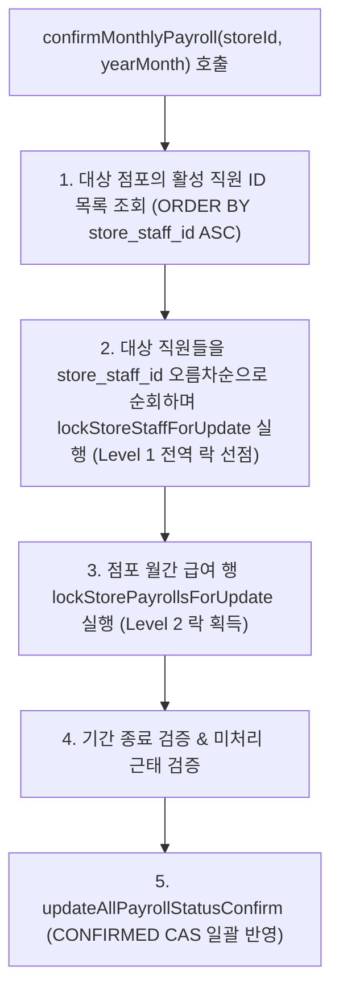

# F-04 락 메커니즘 정밀 분석 및 confirmMonthlyPayroll 보완 설계서

## 1. lockStorePayrollsForUpdate SQL 및 EXPLAIN 정밀 분석

### ① 실행 대상 쿼리 (MyBatis lockStorePayrollsForUpdate)
```sql
SELECT payroll_id, store_id, store_staff_id, target_year_month, ...
FROM payroll
WHERE store_id = #{storeId}
  AND target_year_month = #{targetYearMonth}
ORDER BY store_staff_id ASC, payroll_id ASC
FOR UPDATE;
```

### ② MySQL 26.7.0 실측 EXPLAIN 결과
```text
-> Sort: kintai_db.payroll.store_staff_id, kintai_db.payroll.payroll_id  (cost=0.35 rows=1)
    -> Filter: (kintai_db.payroll.target_year_month = '2026-10')  (cost=0.35 rows=1)
        -> Index lookup on payroll using fk_payroll_store (store_id = 1)  (cost=0.35 rows=1)
```

### ③ 물리적 락 획득 순서 및 위험성 정밀 규명
- **핵심 사실**: MySQL InnoDB는 `ORDER BY`로 정렬된 순서대로 락을 거는 것이 아니라, **스토리지 엔진이 인덱스를 스캔하며 행을 읽는 물리적 순환 순서대로 행 락을 즉시 획득**합니다.
- 위 실행 계획을 보면 `fk_payroll_store` 인덱스를 통해 행들을 읽은 후 메모리에서 정렬(`Sort`)합니다.
- 즉, SQL 문에 `ORDER BY store_staff_id ASC, payroll_id ASC`가 명시되어 있더라도, **InnoDB 레벨에서 실제 락이 걸리는 순서는 인덱스 물리 저장 순서**에 종속됩니다.
- 더 중요한 점은, `confirmMonthlyPayroll`이 `store_staff` 행을 먼저 잠그지 않고 `payroll` 행들만 잠그는 구조를 유지할 경우:
  - 동시 실행 중인 `calculatePayrollForStaff`는 `store_staff`를 먼저 잡고 `payroll`을 잡으려 합니다.
  - `confirmMonthlyPayroll`은 `payroll` 다건을 먼저 잡고 나중에 다른 로직에서 `store_staff`를 참조/잠그려 하면 여전히 **이종 테이블 간 데드락 사이클이 형성될 수 있습니다.**

---

## 2. confirmMonthlyPayroll 안전 2단계 잠금 아키텍처 보완 설계

### [결정된 2단계 잠금 원칙]
전역 락 계층인 `store_staff (Level 1) -> payroll (Level 2)`를 월차 일괄 확정에서도 100% 관철하기 위해, **대상 직원 ID들을 오름차순으로 정렬하여 `store_staff`를 먼저 1건씩 선점 잠금(Pre-lock)한 후, 급여 행들을 확정 처리**하도록 설계를 보완합니다.



이 방식을 적용하면 점포 내의 모든 개별 급여 계산(`calculatePayrollForStaff`), 단일 급여 확정(`confirmPayroll`), 월간 일괄 확정(`confirmMonthlyPayroll`)이 모두 **단일한 전역 순서(`store_staff ID 오름차순` -> `payroll`)로만 락을 요청**하므로 교착 상태(데드락)가 원천 방어됩니다.

---

## 3. GAP Lock 및 데드락 해소 한계 규정 (정직한 기술 문서화)

1. **READ COMMITTED 격리 수준에서의 GAP Lock 예외**:
   - 일반적인 `READ COMMITTED` 격리 수준에서는 검색 조건에 해당하는 레코드만 잠그며 Gap Lock이 비활성화되는 것이 일반적입니다 (`rec but not gap`).
   - **그러나 예외가 존재합니다**: 외래 키 제약 조건 검사(`FOREIGN KEY constraint check`) 및 고유 인덱스 중복 키 충돌 검사(`Duplicate Key check`) 시에는 `READ COMMITTED`에서도 참조 무결성 보장을 위해 일시적으로 Next-Key Lock 또는 Gap Lock이 활성화될 수 있습니다.
   - 따라서 "모든 잠금이 Gap Lock 없이 안전하다"고 단정할 수 없으며, 외래키 관계가 얽힌 테이블 간에는 예상치 못한 갭 락 대기가 형성될 수 있음을 인정합니다.

2. **전역 락 순서 통일의 실제 효용 범위**:
   - 본 작업에서 구현한 전역 락 순서 통일(`store_staff -> payroll -> payroll_daily_detail`)은 **"동일/연관 행에 대한 교차 잠금 역전으로 발생하는 데드락(1213)"을 제거하는 것**입니다.
   - 인덱스 부재로 인한 테이블 풀스캔 락, 동시 대량 배치 작업, 외래키 검증 등에서 기인하는 모든 잠재적 데드락을 100% 절대적으로 방어한다는 보장은 아닙니다.

3. **엔터프라이즈 환경에서의 MySQL 1213 대응 원칙**:
   - 비관적 락 순서 제어와 더불어, 엔터프라이즈 분산/동시성 환경에서는 일시적인 동시 경합으로 MySQL 1213 데드락이 언제든 감지될 수 있으므로, **Spring Retry(`@Retryable`) 또는 애플리케이션 트랜잭션 단위 재시도(Transaction-level Retry)** 전략이 반드시 수반되어야 합니다.
