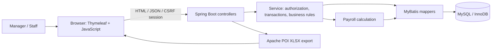
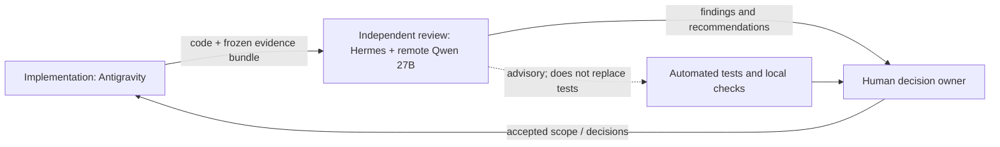

# Architecture

## Application

Controllers validate session-scoped access and requests. Services coordinate business rules and transactions. MyBatis contains SQL, including row-locking queries where used. MySQL stores shifts, attendance, breaks, payroll, and details. The browser renders calendar and payroll screens; Apache POI generates the XLSX export.

## Three-role AI review workflow

“Three-tier AI cooperation” means implementation, independent review, and human decision roles. It is separate from the application's web layers. The final Day 13 audit used `http://100.111.193.94:11434`, model `qwen27b:latest`. No local 7B substitution was made.

## Database integrity note

The canonical DDL `src/main/resources/db/schema.sql` defines ordinary attendance date indexes, foreign keys, and checks. It does not define the generated-column unique constraint `uq_att_open_per_staff` mentioned in older portfolio notes. Do not describe that historical claim as current schema fact.
