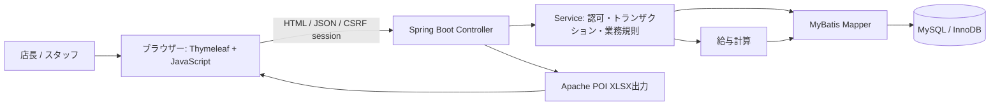
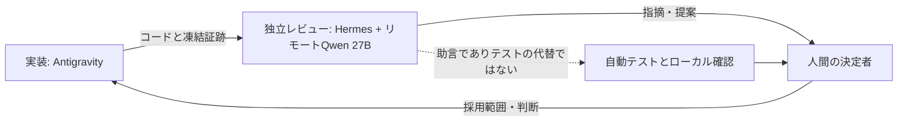

# アーキテクチャ

## アプリケーション構成

Controllerはセッションに基づくアクセス権とリクエストを検証します。Serviceは業務規則とトランザクションを調整し、MapperがSQLを実行します。必要な処理では行ロックを使用します。MySQLはシフト、勤怠、休憩、給与と明細を保持します。ブラウザーはカレンダー・給与を表示し、Apache POIが生成したXLSXを受け取ります。

## 3役AIレビュー

これは監査・判断の役割分担です。アプリのWeb層構成とは異なります。最終Day 13監査は`http://100.111.193.94:11434`の`qwen27b:latest`で実行し、ローカル7Bを代替使用していません。

## スキーマ上の注意

正本`src/main/resources/db/schema.sql`のattendanceには日付インデックス、外部キー、CHECK制約があります。旧資料に記載された生成列UNIQUE制約`uq_att_open_per_staff`は現行DDLにはありません。現在のスキーマ事実として記載しないでください。
