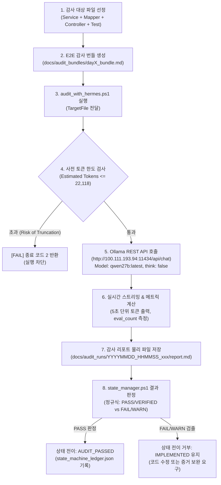

# Hermes 로컬 AI 감사 파이프라인 v1 아키텍처 및 실행 흐름 조사 보고서

## 1. 개요 및 조사 목적
본 보고서는 Kintai 프로젝트에서 운영 중인 **Hermes 로컬 AI 코드 감사 시스템(v1.1.1)**의 실제 물리적 구성 파일, 실행 스크립트, 상태 전이 게이트웨이, 데이터 흐름, 그리고 현재까지 누적된 Day 1부터 Day 9까지의 실행 로그를 전수 조사하여 현행 파이프라인의 강점과 결함 발생 지점을 객관적 사실(Fact)에 기반해 분석한 문서이다.

---

## 2. 현행 Hermes v1 핵심 구성요소 전수 조사 목록

| 구성요소 명칭 | 실제 파일 경로 | 버전/설정 | 담당 역할 및 기능 | 호출자 (Caller) / 피호출자 (Callee) |
|---|---|---|---|---|
| **메인 감사 실행 스크립트** | `C:\Users\klad3\.gemini\scripts\audit_with_hermes.ps1` | v1.1.1 | - Ollama REST API(`/api/chat`) 원격 호출 - 입력 토큰 수 추정 및 컨텍스트 한도(90%) 사전 방어 - 5초 스트리밍 하트비트 출력 - 실행 메트릭(소요시간, 속도, 토큰) 계산 및 리포트 저장 | **Caller**: 개발자/에이전트 수동 호출, `state_manager.ps1` **Callee**: 원격 Ollama 서버 (`http://100.111.193.94:11434`) |
| **상태 전이 관리자** | `c:\dev\kintai\scripts\state_manager.ps1` | v3.0 | - 6단계 엄격 상태 머신(`IMPLEMENTED` ➔ `TESTED` ➔ `AUDIT_PASSED` ➔ `USER_APPROVED` ➔ `COMMITTED` ➔ `PUSHED`) 관리 - 감사 결과 리포트 파싱(PASS/FAIL/WARN 탐지) - SHA-256 해시 검증 및 변조 방지 | **Caller**: 빌드/배포 스크립트, 에이전트 작업 파이프라인 **Callee**: `docs/state_machine_ledger.json`, 감사 리포트 파일 |
| **감사 설정 파일** | `c:\dev\kintai\scripts\audit_config.json` | v1.0 | - 로컬 Ollama 엔드포인트(`100.111.193.94:11434`) 지정 - 메인 모델(`qwen27b:latest`), 컨텍스트(`num_ctx: 24576`), `temperature: 0.1`, `think: false` 고정 - 폴백 엔드포인트(`127.0.0.1:11434`, `qwen2.5:7b`) 정의 | **Caller**: `audit_with_hermes.ps1`, `state_manager.ps1` |
| **설정 유효성 스키마** | `c:\dev\kintai\scripts\audit_config.schema.json` | Draft-07 | `audit_config.json`의 JSON 스키마 유효성 검증용 메타 규격 | **Caller**: 설정 검증 스크립트 |
| **4계층 판정 헌법** | `c:\dev\kintai\docs\constitution_4layer_specification.md` | v2.1 | - 계층 1(기본 원칙) ~ 계층 4(기술 증적서) 가이드라인 - 트랜잭션 격리, 일본 노동법 37조, 동시성 비관적 락 가이드 정의 | **Caller**: 감사관 프롬프트 빌더 |
| **감사 프롬프트 명세** | `c:\dev\kintai\docs\audit_prompt_spec.md` | v1.0 | - Hermes 시스템 프롬프트(영문 100% 강제, 역할 정의) - 마크다운 출력 포맷 템플릿 제공 | **Caller**: `audit_with_hermes.ps1` |
| **상태 전이 원장** | `c:\dev\kintai\docs\state_machine_ledger.json` | Runtime | 각 태스크/일차별 상태 전이 이력, 커밋 해시, 테스트 통과 증적, 감사 리포트 해시 보관 | **Caller**: `state_manager.ps1` |
| **감사 번들 저장소** | `c:\dev\kintai\docs\audit_bundles\` | Runtime | 검사 대상 Java/XML/SQL 파일들을 단일 E2E 마크다운 파일로 결합한 물리적 파일 | **Caller**: PowerShell 파이프라인 |
| **감사 리포트 원본** | `c:\dev\kintai\docs\audit_runs\` | Runtime | 로컬 Ollama가 생성한 원시 마크다운 감사 리포트 디렉터리 (타임스탬프 기반 명명) | **Caller**: `audit_with_hermes.ps1` |

---

## 3. 현행 실행 흐름 및 데이터 흐름도

---

## 4. 현행 v1 시스템의 핵심 취약점 및 실패 패턴 분석

### 4.1. Severity와 Verdict의 혼용 및 비표준화
- **현상**: 마크다운 테이블 컬럼에 `Severity`와 `Verdict`가 분리되어 있으나, 모델이 `Severity`에 `FAIL`을 넣거나 `Verdict`에 `P1`을 표기하는 환각이 간헐적으로 발생함.
- **원인**: 시스템 프롬프트 상에서 Enum 집합이 엄격히 폐쇄(Closed set)되어 있지 않고, 마크다운 표 파서가 정규식 기반 단순 문자열 매칭에 의존함.

### 4.2. 증거 부재 시 무조건 FAIL 부여 (False Positive)
- **현상**: 호출부 클래스만 감사 번들에 포함되고 피호출 유틸/서비스 클래스가 번들에서 제외된 경우, 모델이 구현이 없다고 단정하고 `P0 FAIL`을 발행함. (예: `PayrollExcelExporter` 감사 시 `PayrollService` 및 도메인 모델 계산식이 번들에 누락되자 계산 오류 위험이라며 FAIL 판정)
- **원인**: `NOT_VERIFIABLE` 또는 `OUT_OF_SCOPE` 상태가 헌법에 정의되지 않아, 모델이 "코드가 없으면 결함이다"라는 이분법적 사고로 판정함.

### 4.3. 보수적 사전 토큰 한도 검사로 인한 전수 검수 차단
- **현상**: `audit_with_hermes.ps1` 236행의 `($systemPrompt.Length + $userPromptText.Length) / 3.0` 추정 공식으로 인해, 실제 4개 파일 결합 시 문자 수가 70,000자를 초과하면 실제 토큰이 20,000 수준임에도 22,987로 과대 추정되어 90% 한도 초과 에러로 중단됨.

### 4.4. 일본 노동기준법 37조 가산율 및 경계값 환각
- **현상**: 심야시간(`22:00 ~ 05:00`)과 법정외 연장시간(1일 8시간 초과)이 동시에 겹치는 구간에 대해 기본 25% + 연장 25% = 50% 중복 가산이 정당함에도, 별도의 전용 필드(`nightOvertimeMinutes`)가 엔티티에 분리되어 있지 않다는 이유로 결함 판정.
- **원인**: 일본 노동법 행정해석(소정외 vs 법정외, 심야 가산 분리 산정 원리)에 대한 구체적 기준이 프롬프트에 명시되지 않음.

### 4.5. MySQL 8.4 기본 트랜잭션 격리 수준 오판
- **현상**: MySQL InnoDB의 기본 격리 수준은 `REPEATABLE READ`임에도 불구하고, PostgreSQL 표준인 `READ COMMITTED`로 가정하여 팬텀 리드나 비관적 락 범위를 잘못 지적함.

---

## 5. 결론 및 개정 방향
현행 Hermes v1은 27B 모델의 빠른 추론 속도(`51 tokens/s`)와 스트리밍 연동, 상태 머신 통제라는 훌륭한 골격을 갖추었으나, **결함 판정의 증거 기반 헌법 부재**와 **비구조화된 마크다운 파싱의 한계**로 인해 오판이 발생하고 있다. 따라서 **v2에서는 구조화된 JSON 스키마와 7대 엄격 FAIL 발급 조건, `NOT_VERIFIABLE` 상태의 공식 도입이 필수적**이다.
