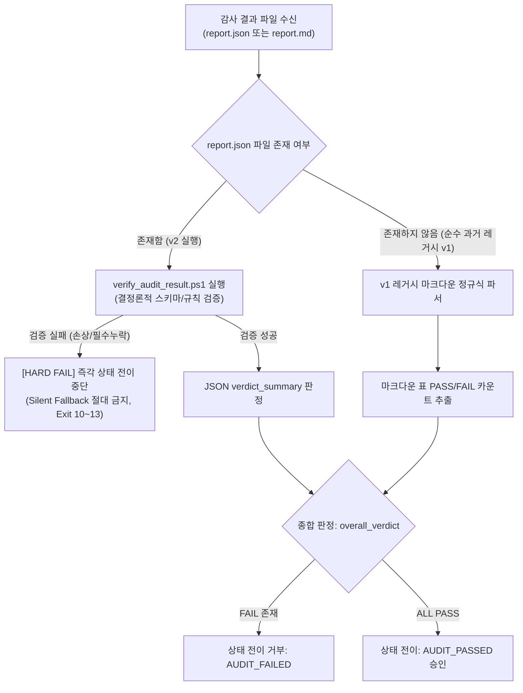

# Hermes v1 결과와 v2 간 호환성 및 마이그레이션 분석 보고서 (최종 개정본)

## 1. 개요
본 문서는 현행 Hermes v1 마크다운 형식의 결과 파일(`docs/audit_runs/*/report.md`)과 새롭게 정의된 v2 JSON 스키마 간의 데이터 필드 1:1 매핑 규칙, 과거 데이터(Day 1 ~ Day 9) 보존 및 변환 전략, 그리고 상태 관리자(`state_manager.ps1`)의 하위 호환성 유지 방안을 정의한다.

---

## 2. v1 마크다운 표 필드 ➔ v2 JSON 필드 1:1 매핑 규칙

| v1 마크다운 표 컬럼명 | v2 JSON 경로 | 매핑 규칙 및 정제 로직 | 비고 / 차이점 |
|---|---|---|---|
| `Finding ID` | `findings[].finding_id` | 정규식 `F-\d{3}` 추출. 누락 시 순차 번호 자동 부여 | v1에서는 때때로 `Finding 1`, `F-01` 등 비표준 표기가 있었으나 v2는 3자리 패딩 강제 |
| `Audit Item` | `findings[].title` 및 `findings[].category` | 텍스트 내용을 기반으로 7대 폐쇄 Enum 카테고리 자동 분류 | v1의 단순 텍스트를 카테고리 Enum과 상세 제목으로 분리 |
| `Severity` | `findings[].severity` | `P0`, `P1`, `P2`, `P3`, `INFO` 대문자 매핑. `High/Critical`은 P0/P1로 변환 | 유효하지 않은 값 입력 시 스키마 유효성 검사에서 차단 |
| `Verdict` | `findings[].verdict` | `PASS`, `FAIL`, `WARN`, `N/A`, `NOT_VERIFIABLE` 대문자 정규화 | v1에서 코드가 없어 FAIL이었던 건은 마이그레이션 시 `NOT_VERIFIABLE`로 재평가 |
| `Code & Test Evidence` | `findings[].evidence.code_snippet_or_proof` | 백틱 블록 코드 및 인용 텍스트 그대로 보존 | v2에서는 `expected_behavior`와 `actual_behavior` 필드로 상세 분해 |
| `Detailed Analysis & Recommendation` | `findings[].analysis.risk_evaluation` 및 `recommendation` | 분석 내용과 조치 권고 분리 매핑 | 법률 조항 언급(예: Article 37)은 `applicable_laws` 배열로 자동 추출 |
| (신설 필드) | `findings[].tracking_status` | 기본값 `OPEN` 부여 (해결 증적이 확인된 과거 건은 `VERIFIED_FIXED`) | v1에는 결함 추적 라이프사이클이 없었음 |

---

## 3. 과거 감사 로그(Day 1 ~ Day 9) 무수정 보존 및 마이그레이션 원칙
1. **[원본 불변성 절대 보장]**:
   - `docs/audit_runs/` 내에 이미 생성되어 있는 기존 v1 마크다운 실행 원본 파일은 **일체 수정하거나 덮어쓰지 않는다.**
2. **[사이드카 마이그레이션 방식]**:
   - v2 마이그레이션 스크립트를 통해 변환된 파일은 기존 디렉터리 내에 `report_v2.json`이라는 별도 사이드카 파일로 생성하여 나란히 보존한다.
   - 예: `docs/audit_runs/20261112_054459_PROMPT/report.md` (v1 원본 보존) + `report_v2.json` (변환 산출물).
3. **[원장(Ledger) 해시 체인 무결성 유지]**:
   - `docs/state_machine_ledger.json`에 기록된 기존 트랜잭션 해시는 v1 마크다운 파일의 해시이므로, 기존 기록을 변조하지 않고 v2 변환 이력은 새 이벤트 타입(`MIGRATED_TO_V2`)으로 추가 기록한다.

---

## 4. `state_manager.ps1` 하위 호환성 및 Silent Fallback 원천 차단 (Hard-Gate 전략)

> **[핵심 보안 규칙 (Hard-Gate Policy)]**:  
> 손상되거나 변조된 v2 JSON이 존재할 때 이를 레거시 마크다운 정규식 파서로 자동 대체(Silent Fallback)하는 행위를 전면 금지한다.  
> v2 JSON 검증에 실패하면 결함 은폐를 방어하기 위해 즉시 파이프라인을 `AUDIT_FAILED`로 중단(Hard Stop)해야 한다.

- **우선순위 및 격리 원칙**:
  1. `report.json`이 감지된 디렉터리는 오직 v2 검증기를 통해서만 승인될 수 있다.
  2. v2 JSON이 스키마를 위반하거나 문법 오류가 있을 경우, v1 파서로의 조용한 폴백을 엄격히 차단하고 즉시 오류를 반환한다.
  3. `report.md` 단독 파싱은 오직 `report.json`이 애초에 생성되지 않았던 과거 실행 디렉터리(Day 1 ~ Day 9 원본)를 조회할 때만 한정적으로 허용된다.

### v2 식별 보강
v2는 파일명이나 `report.json` 존재 여부로 식별하지 않는다. `audit_run.json`의 `result_format: HERMES_V2_JSON` 및 `result_schema_version`이 결과의 `schema_version`과 일치해야 한다. Provenance 불일치는 Exit 20으로 중단하며 상태는 `AUDIT_INCOMPLETE`다.
