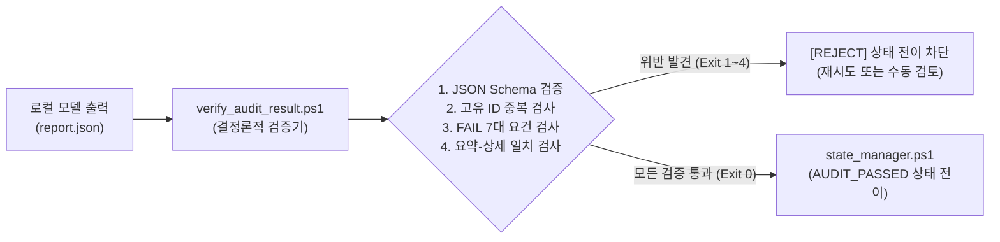

# 결정론적 결과 검증기(Deterministic Verifier) 아키텍처 및 구현 설계서

## 1. 개요 및 목적
LLM(로컬 27B 모델)이 생성한 감사 리포트는 텍스트 기반 출력이므로, 환각이나 형식 파괴, 스키마 불일치가 발생할 수 있다.
본 설계서는 LLM의 비결정론적(Non-Deterministic) 출력을 상태 관리자(`state_manager.ps1`)에 전달하기 전에, 엄격한 규칙 기반(Rule-based)으로 **100% 결정론적으로 필터링하고 검증하는 게이트키퍼 스크립트(`verify_audit_result.ps1`)**의 사양을 정의한다.

---

## 2. 검증기 아키텍처 및 파이프라인 위치



---

## 3. 검증기 4대 핵심 검증 파이프라인 (Verification Pipeline)

### 3.1. 제1파이프: JSON Schema 유효성 검사 (Syntax & Enum)
- `docs/hermes_v2_spec/03_result_schema_v2_draft.json` 규격에 대한 적합성 검사.
- `severity` 및 `verdict`가 허용된 폐쇄 집합에 속하는지 정밀 확인.
- 위반 시: `Exit Code 10 (SCHEMA_ERROR)`

### 3.2. 제2파이프: Finding ID 무결성 및 고유성 검사 (Uniqueness)
- 모든 `findings[].finding_id`가 `F-001`, `F-002` 등의 형식이며 리포트 내에서 유일한지 확인.
- 중복 발견 시: `Exit Code 11 (DUPLICATE_ID_ERROR)`

### 3.3. 제3파이프: FAIL 판정 7대 필수 성립 요건 강제 검사 (Proof Guard)
- 어떤 항목의 `verdict`가 `FAIL`인 경우:
  1. `location.file_path`가 실제 감사 번들 내 대상 파일 목록에 존재하는가?
  2. `evidence.code_snippet_or_proof`가 비어있지 않고 최소 20자 이상의 물리적 코드를 포함하는가?
  3. `evidence.expected_behavior`와 `evidence.actual_behavior`가 모두 작성되었는가?
  4. `reproduction_test_case` 또는 `counterexample_data`가 제공되었는가?
- 위 요건 중 하나라도 미흡한데 `FAIL`이 부여된 경우:
  - 검증기가 자동으로 해당 항목의 Verdict를 **`WARN` 또는 `NOT_VERIFIABLE`로 강제 다운그레이드**하거나 `Exit Code 12 (UNSUPPORTED_FAIL)`로 리포트를 거부함.

### 3.4. 제4파이프: 통계 정합성 및 요약 대조 검사 (Cross-Consistency)
- `verdict_summary.counts_by_verdict`의 합계가 `total_findings`와 일치하는가?
- `findings[]` 배열의 실제 개수와 일치하는가?
- 배열 내에 `FAIL`이 1개라도 있는데 `overall_verdict`가 `PASS`로 되어 있는 모순(Inconsistency)이 없는가?
- 위반 시: `Exit Code 13 (INCONSISTENCY_ERROR)`

---

## 4. 검증기 구현 설계 (PowerShell 명세)

### 4.1 구현 범위와 종료 코드
검증기는 완전한 Draft-07 엔진이 아니다. 현 v2 schema에서 사용하는 키워드만 지원하며, 미지원 키워드가 schema 어디에서든 발견되면 Exit 10으로 거부한다. Exit 10~13은 schema/duplicate/proof/consistency에 유지하고, Run ID·모델·bundle provenance 및 허용 bundle root 위반은 Exit 20 (`AUDIT_INCOMPLETE`)으로 분리한다.

```powershell
# docs/hermes_v2_spec/verify_audit_result_prototype.ps1
param(
    [Parameter(Mandatory=$true)]
    [string]$ResultJsonPath,
    [Parameter(Mandatory=$true)]
    [string]$SchemaJsonPath = "docs/hermes_v2_spec/03_result_schema_v2_draft.json"
)

[Console]::OutputEncoding = [System.Text.Encoding]::UTF8
$OutputEncoding = [System.Text.Encoding]::UTF8

Write-Host "[Verifier] Validating audit result: $ResultJsonPath against $SchemaJsonPath" -ForegroundColor Cyan

if (-not (Test-Path $ResultJsonPath)) {
    Write-Error "[FATAL] Result file not found: $ResultJsonPath"
    exit 1
}

$rawJson = [System.IO.File]::ReadAllText($ResultJsonPath, [System.Text.Encoding]::UTF8)
$auditObj = $null
try {
    $auditObj = $rawJson | ConvertFrom-Json
} catch {
    Write-Error "[FATAL] Invalid JSON format: $_"
    exit 10
}

# 1. 고유 ID 중복 검사
$idSet = @{}
foreach ($finding in $auditObj.findings) {
    if ($idSet.ContainsKey($finding.finding_id)) {
        Write-Error "[RULE-VIOLATION] Duplicate Finding ID detected: $($finding.finding_id)"
        exit 11
    }
    $idSet[$finding.finding_id] = $true
}

# 2. FAIL 7대 요건 및 증거 강제 검증
foreach ($finding in $auditObj.findings) {
    if ($finding.verdict -eq "FAIL") {
        if ([string]::IsNullOrWhiteSpace($finding.evidence.code_snippet_or_proof) -or
            [string]::IsNullOrWhiteSpace($finding.evidence.expected_behavior) -or
            [string]::IsNullOrWhiteSpace($finding.evidence.actual_behavior)) {
            Write-Error "[RULE-VIOLATION] Finding $($finding.finding_id) is marked as FAIL without required physical evidence!"
            exit 12
        }
    }
}

# 3. 요약 통계와 실제 배열 일치 검사
if ($auditObj.findings.Count -ne $auditObj.verdict_summary.total_findings) {
    Write-Error "[RULE-VIOLATION] Total findings count mismatch! (Summary: $($auditObj.verdict_summary.total_findings), Actual: $($auditObj.findings.Count))"
    exit 13
}

Write-Host "[Verifier] SUCCESS! Deterministic validation passed." -ForegroundColor Green
exit 0
```
