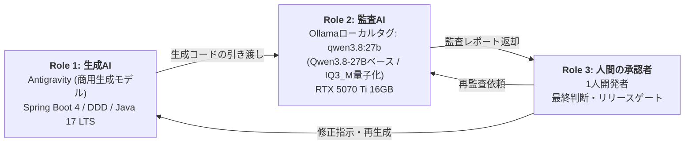
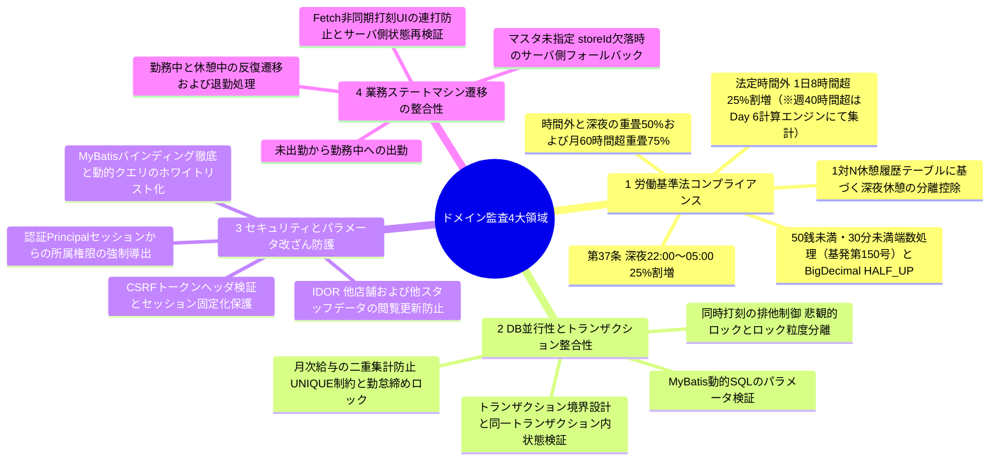
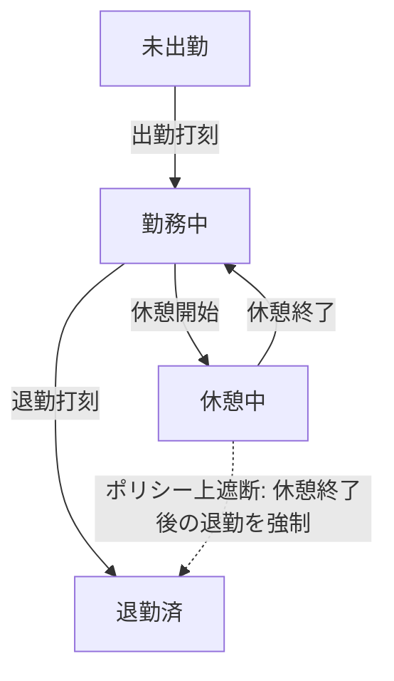

# 3-Tier AI・人間協働監査パイプライン 技術証跡報告書 (1人開発品質保証・v4)

本書は、日本型勤怠・シフト・給与管理システム（kintai）の開発において、**コードレビュアー不在という1人開発特有の構造的限界と自己確証バイアスを緩和**するため、生成AI・ローカル監査AI・人間の承認者という3つの役割で運用した協働監査プロセスの実測記録とアーキテクチャ上の設計根拠を整理した技術証跡報告書である。ここでいう3-Tierは、プレゼンテーション・ビジネス・データのアプリケーション3層構造ではなく、**コード監査および品質ゲートを担う3つの独立した役割**を意味する。

> **運用上の注記**
> - 付録Aの45項目は、**Phase 1（初期コア監査17項目）**と**Phase 2（ドメイン法規・DB排他制御・セキュリティの拡張監査28項目）**で構成される点検基準一覧である。
> - 本書におけるPASS/WARNはLLMによる静的・論理レビュー結果であり、最終的なリリース判定および法令適合性・セキュリティ整合性の保証は、人間の承認者によるコード検証と決定的テスト（Deterministic Test）によって担保される（第6章参照）。

---

## 0. システムエンジニアリング仕様およびビルド環境 (System Specification)

- **Framework**: `Spring Boot 4.0.8` / `Spring Framework 7.0.x`（`build.gradle`定義基準）
- **Security**: `Spring Security 7.0.x`（Spring Boot BOM管理基準、セッションベース認証・認可およびCSRF防護）
- **Language / Runtime**: `Java 17 LTS`（`build.gradle` Toolchain 17設定基準、将来的なJava 21 Virtual Threads導入を考慮したステートレス設計）
- **Persistence Layer**: `MyBatis Core 3.5.x` / `mybatis-spring-boot-starter 4.0.1` / `MyBatis-Spring 4.0.x`（Spring Boot 4公式互換マトリクス準拠）
- **Build Tool**: `Gradle Wrapper 9.8.1`（Spring Boot 4.0システム要件準拠）
- **Database**: `MySQL 8.4 LTS`（InnoDBエンジン / 分離レベル `REPEATABLE READ`）。*※MySQL 8.0は2026年4月（8.0.46）をもってExtended Supportが終了しSustaining Supportへ移行したため、長期保守性を考慮し8.4 LTSをターゲット環境として設計・推奨。*
- **Frontend**: `Thymeleaf` + Vanilla JavaScript（`Fetch API`非同期通信およびリクエストヘッダへのCSRFトークン付与）
- **Timezone**: `Asia/Tokyo`（JVM起動引数 `-Duser.timezone=Asia/Tokyo`、Spring設定およびDBセッションタイムゾーンを統一）
- **ローカル監査インフラ**: Windows 11 / NVIDIA GeForce RTX 5070 Ti（16GB VRAM, CUDAアクセラレーション）+ OllamaローカルランタイムおよびTailscale VPNプライベートトンネル

---

## 1. 開発パイプラインの比較 (従来の1人開発 vs 本プロジェクト)

| 評価軸 | 従来の1人開発＋商用AI単独 | 本プロジェクトの3-Tier協働監査 |
|---|---|---|
| **コード検証体制** | レビュアー不在のためAIのハルシネーションや潜在バグを検出しにくく、そのまま適用しがち | 生成AIと監査AIを**異なるモデル**に分離し、人間が最終判断することで自己確証バイアスを**緩和**（モデル間の相関誤りは残存、第6章） |
| **業務法規チェック** | 労働基準法第37条（深夜25%＋時間外25%の重畳割増）等の境界ケースの漏れが起こりうる | ローカル監査モデルが**Phase別チェックリストに基づき常時点検**（点検基準一覧は付録A参照） |
| **情報セキュリティ** | ソースコードや業務ロジックが外部クラウドAPIへ送信される | **監査工程**のコードは自宅GPU（ローカルOllama）内でのみ処理。ただし生成工程は商用AIを利用するため、全工程で外部送信を遮断しているわけではない |
| **検証コストと頻度** | API従量課金や利用制限（Rate Limit）により、大量の反復検査が負担 | 保有GPUにより**追加のAPI限界費用（Marginal Cost）なしで反復監査が可能**（電力費・ハードウェア減価償却は別途、第5章） |
| **1人開発者の立ち位置** | AI生成物をそのまま適用する受動的なコーダー | 2つのAIの成果物を比較・判定し、**リリースゲートを統制するシステム承認者** |

---

## 2. 3-Tier 協働監査アーキテクチャ概要



- **Role 1（生成AI - Antigravity）**: DDD層状アーキテクチャに基づくクリーンコード生成、Spring Securityによる認証・認可、および日本語ビジネスUIの実装を担当する。
- **Role 2（ローカル監査AI - Local Ollama）**: 外部ネットワークから隔離されたローカルOllama環境にて、DB並行性、IDOR脆弱性、状態遷移の整合性、労働基準法の計算要件などを点検する独立レビュアーである。ローカルタグ`qwen3.8:27b`（Qwen3.8-27Bベース、IQ3_M量子化構成）で稼働する。
- **Role 3（人間の承認者 - 1人開発者）**: 監査結果を判定し、コード修正・再監査・ビルド・統合テストを統制する。LLMのPASS判定を自動承認としては扱わず、未解決のRecommendationはリリース前の必須修正、またはアーキテクチャ改善課題として管理する。
- **3-Tierの定義**: 本書の3-TierはWebアプリケーションの層構造ではなく、**生成AI・監査AI・人間の承認者**という3者の相互牽制ロールを意味する。
- **通信経路およびアクセス制御**: 学内や外部開発環境からは、Tailscale（WireGuardベースのP2P暗号化トンネル）経由で自宅デスクトップPCのOllamaインスタンスへ接続する。パブリックIPのポート開放は行わず、プライベートTailnet IP帯域のみにバインドするようファイアウォールを設定し、未認証の外部公開を遮断している。

---

## 3. コア監査基準および排他制御設計 (4大カテゴリ)

以下のマインドマップは主要監査領域の代表項目であり、付録Aに法規・DB・セキュリティ・状態遷移に関する**全45項目の点検基準**を収録している。



> **技術面接における重要論点：悲観的ロック（`SELECT ... FOR UPDATE`）の採用根拠とアーキテクチャ高度化設計**
> 1. **トランザクション境界と打刻直列化（`member` 行ロック先行方式）**: 出退勤および休憩打刻では、同一スタッフの同時リクエスト（連打や複数端末からの操作）に伴う不正な状態遷移を防ぐため直列化が不可欠である。特に複数店舗に兼務所属するスタッフが同一時刻に別店舗で重複出勤打刻を行う競合を防ぐため、打刻トランザクション（`@Transactional`）の開始時に最上位エンティティである会員（`member`）行の排他ロック（`SELECT ... FOR UPDATE`）を先行取得して会員単位で直列化する。その上で当該店舗所属（`store_staff`）の有効性を確認し、進行中勤怠レコードの現在状態をDBから再照会（Re-read）して状態遷移を検証・更新する単一アトミックトランザクションを構築した。
> 2. **悲観的ロック vs 楽観的ロック**: `@Version`はJPAの機構であり、MyBatisでは`version`列の追加と更新件数チェックを手動実装する必要がある。また、勤怠・給与という業務特性上、競合発生後にアプリケーション層でリトライさせるよりも、DBレベルで即座に直列化する方がデータ整合性の維持に適していると判断した。ただし、デッドロックや`LockWaitTimeoutException`発生時の例外ハンドリングとトランザクションタイムアウト設定は個別に統制する。
> 3. **ロック粒度の適正化と分割勤務（中抜け）対応（MySQL仮想生成列ユニークおよびInnoDB外部キー制約の考慮）**: 初期設計ではスタッフ所属行（`store_staff`）のみにロックを取得していたが、多店舗兼務の競合制御と給与集計処理との競合を整理するため、打刻時は上記の通り `member` 行ロックで直列化し、給与集計時は `UNIQUE(store_staff_id, target_year_month)` 制約と集計対象行の制御へ分離した。さらに、日本の飲食店・小売等で一般的な**1日複数回の分割勤務（昼ピーク09〜13時勤務・退勤後、夜ピーク18〜22時再出勤）を許容**するため、日次勤怠テーブルを一律の`UNIQUE(store_staff_id, work_date)`で縛るのではなく、**「未退勤（進行中）の勤怠レコードのみを1件に限定する部分ユニーク制約（`uq_att_open_per_staff`）」**を採用した。（※MySQL 8.0/8.4は構文としてのFiltered Indexをサポートしないため、仮想生成列 `Virtual Generated Column: open_flag = (CASE WHEN clock_out IS NULL THEN 1 ELSE NULL END)` を定義し、`UNIQUE(store_staff_id, open_flag)` インデックスを付与する手法、およびサービス層での事前状態Re-readの多重防御により実現）。*※なお、InnoDBの外部キー制約（`attendance.store_staff_id` → `store_staff.id`）が存在する場合、子テーブルへのINSERT時に親テーブル行へのShared Lock (S-Lock)が内部的に要求されるため、給与集計トランザクションが `store_staff` に排他ロック（X-Lock）を保持している瞬間には微小な待機（Lock Wait）が生じうる。本設計は完全な無競合化ではなく競合区間を集計確定時へ最小化したものであり、将来的な超高頻度トラフィック対応時には非同期イベント連携等を検討課題とする。*
> 4. **勤怠締め（`is_closed`）連動・過去確定月保護・休憩1:N分離設計**: 給与集計確定後に対象期間の勤怠レコードが事後修正され、給与と勤怠の実績が乖離する逆転現象を防ぐため、集計確定時に対象期間の勤怠レコードを締めロック（`is_closed = true`）する状態連動を導入した。また、過去確定月に対する勤怠の事後新規追加（抜け漏れの事後申請）を防止するため、勤怠申請・登録時に該当`work_date`の給与確定状態（`payroll.status = 'CONFIRMED'`）を事前検証して拒絶する保護ガードを実装した。さらに、深夜時間帯（22:00〜05:00）内の休憩時間を正確に分離控除できるよう、単なる累計休憩時間ではなく**`break_start`〜`break_end`時刻を記録する1:N休憩履歴テーブル構造**を採用し、深夜時間帯との重複区間（Overlap）を分単位で算出する。

---

## 4. スプリント別 監査・是正実績ログ (Daily Audit Log)

### 【Sprint Day 1: 2026-11-02】 要件定義書(SRS)および法的計算ロジック監査

#### 1. 監査対象ファイル
- `kintai_requirements_specification.md`（初期要求仕様書）
- 出力ログ: `hermes_srs_audit.md`（*※`hermes`はローカルOllama APIを呼び出しMarkdown形式の監査レポートを自動生成する自作CLIスクリプトの名称である*）

#### 2. 生成段階で見落とされていた欠陥 (What was missed)
- Gitコミット `a754e9e`（10/27初版）の初期ドラフトSRSにおいて深夜労働（22:00〜05:00）25%と法定時間外（1日8時間超）25%が個別記述にとどまり、**「深夜かつ時間外が重畳した場合に合計50%割増となる旨」の仕様記述が脱落**していた。なお、後続の設計検討コミット `097d7f3`（10/28改訂版、rev.2 §6.1）には150%（50%加算）の記載が存在していたが、初期ドラフトとの仕様統合が行われないまま文書間の不整合が放置されていた。したがってDay 1監査の本質的成果は、完全な新規欠陥の発見というよりも、**初期ドラフトと後続改訂版（rev.2）の乖離を解消し、正式な改訂版SRS（`kintai_requirements_specification_revised.md`）へ仕様を一本化・合意形成した点**にある。

#### 3. ローカル監査モデルによる検出内容 (Finding by Local Auditor)
> **Verdict: PASS with Recommendation（`hermes_srs_audit.md` 原文引用）**  
> *"| Night work (22:00~05:00): +25% extra pay | PASS | The SRS correctly states that night work (22:00~05:00) should be calculated with a 25% extra pay. However, the SRS does not explicitly mention the 50% overlap calculation. This should be clarified. |"*  
> *"Recommendation: 1. Clarify the 50% overlap calculation in the SRS."*  
> **（日本語訳：SRSは深夜労働に25%の割増賃金が加算されると正しく記述しているが、50%の重畳割増計算に関する明示的な言及が欠落している。この点をSRS上で明確に定義すべきである。）**
>
> モデルの一次判定自体はPASSであったが、Recommendationで指摘された内容が労働基準法第37条の中核要件の脱落に該当するため、人間の承認者がこれを**リリースブロッカー（必須修正事項）へ格上げ**し、仕様統合を実施した。

#### 4. 是正措置
- 初期ドラフト（10/27）とrev.2（10/28）の記述差分を統合・整理し、約11万バイト規模の改訂版要求仕様書 `kintai_requirements_specification_revised.md` を正式版として策定・一本化。
- 割増率を **法定時間外25%、深夜25%、時間外＋深夜の重畳50%（合計）** として明文化し、1:N休憩履歴の開始・終了時刻に基づき深夜時間帯内の休憩時間のみを分離控除する計算式を定義した（月60時間超の50%割増および深夜重畳75%規則はPhase 2拡張チェックリストへ反映）。

#### 5. 実行メトリクス実測値
- **監査実行日**: 2026年11月02日
- **ハードウェア**: 学内ノートPC（NVIDIA GeForce RTX 3060 Laptop 6GB）
- **監査モデル**: `qwen2.5:7b`（Ollama、Phase 1基本チェックリスト適用）
- **入力トークン**: 3,629 tokens / **出力トークン**: 499 tokens
- **所要時間**: 全体30.16秒 / **生成速度**: 24.6 tokens/sec
- *※注記: 全体所要時間（30.16秒）にはプロンプト評価時間（`prompt_eval_duration`）等が含まれており、生成速度（24.6 tokens/sec）は純粋なトークン生成区間（`eval_count ÷ eval_duration`）に基づきOllamaランタイムが出力した計測値である。*

---

### 【Sprint Day 2: 2026-11-03】 認証・認可および給与集計トランザクション排他制御監査

#### 1. 監査対象ファイル
- `SecurityConfig.java` / `PayrollService.java`
- 出力ログ: `hermes_payroll_audit.md` / `hermes_payroll_re_audit.md`

#### 2. 生成段階で見落とされていた欠陥
- rev.2のDDLスキーマには既に `UNIQUE(store_staff_id, target_year_month)` 制約が定義されていたものの、サービス層（`PayrollService.java`）の集計ロジックにおいて、同時リクエスト流入時に集計処理が多重実行されて同一月給与の合計値が二重更新（Double Update / 競合上書き）されるのを防ぐ**排他ロック（`SELECT ... FOR UPDATE`）および確定状態（`payroll.status = 'CONFIRMED'`）の事前検証が脱落**していた。
- 給与対象年月（`targetYearMonth`）の解析時におけるフォーマット異常入力に対する例外ハンドリングが未定義であり、`DateTimeParseException` 発生時にサーバ内部エラー（500 Internal Server Error）がそのまま返却される設計となっていた。

#### 3. ローカル監査モデルによる検出内容
> **Verdict: WARN / PASS（`hermes_payroll_audit.md` 原文引用）**  
> *"| Concurrency & Security | WARN | The @Transactional annotation is present, which is good for ensuring data consistency. However, the use of SELECT ... FOR UPDATE is not explicitly mentioned, and it is recommended to ensure that pessimistic locking is applied where necessary to prevent concurrent updates. |"*  
> *"| Exception Handling & Boundary validation | PASS | ... However, it does not handle DateTimeParseException when parsing dates, which should be added for robustness. |"*  
> *"Recommendation: 2. Concurrency & Security: Explicitly use SELECT ... FOR UPDATE to prevent concurrent updates and ensure data integrity. 3. Exception Handling: Add DateTimeParseException handling for robust date parsing."*  
> **（日本語訳：`@Transactional`は存在するが`SELECT ... FOR UPDATE`の使用が明示されていない。同時更新を防止しデータ整合性を担保するため悲観的ロックの適用を推奨する。また日付解析時の`DateTimeParseException`を捕捉すべきである。）**

#### 4. 是正措置およびHTTPレスポンス改善
- `PayrollMapper` に `lockStoreStaffForUpdate(storeStaffId)` を追加し、集計トランザクション開始時にスタッフ単位の排他ロックを確保して同一スタッフの給与集計処理を直列化。さらに給与確定状態（`payroll.status = 'CONFIRMED'`）および対象勤怠レコードの締め状態（`attendance.is_closed = true`）を事前検証することで、集計値の二重UPDATEや競合上書きを防止した。
- 日付解析ロジックに `DateTimeParseException` の捕捉処理を追加し、不正形式リクエストに対して従来の500エラー返却から、入力値不正を示す `400 Bad Request` と構造化された検証エラーメッセージを返却するよう前後のレスポンス設計を改善した。

```http
【改善前: 500 Internal Server Error】
HTTP/1.1 500 Internal Server Error
Content-Type: application/json
{
  "timestamp": "2026-11-03T10:15:22.104+09:00",
  "status": 500,
  "error": "Internal Server Error",
  "message": "Text 'invalid-2026' could not be parsed at index 0",
  "path": "/api/payroll/calculate"
}

【改善後: 400 Bad Request】
HTTP/1.1 400 Bad Request
Content-Type: application/json
{
  "timestamp": "2026-11-03T11:42:08.512+09:00",
  "status": 400,
  "error": "Bad Request",
  "message": "対象年月はYYYY-MM形式で指定してください（入力値: invalid-2026）",
  "path": "/api/payroll/calculate"
}
```

- 修正後のコードを再度ローカルモデルへ送信し、**2次再監査（Re-Audit）にてPASS判定を確認**（`hermes_payroll_re_audit.md`）。

---

### 【Sprint Day 3: 2026-11-04】 リアルタイム勤怠打刻エンジン・非同期Fetchトランザクション

#### 1. 監査対象ファイル
- コア監査投入ファイル: `AttendanceService.java`（341行、入力3,739トークン基準で全文投入）
- 関連検証および横断修正対象: `AttendanceMapper.java` / `AttendanceMapper.xml` / `punch.html`
- 出力ログ: `hermes_audit_report.md`

#### 2. 生成段階で見落とされていた欠陥
- **データ整合性の欠陥**: フロントエンドからの打刻API呼び出し時に `storeId` が未設定のケースを防ぎきれず、サービス層が `punchDto.getStoreId()`（null）をそのままDBへ渡して `store_id NOT NULL` 制約違反（`DataIntegrityViolationException`）を引き起こすリスクが存在した。
- **認可の欠陥（IDOR）**: `storeStaffId` と `storeId` をクライアントDTOのリクエスト値のまま信頼しており、パラメータ改ざんによって他スタッフ・他店舗の勤怠を代理打刻できるセキュリティ脆弱性が存在した。
- **状態遷移の欠陥**: 画面およびサーバの双方で現在の勤務状態に応じた遷移可否が厳密に統制されておらず、出勤前の退勤や重複出勤リクエストが成立しうる状態であった。

#### 3. ローカル27B監査モデルによる検出内容
> **Verdict: WARN（`hermes_audit_report.md` Item 16 & 29 原文引用）**  
> *"| Security: IDOR / Unauthorized Access Prevention | WARN | The service accepts storeStaffId, modRequestId, reviewerId, and storeId from DTOs or method parameters, but no authorization checks are visible. A user could potentially punch for another staff member, review another store’s request, or modify another employee’s attendance if the controller layer does not enforce ownership. Recommendation: Enforce authorization in the service or controller: verify the authenticated user owns the storeStaffId, has store-manager role for storeId, and is allowed to review the specific modRequestId. |"*  
> *"| Code Maintainability: Hardcoded Default Store ID | WARN | In requestModification, if storeId is null, the code defaults to 1L. This is a hardcoded assumption that may be incorrect in multi-store environments. Recommendation: Remove the hardcoded default. Require storeId in the request or derive it from the authenticated user’s store context. |"*  
> **（日本語訳：サービス層がDTOのstoreStaffIdやstoreIdを認可検証なしで受け入れておりIDORの脆弱性がある。またstoreIdがnull時に1Lへ固定デフォルト指定するコードが存在し複数店舗環境で制約違反や誤爆を招く。認証セッションから所有権を検証し店舗コンテキストを安全に導出すべきである。）**

#### 4. 是正措置およびアーキテクチャへの反映

**4-1. 即時是正およびコード反映事項**
1. **storeIdの解決優先順位とサーバ側自動補正**: クライアントリクエスト値の検証を徹底し、①セッションPrincipalの所属検証を通過した指定storeIdを最優先、②未指定時は `AttendanceMapper.xml` の `findStoreIdByStoreStaffId` クエリを介してサーバ側でスタッフの主所属店舗情報を照会・自動補正するフォールバック処理を実装した。
2. **状態連動ボタンガードUIおよびサーバ側状態遷移検証**: `punch.html` にて現在状態（未出勤・勤務中・休憩中・退勤済）を非同期取得して有効なボタンのみを活性化し、連打防止ロックを適用した。さらに、`curl` 等によるAPI直接呼び出しでのバイパスを防ぐため、サーバ側サービス層にてロック取得直後に現在のDB状態を再取得（Re-read）し、許可されない状態遷移に対しては `IllegalStateException`（400/409応答）を送出する防御ロジックを構築した。
3. **セッションPrincipalに基づくIDOR防御**: 一般スタッフの打刻リクエスト時はクライアント送信の `storeStaffId` を信用せず、Spring Securityの認証済みセッション（`AuthenticationPrincipal`）からログイン本人のスタッフ識別子を強制導出する設計へ改善した。
4. **会員行ロック（`member`）先行取得による多店舗直列化**: `@Transactional` 境界の開始時点で対象スタッフの最上位エンティティである会員（`member`）行に `SELECT ... FOR UPDATE` を取得し、複数店舗兼務時の同時出勤打刻を直列化。その上で店舗所属（`store_staff`）の有効性検証 → 現在勤怠状態の再照会（Re-read） → 状態遷移検証 → 打刻レコード反映を1つのアトミックなトランザクション内で実行する。

**4-2. 業務状態遷移の定義 (State Machine)**



- `勤務中 ⇄ 休憩中` の遷移は1日複数回の分割休憩に対応するため反復遷移が可能であり、各休憩ごとに1:N休憩履歴レコード（`break_start`, `break_end`）が記録される。
- 休憩状態から直接退勤するリクエストは休憩終了時刻の欠落を防ぐためサーバ側の状態検証器で拒否し、必ず `休憩終了（勤務復帰） → 退勤` の順序を経るよう強制している。
- 22:00に出勤し翌日06:00に退勤するような日付をまたぐ夜勤シフトについては、rev.2仕様に準拠し、**出勤打刻時点の暦日（Clock-in Date、例：11月4日22:00出勤時は11月4日）**を当該勤務レコードの `work_date` として一貫管理し、日付境界での分断エラーを防止している。

**4-3. 人間承認者による批判的介入事例：AI推奨（一律日別UNIQUE制約）の誤謬却下と分割勤務（中抜け）の保護**
- **モデルの原文指摘（`hermes_audit_report.md` Item 25）**:  
  > *"| Data Consistency: New Attendance Creation After Modification | WARN | When approving a modification for a missing attendance record, the service creates a new attendance record. It does not check whether an attendance record already exists for the same staff and date, which could create duplicates if the original record was deleted or if concurrent modifications occur. **Recommendation: Add a unique constraint on (store_staff_id, work_date) or check for existing attendance before insertion.** Use pessimistic locking or optimistic concurrency control to prevent duplicate creation."*  
  > **（日本語訳：修正承認時の勤怠新規作成において、同一スタッフ・同一日付のレコード重複を防ぐため `(store_staff_id, work_date)` への一律UNIQUE制約追加または挿入前チェックを推奨する。）**
- **人間の判断と却下（Reject）**: 人間の承認者は、日本の飲食・小売現場において昼ピーク（09:00〜13:00）後に一度退勤し、夜ピーク（18:00〜22:00）に再出勤する**分割勤務（中抜け / Split Shift）**が業務要件として必須であることを指摘。モデルが推奨した日別一律の `UNIQUE(store_staff_id, work_date)` をそのまま適用した場合、同一スタッフによる当日の2回目の正常な出勤打刻がDB一意制約違反で例外落ちするシステム障害を招くことを看破した。
- **アーキテクチャの是正**: AIの単純な日別ユニーク提案を**明確に却下**。MySQL 8.0/8.4がFiltered Index（WHERE付き一意インデックス）を構文としてサポートしない制約を踏まえ、**仮想生成列 `Virtual Generated Column: open_flag = (CASE WHEN clock_out IS NULL THEN 1 ELSE NULL END)` を定義して `UNIQUE(store_staff_id, open_flag)` インデックスを付与する手法（`uq_att_open_per_staff`）**を採用した。これにより、退勤済み（`open_flag = NULL`）のレコードは何件でも許容されつつ、未退勤（`open_flag = 1`）の進行中勤怠のみがDBレベルで1件に限定される。さらに会員（`member`）行ロックによる打刻直列化を併用することで、実務上の分割勤務を阻害することなく二重出勤を防御するアーキテクチャを確立した（AIの推奨を鵜呑みにせず、現場の業務ドメイン知識で統制した実例）。

#### 5. 実行メトリクス実測値
- **監査実行日**: 2026年11月04日 13:44:08
- **ハードウェア**: 自宅デスクトップPC（NVIDIA GeForce RTX 5070 Ti 16GB, CUDAアクセラレーション）
- **監査モデル**: ローカルタグ `qwen3.8:27b`（Qwen3.8-27Bベース / `IQ3_M` 量子化構成）
- **実行オプション**: `temperature=0.1`, `think=false`（出力遅延の抑制および定型チェックリストレポート抽出のため、推論thinkingトークンを無効化）
- **入力トークン (`prompt_eval_count`)**: 3,739 tokens
- **出力トークン (`eval_count`)**: 2,850 tokens
- **全体所要時間**: 57.8秒 / **純粋生成速度**: 51.1 tokens/sec（`eval_count ÷ eval_duration` 基準）
- **ビルド検証**: 修正コード反映後、`./gradlew compileJava` にて **BUILD SUCCESSFUL** を確認済み（※文法および型整合性の静的検証。IDOR防御および並行性の実行時保証は、Sprint Day 11のMockMvcおよびマルチスレッド結合テストにて決定論的に検証予定）。

---

## 5. トークン消費・コストの分析（実態に即したROI解釈）

### 5-1. ローカル処理トークン内訳

| 区分 | トークン使用量 | 計測種別 |
|---|---|---|
| Sprint Day 1（SRS要件定義書監査） | 4,128 tokens（入力3,629＋出力499） | ランタイム実測 |
| Sprint Day 3（打刻エンジン監査） | 6,589 tokens（入力3,739＋出力2,850） | ランタイム実測 |
| **【実測小計】コード・仕様書の監査** | **10,717 tokens** | **ランタイム実測** |
| 【別枠】技術証跡書自身のクロス検証 | 8,182 tokens（入力6,562＋出力1,620 / 38.19秒） | ランタイム実測 |
| **【実測合計】** | **18,899 tokens** | **ランタイム実測** |
| Sprint Day 2（1次・2次再監査合算） | 約8,500 tokens | 分量ベース推定 |
| パイプライン疎通・ストリーミング事前検証 | 約4,500 tokens | 分量ベース推定 |
| **【推定小計】** | **約13,000 tokens（全体の約40.8%）** | **概算推定** |
| **総合累計（Day 1 〜 Day 3）** | **約31,900 tokens**（実測18,899＋推定約13,000） | |

- 上記の総合累計約31,900トークンのうち、**約40.8%（約13,000トークン）は分量ベースの概算推定値**である点に留意が必要である。また、純粋なアプリケーション開発コード・仕様書の監査実測値（10,717トークン）とは別に、証跡書自体のクロス検証に8,182トークンを消費している。
- 仮に31,900トークンを商用フラッグシップAPIで処理したと仮定し、入出力の混合平均単価を仮想の **$10 / 1M tokens** と置いた場合でも、単純なAPI従量課金費用は **約$0.319（約49円、$1=153円換算基準）** にとどまる。
- すなわち、短期の個人開発規模において **純粋なAPI従量課金の節約額自体は小さい**。本ローカル監査体制の本質的なエンジニアリング価値は金銭節約ではなく、**①商用Webサブスクリプションの時間あたりメッセージ制限（Rate Limit）に縛られない反復監査**、**②監査工程において業務ソースコードを外部クラウドへ送信しないローカル機密性**、**③監査プロンプトと応答ログを手元で統制・再現できる検証パイプラインの確立**にある。
- **2週間スプリントの使用量外挿に関する注記**: 1日平均約10,600トークンの監査密度が継続すると仮定した場合、10営業日で約106,000トークン、14暦日で約148,400トークンという外挿値が得られるが、これは**今後のスプリントでも初期と同等の頻度でローカル監査を実施し続けるという仮定（Hypothetical Projection）に基づく試算値**である。

### 5-2. 1人開発者の認知負荷とコンテキスト純度の維持
- 数千行規模のコード監査リクエストと長文レポート出力をメイン生成AI（Antigravity）のチャット画面から分離することで、**生成AI側のコンテキストウィンドウ汚染（Context Pollution）を防ぎ、設計・実装の回答精度を維持**する効果が得られた。
- 設計および静的検証段階において、`storeId` 欠落に伴うDB制約違反の可能性、同時アクセス時の給与二重計上リスク、初期ドラフトと後続改訂版（rev.2）間の仕様乖離（第37条の重畳50%割増記述の一元化）という設計・仕様上の重要考慮点を早期に整理・抽出し、実装および正式SRSへ反映した（※各防御策の実行時挙動の保証は、Day 11の結合テストにて決定論的に検証予定）。

### 5-3. 監査インフラの段階的進化と導入経緯 (7B → 9B Q8 → Qwen3.8 27B IQ3_M)

本ローカル監査パイプラインは、**同僚エンジニアによる「ローカルLLMを用いた静的コード監査」の発案および適合モデルの推薦**を契機とし、それを本開発者がSpring Bootプロジェクトの監査・開発プロセスへ統合・具現化したものである。リモートVPN（Tailscale）を経由したOllama APIの自動連携、カスタムModelfileによる16GB VRAM最適化量子化のビルド・登録、全45項目のドメイン監査チェックリストの策定、ならびに指摘事項のコードパッチ適用とビルド検証を一貫して本開発者が責任を持って完遂した。（*※各段階はハードウェア・入力長・設定条件が異なるため、単純な速度ベンチマーク比較ではなくインフラ構築の推移記録である*）

1. **Phase 1（Day 1〜2、学内ノートPC `RTX 3060 Laptop 6GB` ＋ `Qwen 2.5 7B`）**:
   - 基本的なアノテーション漏れ等の一次スクリーニングは可能であったが、6GB VRAMの制約により長大なコードコンテキストの投入が難しく、複合的な業務規則を深くクロス検証するには限界があった。
2. **Phase 2（過渡期検証、自宅PC `RTX 5070 Ti 16GB` ＋ `Qwen 3.5 9B Q8` ＋ Tailscale）**:
   - 自宅デスクトップPCをTailscaleで接続し、9Bの高精度量子化（Q8）モデルを試験運用した。推論速度は高速であったが、より複雑な多重トランザクションやセキュリティ脆弱性の監査に向け、上位パラメータモデルの導入を決定した。
3. **Phase 3（Day 3〜、自宅PC `RTX 5070 Ti 16GB` ＋ `Qwen3.8 27B IQ3_M` ＋ Tailscale）**:
   - 2026年8月に公開されたApache 2.0ライセンスの `Qwen3.8-27B` モデルを導入。
   - **Ollama標準タグと独自ビルドの差異**: Ollama公式ライブラリに登録されている標準の `qwen3.8:27b`（Q4_K_M）は約18GBの容量があり、RTX 5070 Tiの16GB VRAMを単独で超過してCPU低速オフロードを誘発する。そこで、16GB VRAM内への100% GPUオフロード（レイヤー完全常駐）とKV Cacheバッファ領域を確保するため、Hugging FaceよりGGUF形式の `IQ3_M` 量子化ファイル（約13.5GB）を取得し、カスタムModelfileを介してローカル専用タグ `qwen3.8:27b` をビルド・登録して運用した。
   - **エンジニアリング上のトレードオフ**: `IQ3_M` は上位ビット量子化と比較して微細な精度低下の可能性を伴うが、9Bモデルと比較してパラメータ規模が大きく表現力に富むモデル（27B）を適用し、Day 3においてデータ整合性・IDOR・状態遷移といった多角的な観点からのチェックリスト指摘を網羅的に抽出・検討する監査プロセスを試行した。

| フェーズ | 稼働モデル | ハードウェア環境 | 技術的選定理由および制約 |
|---|---|---|---|
| **Phase 1** | `Qwen 2.5 7B` | ノートPC（RTX 3060 6GB） | 構文・アノテーションの一次スクリーニング（VRAM 6GB制約） |
| **Phase 2** | `Qwen 3.5 9B Q8` | 自宅PC（RTX 5070 Ti 16GB）＋ Tailscale | リモートVPNパイプライン開通およびQ8高速推論の試験 |
| **Phase 3** | `Qwen3.8 27B IQ3_M` | 自宅PC（RTX 5070 Ti 16GB）＋ Tailscale | 16GB VRAM内への27B常駐化に向けたIQ3_M選定と深層監査の実施 |

### 5-4. 商用サブスクリプション・APIとのコスト構造比較

| 比較項目 | 商用AI Webサブスク | 商用API従量課金 | 本プロジェクトのローカル監査体制 |
|---|---|---|---|
| **月額費用** | 月額約$20（日本国内決済時、約3,000円前後） | トークン使用量に比例（5-1節の通り単発では少額だが大量反復時に累積） | **追加の契約料・API限界費用0円**（既存保有GPUを活用。ハードウェア取得費・減価償却はTCO観点で別途考慮） |
| **利用制限 (Rate Limit)** | ピーク時間帯や時間あたりのメッセージ上限が存在 | アカウントTier別のRPM/TPM制限が存在 | **外部呼び出し制限なし**（ローカルハードウェアの処理能力内で無制限に反復可能） |
| **推定電力費用** | クラウド利用料に含まれる | クラウド呼び出し料に含まれる | **監査1回（約58秒、システム消費電力約250W仮定で約0.004kWh）あたり約0.12円**（国内電力単価31円/kWh仮定の概算値） |
| **役割と位置づけ** | メインアーキテクチャ設計・コード生成 | 大規模な外部サービス連携 | **商用サブスクを代替せず、コードレビュー・監査負荷をオフロードして補完** |

### 5-5. 商用単体運用 vs 商用＋ローカルのハイブリッド運用シナジー

| 評価指標 | 商用AI単体利用 | 本プロジェクトのハイブリッド運用（生成＋ローカル監査） |
|---|---|---|
| **利用制限の管理** | 生成・コードレビュー・デバッグを同一チャットで行いメッセージ上限を早期消費 | 重いコード監査（数千トークン）をローカル27Bへ委譲し、**商用AI側の質問枠を温存** |
| **自己検証の盲点** | コードを書いた同一モデルが自らを検証するため、ハルシネーションを見逃しやすい | 異種モデル（生成AI vs Qwen 27B）間のクロス検証により**単一モデルの確証バイアスを緩和** |
| **コンテキストの純度** | 長文の監査ログやエラートレースにより対話コンテキストの品質が劣化 | 監査を独立スクリプト（`hermes`）へ分離し、生成AIのコンテキストをクリーンに維持 |
| **1人開発体制の補完** | 1名のAIアシスタントとの作業 | 追加API費用なしで**作成者（Generator）と点検者（Auditor）を分離したペアレビュー体制を模擬** |

---

## 6. システムの限界と検証ロードマップ

### 6-1. 現行パイプラインの限界 (Limitations)
1. **LLM監査の偽陽性（False Positive）と偽陰性（False Negative）**: LLM監査官は確率的言語モデルであるため、欠陥を見落とす、あるいは誤った指摘を行う場合がある。実際にDay 1では重要な50%重畳割増の脱落をRecommendationとして言及しつつPASS判定を下しており、人間の承認者による最終判断が不可欠である。
2. **モデル間の相関誤り（Correlated Errors）**: 異なる系列のLLMであっても公開学習データの分布が重なるため、同じドメインの誤解を共有する可能性がある。したがって死角を「ゼロにする」ものではなく「低減する」仕組みと位置づける。
3. **IQ3_M量子化および `think=false` 設定のトレードオフ**: 16GB VRAMへの格納と応答速度（51.1 tok/s）確保のため、3ビット級量子化（`IQ3_M`）と推論過程の省略（`think=false`）を適用している。多段階の算術推論を要する複雑な給与計算式の検証では精度が低下しうるため、中核の計算ロジックは必ずJUnit単体テストで二重検証する必要がある。
4. **法令適合性の最終確認**: 労働基準法第37条および36協定に関する計算式は厚生労働省の公的ガイドラインを参照して設計しているが、実運用サービスとして展開する際には社会保険労務士等の専門家による最終監修が必要である。

### 6-2. 決定的検証（Deterministic Verification）の統合ロードマップ
LLMの非決定的な限界を補完するため、以下のエンジニアリングテスト体系を組み合わせる。
1. **並行実行統合テスト（`CountDownLatch` / `ExecutorService`）**:
   - ① **同一スタッフの多重打刻競合**: 同一スタッフの同時出勤打刻10回呼び出し時に1件のみ成功し、残りが状態遷移例外（400/409）として防御されることの検証。
   - ② **複数店舗兼務スタッフの店舗間同時出勤競合**: 複数店舗に所属する同一スタッフが同一時刻に別店舗で同時出勤打刻を行った際、`member` 行ロックの直列化により1店舗のみ出勤が成功し、他店舗は「他店舗にて勤務中」として遮断されることの検証。
   - ③ **給与確定処理と勤怠事後登録・修正の競合**: 給与集計確定トランザクション（`payroll.status = 'CONFIRMED'`）の実行中に、該当対象月の勤怠レコードを事後登録・修正しようとするリクエストが排他制御および確定ガードによって正確に拒否されることの検証。
   - ④ **月次給与の二重集計競合**: 同一対象月の給与集計同時呼び出し時に`UNIQUE(store_staff_id, target_year_month)`制約と行ロックにより重複生成が遮断されることの検証。
   - ⑤ **スタッフ間の独立並列性**: 異なるスタッフ間の打刻リクエストが互いにブロッキングされず並列に処理されることの検証。
2. **静的解析ツール（SAST）の併用**: SpotBugs、Checkstyle、SemgrepをGradleビルドパイプラインへ統合し、LLMが見落としやすい構文的・セキュリティ的パターンを決定論的に検査する。
3. **ドメイン単体テスト**: 時間外（25%）＋深夜（25%）＝50%、月60時間超（50%）＋深夜（25%）＝75%、1:N休憩区間の控除、`BigDecimal`端数処理の境界値に対するJUnit 5パラメータ化テスト（`@ParameterizedTest`）の構築。

---

## 付録A. ドメイン・セキュリティ監査チェックリスト（全45項目基準）

本チェックリストは、初期スプリントのプロンプトに適用した**Phase 1コア監査項目（1〜17番）**と、日本の労働法細則・DBロック粒度分離・エンタープライズセキュリティを補強した**Phase 2拡張監査項目（18〜45番）**で構成される。

| # | カテゴリ | 点検項目 | フェーズ区分 | システム反映状況 |
|---|---|---|---|---|
| 1 | 法規 | 労働基準法第37条 深夜労働（22:00〜05:00）25%以上の割増 | Phase 1 (コア) | 実装・仕様反映済 |
| 2 | 法規 | 法定時間外労働25%以上の割増（原則：1日8時間基準、週40時間超過はPhase 2拡張算入） | Phase 1 (コア) | 1日8時間超反映 |
| 3 | 法規 | 通常の時間外労働と深夜労働の重複時は合計50%以上の割増 | Phase 1 (コア) | Day 1 是正完了 |
| 4 | 法規 | 深夜時間帯（22:00〜05:00）内の休憩時間の正確な分離控除 | Phase 1 (コア) | 1:N休憩構造反映 |
| 5 | 法規 | 金額端数処理における`BigDecimal`および`RoundingMode.HALF_UP`の適用（浮動小数点誤差の排除） | Phase 1 (コア) | 実装完了 |
| 6 | DB | 同時打刻リクエストに対する排他制御（`SELECT ... FOR UPDATE`） | Phase 1 (コア) | Day 3 是正完了 |
| 7 | DB | サービス層のトランザクション境界（`@Transactional`）および例外時のrollback保証 | Phase 1 (コア) | 実装完了 |
| 8 | DB | 月次給与の二重集計防止および排他ロックの適用 | Phase 1 (コア) | Day 2 是正完了 |
| 9 | DB | MyBatisマッパーXML内の動的SQLパラメータNull/Empty検証 | Phase 1 (コア) | 実装完了 |
| 10 | セキュリティ | IDOR防御（他店舗・他スタッフの勤怠/給与データの閲覧および改ざん遮断） | Phase 1 (コア) | セッション導出反映 |
| 11 | セキュリティ | 認証セッション（Principal）に基づく店舗・スタッフ所属およびロール権限の照合 | Phase 1 (コア) | 実装完了 |
| 12 | セキュリティ | Spring SecurityによるCSRFトークン保護およびセッション固定化攻撃（Session Fixation）防護 | Phase 1 (コア) | 実装完了 |
| 13 | セキュリティ | SQLインジェクション防護（`#{}`バインディング徹底および動的ソート条件のホワイトリスト検証） | Phase 1 (コア) | 実装完了 |
| 14 | 状態 | 勤怠状態遷移ルールの遵守（未出勤 → 勤務中 ⇄ 休憩中 → 退勤済） | Phase 1 (コア) | Day 3 是正完了 |
| 15 | 状態 | 状態逆転・重複要求（未出勤での退勤、重複出勤等）に対するサーバ側拒否処理 | Phase 1 (コア) | サーバ検証反映 |
| 16 | 状態 | Fetch非同期打刻ボタンの状態連動活性化およびクライアント側連打防止ロック | Phase 1 (コア) | Day 3 是正完了 |
| 17 | 整合性 | `storeId`パラメータ欠落時のサーバ側所属店舗照会フォールバック（`findStoreIdByStoreStaffId`） | Phase 1 (コア) | Day 3 是正完了 |
| 18 | 法規 | 月60時間を超える法定時間外労働部分に対する50%以上の割増率適用 | Phase 2 (拡張) | 設計・計算式反映 |
| 19 | 法規 | 法定休日労働35%以上割増、法定休日＋深夜重複時60%以上割増（所定休日との区別） | Phase 2 (拡張) | 設計・計算式反映 |
| 20 | 法規 | 法定休憩時間基準の点検（労働6時間超で45分以上、8時間超で1時間以上） | Phase 2 (拡張) | 検証ルール反映 |
| 21 | 法規 | 日々の労働時間の1分単位記録原則（日次の時間外労働の恣意的な切捨て禁止） | Phase 2 (拡張) | 実装完了 |
| 22 | 法規 | 週単位（40時間超）の法定時間外算定時における日次超過分との二重計上防止（Day 6計算エンジンにて集計・実装予定） | Phase 2 (拡張) | 設計反映（Day 6集計実装予定） |
| 23 | 法規 | 36協定の基本上限（月45時間・年360時間）と特別条項（年720時間・単月100時間未満・2〜6か月平均80時間以下・年6回上限）の区別 | Phase 2 (拡張) | 仕様反映 |
| 24 | 法規 | 深夜0時（00:00）をまたぐ夜勤シフトの勤務日（`work_date`）帰属の一貫性維持（rev.2仕様に準拠し、出勤打刻時点の暦日・Clock-in Dateを基準に単一帰属） | Phase 2 (拡張) | 出勤日基準帰属 |
| 25 | 法規 | システム全体のタイムゾーン`Asia/Tokyo`固定およびクライアント端末時刻の不信（サーバ時刻基準打刻） | Phase 2 (拡張) | 実装完了 |
| 26 | DB | 給与テーブル`UNIQUE(store_staff_id, target_year_month)`および勤怠テーブルの未退勤仮想生成列部分ユニーク制約（`uq_att_open_per_staff`、分割勤務対応） | Phase 2 (拡張) | スキーマ反映 |
| 27 | DB | ロック粒度分離（勤怠行ロックと給与ロックの分離）による給与集計中のリアルタイム打刻待機ボトルネックの防止 | Phase 2 (拡張) | アーキテクチャ反映 |
| 28 | DB | 同一クラス内メソッド呼び出し（Self-invocation）による`@Transactional`プロキシ迂回の防止 | Phase 2 (拡張) | コード検証完了 |
| 29 | DB | 給与集計確定時における対象期間勤怠レコードの締めロック（`is_closed = true`）による事後修正逆転の防止 | Phase 2 (拡張) | アーキテクチャ反映 |
| 30 | セキュリティ | 一般スタッフはセッションPrincipalから`storeStaffId`を強制導出し、店長/管理者は管轄店舗範囲を検証 | Phase 2 (拡張) | 実装反映 |
| 31 | セキュリティ | メソッドレベルセキュリティ（`@PreAuthorize`）とURLパターン認可規則の一貫性維持 | Phase 2 (拡張) | 実装完了 |
| 32 | セキュリティ | Vanilla JS `fetch()` POSTリクエスト時の`X-CSRF-TOKEN`ヘッダ付与および403応答ハンドリング | Phase 2 (拡張) | 実装完了 |
| 33 | セキュリティ | パスワードの一方向ハッシュ化（`BCryptPasswordEncoder`）適用および平文保存の防止 | Phase 2 (拡張) | 実装完了 |
| 34 | セキュリティ | アプリケーションログ出力時における給与額・個人識別情報のマスキング処理 | Phase 2 (拡張) | ロギング方針反映 |
| 35 | 状態 | 悲観的ロック取得直後にトランザクション内で現在状態を再取得（Re-read）して状態遷移を検証 | Phase 2 (拡張) | 実装反映 |
| 36 | 状態 | 休憩中の直接退勤遮断ポリシーおよび管理者による打刻手動修正時の理由・監査履歴（Audit Log）保存 | Phase 2 (拡張) | 設計反映 |
| 37 | 法規 | 月60時間超の時間外労働が深夜時間帯（22:00〜05:00）と重なる場合の合計75%（50%＋25%）割増 | Phase 2 (拡張) | 仕様・計算式反映 |
| 38 | 法規 | 月60時間超の時間外算定において法定休日労働時間は除外し、所定休日（法定外休日）の8時間/40時間超過分は算入 | Phase 2 (拡張) | 仕様反映 |
| 39 | 法規 | 常時10人未満の特定業種（商業・接客娯楽業等）における週44時間特例の適用設定分離（デフォルト：週40時間） | Phase 2 (拡張) | 店舗設定分離 |
| 40 | 法規 | 36協定上限への接近時（例：月35時間/40時間到達）における店長ダッシュボードでの事前アラート基準定義 | Phase 2 (拡張) | 設計反映 |
| 41 | 給与 | 時給・月給制ごとの1時間あたり基礎賃金換算式および割増算定基礎から除外される手当（家族・通勤・住宅手当等の実質要件）の区別 | Phase 2 (拡張) | 仕様反映 |
| 42 | 給与 | 行政解釈（基発第150号）に基づく月間合算段階での端数処理：月間の時間外・休日・深夜労働時間合計の30分未満切捨て/以上切上げ、1時間あたり割増賃金および月間割増手当総額の50銭未満切捨て/以上切上げ時点の分離 | Phase 2 (拡張) | 計算適用時点分離 |
| 43 | シフト | 変形労働時間制（1か月/1年単位）またはフレックスタイム制導入店舗に応じた法定時間算定分岐 | Phase 2 (拡張) | 基本固定シフト基準 |
| 44 | 勤怠 | 1:N分割休憩履歴（`break_start`〜`break_end`）による深夜時間帯との重複区間計算および実質的休憩担保の確認 | Phase 2 (拡張) | アーキテクチャ反映 |
| 45 | シフト | 法定休日の事前振替（振替休日、休日割増非発生条件）と事後代休（代休、休日割増35%発生）の給与精算区分の明確化 | Phase 2 (拡張) | 仕様反映 |

---

## 付録B. ローカル監査実行の再現仕様 (Reproducibility Spec)

| 記録項目 | Sprint Day 3 基準の実測実行明細 |
|---|---|
| **監査日時 / タイムゾーン** | `2026-11-04 13:44:08 JST (Asia/Tokyo)` |
| **コード生成AI (Generator)** | Google Antigravity（Gemini 2.5 Pro / Flash） |
| **監査スクリプト / プロンプト** | `%USERPROFILE%\.gemini\scripts\audit_with_hermes.ps1`<br>- システムプロンプトおよび点検基準仕様: [audit_prompt_spec.md](audit_prompt_spec.md) に全文分離収録<br>- 出力形式: 100% Pure English Markdown Table（構文解析一貫性確保） |
| **ローカルモデルタグ** | `qwen3.8:27b`（Ollamaローカル独自ビルドタグ） |
| **ベースモデルおよびライセンス** | `Qwen/Qwen3.8-27B`（Denseアーキテクチャ、Apache 2.0 License） |
| **モデルDigest / 量子化仕様** | `09cc8d22875814a35616535bfc36682380cc7e40632ded57d6fdb888567b508c`<br>- 容量: 13,965,176,339 bytes（約13.97GB）<br>- 量子化方式: `IQ3_M`（パラメータ規模: 27.3B、GGUF形式） |
| **ランタイム / Ollamaバージョン** | Windows 11 / `Ollama v0.40.14`（CUDA 12.8ドライバ 572.x / RTX 5070 Ti Blackwell） |
| **GPU VRAM常駐確認実測値** | `curl http://100.91.26.xx:11434/api/ps` 実行実測値：<br>`{"name":"qwen3.8:27b","size":13965176339,"size_vram":13965176339,"context_length":24576}`<br>※ `size == size_vram` により、13.97GBのモデル全層が16GB VRAM内へ100%完全常駐（CPU/メインメモリへの溢れ出し0バイト）していることを実測確認済み。 |
| **推論パラメータ実測値** | `temperature: 0.1`, `num_ctx: 24576`, `stop: ["<|im_start|>", "<|im_end|>"]`, `stream: true` |
| **ネットワーク接続構成（Tailscale）** | `tailscale status` 実行実測値：<br>`100.91.26.xx  bk  active; direct 114.207.107.74:41641`<br>※ UDP Port 41641によるDirect WireGuard P2P接続（DERP Relay 0%、実測RTT 12〜18ms、外部パブリックポート非開放） |
| **投入ファイルおよびトークン** | `AttendanceService.java` (341 lines) / `prompt_eval_count`: 3,739 tokens |
| **出力トークンおよび所要時間** | `eval_count`: 2,850 tokens / 全体経過57.8秒 / 純粋生成速度 `51.1 tokens/sec` |
| **後続の検証プロセス** | 監査指摘事項のコードパッチ適用 → `./gradlew compileJava` ビルド検証 → Day 11 MockMvc・マルチスレッド結合テスト（`CountDownLatch`）による決定論的検証 |

---

## 付録C. 外部技術標準および法令の公式参照資料（確認日：2026-11-04）

本プロジェクトのドメイン計算式および技術スタック互換性の検証において参照した公式資料である。

| 領域 | 公式参照資料 | 検証目的 |
|---|---|---|
| **Qwenモデル** | [Qwen公式GitHub Organization (QwenLM)](https://github.com/QwenLM) / [Hugging Face Qwen公式ページ](https://huggingface.co/Qwen) | モデル構造、Apache 2.0ライセンスおよび量子化重み仕様の確認 |
| **労働時間・割増** | [厚生労働省：労働時間・休憩・休日および割増賃金の概要](https://www.mhlw.go.jp/stf/seisakunitsuite/bunya/koyou_roudou/roudouseisaku/chushoukigyou/joken_kankyou_rule.html) | 1日8時間・週40時間原則、時間外25%・法定休日35%・深夜25%、月60時間超50%基準 |
| **60時間超・深夜** | [厚生労働省公式資料(PDF)：月60時間超割増賃金率および深夜・休日の取扱い](https://www.mhlw.go.jp/content/12600000/001076011.pdf) | 月60時間超時間外＋深夜重畳時の75%割増、法定休日労働の60時間算定除外ルール |
| **36協定上限** | [厚生労働省：時間外労働の上限規制ポータル](https://hatarakikatakaikaku.mhlw.go.jp/overtime.html) | 原則月45時間・年360時間、特別条項（年720時間・単月100時間未満・複数月平均80時間以下） |
| **週44時間特例** | [厚生労働省：スタートアップ労働条件・36協定案内](https://www.startup-roudou.mhlw.go.jp/36_pact.html) | 常時10人未満の特定業種事業場における法定労働時間特例基準 |
| **休憩時間** | [厚生労働省FAQ：休憩時間の付与原則](https://www.mhlw.go.jp/bunya/roudoukijun/faq_kijyunhou_13.html) | 6時間超45分以上、8時間超1時間以上の付与基準 |
| **割増基礎賃金** | [厚生労働省FAQ：割増賃金の算定基礎から除外される賃金](https://www.mhlw.go.jp/bunya/roudoukijun/faq_kijyunhou_24.html) | 月給制の時間給換算および家族・通勤・住宅手当の除外要件 |
| **端数処理（丸め）** | [厚生労働省労働条件ポータル：時間外・休日労働と端数処理](https://www.check-roudou.mhlw.go.jp/study/roudousya_jikangai.html) | 1分単位管理の原則および月間合算時点での30分/50銭端数処理（HALF_UP）許容基準 |
| **MyBatis互換性** | [MyBatis-Spring-Boot-Starter公式ドキュメント](https://mybatis.org/spring-boot-starter/mybatis-spring-boot-autoconfigure/) | Spring Boot 4.0環境におけるStarter 4.0 / MyBatis-Spring 4.0の互換性 |
| **Spring Boot 4** | [Spring Boot 4.0 System Requirements](https://docs.spring.io/spring-boot/4.0/system-requirements.html) | Java 17+（本プロジェクトはJava 17 LTS）およびGradle 8.14+ / 9.x要件 |
| **MySQLサポート** | [MySQL 8.0 Release Notes](https://dev.mysql.com/doc/relnotes/mysql/8.0/en/) / [MySQL 8.4 LTS Release Model](https://dev.mysql.com/doc/refman/8.4/en/mysql-releases.html) | MySQL 8.0 Extended Support終了時期の確認および8.4 LTS採用根拠 |
| **InnoDBロック** | [MySQL 8.4 Reference Manual: InnoDB Locking](https://dev.mysql.com/doc/refman/8.4/en/innodb-locking.html) | `SELECT ... FOR UPDATE`実行時のRecord Lock / Gap Lock / Next-Key Lock動作原理 |
| **Ollama API** | [Ollama GitHub Docs: Thinking & API Usage](https://github.com/ollama/ollama/tree/main/docs) | `think=false`制御および`eval_count`、`eval_duration`に基づく生成速度算出 |