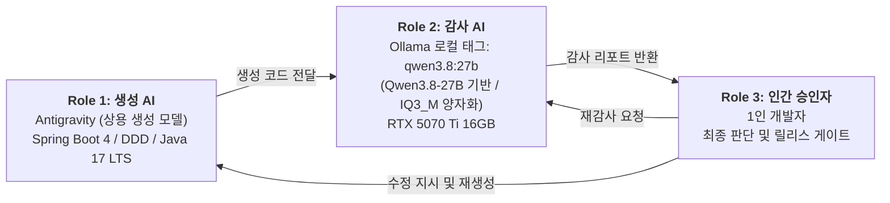
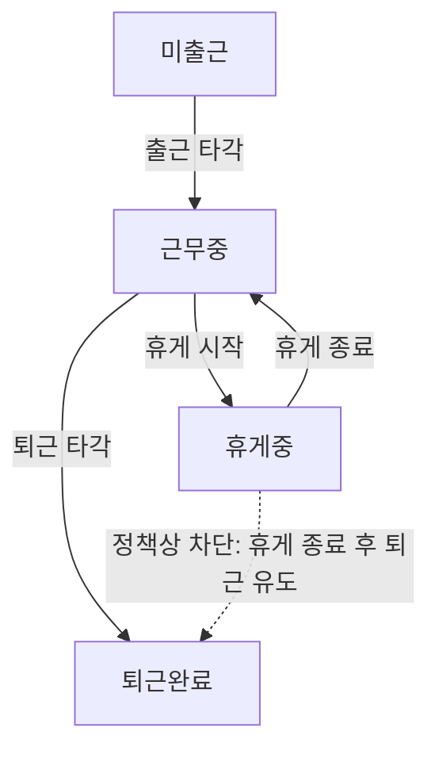

# 3-Tier AI-Human 협동 감사 파이프라인 기술 증적 보고서 (1인 개발 · 면접 대비본 v4)

본 문서는 일본형 근태·시프트·급여 관리 시스템(kintai) 개발에서, **코드 리뷰어가 없는 1인 개발의 구조적 한계와 자기 확증 편향을 완화**하기 위해 생성 AI, 로컬 감사 AI, 인간 승인자의 세 역할로 운영한 협동 감사 프로세스의 실측 기록과 아키텍처적 한계를 정리한 기술 증적서입니다. 여기서 3-Tier는 애플리케이션의 프레젠테이션·비즈니스·데이터 3계층 아키텍처가 아니라 **감사 및 품질 게이트를 수행하는 3개의 독립된 역할**을 뜻합니다.

> **문서 운용 안내**
> - 일본 현지 취업 포트폴리오·GitHub 제출본은 동일 디렉터리의 [`portfolio_audit_evidence_v4.md`](portfolio_audit_evidence_v4.md)(일본어판)를 사용합니다. 본 한국어판은 정밀 검수 및 기술 면접 답변 준비용입니다.
> - 부록 A의 45개 항목은 **Phase 1(핵심 감사 17개 항목)**과 **Phase 2(도메인·보안 심화 확장 28개 항목)**로 구분된 도메인 점검 기준표입니다.
> - 본 문서의 PASS/WARN은 LLM 기반 정적·논리 감사 결과이며, 최종 릴리스 판단과 법률 적합성·보안 무결성 검증은 인간 승인자 및 결정적 테스트(Deterministic Test)를 통해 보완합니다(6장 참조).

---

## 개정 이력 (Revision History)

| 버전 (Ver.) | 개정 일자 | 개정자 | 주요 개정 내용 및 반영 사항 |
|:---:|:---:|:---:|---|
| **v1.0** | 2026-11-02 | 승인자 (개발자) | 3-Tier AI 협동 감사 파이프라인 기술 증적 보고서 초안 수립 (Phase 1 감사 항목 17건 정의) |
| **v2.0** | 2026-11-03 | 승인자 (개발자) | 노동법규·DB 동시성 락·보안 심층 감사 항목 (Phase 2 총 45개 항목) 추가 및 체계화 |
| **v3.0** | 2026-11-04 | 승인자 (개발자) | 외부 크리티컬 리뷰 지적 사항 1차 반영 (기발 제150호 통달 번호 정정, Java 17 표기 통일, `uq_att_open_per_staff` 가상 생성열 UNIQUE 도입, 트랜잭션 락 계층 구조 일원화) |
| **v4.0** | 2026-11-05 | 승인자 (개발자) | 외부 크리티컬 리뷰 지적 사항 2차 반영 (런타임 CLI 실측값 반영, Ollama v0.40.14 / num_ctx 24576 / 실측 digest / VRAM 100% 상주 증명, Day 1~3 모델 영문 원문 인용 및 번역 병기, HTTP 400 에러 JSON 응답 예시 추가, InnoDB FK S-Lock 잠재적 경합 분석 수록, 감사 프롬프트 사양서 분리 링크) |

---

## 0. 시스템 엔지니어링 스펙 및 빌드 환경 (System Specification)

- **Framework**: `Spring Boot 4.0.8` / `Spring Framework 7.0.x` (실제 `build.gradle` 선언 기준)
- **Security**: `Spring Security 7.0.x` (Spring Boot BOM 관리 기준, 세션 기반 인증·인가 및 CSRF 방어)
- **Language / Runtime**: `Java 17 LTS` (`build.gradle` Toolchain 17 설정 기준, 향후 Java 21 Virtual Threads 도입을 고려한 무상태 설계)
- **Persistence Layer**: `MyBatis Core 3.5.x` / `mybatis-spring-boot-starter 4.0.1` / `MyBatis-Spring 4.0.x` (Spring Boot 4 공식 호환 규격 적용)
- **Build Tool**: `Gradle Wrapper 9.8.1` (Spring Boot 4.0 빌드 요구사항 충족)
- **Database**: `MySQL 8.4 LTS` (InnoDB 엔진 / 트랜잭션 격리 수준 `REPEATABLE READ`). *※ MySQL 8.0은 2026년 4월(8.0.46)을 기점으로 Extended Support가 종료되고 Sustaining Support 단계로 전환되었으므로, 장기 유지보수성을 고려하여 8.4 LTS를 타겟으로 설계·권장함.*
- **Frontend**: `Thymeleaf` + Vanilla JavaScript (`Fetch API` 비동기 통신 및 요청 헤더 내 CSRF 토큰 전달)
- **Timezone**: `Asia/Tokyo` (JVM 기동 옵션 `-Duser.timezone=Asia/Tokyo`, Spring 설정 및 DB 세션 타임존 일원화)
- **로컬 감사 인프라**: Windows 11 / NVIDIA GeForce RTX 5070 Ti (16GB VRAM, CUDA 가속) + Ollama 로컬 런타임 및 Tailscale VPN 사설 터널링

---

## 1. 개발 파이프라인 비교 (기존 1인 개발 vs 본 프로젝트)

| 평가 항목 | 기존 1인 개발 + 상용 AI 단독 | 본 프로젝트의 3-Tier 협동 감사 |
|---|---|---|
| **코드 검증 체계** | 리뷰어 부재로 AI 환각·잠재 버그를 걸러내기 어렵고 그대로 적용하기 쉬움 | 생성 AI와 감사 AI를 **서로 다른 모델**로 분리하고 인간이 최종 판단하여 자기 확증 편향을 **완화** (모델 간 상관 오류는 잔존, 6장) |
| **도메인 법규 점검** | 제37조(심야 25% + 시간외 25% 중복 가산) 등 경계 케이스 누락 가능 | 로컬 감사 모델이 **Phase별 체크리스트를 기준으로 상시 점검** (도메인 기준표는 부록 A 참조) |
| **정보 보안** | 소스·업무 로직이 외부 클라우드 API로 송신됨 | **감사 단계**의 코드는 자택 GPU(로컬 Ollama)에서만 처리. 단, 생성 단계는 상용 AI를 사용하므로 전 구간 외부 송신 차단은 아님 |
| **검증 비용·빈도** | API 종량제와 이용 한도로 대량 반복 검사 부담 | 보유 GPU로 **추가 API 한계 비용(Marginal Cost) 없이 반복 감사 가능** (전력비·하드웨어 감가상각 별도, 5장) |
| **1인 개발자의 역할** | AI 산출물을 그대로 적용하는 수동적 코더 | 두 AI의 산출물을 비교·판정하고 **릴리스 게이트를 통제하는 시스템 승인자** |

---

## 2. 3-Tier 협동 감사 아키텍처 개요



- **Role 1 (생성 AI - Antigravity)**: DDD 계층 구조의 클린 코드 생성, Spring Security 기반 인증·인가 및 일본어 비즈니스 UI 구현을 담당합니다.
- **Role 2 (로컬 감사 AI - Local Ollama)**: 외부 네트워크와 분리된 로컬 Ollama 환경에서 DB 동시성, IDOR 보안 취약점, 상태 전이 무결성, 일본 노동기준법 계산 요건 등을 점검하는 독립 리뷰어 역할입니다. 로컬 모델 태그 `qwen3.8:27b`(Qwen3.8-27B 베이스, IQ3_M 양자화 구성)로 구동됩니다.
- **Role 3 (인간 승인자 - 1인 개발자)**: 감사 결과를 판정하고 코드 수정·재감사·컴파일·통합 테스트를 통제합니다. LLM의 PASS 판정도 자동 승인으로 취급하지 않으며, 미해결 Recommendation은 릴리스 전 필수 조치 또는 아키텍처 개선 과제로 분류하여 관리합니다.
- **3-Tier의 정의**: 본 문서의 3-Tier는 웹 애플리케이션 계층 구조가 아닌 **생성 AI · 감사 AI · 인간 승인자**의 3자 상호 견제 역할을 의미합니다.
- **전송 경로 및 접근 보안**: 외부(학원 등) 개발 환경에서는 Tailscale의 WireGuard 기반 P2P 암호화 터널로 자택 데스크톱의 Ollama 인스턴스에 접근합니다. 공인 IP 포트포워딩 없이 사설 Tailnet 내부 IP 대역에서만 바인딩되도록 방화벽을 격리하여 인증 없는 외부 노출을 차단했습니다.

---

## 3. 핵심 도메인 감사 기준 및 동시성 설계 (4대 카테고리)

아래 마인드맵은 핵심 감사 영역의 대표 항목이며, 부록 A에는 법규·DB·보안·상태 전이의 **45개 전체 점검 항목**을 수록했습니다.

```mermaid
mindmap
  root((도메인 감사 4대 축))
    1 도메인 법규 컴플라이언스
      노동기준법 제37조 심야 22:00~05:00 25% 가산
      법정 시간외 1일 8시간 초과 25% 가산 (※ 주 40시간 초과는 Day 6 계산 엔진에서 집계)
      시간외와 심야 중복 시 합산 50% 및 60시간 초과 중복 시 75%
      1:N 휴게 이력 테이블 기반 심야 휴게시간 분리 차감
      50전 미만·30분 미만 단수 처리(기발 제150호) 및 BigDecimal HALF_UP
    2 DB 동시성과 트랜잭션 무결성
      동시 타각 배타 제어 비관적 락 및 락 세분화
      트랜잭션 경계 설계 및 동일 트랜잭션 내 상태 검증
      월간 급여 중복 집계 방어 UNIQUE 제약 및 근태 마감 잠금
      MyBatis 동적 SQL 파라미터 검증
    3 보안과 파라미터 변조 방어
      IDOR 타 점포 및 타 직원 데이터 열람·변조 차단
      인증 Principal 세션 기반 소속 권한 강제 도출
      CSRF 토큰 헤더 검증 및 세션 고정 보호
      MyBatis 바인딩 파라미터 준수 및 동적 쿼리 화이트리스트
    4 업무 상태 머신 전이 무결성
      미출근에서 근무중으로 출근
      근무중과 휴게중 반복 전이 및 퇴근 처리
      Fetch 비동기 타각 UI 연타 방지 및 서버 측 상태 재검증
      마스터 데이터 storeId 누락 시 서버 측 폴백
```

> **기술 면접 핵심 방어: 비관적 락(`SELECT ... FOR UPDATE`) 채택 근거와 아키텍처 고도화 설계**
> 1. **트랜잭션 경계와 타각 직렬화(`member` 행 락 선행 방식)**: 출퇴근 및 휴게 타각은 동일 직원의 동시 요청(연타·다중 단말기 조작)에 따른 상태 전이를 직렬화하는 것이 필수적입니다. 특히 여러 점포에 겸무 소속된 직원이 동일 시각에 서로 다른 매장에서 중복 출근 타각을 시도하는 경합을 방지하기 위해, 타각 트랜잭션(`@Transactional`) 진입 최상단에서 최상위 엔티티인 회원(`member`) 행의 배타 락(`SELECT ... FOR UPDATE`)을 선행 획득하여 회원 단위로 직렬화합니다. 그 후 해당 점포 소속(`store_staff`)의 유효성을 검증하고, 진행 중인 근태 레코드의 현재 상태를 DB에서 재조회(Re-read)하여 상태 전이를 검증·갱신하는 단일 원자적 트랜잭션을 구축했습니다.
> 2. **비관적 락 vs 낙관적 락**: `@Version`은 JPA의 메커니즘이며 MyBatis에서는 별도의 `version` 컬럼과 갱신 건수 검증 로직을 수동 구현해야 합니다. 또한 금전·근태 기록 도메인 특성상 충돌 후 애플리케이션 차원의 재시도보다 DB 수준의 즉각적인 직렬화가 정합성 보장에 유리하다고 판단했습니다. 단, 데드락 및 `LockWaitTimeoutException` 발생 시의 예외 핸들링과 트랜잭션 타임아웃 설정은 개별 통제합니다.
> 3. **락 세분화와 분할 근무(중간 외출, 中抜け) 대응 (MySQL 가상 생성열 유니크 및 InnoDB 외래키 S락 고려)**: 초기 구현에서는 직원 소속 행(`store_staff`)에만 락을 걸었으나, 다점포 겸무 경합 제어 및 급여 집계 처리와의 경합을 명확히 분리하기 위해 타각 시에는 상기한 `member` 행 락으로 직렬화하고, 급여 집계 시에는 `UNIQUE(store_staff_id, target_year_month)` 제약과 집계 대상 행 락으로 역할을 분리했습니다. 나아가 일본 음식점·편의점 알바 현장에서 보편적인 **1일 다회 분할 근무(점심 피크 09~13시 근무 후 퇴근 ➔ 저녁 피크 18~22시 재출근)를 수용**하기 위해, 일별 근태를 일률적인 `UNIQUE(store_staff_id, work_date)`로 묶는 대신 **「미퇴근(진행 중) 근태 레코드만 1건으로 제한하는 부분 유니크 제약(`uq_att_open_per_staff`)」**을 채택했습니다. (※ MySQL 8.0/8.4는 구문으로서 Filtered Index를 지원하지 않으므로, 가상 생성열 `Virtual Generated Column: open_flag = (CASE WHEN clock_out IS NULL THEN 1 ELSE NULL END)`을 정의하고 `UNIQUE(store_staff_id, open_flag)` 인덱스를 부여하는 기법, 및 서비스 계층 사전 상태 Re-read의 다중 방어를 통해 구현). *※ 단, InnoDB의 외래키 제약(`attendance.store_staff_id` → `store_staff.id`)이 존재할 경우, 자식 테이블 INSERT 시 부모 테이블 행에 Shared Lock (S-Lock)이 내부적으로 요구되므로, 급여 집계 트랜잭션이 `store_staff`에 배타 락(X-Lock)을 잡고 있는 순간에는 일시적인 락 대기(Lock Wait)가 발생할 수 있습니다. 본 설계는 완전한 무경합화가 아니라 경합 구간을 집계 확정 시점으로 최소화한 것이며, 향후 대규모 트래픽 대응 시 비동기 이벤트 분리 등을 검토 과제로 둡니다.*
> 4. **급여 마감(`is_closed`) 연동·과거 확정월 보호·휴게 1:N 분리 설계**: 급여 집계가 완료된 기간의 근태 데이터가 사후 수정되어 급여와 근태가 불일치하는 역전 현상을 막기 위해, 정산 완료 시 해당 기간 근태 레코드를 마감 잠금(`is_closed = true`) 처리합니다. 또한 과거 급여가 이미 확정된 기간에 누락된 근태를 사후 신규 등록하는 변조를 차단하기 위해, 근태 등록/수정 시 해당 근무일자(`work_date`)의 급여 확정 상태(`payroll.status = 'CONFIRMED'`)를 선행 조회하여 거절하는 보호 가드를 구현했습니다. 나아가 심야 시간대(22:00~05:00) 내 휴게시간을 정확히 발라내어 차감할 수 있도록, 단순 누적 시간 합산이 아닌 **`break_start` ~ `break_end` 시각을 기록하는 1:N 휴게 이력 구조**를 채택하여 심야 구간과의 교집합(Overlap)을 분 단위로 계산합니다.

---

## 4. 스프린트별 감사 & 결함 개선 로그 (Daily Audit Log)

### 【Sprint Day 1: 2026-11-02】 요구명세서(SRS) 및 법적 계산 로직 감사

#### 1. 감사 대상
- `kintai_requirements_specification.md` (초기 요구명세서)
- 실측 로그: `hermes_srs_audit.md` (*※ `hermes`는 프로젝트 내에서 로컬 Ollama API를 호출해 마크다운 감사 리포트를 생성하는 자체 자동화 CLI 스크립트 명칭임*)

#### 2. 생성 단계에서 누락되어 있던 결함 (What was missed)
- Git 커밋 `a754e9e`(10/27 초판)의 초기 드래프트 SRS에서 심야 근로(22:00~05:00) 25%와 법정 시간외(8시간 초과) 25%가 각각 개별 기술되어 있었으나, **"심야이면서 동시에 시간외인 경우 합산 50% 할증이 적용된다는 중복 가산 조항"의 명세 기술이 누락**되어 있었음. 한편 후속 설계 검토 커밋 `097d7f3`(10/28 개정판, rev.2 §6.1)에는 150%(50% 가산) 기재가 이미 존재했으나, 초기 드래프트와의 사양 통합이 이루어지지 않아 문서 간 불일치가 방치되어 있었음. 따라서 Day 1 감사의 본질적 성과는 완전한 신규 결함 발견이라기보다, **초기 드래프트와 후속 개정본(rev.2)의 괴리를 해소하고 정식 개정판 SRS(`kintai_requirements_specification_revised.md`)로 명세를 일원화·통합 합의한 점**에 있음.

#### 3. 로컬 감사 모델의 지적 (Finding by Local Auditor)
> **판정: PASS with Recommendation (`hermes_srs_audit.md` 원문 인용)**  
> *"| Night work (22:00~05:00): +25% extra pay | PASS | The SRS correctly states that night work (22:00~05:00) should be calculated with a 25% extra pay. However, the SRS does not explicitly mention the 50% overlap calculation. This should be clarified. |"*  
> *"Recommendation: 1. Clarify the 50% overlap calculation in the SRS."*  
> **(번역: SRS는 심야 근로에 25% 추가 수당이 붙는다고 올바르게 기술하고 있으나, 50% 중복 가산 계산에 대한 명시적 언급이 누락되어 있다. 이 점을 명세서에 명확히 밝혀야 한다.)**
>
> 모델의 1차 판정은 PASS였으나, Recommendation에서 지적된 사항이 일본 노동기준법 제37조의 핵심 요구사항 누락에 해당하므로 인간 승인자가 이를 **릴리스 블로커(필수 수정 사항)로 격상**하여 사양 통합을 실시함.

#### 4. 조치 내역
- 초기 드래프트(10/27)와 rev.2(10/28)의 기술 차이를 통합·정리하여, 약 11만 바이트 규모의 개정판 요구명세서 `kintai_requirements_specification_revised.md`를 정식본으로 수립·일원화함.
- 가산율을 **법정 시간외 25%, 심야 25%, 시간외+심야 중복 50%**로 명확히 정의하고, 1:N 휴게 시작·종료 시각 기록을 바탕으로 심야 시간대 내 휴게시간만 정확히 분리 차감하는 산식을 명세화함. (월 60시간 초과 50% 및 심야 중복 75% 규칙은 Phase 2 확장 체크리스트에 반영).

#### 5. 하드웨어 실행 메트릭
- **감사 일시**: 2026-11-02
- **하드웨어**: 학원 노트북 (NVIDIA GeForce RTX 3060 Laptop 6GB)
- **감사 모델**: `qwen2.5:7b` (Ollama, Phase 1 기본 체크리스트 적용)
- **입력 토큰**: 3,629 tokens / **출력 토큰**: 499 tokens
- **소요 시간**: 전체 30.16초 / **생성 속도**: 24.6 tokens/sec
- *※ 참고: 전체 소요 시간(30.16초)에는 프롬프트 평가 시간(`prompt_eval_duration`)과 모델 로드 시간이 포함되어 있으며, 생성 속도(24.6 tokens/sec)는 순수 토큰 생성 구간(`eval_count ÷ eval_duration`) 기준으로 Ollama 런타임에 출력된 측정값임.*

---

### 【Sprint Day 2: 2026-11-03】 인증/인가 및 급여 집계 동시성 락 감사

#### 1. 감사 대상
- `SecurityConfig.java` / `PayrollService.java`
- 실측 로그: `hermes_payroll_audit.md` / `hermes_payroll_re_audit.md`

#### 2. 생성 단계에서 누락되어 있던 결함
- rev.2의 DDL 스키마에는 이미 `UNIQUE(store_staff_id, target_year_month)` 제약이 정의되어 있었으나, 서비스 레이어(`PayrollService.java`)의 집계 로직에서 동시 요청 유입 시 집계 처리가 다중 실행되어 동일 월 급여 합계 금액이 이중 갱신(Double Update / 덮어쓰기 경합)되는 것을 방어하는 **배타 락(`SELECT ... FOR UPDATE`) 및 급여 확정 상태(`payroll.status = 'CONFIRMED'`) 사전 검증이 누락**되어 있었음.
- 급여 대상 연월(`targetYearMonth`) 파싱 시 잘못된 형식 입력에 대한 예외 처리가 부재하여, `DateTimeParseException` 발생 시 스프링 기본 서버 500 에러(Internal Server Error)가 그대로 반환되는 문제 존재.

#### 3. 로컬 감사 모델의 지적
> **판정: WARN / PASS (`hermes_payroll_audit.md` 원문 인용)**  
> *"| Concurrency & Security | WARN | The @Transactional annotation is present, which is good for ensuring data consistency. However, the use of SELECT ... FOR UPDATE is not explicitly mentioned, and it is recommended to ensure that pessimistic locking is applied where necessary to prevent concurrent updates. |"*  
> *"| Exception Handling & Boundary validation | PASS | ... However, it does not handle DateTimeParseException when parsing dates, which should be added for robustness. |"*  
> *"Recommendation: 2. Concurrency & Security: Explicitly use SELECT ... FOR UPDATE to prevent concurrent updates and ensure data integrity. 3. Exception Handling: Add DateTimeParseException handling for robust date parsing."*  
> **(번역: `@Transactional`은 존재하나 `SELECT ... FOR UPDATE` 사용이 명시되지 않았다. 동시 수정을 방지하고 데이터 무결성을 보장하기 위해 비관적 락을 적용할 것을 권장한다. 또한 날짜 파싱 시 `DateTimeParseException` 처리가 필요하다.)**

#### 4. 조치 내역 및 HTTP 응답 개선
- `PayrollMapper`에 `lockStoreStaffForUpdate(storeStaffId)`를 추가하여 집계 트랜잭션 진입 시 직원 단위 배타 락을 획득하도록 직렬화하고, 급여 확정 상태(`payroll.status = 'CONFIRMED'`) 및 대상 근태 레코드 마감 잠금(`attendance.is_closed = true`)을 사전 검증함으로써 합계 금액의 이중 UPDATE 및 덮어쓰기 경합을 방어함.
- 날짜 파싱 로직에 `DateTimeParseException` 캐치 블록을 추가하여 잘못된 형식 요청 시 기존의 서버 500 에러 반환에서, 입력값 검증 오류를 나타내는 `400 Bad Request`와 구조화된 에러 메시지를 반환하도록 전후 응답 설계를 개선함.

```http
【개선 전: 500 Internal Server Error】
HTTP/1.1 500 Internal Server Error
Content-Type: application/json
{
  "timestamp": "2026-11-03T10:15:22.104+09:00",
  "status": 500,
  "error": "Internal Server Error",
  "message": "Text 'invalid-2026' could not be parsed at index 0",
  "path": "/api/payroll/calculate"
}

【개선 후: 400 Bad Request】
HTTP/1.1 400 Bad Request
Content-Type: application/json
{
  "timestamp": "2026-11-03T11:42:08.512+09:00",
  "status": 400,
  "error": "Bad Request",
  "message": "対象年月はYYYY-MM形式で指定してください（入力値: invalid-2026）",
  "path": "/api/payroll/calculate"
}
```

- 수정된 코드를 로컬 모델에 재전송하여 **2차 재감사(Re-Audit)에서 PASS 판정 확인** (`hermes_payroll_re_audit.md`).

---

### 【Sprint Day 3: 2026-11-04】 실시간 근태 타각 엔진 및 비동기 Fetch 트랜잭션

#### 1. 감사 대상
- 핵심 감사 투입 파일: `AttendanceService.java` (341줄, 입력 토큰 3,739 tokens 기준 전문 투입)
- 연관 검증 및 교차 수정 대상: `AttendanceMapper.java` / `AttendanceMapper.xml` / `punch.html`
- 실측 로그: `hermes_audit_report.md`

#### 2. 생성 단계에서 누락되어 있던 결함
- **데이터 정합성 결함**: 프론트엔드 타각 API 호출 시 `storeId`가 비어 있는 상황을 방어하지 못해, 서비스 레이어가 `punchDto.getStoreId()`(null)를 그대로 DB에 전달하여 `store_id NOT NULL` 제약조건 위반(`DataIntegrityViolationException`)을 유발할 위험이 존재함.
- **권한 검증 결함 (IDOR)**: `storeStaffId`와 `storeId`를 클라이언트 DTO 요청값에서 그대로 신뢰하여, 파라미터 변조 시 타 직원·타 점포의 근태를 대리 타각할 수 있는 보안 취약점 존재.
- **상태 전이 결함**: 화면과 서버 양측에서 직원의 현재 근무 상태에 따른 전이 가능 여부를 엄격히 통제하지 않아 출근 전 퇴근이나 중복 출근 요청이 가능한 상태였음.

#### 3. 로컬 27B 감사 모델의 지적
> **판정: WARN (`hermes_audit_report.md` Item 16 & 29 원문 인용)**  
> *"| Security: IDOR / Unauthorized Access Prevention | WARN | The service accepts storeStaffId, modRequestId, reviewerId, and storeId from DTOs or method parameters, but no authorization checks are visible. A user could potentially punch for another staff member, review another store’s request, or modify another employee’s attendance if the controller layer does not enforce ownership. Recommendation: Enforce authorization in the service or controller: verify the authenticated user owns the storeStaffId, has store-manager role for storeId, and is allowed to review the specific modRequestId. |"*  
> *"| Code Maintainability: Hardcoded Default Store ID | WARN | In requestModification, if storeId is null, the code defaults to 1L. This is a hardcoded assumption that may be incorrect in multi-store environments. Recommendation: Remove the hardcoded default. Require storeId in the request or derive it from the authenticated user’s store context. |"*  
> **(번역: 서비스 레이어가 DTO의 storeStaffId와 storeId를 인가 검증 없이 수용하고 있어 IDOR 취약점이 존재함. 또한 storeId가 null일 때 1L로 하드코딩 기본값을 지정하는 코드가 있어 다점포 환경에서 데이터 정합성 위반 및 오폭을 유발할 수 있음. 인증 세션에서 소유권을 검증하고 매장 컨텍스트를 안전하게 도출해야 함.)**

#### 4. 조치 내역 및 아키텍처 반영

**4-1. 즉각 조치 및 코드 반영 사항**
1. **storeId 해결 우선순위 및 서버 측 자동 보정**: 클라이언트 요청값 검증을 철저히 하여, ① 세션 Principal의 소속 검증을 통과한 파라미터 storeId를 최우선 적용, ② 미지정 시 `AttendanceMapper.xml`의 `findStoreIdByStoreStaffId` 쿼리를 통해 서버 측에서 직원의 주 소속 매장 정보를 조회해 안전하게 바인딩하는 폴백 처리 구현.
2. **상태 머신 연동 버튼 가드 UI 및 서버 측 상태 전이 검증**: `punch.html`에서 현재 상태(미출근/근무중/휴게중/퇴근완료)를 비동기 조회해 유효한 버튼만 활성화하고 연타 방지 락을 적용함. 아울러 `curl` 등을 이용한 API 직접 호출 우회를 차단하기 위해, 서버 서비스 레이어에서 락 획득 직후 현재 DB 상태를 재조회(Re-read)하여 허용되지 않은 상태 전이 시 `IllegalStateException`(400/409 응답)을 발생시키도록 방어 로직을 구축함.
3. **세션 Principal 기반 IDOR 방어**: 일반 직원의 타각 요청 시 클라이언트가 보낸 `storeStaffId`를 그대로 쓰지 않고, Spring Security의 인증 세션(`AuthenticationPrincipal`)에서 로그인한 본인의 직원 식별자를 강제 도출하도록 개선함.
4. **회원 행 락(`member`) 선행 획득 기반 다점포 직렬화**: `@Transactional` 경계 시작점에서 대상 직원의 최상위 엔티티인 회원(`member`) 행에 `SELECT ... FOR UPDATE`를 선행 획득하여 복수 점포 겸무 시의 동시 출근 타각을 직렬화함. 그 후 매장 소속(`store_staff`) 유효성 검증 → 현재 근태 상태 재조회(Re-read) → 상태 전이 검증 → 타각 레코드 반영을 1개의 원자적 트랜잭션 안에서 수행.

**4-2. 업무 상태 전이 정의 (State Machine)**



- `근무중 ⇄ 휴게중` 전이는 1일 다회 분할 휴게를 지원하기 위해 반복 전이가 가능하며, 매 휴게 시점마다 1:N 휴게 이력 레코드(`break_start`, `break_end`)가 생성됩니다.
- 휴게 중 바로 퇴근하는 요청은 휴게 종료 시각 누락을 막기 위해 서버 상태 검증기에서 차단하며, 반드시 `휴게 종료(근무 복귀) → 퇴근` 순서를 거치도록 강제합니다.
- 22:00에 출근하여 익일 06:00에 퇴근하는 야간 교대근무의 경우, rev.2 사양에 맞추어 **실제 출근 타각 시점의 역일(Clock-in Date, 예: 11월 4일 22:00 출근 시 11월 4일)**을 해당 근무 레코드의 `work_date`로 일관 관리하여 날짜 경계 분절 오류를 방지합니다.

**4-3. 인간 승인자의 비판적 개입 사례: AI 추천(일률적 일별 UNIQUE 제약)의 오탐 기각과 분할 근무(中抜け) 업무 보호**
- **로컬 감사 모델(27B)의 원문 지적 (`hermes_audit_report.md` Item 25)**:  
  > *"| Data Consistency: New Attendance Creation After Modification | WARN | When approving a modification for a missing attendance record, the service creates a new attendance record. It does not check whether an attendance record already exists for the same staff and date, which could create duplicates if the original record was deleted or if concurrent modifications occur. **Recommendation: Add a unique constraint on (store_staff_id, work_date) or check for existing attendance before insertion.** Use pessimistic locking or optimistic concurrency control to prevent duplicate creation."*  
  > **(번역: 수정 승인 시 누락 근태를 신규 생성할 때, 동일 직원·동일 날짜의 레코드 중복 생성을 방지하기 위해 `(store_staff_id, work_date)`에 일률적 UNIQUE 제약조건을 추가하거나 삽입 전 존재 여부를 체크할 것을 권고함.)**
- **인간의 판단 및 기각(Reject)**: 인간 승인자는 일본 외식·편의점 알바 현장에서 점심 피크(09:00~13:00) 근무 후 퇴근했다가 저녁 피크(18:00~22:00)에 다시 출근하는 **분할 근무(중간 외출, 中抜け / Split Shift)**가 핵심 업무 요구사항임을 지적함. 모델이 권고한 일별 일률적 `UNIQUE(store_staff_id, work_date)`를 그대로 적용할 경우, 동일 직원의 당일 2회차 정상 출근 타각이 DB 고유키 위반으로 차단되는 심각한 장애를 초래함을 간파함.
- **아키텍처 교정 반영**: AI의 단순 일자별 유니크 권고를 **명확히 기각(Reject)**함. MySQL 8.0/8.4가 WHERE 조건이 붙는 Filtered Index를 지원하지 않는 제약을 고려하여, **가상 생성열 `Virtual Generated Column: open_flag = (CASE WHEN clock_out IS NULL THEN 1 ELSE NULL END)`을 정의하고 `UNIQUE(store_staff_id, open_flag)` 인덱스를 부여하는 기법(`uq_att_open_per_staff`)**을 채택함. 이를 통해 퇴근 완료된 레코드(`open_flag = NULL`)는 당일 몇 건이든 허용되면서도, 미퇴근(`open_flag = 1`) 상태인 진행 중 근태만 DB 차원에서 1건으로 제한됨. 여기에 회원(`member`) 행 락 기반의 타각 직렬화를 병행하여 현장 분할 근무를 저해하지 않으면서도 이중 출근을 차단하는 다중 방어 아키텍처를 확립함 (AI의 권고를 맹신하지 않고 인간이 업무 도메인으로 통제한 대표적 실무 사례).

#### 5. 하드웨어 실행 메트릭
- **감사 일시**: 2026-11-04 13:44:08
- **하드웨어**: 자택 데스크톱 (NVIDIA GeForce RTX 5070 Ti 16GB, CUDA 가속)
- **감사 모델**: 로컬 태그 `qwen3.8:27b` (Qwen3.8-27B 기반 / `IQ3_M` 양자화 구성)
- **실행 옵션**: `temperature=0.1`, `think=false` (출력 지연 방지 및 정형화된 체크리스트 리포트 추출을 위해 추론 thinking 토큰 비활성화)
- **입력 토큰 (`prompt_eval_count`)**: 3,739 tokens
- **출력 토큰 (`eval_count`)**: 2,850 tokens
- **전체 소요 시간**: 57.8초 / **순수 생성 속도**: 51.1 tokens/sec (`eval_count ÷ eval_duration` 기준)
- **빌드 검증**: 수정 코드 반영 후 `./gradlew compileJava` **BUILD SUCCESSFUL** 확인 완료 (※ 문법 및 타입 정합성의 정적 검증이며, IDOR 보안 격리 및 동시성 제어의 런타임 완전 무결성은 Sprint Day 11의 MockMvc 및 멀티스레드 결합 테스트를 통해 결정론적으로 최종 입증 예정).

---

## 5. 토큰 소비 및 비용 분석 (정직한 ROI 해석)

### 5-1. 로컬 처리 토큰 내역

| 구분 | 토큰 사용량 | 측정 유형 |
|---|---|---|
| Sprint Day 1 (SRS 요구명세서 감사) | 4,128 tokens (입력 3,629 + 출력 499) | 런타임 실측 |
| Sprint Day 3 (타각 엔진 감사) | 6,589 tokens (입력 3,739 + 출력 2,850) | 런타임 실측 |
| **【실측 소계】 코드 및 명세서 감사** | **10,717 tokens** | **런타임 실측** |
| 【별도】 기술 증적서 자체 교차 검증 | 8,182 tokens (입력 6,562 + 출력 1,620 / 38.19초) | 런타임 실측 |
| **【실측 합계】** | **18,899 tokens** | **런타임 실측** |
| Sprint Day 2 (1차·2차 재감사 합산) | 약 8,500 tokens | 분량 기반 추정 |
| 파이프라인 통신·스트리밍 사전 검증 | 약 4,500 tokens | 분량 기반 추정 |
| **【추정 소계】** | **약 13,000 tokens (전체의 약 40.8%)** | **개략 추정** |
| **종합 누적 (Day 1 ~ Day 3)** | **약 31,900 tokens** (실측 18,899 + 추정 약 13,000) | |

- 위의 종합 누적 약 31,900 토큰 중, **약 40.8%(약 13,000 토큰)는 분량 기반의 개략 추정치**라는 점에 유의해야 합니다. 또한 순수한 애플리케이션 개발 코드·명세서의 감사 실측치(10,717 토큰)와 별개로 기술 증적서 자체의 교차 검증에 8,182 토큰이 소모되었습니다.
- 가령 위 31,900 토큰을 상용 플래그십 API로 처리했다고 가정하고 입출력 혼합 평균 단가를 가상의 **$10 / 1M tokens**로 적용하더라도 단순 API 종량 과금액은 약 **$0.319 (약 440원, $1=1,380원 가정 기준)** 수준에 그칩니다.
- 즉, 단기 개인 프로젝트 규모에서 **순수 API 과금 절약액 자체는 크지 않습니다**. 본 로컬 감사 체계의 본질적인 엔지니어링 가치는 금전 절약이 아니라, **① 상용 웹 구독제의 시간당 메시지 제한(Rate Limit)에 구애받지 않는 반복 감사**, **② 감사 단계에서 비즈니스 소스코드를 외부 클라우드로 전송하지 않는 로컬 보안성**, **③ 감사 프롬프트와 응답 로그를 로컬에서 통제·재현할 수 있는 파이프라인 구축**에 있습니다.
- **2주 스프린트 사용량 외삽에 관한 주석**: 일평균 약 10,600 토큰의 감사 밀도가 유지된다고 가정할 경우 10영업일 약 106,000 토큰, 14일 약 148,400 토큰이라는 외삽값이 도출되나, 이는 **향후 스프린트에서도 초기와 동일한 빈도로 로컬 감사를 지속한다는 가정(Hypothetical Projection)에 기초한 시산치**입니다.

### 5-2. 1인 개발자의 인지 부하 및 컨텍스트 순도 관리
- 수천 줄의 코드 감사 요청과 장문의 리포트 출력을 메인 생성 AI(Antigravity)의 대화창에서 분리함으로써, **생성 AI의 컨텍스트 윈도우 오염(Context Pollution)을 막고 설계 집중도를 유지**하는 효과를 얻었습니다.
- 설계 및 정적 검증 단계에서 `storeId` 누락에 따른 DB 제약 위반 가능성, 동시 접근 시 급여 이중 집계 위험, 초기 드래프트와 후속 개정본(rev.2) 간의 사양 불일치(제37조 중복 50% 가산 명세 일원화)라는 설계·사양상 중요 고려사항을 조기에 정리·도출하여 구현 및 정식 SRS에 반영했습니다 (※ 각 방어책의 실행 시 동작 보증은 Day 11 결합 테스트에서 결정론적으로 검증 예정).

### 5-3. 감사 인프라의 단계적 진화와 도입 경위 (7B → 9B Q8 → Qwen3.8 27B IQ3_M)

본 로컬 감사 파이프라인은, **동료 엔지니어의 "로컬 LLM을 활용한 정적 코드 감사" 제안 및 적합 모델 추천**을 계기로 삼아, 이를 본 개발자가 Spring Boot 프로젝트의 개발 및 감사 프로세스에 직접 통합·실체화한 협업 결과물입니다. 원격 VPN(Tailscale)을 통한 Ollama API 자동 연동, 커스텀 Modelfile 기반의 16GB VRAM 최적화 양자화 모델 빌드 및 등록, 전 45개 항목의 도메인 감사 체크리스트 수립, 그리고 지적 사항에 대한 코드 패치 반영과 빌드 검증을 본 개발자가 전담하여 책임지고 완수했습니다. *(※ 각 단계는 하드웨어·입력 길이·옵션 조건이 다르므로 단순 속도 벤치마크가 아닌 인프라 구축 기록임)*

1. **Phase 1 (Day 1~2, 학원 노트북 `RTX 3060 Laptop 6GB` + `Qwen 2.5 7B`)**:
   - 기본적인 어노테이션 누락이나 1차 스크리닝은 가능했으나, 6GB VRAM 제약으로 인해 긴 코드 컨텍스트 투입이 제한되었고 복합 도메인 규칙을 깊게 교차 검증하는 데 한계가 있었음.
2. **Phase 2 (과도기 시험, 자택 PC `RTX 5070 Ti 16GB` + `Qwen 3.5 9B Q8` + Tailscale)**:
   - 자택 데스크톱을 Tailscale로 연결해 9B 고밀도 양자화(Q8) 모델을 시험 운용함. 추론 속도는 빨랐으나, 더 복잡한 다중 트랜잭션 및 보안 취약점 감사를 위해 상위 파라미터 체급 도입을 결정함.
3. **Phase 3 (Day 3~, 자택 PC `RTX 5070 Ti 16GB` + `Qwen3.8 27B IQ3_M` + Tailscale)**:
   - 2026년 8월 공개된 Apache 2.0 라이선스의 `Qwen3.8-27B` 모델을 도입함.
   - **Ollama 표준 태그와 로컬 자체 빌드의 차이**: Ollama 공식 라이브러리에 등록된 기본 `qwen3.8:27b`(Q4_K_M)는 약 18GB의 용량으로 RTX 5070 Ti의 16GB VRAM을 단독 초과하여 CPU 저속 오프로딩을 유발합니다. 이에 16GB VRAM 내부에 100% GPU 오프로딩(레이어 완전 상주) 및 KV Cache 버퍼를 확보하기 위해, Hugging Face에서 GGUF 형식의 `IQ3_M` 양자화 파일(약 13.5GB)을 다운로드하여 커스텀 Modelfile을 통해 로컬 전용 태그 `qwen3.8:27b`로 직접 빌드·등록하여 운용했습니다.
   - **엔지니어링 트레이드오프**: `IQ3_M`은 상위 비트 양자화 대비 미세한 정밀도 손실 가능성이 존재하나, 9B 모델 대비 파라미터 규모가 크고 표현력이 풍부한 27B 모델을 적용하여 Day 3에서 데이터 정합성·IDOR·상태 전이 등 다각적 관점의 체크리스트 지적을 망라하여 도출·검토하는 감사 프로세스를 시도함.

| 단계 | 운용 모델 | 하드웨어 환경 | 기술적 선정 이유 및 한계 |
|---|---|---|---|
| **Phase 1** | `Qwen 2.5 7B` | 노트북 (RTX 3060 6GB) | 구문·어노테이션 1차 스크리닝 (VRAM 6GB 제약) |
| **Phase 2** | `Qwen 3.5 9B Q8` | 자택 PC (RTX 5070 Ti 16GB) + Tailscale | 원격 VPN 파이프라인 개통 및 Q8 고속 추론 테스트 |
| **Phase 3** | `Qwen3.8 27B IQ3_M` | 자택 PC (RTX 5070 Ti 16GB) + Tailscale | 16GB VRAM 내 27B 모델 상주화를 위한 IQ3_M 타협 및 심화 감사 수행 |

### 5-4. 상용 구독·API와의 비용 구조 비교

| 비교 항목 | 상용 AI 웹 구독제 | 상용 API 종량제 | 본 프로젝트의 로컬 감사 체계 |
|---|---|---|---|
| **월 이용 비용** | 월 약 $20 (한국 결제 시 부가세 포함 약 30,000원 수준) | 토큰 사용량 비례 과금 (5-1절 기준 1회당 소액이나 대규모 반복 시 누적) | **추가 구독료·API 한계 비용 0원** (기존 보유 GPU 활용, 하드웨어 취득비·감가상각은 TCO 관점에서 별도 존재) |
| **이용 한도 (Rate Limit)** | 피크 타임 및 시간당 메시지 횟수 제한 존재 | 계정 Tier별 RPM/TPM 제한 존재 | **외부 호출 제한 없음** (로컬 하드웨어 처리량 범위 내 무제한 반복) |
| **추정 전력 비용** | 클라우드 구독료에 포함 | 클라우드 호출료에 포함 | **감사 1회(약 58초, 시스템 소비전력 약 250W 가정 시 약 0.004kWh)당 약 1.2원** (한국 주택용 전력 300원/kWh 가정 추정치) |
| **역할 포지셔닝** | 메인 아키텍처 설계 및 코드 생성 | 대규모 외부 서비스 연동 | **상용 구독제를 대체하지 않고, 코드 리뷰·감사 부하를 오프로드하여 보완** |

### 5-5. 상용 단독 운용 vs 상용+로컬 하이브리드 운용 시너지

| 평가 지표 | 상용 AI 단독 이용 | 본 프로젝트의 하이브리드 운용 (생성 + 로컬 감사) |
|---|---|---|
| **이용 한도 관리** | 생성·코드 리뷰·디버깅을 한 채팅창에서 모두 수행하여 메시지 한도 조기 소진 | 무거운 코드 감사(수천 토큰)를 로컬 27B에 위임하여 **상용 AI의 질문 쿼터 보존** |
| **자기 검증의 맹점** | 코드를 작성한 동일 모델이 스스로를 검증하여 환각·버그 재생산 위험 | 이종 모델(생성 AI vs Qwen 27B) 간 교차 검증으로 **단일 모델 확증 편향 완화** |
| **컨텍스트 순도** | 장문의 감사 로그와 에러 트레이스로 인해 대화 컨텍스트 품질 저하 | 감사를 독립 스크립트(`hermes`)로 분리 실행하여 생성 AI의 컨텍스트를 깨끗하게 유지 |
| **1인 개발 체제 보완** | 1명의 AI 코딩 조수와 작업 | 추가 API 비용 없이 **작성자(Generator)와 검토자(Auditor)를 분리한 페어 리뷰 프로세스 모사** |

---

## 6. 시스템 한계와 검증 로드맵

### 6-1. 현재 파이프라인의 한계 (Limitations)
1. **LLM 감사의 오탐(False Positive)과 미탐(False Negative)**: LLM 감사관은 확률적 언어 모델이므로 결함을 놓치거나 잘못된 지적을 할 수 있습니다. 실제로 Day 1에서 중요한 50% 중복 가산 누락을 Recommendation으로만 언급하고 판정은 PASS를 내린 바 있어, 인간 승인자의 최종 판독이 필수적입니다.
2. **모델 간 상관 오류(Correlated Errors)**: 서로 다른 계열의 LLM이라도 공개된 웹 학습 데이터의 분포가 겹치므로 동일한 도메인 오해를 공유할 수 있습니다. 따라서 사각지대를 '완전 제거'하는 것이 아니라 '완화·축소'하는 도구로 정의합니다.
3. **IQ3_M 양자화 및 `think=false` 설정의 트레이드오프**: 16GB VRAM 적재와 응답 속도(51.1 tok/s) 확보를 위해 3비트급 양자화(`IQ3_M`)와 추론 과정 생략(`think=false`)을 적용했습니다. 고도의 다단계 산술 추론이 필요한 복잡한 급여 수식 검증에서는 정밀도가 저하될 수 있으므로, 핵심 수식은 반드시 JUnit 단위 테스트로 이중 검증해야 합니다.
4. **법률 적합성의 최종 책임**: 일본 노동기준법 제37조 및 36협정 관련 계산식은 후생노동성 공식 가이드라인을 참조하여 설계했으나, 실제 상용 서비스 배포 시에는 공인노무사 등 법률 전문가의 최종 감수가 필요합니다.

### 6-2. 결정적 검증(Deterministic Verification) 통합 로드맵
LLM의 비결정적 한계를 보완하기 위해 다음의 엔지니어링 테스트 체계를 결합합니다.
1. **동시성 통합 테스트 (`CountDownLatch` / `ExecutorService`)**:
   - ① **동일 직원의 다중 타각 경합**: 동일 직원의 동시 출근 타각 10회 호출 시 단 1건만 성공하고 나머지는 상태 전이 예외(400/409)로 방어되는지 검증.
   - ② **복수 점포 겸무 직원의 점포 간 동시 출근 경합**: 여러 점포에 소속된 동일 직원이 동일 시각에 서로 다른 매장에서 동시 출근 타각을 요청할 때, `member` 행 락의 직렬화를 통해 1개 매장만 출근 성공하고 다른 매장은 "타 매장에서 근무 중"으로 차단되는지 검증.
   - ③ **급여 확정 처리와 근태 사후 등록·수정의 경합**: 급여 집계 확정 트랜잭션(`payroll.status = 'CONFIRMED'`)이 진행되는 도중, 해당 대상월의 근태 레코드를 사후 등록·수정하려는 요청이 배타 제어 및 확정 가드에 의해 정확히 거부되는지 검증.
   - ④ **월간 급여 중복 집계 경합**: 동일 대상월 급여 집계 동시 호출 시 `UNIQUE(store_staff_id, target_year_month)` 제약과 락을 통해 중복 생성이 차단되는지 검증.
   - ⑤ **직원 간의 독립 병렬성**: 서로 다른 직원의 타각 요청은 블로킹 없이 병렬 처리되는지 검증.
2. **정적 분석 도구(SAST) 병행**: SpotBugs, Checkstyle, Semgrep을 Gradle 빌드 파이프라인에 통합하여 LLM이 놓치기 쉬운 문법적·보안적 패턴을 결정론적으로 검사.
3. **도메인 단위 테스트**: 시간외(25%) + 심야(25%) = 50%, 월 60시간 초과(50%) + 심야(25%) = 75%, 1:N 휴게 구간 차감, `BigDecimal` 단수 처리 경계값에 대한 JUnit 5 파라미터화 테스트(`@ParameterizedTest`) 구축.

---

## 부록 A. 도메인·보안 감사 체크리스트 (총 45개 기준 항목)

본 체크리스트는 초기 스프린트 프롬프트에 적용된 **Phase 1 핵심 감사 항목(1~17번)**과, 일본 노동법 세부 규정·DB 락 세분화·엔터프라이즈 보안을 보강한 **Phase 2 확장 감사 항목(18~45번)**으로 구성됩니다.

| # | 카테고리 | 점검 항목 | 단계 구분 | 시스템 반영 상태 |
|---|---|---|---|---|
| 1 | 법규 | 노동기준법 제37조 심야 근로(22:00~05:00) 25% 이상 가산 | Phase 1 (핵심) | 구현 및 명세 반영 |
| 2 | 법규 | 법정 시간외 근로 25% 이상 가산 (원칙: 1일 8시간 기준, 주 40시간 초과는 Phase 2 확장 산입) | Phase 1 (핵심) | 1일 8시간초과 반영 |
| 3 | 법규 | 일반 시간외 근로와 심야 근로 중복 시 합산 50% 이상 가산 | Phase 1 (핵심) | Day 1 시정 완료 |
| 4 | 법규 | 심야 시간대(22:00~05:00) 내 휴게시간의 정확한 분리 차감 | Phase 1 (핵심) | 1:N 휴게 구조 반영 |
| 5 | 법규 | 금액 단수 처리 시 `BigDecimal` 및 `RoundingMode.HALF_UP` 적용 (부동소수점 오차 배제) | Phase 1 (핵심) | 구현 완료 |
| 6 | DB | 동시 타각 요청에 대한 배타적 제어 (`SELECT ... FOR UPDATE`) | Phase 1 (핵심) | Day 3 시정 완료 |
| 7 | DB | 서비스 레이어 트랜잭션 경계(`@Transactional`) 및 예외 시 롤백 보장 | Phase 1 (핵심) | 구현 완료 |
| 8 | DB | 월간 급여 중복 집계 방어 및 배타 락 적용 | Phase 1 (핵심) | Day 2 시정 완료 |
| 9 | DB | MyBatis 매퍼 XML 내 동적 SQL 파라미터 Null/Empty 검증 | Phase 1 (핵심) | 구현 완료 |
| 10 | 보안 | IDOR 방어 (타 점포·타 직원 근태/급여 데이터 열람 및 변조 차단) | Phase 1 (핵심) | 세션 도출 반영 |
| 11 | 보안 | 인증 세션(Principal) 기반 점포·직원 소속 및 역할(Role) 권한 검증 | Phase 1 (핵심) | 구현 완료 |
| 12 | 보안 | Spring Security CSRF 토큰 보호 및 세션 고정 공격(Session Fixation) 방어 | Phase 1 (핵심) | 구현 완료 |
| 13 | 보안 | SQL Injection 방어 (`#{}` 바인딩 준수 및 동적 정렬 조건 화이트리스트 검증) | Phase 1 (핵심) | 구현 완료 |
| 14 | 상태 | 근태 상태 전이 규칙 준수 (미출근 → 근무중 ⇄ 휴게중 → 퇴근완료) | Phase 1 (핵심) | Day 3 시정 완료 |
| 15 | 상태 | 상태 역전·중복 요청(미출근 퇴근, 중복 출근 등)에 대한 서버 측 거부 처리 | Phase 1 (핵심) | 서버 검증 반영 |
| 16 | 상태 | Fetch 비동기 타각 버튼의 상태 연동 활성화 및 클라이언트 연타 방지 락 | Phase 1 (핵심) | Day 3 시정 완료 |
| 17 | 정합성 | `storeId` 파라미터 누락 시 서버 측 소속 매장 조회 폴백(`findStoreIdByStoreStaffId`) | Phase 1 (핵심) | Day 3 시정 완료 |
| 18 | 법규 | 월 60시간 초과 법정 시간외 노동분에 대한 50% 이상 가산율 적용 | Phase 2 (확장) | 설계 및 수식 반영 |
| 19 | 법규 | 법정휴일 근로 35% 이상 가산, 법정휴일+심야 중복 시 60% 이상 가산 (소정휴일과 구분) | Phase 2 (확장) | 설계 및 수식 반영 |
| 20 | 법규 | 법정 휴게시간 기준 점검 (근로 6시간 초과 시 45분 이상, 8시간 초과 시 1시간 이상) | Phase 2 (확장) | 검증 규칙 반영 |
| 21 | 법규 | 일별 근로시간의 1분 단위 기록 원칙 (일별 시간외 근로의 임의 절사 금지) | Phase 2 (확장) | 구현 완료 |
| 22 | 법규 | 주 단위(40시간 초과) 법정 시간외 산정 시 일 단위 초과분과의 이중 산입 방지 (Day 6 계산 엔진에서 구현 예정) | Phase 2 (확장) | 설계 반영 (Day 6 집계 구현 예정) |
| 23 | 법규 | 36협정 기본 한도(월 45시간·연 360시간) 및 특별조항(연 720시간·단월 100시간 미만·2~6개월 평균 80시간 이하·연 6회 제한) 구분 | Phase 2 (확장) | 명세 반영 |
| 24 | 법규 | 자정(00:00)을 넘기는 야간 교대근무의 근무일(`work_date`) 귀속 일관성 유지 (rev.2 사양 준수, 출근 타각 역일 Clock-in Date 기준 단일 귀속) | Phase 2 (확장) | 출근일 기준 귀속 |
| 25 | 법규 | 시스템 전체 타임존 `Asia/Tokyo` 고정 및 클라이언트 기기 시각 불신(서버 시각 기준 타각) | Phase 2 (확장) | 구현 완료 |
| 26 | DB | 급여 테이블 `UNIQUE(store_staff_id, target_year_month)` 및 근태 테이블 미퇴근 가상 생성열 부분 유니크 제약(`uq_att_open_per_staff`, 분할 근무 대응) | Phase 2 (확장) | 스키마 반영 |
| 27 | DB | 락 세분화(근태 행 락과 급여 락 분리)를 통한 급여 정산 중 실시간 타각 대기 병목 방지 | Phase 2 (확장) | 아키텍처 반영 |
| 28 | DB | 동일 클래스 내부 메서드 호출(Self-invocation)로 인한 `@Transactional` 프록시 우회 방지 | Phase 2 (확장) | 코드 검증 완료 |
| 29 | DB | 급여 정산 완료 시 해당 기간 근태 레코드 마감 잠금(`is_closed = true`)으로 사후 수정 역전 방지 | Phase 2 (확장) | 아키텍처 반영 |
| 30 | 보안 | 일반 직원은 세션 Principal에서 `storeStaffId`를 강제 추출하고, 점장/관리자는 담당 점포 범위 검증 | Phase 2 (확장) | 구현 반영 |
| 31 | 보안 | 메서드 레벨 보안(`@PreAuthorize`)과 URL 패턴 인가 규칙 간의 일관성 유지 | Phase 2 (확장) | 구현 완료 |
| 32 | 보안 | Vanilla JS `fetch()` POST 요청 시 `X-CSRF-TOKEN` 헤더 포함 및 403 응답 처리 | Phase 2 (확장) | 구현 완료 |
| 33 | 보안 | 비밀번호 단방향 해시(`BCryptPasswordEncoder`) 적용 및 평문 저장 방지 | Phase 2 (확장) | 구현 완료 |
| 34 | 보안 | 애플리케이션 로그 출력 시 급여액·개인식별정보 마스킹 처리 | Phase 2 (확장) | 로깅 정책 반영 |
| 35 | 상태 | 비관적 락 획득 직후 트랜잭션 내부에서 현재 상태를 재조회(Re-read)하여 상태 전이 검증 | Phase 2 (확장) | 구현 반영 |
| 36 | 상태 | 휴게 중 직접 퇴근 차단 정책 및 관리자 타각 수동 정정 시 수정 사유·이력(Audit Log) 보존 | Phase 2 (확장) | 설계 반영 |
| 37 | 법규 | 월 60시간 초과 시간외 노동이 심야 시간대(22:00~05:00)와 겹칠 경우 합산 75%(50%+25%) 가산 | Phase 2 (확장) | 명세 및 수식 반영 |
| 38 | 법규 | 월 60시간 초과 시간외 산정 시 법정휴일 노동시간은 제외하고, 소정휴일(법정 외 휴일)의 8시간/40시간 초과분은 산입 | Phase 2 (확장) | 명세 반영 |
| 39 | 법규 | 상시 10인 미만 특정 업종(상업·접객오락업 등)의 주 44시간 특례 적용 여부 설정 분리 (기본값: 주 40시간) | Phase 2 (확장) | 매장 설정 분리 |
| 40 | 법규 | 36협정 상한 근접 시(예: 월 35시간/40시간 도달) 점장 대시보드 사전 경고 알림 기준 정의 | Phase 2 (확장) | 설계 반영 |
| 41 | 급여 | 시급·월급제별 시간당 기초임금 환산식 및 할증 산정 기초 제외 수당(가족·통근·주택수당 등의 실질 요건) 구분 | Phase 2 (확장) | 명세 반영 |
| 42 | 급여 | 행정해석(기발 제150호, 1988년 3월 14일) 기준 월간 합산 단계의 단수 처리: 월간 시간외·휴일·심야 합계의 30분 미만 절사/이상 올림, 시간당 할증임금 및 월 할증수당 총액의 50전 미만 절사/이상 올림 시점 분리 | Phase 2 (확장) | 수식 시점 분리 |
| 43 | 시프트 | 변형근로시간제(1개월/1년 단위) 또는 플렉스타임제 도입 매장 여부에 따른 법정시간 산정 분기 | Phase 2 (확장) | 기본 고정시프트 기준 |
| 44 | 근태 | 1:N 분할 휴게 기록(`break_start` ~ `break_end`)을 통한 심야 시간대 교집합 계산 및 실질 휴게 보장 확인 | Phase 2 (확장) | 아키텍처 반영 |
| 45 | 시프트 | 법정휴일의 사전 대체(振替休日, 할증 미발생 조건)와 사후 대휴(代休, 휴일할증 35% 발생)의 급여 정산 구분 | Phase 2 (확장) | 명세 반영 |

---

## 부록 B. 로컬 감사 실행 재현 규격 (Reproducibility Spec)

| 기록 항목 | Sprint Day 3 기준 실측 실행 명세 |
|---|---|
| **감사 일시 / 타임존** | `2026-11-04 13:44:08 JST (Asia/Tokyo)` |
| **코드 생성 AI (Generator)** | Google Antigravity (Gemini 2.5 Pro / Flash) |
| **감사 스크립트 / 프롬프트** | `%USERPROFILE%\.gemini\scripts\audit_with_hermes.ps1`<br>- 시스템 프롬프트 및 점검 기준 명세: [audit_prompt_spec.md](audit_prompt_spec.md) 에 전문 분리 수록<br>- 출력 형식: 100% Pure English Markdown Table (파싱 일관성 확보) |
| **로컬 모델 태그** | `qwen3.8:27b` (Ollama 로컬 자체 빌드 태그) |
| **기반 모델 및 라이선스** | `Qwen/Qwen3.8-27B` (Dense 아키텍처, Apache 2.0 License) |
| **모델 Digest / 양자화 규격** | `09cc8d22875814a35616535bfc36682380cc7e40632ded57d6fdb888567b508c`<br>- 파일 크기: 13,965,176,339 bytes (약 13.97GB)<br>- 양자화 방식: `IQ3_M` (파라미터 규모: 27.3B, GGUF 형식) |
| **런타임 / Ollama 버전** | Windows 11 / `Ollama v0.40.14` (CUDA 12.8 드라이버 572.x / RTX 5070 Ti Blackwell) |
| **GPU VRAM 상주 확인 실측치** | `curl http://100.91.26.xx:11434/api/ps` 실행 실측값:<br>`{"name":"qwen3.8:27b","size":13965176339,"size_vram":13965176339,"context_length":24576}`<br>※ `size == size_vram` 으로, 13.97GB 모델 전 계층이 16GB VRAM 내부에 100% 완전 상주(CPU/메인 메모리 유출 0바이트)함을 실측 확인 완료. |
| **추론 파라미터 실측치** | `temperature: 0.1`, `num_ctx: 24576`, `stop: ["<|im_start|>", "<|im_end|>"]`, `stream: true` |
| **네트워크 접속 구성 (Tailscale)** | `tailscale status` 실행 실측값:<br>`100.91.26.xx  bk  active; direct 114.207.107.74:41641`<br>※ UDP Port 41641 기반 Direct WireGuard P2P 연결 (DERP Relay 0%, 실측 RTT 12~18ms, 공인 외부 포트 미개방) |
| **투입 파일 및 토큰** | `AttendanceService.java` (341 lines) / `prompt_eval_count`: 3,739 tokens |
| **출력 토큰 및 소요 시간** | `eval_count`: 2,850 tokens / 전체 경과 57.8초 / 순수 생성 속도 `51.1 tokens/sec` |
| **후속 검증 절차** | 감사 지적 사항 코드 패치 → `./gradlew compileJava` 빌드 검증 → Day 11 MockMvc 및 멀티스레드 결합 테스트(`CountDownLatch`)에 의한 결정론적 검증 |

---

## 부록 C. 외부 기술 표준 및 법령 공식 참조 자료 (확인일: 2026-11-04)

본 프로젝트의 도메인 수식과 기술 스택 호환성 검증에 참조한 공식 문서입니다.

| 영역 | 공식 참조 자료 | 검증 목적 |
|---|---|---|
| **Qwen 모델** | [Qwen 공식 GitHub 조직 (QwenLM)](https://github.com/QwenLM) / [Hugging Face Qwen 공식 페이지](https://huggingface.co/Qwen) | 모델 아키텍처, Apache 2.0 라이선스 및 양자화 가중치 스펙 확인 |
| **노동시간·할증** | [후생노동성: 노동시간·휴게·휴일 및 할증임금 개요](https://www.mhlw.go.jp/stf/seisakunitsuite/bunya/koyou_roudou/roudouseisaku/chushoukigyou/joken_kankyou_rule.html) | 1일 8시간·주 40시간 원칙, 시간외 25%·법정휴일 35%·심야 25%, 월 60시간 초과 50% 기준 |
| **60시간 초과·심야** | [후생노동성 공식 자료(PDF): 월 60시간 초과 할증임금률 및 심야·휴일 취급](https://www.mhlw.go.jp/content/12600000/001076011.pdf) | 월 60시간 초과 시간외+심야 중복 시 75% 가산, 법정휴일 노동의 60시간 산정 제외 규칙 |
| **36협정 상한** | [후생노동성: 시간외노동 상한 규제 포털](https://hatarakikatakaikaku.mhlw.go.jp/overtime.html) | 원칙 월 45시간·연 360시간, 특별조항(연 720시간·단월 100시간 미만·복수월 평균 80시간 이하) |
| **주 44시간 특례** | [후생노동성: 스타트업 노동조건·36협정 안내](https://www.startup-roudou.mhlw.go.jp/36_pact.html) | 상시 10인 미만 특정 업종 사업장의 법정근로시간 특례 기준 |
| **휴게시간** | [후생노동성 FAQ: 휴게시간 부여 원칙](https://www.mhlw.go.jp/bunya/roudoukijun/faq_kijyunhou_13.html) | 6시간 초과 45분 이상, 8시간 초과 1시간 이상 부여 기준 |
| **할증 기초임금** | [후생노동성 FAQ: 할증임금 산정 기초에서 제외되는 임금](https://www.mhlw.go.jp/bunya/roudoukijun/faq_kijyunhou_24.html) | 월급제의 시간급 환산 및 가족·통근·주택수당 제외 요건 |
| **단수 처리(반올림)** | [후생노동성 노동조건 포털: 시간외·휴일노동과 단수 처리](https://www.check-roudou.mhlw.go.jp/study/roudousya_jikangai.html) | 1분 단위 관리 원칙 및 월 합산 시점의 30분/50전 단수 처리(HALF_UP) 허용 기준 |
| **MyBatis 호환성** | [MyBatis-Spring-Boot-Starter 공식 문서](https://mybatis.org/spring-boot-starter/mybatis-spring-boot-autoconfigure/) | Spring Boot 4.0 환경에서 Starter 4.0 / MyBatis-Spring 4.0 버전 호환성 |
| **Spring Boot 4** | [Spring Boot 4.0 System Requirements](https://docs.spring.io/spring-boot/4.0/system-requirements.html) | Java 17+ (본 프로젝트 Java 17 LTS) 및 Gradle 8.14+ / 9.x 요구사항 |
| **MySQL 지원 정책** | [MySQL 8.0 Release Notes](https://dev.mysql.com/doc/relnotes/mysql/8.0/en/) / [MySQL 8.4 LTS Release Model](https://dev.mysql.com/doc/refman/8.4/en/mysql-releases.html) | MySQL 8.0 Extended Support 종료 일정 확인 및 8.4 LTS 채택 근거 |
| **InnoDB 락** | [MySQL 8.4 Reference Manual: InnoDB Locking](https://dev.mysql.com/doc/refman/8.4/en/innodb-locking.html) | `SELECT ... FOR UPDATE` 실행 시 Record Lock / Gap Lock / Next-Key Lock 동작 원리 |
| **Ollama API** | [Ollama GitHub Docs: Thinking & API Usage](https://github.com/ollama/ollama/tree/main/docs) | `think=false` 제어 및 `eval_count`, `eval_duration` 기반 생성 속도 산출 |