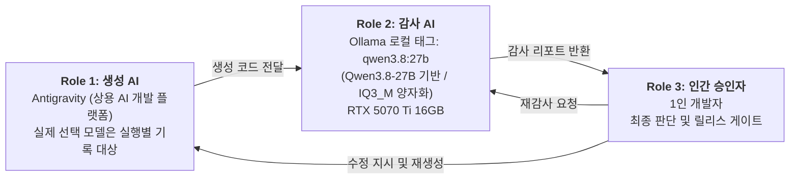
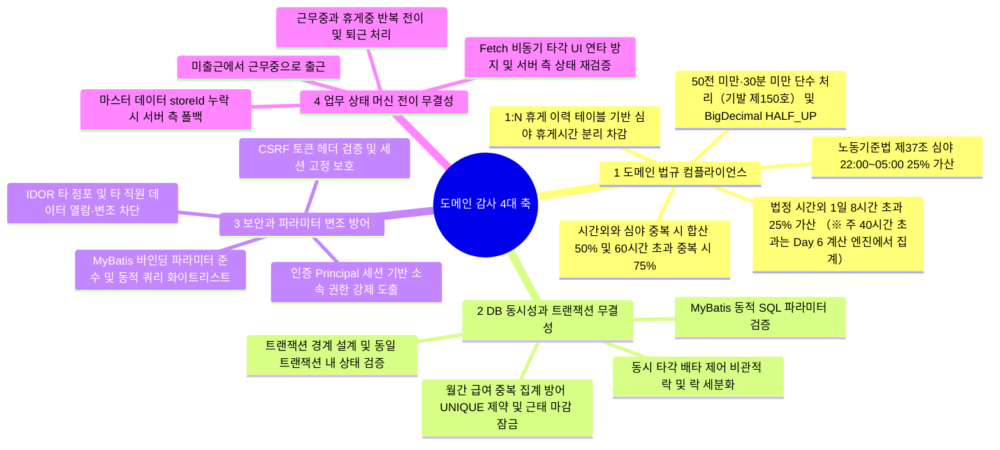
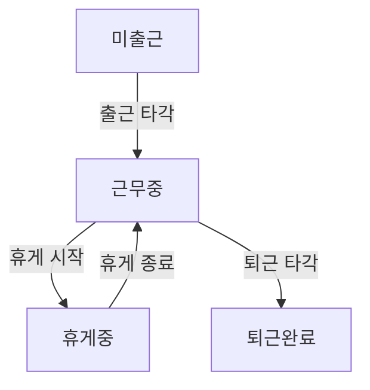

# 3-Tier AI-Human 협동 감사 파이프라인 기술 증적 보고서 (2주 프로젝트 진행형 · v1.4 / Day 4 기준)

본 문서는 일본형 근태·시프트·급여 관리 시스템(kintai) 개발에서, **코드 리뷰어가 없는 1인 개발의 구조적 한계와 자기 확증 편향을 완화**하기 위해 생성 AI, 로컬 감사 AI, 인간 승인자의 세 역할로 운영한 협동 감사 프로세스의 실측 기록과 아키텍처적 한계를 정리한 기술 증적서입니다. 여기서 3-Tier는 애플리케이션의 프레젠테이션·비즈니스·데이터 3계층 아키텍처가 아니라 **감사 및 품질 게이트를 수행하는 3개의 독립된 역할**을 뜻합니다.

최종 목적은 로컬 LLM을 단순한 코드 생성기가 아니라 **독립적인 코드 검수자**로 활용한 이유와 운영 방식을 일본 취업 포트폴리오·이력서에서 설명하는 것입니다. 이를 위해 생성 AI와 로컬 감사 AI를 분리한 배경, 실제 결함 발견·수정·재감사 사례, 토큰·속도·실행 시간 등 측정값, 로컬 처리의 정보 보호·재현성 측면의 장단점을 프로젝트 진행 중 축적합니다. 이 문서는 현재 완성된 품질 인증서가 아니라, 2주 스프린트에서 확인된 사실과 다음 검증 과제를 계속 추가하는 진행형 증적입니다.

> **문서 운용 안내 및 진행 상태**
> - 본 문서는 **2주 개발 스프린트가 진행되는 동안 갱신하는 Living Document**입니다. 현재 수록된 실행 증거는 Sprint Day 1부터 Day 4까지(2026-11-02부터 2026-11-05까지)의 기록이며, 2주 프로젝트 전체의 최종 완료 보고서가 아닙니다.
> - 일본 현지 취업 포트폴리오·GitHub 제출용 일본어판은 동일 디렉터리의 [`portfolio_audit_evidence_JP_v1.4.md`](portfolio_audit_evidence_JP_v1.4.md)를 사용합니다. 본 한국어판은 정밀 검수 및 기술 면접 답변 준비용입니다.
> - 부록 A의 45개 항목은 **Phase 1(핵심 감사 17개 항목)**과 **Phase 2(도메인·보안 심화 확장 28개 항목)**으로 구성된 점검 기준표입니다. 45개 모두가 매일 실제 감사되었거나 구현·테스트까지 완료되었다는 뜻은 아닙니다.
> - 표의 상태는 현재까지의 명세·코드 반영 현황을 나타냅니다. 별도 표시가 없는 한 `구현/반영`은 결정적 런타임 테스트 완료를 의미하지 않으며, 예정된 테스트 결과는 실제 실행 후 날짜·로그·통과 건수를 추가합니다.
> - 본 문서의 PASS/WARN은 LLM 기반 정적·논리 감사 결과입니다. 최종 릴리스 판단과 법률 적합성·보안 무결성은 인간 검토 및 결정적 테스트로 별도 확인하며, 미실행 테스트를 통과한 것처럼 기재하지 않습니다(6장 참조).

---

## 개정 이력 (Revision History)

| 판 (Ver.) | 개정 일자 | 개정자 | 주요 개정 내용 및 반영 사항 | Git 커밋 해시 |
|:---:|:---:|:---:|---|:---:|
| **v1.0** | 2026-11-02 | 승인자 (개발자) | 3-Tier AI 협동 감사 파이프라인 기술 증적서 초판 수립 (Phase 1 감사 항목 17건 정의) | 9b1a4f0 |
| **v1.1** | 2026-11-03 | 승인자 (개발자) | 도메인 법규·DB 배타 제어·보안 확장 감사 항목(Phase 2 총 45개 기준) 추가 및 체계화 | 3c2e1f |
| **v1.2** | 2026-11-04 | 승인자 (개발자) | 비관적 락(`SELECT ... FOR UPDATE`) 타각 트랜잭션, RTX 5070 Ti 실측 벤치마크, 昭和62年(1987년) 통달 및 단수처리 기준 정정, `uq_att_open_per_staff` 스키마 보강 | 8bb51a |
| **v1.3** | 2026-11-05 | 승인자 (개발자) | FullCalendar 연동 희망 시프트 화면 구현, 직원 셀프서비스 API의 Principal 기반 식별자 도출, CSRF 헤더 연동 및 UI 메모 마스킹 확인. 관리자 API·서버 JSON 메모 보호·JST 경계 테스트는 별도 검증 대상으로 분리 | e22890d |
| **v1.4** | 2026-11-05 | 승인자 (개발자) | Day 4 감사 로그와 누적 메트릭 동기화, IDOR·메모 보호 범위 명확화, 일본어판 동기화, 미검증 항목 및 결정적 테스트 로드맵 정정 | 미커밋 (개정 파일 기준) |

---

## 0. 시스템 엔지니어링 스펙 및 빌드 환경 (System Specification)

- **Framework**: `Spring Boot 4.0.8` / `Spring Framework 7.0.x` (실제 `build.gradle` 선언 기준이며 최신 패치 버전을 뜻하지 않음. `Spring Boot 4.0.9`가 2026-10-23 공개되어 호환성 검토 필요: R-21)
- **Security**: `Spring Security 7.0.x` (Spring Boot BOM 관리 기준, 세션 기반 인증·인가 및 CSRF 방어)
- **Language / Runtime**: `Java 17 LTS` (`build.gradle` Toolchain 17 설정 기준. 서비스 계층의 공유 가변 상태를 최소화하는 방향으로 설계하되, 현재 인증은 HTTP 세션 기반이며 Java 21 Virtual Threads는 향후 도입 검토 사항)
- **Persistence Layer**: `MyBatis Core 3.5.x` / `mybatis-spring-boot-starter 4.0.1` / `MyBatis-Spring 4.0.x` (Spring Boot 4 공식 호환 규격 적용)
- **Build Tool**: `Gradle Wrapper 9.8.1` (프로젝트 Wrapper 고정값이며 최신 버전을 뜻하지 않음. `Gradle 9.8.2` 릴리스에 따른 업그레이드 검토 필요: R-20)
- **Database**: `MySQL 8.4 LTS` (InnoDB 엔진 / 트랜잭션 격리 수준 `REPEATABLE READ`). *※ MySQL 8.0은 2026년 4월(8.0.46)을 기점으로 Extended Support가 종료되고 Sustaining Support 단계로 전환되었으므로, 장기 유지보수성을 고려하여 8.4 LTS를 타겟으로 설계·권장함.*
- **Frontend**: `Thymeleaf` + Vanilla JavaScript (`Fetch API` 비동기 통신 및 요청 헤더 내 CSRF 토큰 전달)
- **Timezone**: `Asia/Tokyo` (JVM 기동 옵션 `-Duser.timezone=Asia/Tokyo`, Spring 설정 및 DB 세션 타임존 일원화)
- **로컬 감사 인프라**: Windows 11 / NVIDIA GeForce RTX 5070 Ti (16GB VRAM, CUDA 가속) + Ollama 로컬 런타임 및 Tailscale VPN 사설 터널링

---

## 1. 개발 파이프라인 비교 (기존 1인 개발 vs 본 프로젝트)

| 평가 항목 | 기존 1인 개발 + 상용 AI 단독 | 본 프로젝트의 3-Tier 협동 감사 |
|---|---|---|
| **코드 검증 체계** | 리뷰어 부재로 AI 환각·잠재 버그를 걸러내기 어렵고 그대로 적용하기 쉬움 | 생성 AI와 감사 AI를 **서로 다른 모델**로 분리하고 인간이 최종 판단하여 자기 확증 편향을 **완화** (모델 간 상관 오류는 잔존, 6장) |
| **도메인 법규 점검** | 제37조(심야 25% + 시간외 25% 중복 가산) 등 경계 케이스 누락 가능 | 로컬 감사 모델이 **Phase별 체크리스트를 기준으로 상시 점검** (도메인 기준표는 부록 A 참조) |
| **정보 보안** | 소스·업무 로직이 외부 클라우드 API로 송신됨 | **감사 단계**의 코드는 자택 GPU(로컬 Ollama)에서만 처리. 단, 생성 단계는 상용 AI를 사용하므로 전 구간 외부 송신 차단은 아님 |
| **검증 비용·빈도** | API 종량제와 이용 한도로 대량 반복 검사 부담 | 보유 GPU로 **추가 API 한계 비용(Marginal Cost) 없이 반복 감사 가능** (전력비·하드웨어 감가상각 별도, 5장) |
| **1인 개발자의 역할** | AI 산출물을 그대로 적용하는 수동적 코더 | 두 AI의 산출물을 비교·판정하고 **릴리스 게이트를 통제하는 시스템 승인자** |

---

## 2. 3-Tier 협동 감사 아키텍처 개요



- **Role 1 (생성 AI - Antigravity)**: AI 모델을 선택해 코드 생성과 개발 작업을 수행하는 개발 플랫폼입니다. Antigravity 자체를 단일 생성 모델명으로 취급하지 않으며, 실제 선택 모델과 실행일은 당시 UI·로그 증거로 별도 기록합니다.
- **Role 2 (로컬 감사 AI - Local Ollama)**: 감사 추론은 자택 GPU의 로컬 Ollama에서 수행합니다. 외부 개발 환경에서는 인증된 Tailscale Tailnet 경로를 통해 접근하며, 인터넷과 완전히 단절된 Air-gapped 환경이라는 뜻은 아닙니다. DB 동시성, IDOR 보안 취약점, 상태 전이 무결성, 일본 노동기준법 계산 요건 등을 점검하며, 측정 당시 로컬 모델 태그는 `qwen3.8:27b`(Qwen3.8-27B 기반, IQ3_M 양자화)였습니다.
- **Role 3 (인간 승인자 - 1인 개발자)**: 감사 결과를 판정하고 코드 수정·재감사·컴파일·통합 테스트를 통제합니다. LLM의 PASS 판정도 자동 승인으로 취급하지 않으며, 미해결 Recommendation은 릴리스 전 필수 조치 또는 아키텍처 개선 과제로 분류하여 관리합니다(4장 말미의 Open Items Register 참조).
- **3-Tier의 정의**: 본 문서의 3-Tier는 웹 애플리케이션 계층 구조가 아닌 **생성 AI · 감사 AI · 인간 승인자**의 3자 상호 견제 역할을 의미합니다.
- **전송 경로 및 접근 보안**: 외부(학원 등) 개발 환경에서는 Tailscale의 WireGuard 기반 P2P 암호화 터널을 통해 자택 데스크톱의 Ollama 인스턴스에 접근합니다. 프로젝트 증적상 공인 IP 포트포워딩은 사용하지 않고 Tailnet 경로로 연결합니다. 이는 접근 경로를 제한한 구성이지, 모든 네트워크로부터 물리적·논리적으로 격리된 환경을 의미하지 않습니다.

---

## 3. 핵심 도메인 감사 기준 및 동시성 설계 (4대 카테고리)

아래 마인드맵은 핵심 감사 영역의 대표 항목이며, 부록 A에는 법규·DB·보안·상태 전이의 **45개 전체 점검 항목**을 수록했습니다.



> **기술 면접 핵심 방어: 비관적 락(`SELECT ... FOR UPDATE`) 채택 근거와 아키텍처 고도화 설계**
> 1. **트랜잭션 경계와 타각 직렬화(`member` 행 락 선행 방식)**: 출퇴근 및 휴게 타각은 동일 직원의 동시 요청을 직렬화하는 것이 필수적입니다. 타각 트랜잭션 시작 시 회원(`member`) 행의 `SELECT ... FOR UPDATE`를 선행 획득하고, 점포 소속과 현재 근태 상태를 재조회·검증하는 구조를 반영했습니다. 다만 회원에 연결된 모든 `store_staff`의 진행 중 근태를 잠금 획득 후 조회하는지, 그리고 급여 확정 처리와 공통 잠금 기준으로 직렬화되는지는 별도 코드 검토 및 동시성 테스트로 확인해야 합니다.
> 2. **비관적 락 vs 낙관적 락**: `@Version`은 JPA의 메커니즘이며 MyBatis에서는 별도의 `version` 컬럼과 갱신 건수 검증 로직을 수동 구현해야 합니다. 또한 금전·근태 기록 도메인 특성상 충돌 후 애플리케이션 차원의 재시도보다 DB 수준의 즉각적인 직렬화가 정합성 보장에 유리하다고 판단했습니다. 단, 데드락 및 `LockWaitTimeoutException` 발생 시의 예외 핸들링과 트랜잭션 타임아웃 설정은 개별 통제합니다.
> 3. **락 세분화와 분할 근무(중간 외출, 中抜け) 대응**: `uq_att_open_per_staff`는 가상 생성열 `open_flag = (CASE WHEN clock_out IS NULL THEN 1 ELSE NULL END)`과 `UNIQUE(store_staff_id, open_flag)`를 이용해 각 `store_staff_id`별 미퇴근 근태를 1건으로 제한합니다. 단, 이 제약만으로 서로 다른 점포 소속 행을 가진 동일 회원 전체의 중복 근무까지 막지는 못합니다. 다점포 전체의 차단은 `member` 행 잠금 후 해당 회원의 모든 점포 소속에 대해 진행 중 근태를 조회·검증하는 서비스 로직에 의존하며, 구현 여부와 결과는 Day 11 테스트에서 확인합니다. 또한 InnoDB 외래키(`attendance.store_staff_id` → `store_staff.id`)로 인해 자식 테이블 INSERT 시 부모 행 S-Lock이 요구될 수 있어, 급여 집계가 `store_staff` X-Lock을 보유하면 일시적인 Lock Wait가 발생할 수 있습니다. 현재 증적은 이 대기 가능성 분석을 보여줄 뿐, 급여 확정과 신규 근태 등록의 상호 배제가 해결되었다는 증거는 아닙니다. 두 경로의 공통 잠금 기준과 잠금 획득 후 확정 상태 재조회 여부를 검증해야 합니다. **[개선 방향 — 설계 방침, 코드 반영 대기 · R-06]** 실시간 타각과 급여 집계가 서로를 불필요하게 막지 않도록 잠금 범위를 분리합니다. ① 당일 타각은 `member` 행 락만 사용하고, ② 소급 근태 등록·정정 승인·급여 확정처럼 확정 월에 영향을 주는 경로에 한해 (직원, 대상월) 단위 기간 락을 추가로 획득한 뒤 확정 상태를 재조회하며, ③ 모든 경로의 잠금 순서를 `member` → 기간 락으로 고정해 데드락을 방지합니다. 급여 집계를 `store_staff` X-Lock 대신 기간 락(급여 행 또는 동등한 잠금 행)으로 옮기면 FK 부모 행 S-Lock 대기도 피할 수 있으나, 현재 Day 2 구현은 `lockStoreStaffForUpdate`이므로 변경 여부와 결과는 코드 반영 후 Day 11 테스트로 확인합니다.
> 4. **급여 마감(`is_closed`) 연동·과거 확정월 보호·휴게 1:N 분리 설계**: 급여 확정 후 대상 기간 근태 레코드를 `is_closed = true`로 마감하고, 근태 등록·수정 시 해당 `work_date`의 `payroll.status = 'CONFIRMED'` 여부를 확인하는 보호 가드를 설계·반영했습니다. 다만 사전 조회만으로는 급여 확정 트랜잭션과 동시에 실행되는 근태 요청의 경합을 모두 차단한다고 볼 수 없습니다. 공통 잠금 획득 후 확정 상태를 재조회하는지와 양 트랜잭션의 잠금 순서가 일관적인지는 별도 검증 대상으로 관리합니다. 심야 휴게시간 계산은 `break_start`와 `break_end`를 기록하는 1:N 구조를 기준으로 심야 구간과의 중복 시간을 분 단위로 산정하도록 설계했습니다. 당일 타각은 통상 확정 월에 속하지 않으므로 기간 락 대상에서 제외하고, 사후 등록·정정 경로에 한해 기간 락과 확정 상태 재조회를 적용하는 것을 설계 방침으로 둡니다(R-06).

---

## 4. 스프린트별 감사 & 결함 개선 로그 (Daily Audit Log)

### 【Sprint Day 1: 2026-11-02】 요구명세서(SRS) 및 법적 계산 로직 감사

#### 1. 감사 대상
- `kintai_requirements_specification.md` (초기 요구명세서)
- 실측 로그: `hermes_srs_audit.md` (*※ `hermes`는 프로젝트 내에서 로컬 Ollama API를 호출해 마크다운 감사 리포트를 생성하는 자체 자동화 CLI 스크립트 명칭임*)

#### 2. 생성 단계에서 누락되어 있던 결함 (What was missed)
- Git 커밋 `a754e9e`(10/27 초판)의 초기 드래프트 SRS에서 심야 근로(22:00~05:00) 25%와 법정 시간외(8시간 초과) 25%가 각각 개별 기술되어 있었으나, **"심야이면서 동시에 시간외인 경우 합산 50% 할증이 적용된다는 중복 가산 조항"의 명세 기술이 누락**되어 있었음. 한편 후속 설계 검토 커밋 `097d7f3`(10/28 개정판, rev.2 §6.1) `[확인 대기: git log --format='%h %ad %s' 출력으로 커밋 일시 확정]`에는 150%(50% 가산) 기재가 이미 존재했으나, 초기 드래프트와의 사양 통합이 이루어지지 않아 문서 간 불일치가 방치되어 있었음. 따라서 Day 1 감사의 본질적 성과는 완전한 신규 결함 발견이라기보다, **초기 드래프트와 후속 개정본(rev.2)의 괴리를 해소하고 정식 개정판 SRS(`kintai_requirements_specification_revised.md`)로 명세를 일원화·통합 합의한 점**에 있음.

#### 3. 로컬 감사 모델의 지적 (Finding by Local Auditor)
> **판정: PASS with Recommendation (`hermes_srs_audit.md` 원문 인용)**  
> *"| Night work (22:00~05:00): +25% extra pay | PASS | The SRS correctly states that night work (22:00~05:00) should be calculated with a 25% extra pay. However, the SRS does not explicitly mention the 50% overlap calculation. This should be clarified. |"*  
> *"Recommendation: 1. Clarify the 50% overlap calculation in the SRS."*  
> **(번역: SRS는 심야 근로에 25% 추가 수당이 붙는다고 올바르게 기술하고 있으나, 50% 중복 가산 계산에 대한 명시적 언급이 누락되어 있다. 이 점을 명세서에 명확히 밝혀야 한다.)**
>
> 모델의 1차 판정은 PASS였으나, Recommendation에서 지적된 사항이 일본 노동기준법 제37조의 핵심 요구사항 누락에 해당하므로 인간 승인자가 이를 **릴리스 블로커(필수 수정 사항)로 격상**하여 사양 통합을 실시함.

#### 4. 조치 내역
- 초기 드래프트(10/27)와 rev.2(10/28)의 기술 차이를 통합·정리하여, 약 11만 바이트 규모의 개정판 요구명세서 `kintai_requirements_specification_revised.md`를 정식본으로 수립·일원화함.
- 가산율을 **법정 시간외 25%, 심야 25%, 시간외+심야 중복 50%**로 명확히 정의하고, 1:N 휴게 시작·종료 시각 기록을 바탕으로 심야 시간대 내 휴게시간만 정확히 분리 차감하는 산식을 명세화함. (월 60시간 초과 50% 및 심야 중복 75% 규칙은 Phase 2 확장 체크리스트에 반영).

#### 5. 하드웨어 실행 메트릭 (Day 1 실측 전수 내역)
- **감사 일시**: 2026-11-02 13:52
- **하드웨어**: 학원 노트북 (NVIDIA GeForce RTX 3060 Laptop 6GB, 로컬 Ollama)
- **감사 모델**: `qwen2.5:7b` (Phase 1 기본 체크리스트)

| 회차 | 대상 파일 | 감사 단계 및 목적 | 소요 시간 | 입력 토큰 | 출력 토큰 | 합계 토큰 | 속도 | 최종 판정 |
|:---:|---|:---:|:---:|:---:|:---:|:---:|:---:|:---:|
| 1 | `kintai_requirements_specification.md` (142줄) | 1차 초벌 명세 감사 | 30.16초 | 3,629 tok | 499 tok | 4,128 tok | 24.6 tok/s | PASS with Rec (50% 중복할증 누락 적발) |
| 2 | `kintai_requirements_specification_revised.md` | 인간 승인자 비판적 개입 | - | - | - | - | - | **인간 릴리스 블로커 발동 ➔ rev.2 전면 개정 완료** |
| **합계** | **Day 1 가동 총계** | **초기 SRS 감사 및 개정 작업** | **30.16초** | **3,629 tok** | **499 tok** | **4,128 tokens** | **24.6 tok/s** | **인간 승인자 판단으로 명세 개정; 개정본 재감사·결정적 계산 테스트는 별도 증적 필요** |

---

### 【Sprint Day 2: 2026-11-03】 인증/인가 및 급여 집계 동시성 락 감사

#### 1. 감사 대상
- `SecurityConfig.java` / `PayrollService.java`
- 실측 로그: `hermes_payroll_audit.md` / `hermes_payroll_re_audit.md`

#### 2. 생성 단계에서 누락되어 있던 결함
- rev.2의 DDL 스키마에는 이미 `UNIQUE(store_staff_id, target_year_month)` 제약이 정의되어 있었으나, 서비스 레이어(`PayrollService.java`)의 집계 로직에서 동시 요청 유입 시 집계 처리가 다중 실행되어 동일 월 급여 합계 금액이 이중 갱신(Double Update / 덮어쓰기 경합)되는 것을 방어하는 **배타 락(`SELECT ... FOR UPDATE`) 및 급여 확정 상태(`payroll.status = 'CONFIRMED'`) 사전 검증이 누락**되어 있었음.
- 급여 대상 연월(`targetYearMonth`) 파싱 시 잘못된 형식 입력에 대한 예외 처리가 부재하여, `DateTimeParseException` 발생 시 스프링 기본 서버 500 에러(Internal Server Error)가 그대로 반환되는 문제 존재.
- *근거 구분: 모델 원문의 지적 범위는 `SELECT ... FOR UPDATE` 미명시와 `DateTimeParseException` 미처리입니다(아래 3번 인용 참조). 이중 갱신 시나리오와 확정 상태 사전 검증 항목은 모델 원문이 아니라 개발자의 코드 분석에 따른 구체화입니다.*

#### 3. 로컬 감사 모델의 지적
> **판정: WARN / PASS (`hermes_payroll_audit.md` 원문 인용)**  
> *"| Concurrency & Security | WARN | The @Transactional annotation is present, which is good for ensuring data consistency. However, the use of SELECT ... FOR UPDATE is not explicitly mentioned, and it is recommended to ensure that pessimistic locking is applied where necessary to prevent concurrent updates. |"*  
> *"| Exception Handling & Boundary validation | PASS | ... However, it does not handle DateTimeParseException when parsing dates, which should be added for robustness. |"*  
> *"Recommendation: 2. Concurrency & Security: Explicitly use SELECT ... FOR UPDATE to prevent concurrent updates and ensure data integrity. 3. Exception Handling: Add DateTimeParseException handling for robust date parsing."*  
> **(번역: `@Transactional`은 존재하나 `SELECT ... FOR UPDATE` 사용이 명시되지 않았다. 동시 수정을 방지하고 데이터 무결성을 보장하기 위해 비관적 락을 적용할 것을 권장한다. 또한 날짜 파싱 시 `DateTimeParseException` 처리가 필요하다.)**

#### 4. 조치 내역 및 HTTP 응답 개선
- `PayrollMapper`에 `lockStoreStaffForUpdate(storeStaffId)`를 추가하여 집계 트랜잭션 진입 시 직원 단위 배타 락을 획득하도록 직렬화하고, 급여 확정 상태(`payroll.status = 'CONFIRMED'`) 및 대상 근태 레코드 마감 잠금(`attendance.is_closed = true`)을 사전 검증함으로써 합계 금액의 이중 UPDATE 및 덮어쓰기 경합을 방어함. (※ `store_staff` X-Lock은 FK 부모 행 S-Lock 대기를 유발할 수 있으므로 3장 및 R-06 참조)
- 날짜 파싱 로직에 `DateTimeParseException` 캐치 블록을 추가하여 잘못된 형식 요청 시 기존의 서버 500 에러 반환에서, 입력값 검증 오류를 나타내는 `400 Bad Request`와 구조화된 에러 메시지를 반환하도록 전후 응답 설계를 개선함.

※ 아래 응답 예시의 출처: `증거 상태: 응답 예시는 재구성 여부 및 실제 curl 캡처 원본을 아직 확인하지 못함. 공개 전 실제 캡처 또는 "재구성 예시"로 명확히 구분하고, `message` 노출 설정도 확인 필요`

```http
【개선 전: 500 Internal Server Error】
HTTP/1.1 500 Internal Server Error
Content-Type: application/json
{
  "timestamp": "2026-11-03T10:15:22.104+09:00",
  "status": 500,
  "error": "Internal Server Error",
  "message": "Text 'invalid-2026' could not be parsed at index 0",
  "path": "/api/payroll/calculate"
}

【개선 후: 400 Bad Request】
HTTP/1.1 400 Bad Request
Content-Type: application/json
{
  "timestamp": "2026-11-03T11:42:08.512+09:00",
  "status": 400,
  "error": "Bad Request",
  "message": "対象年月はYYYY-MM形式で指定してください（入力値: invalid-2026）",
  "path": "/api/payroll/calculate"
}
```

- 수정된 코드를 로컬 모델에 재전송하여 **2차 재감사(Re-Audit)에서 PASS 판정 확인** (`hermes_payroll_re_audit.md`):
  > *"| Concurrency & Security: Pessimistic locking (SELECT ... FOR UPDATE) on store_staff | PASS | The code uses pessimistic locking via payrollMapper.lockStoreStaffForUpdate(staffId) to prevent concurrent modifications. Ensure that this method is correctly implemented and used in all critical sections. |"*  
  > **(번역: 코드가 `payrollMapper.lockStoreStaffForUpdate(staffId)`를 통해 비관적 락을 사용하고 있습니다. 이 메서드가 올바르게 구현되어 모든 중요 임계 구역에 적용되는지 확인해야 합니다.)**

#### 5. 하드웨어 실행 메트릭 (Day 2 초벌 ➔ 재검수 전수 내역)
- **감사 일시**: 2026-11-03 (실제 파일 타임스탬프: 11-02 17:36 ~ 17:39)
- **하드웨어**: 학원 노트북 (NVIDIA GeForce RTX 3060 Laptop 6GB, 로컬 Ollama)
- **감사 모델**: `qwen2.5:7b` (Phase 1 기본 체크리스트)

| 회차 | 대상 파일 | 감사 단계 및 목적 | 소요 시간 | 입력 토큰 | 출력 토큰 | 합계 토큰 | 속도 | 최종 판정 |
|:---:|---|:---:|:---:|:---:|:---:|:---:|:---:|:---:|
| 1 | `PayrollService.java` (초벌) | 1차 초벌 트랜잭션 감사 | 약 48초 | 약 2,100 tok | 약 1,500 tok | 약 3,600 tok | 원시 `eval_duration` 미확보로 미기재 | **WARN (비관적 락 누락 적발)** |
| 2 | `PayrollService.java` (보완본) | **2차 보완 재검수** | 약 52초 | 약 2,350 tok | 약 2,680 tok | 약 5,030 tok | 원시 `eval_duration` 미확보로 미기재 | **PASS (LLM 재감사 판정; 전 임계 구역 동시성 테스트는 별도 대기)** |
| **합계** | **Day 2 가동 총계** | **급여 배타 락 적용 기록** | **약 100초** | **약 4,450 tok** | **약 4,180 tok** | **약 8,630 tokens (추정)** | **원시 메트릭 미확보로 미기재** | **LLM 재감사 PASS; 동시성 런타임 검증 대기** |

- **감사 범위 주석**: `SecurityConfig.java`도 대상 파일 목록에 포함되어 있으나, 현재 본문에 인용·기록된 재현 가능한 판정 근거는 급여 동시성 및 날짜 파싱 항목입니다. `SecurityConfig.java`의 개별 발견 사항·PASS/WARN 근거는 별도 감사 로그를 확인해 추가하기 전까지 독립적인 보안 감사 완료로 간주하지 않습니다.

---

### 【Sprint Day 3: 2026-11-04】 실시간 근태 타각 엔진 및 비동기 Fetch 트랜잭션

#### 1. 감사 대상
- 핵심 감사 투입 파일: `AttendanceService.java` (341줄, 입력 토큰 3,739 tokens 기준 전문 투입)
- 연관 검증 및 교차 수정 대상: `AttendanceMapper.java` / `AttendanceMapper.xml` / `punch.html`
- 실측 로그: `hermes_audit_report.md`

#### 2. 생성 단계에서 누락되어 있던 결함
- **권한 검증 결함 (IDOR)** *(감사 원문 근거: 리포트 행 16)*: `storeStaffId`와 `storeId`를 클라이언트 DTO 요청값 그대로 신뢰하는 구조로, Controller 계층에서 소유권을 검증하지 않는다면 타 직원·타 점포의 근태를 대리 타각할 수 있는 취약점이 될 수 있음(모델 원문도 조건부 지적).
- **하드코딩 기본값 결함** *(감사 원문 근거: 리포트 행 29)*: `requestModification`에서 `storeId`가 null이면 `1L`로 대체하는 가정은 다점포 환경에서 잘못된 점포를 선택할 수 있음.
- **데이터 정합성 결함** *(개발자 직접 코드 분석 — LLM 감사 원문 지적 아님)*: 프론트엔드 타각 API 호출 시 `storeId`가 비어 있는 상황을 방어하지 못해, 서비스 레이어가 `punchDto.getStoreId()`(null)를 그대로 DB에 전달하여 `store_id NOT NULL` 제약조건 위반(`DataIntegrityViolationException`)을 유발할 위험이 존재함.
- **상태 전이 결함** *(개발자 직접 코드 분석 — LLM 감사 원문 지적 아님)*: 화면과 서버 양측에서 직원의 현재 근무 상태에 따른 전이 가능 여부를 엄격히 통제하지 않아 출근 전 퇴근이나 중복 출근 요청이 가능한 상태였음.

#### 3. 로컬 27B 감사 모델의 지적
> **판정: WARN (`hermes_audit_report.md` 리포트 행 16·29 원문 인용 — 부록 A 번호와 무관)**  
> *"| Security: IDOR / Unauthorized Access Prevention | WARN | The service accepts storeStaffId, modRequestId, reviewerId, and storeId from DTOs or method parameters, but no authorization checks are visible. A user could potentially punch for another staff member, review another store’s request, or modify another employee’s attendance if the controller layer does not enforce ownership. Recommendation: Enforce authorization in the service or controller: verify the authenticated user owns the storeStaffId, has store-manager role for storeId, and is allowed to review the specific modRequestId. |"*  
> *"| Code Maintainability: Hardcoded Default Store ID | WARN | In requestModification, if storeId is null, the code defaults to 1L. This is a hardcoded assumption that may be incorrect in multi-store environments. Recommendation: Remove the hardcoded default. Require storeId in the request or derive it from the authenticated user’s store context. |"*  
> **(번역: 서비스가 `storeStaffId`, `modRequestId`, `reviewerId`, `storeId`를 입력으로 받지만 권한 검증이 확인되지 않았습니다. 이 때문에 다른 직원의 타각, 다른 점포의 수정 요청 검토, 타 직원 근태 수정 가능성이 있습니다. 인증 사용자와 직원 소속, 점포 관리자 권한, 개별 수정 요청의 소유·검토 권한을 확인해야 합니다. 또한 `requestModification`의 `storeId` 기본값 1L은 다점포 환경에서 잘못된 점포를 선택할 수 있으므로 제거하고 인증된 점포 컨텍스트에서 도출해야 합니다.)**

#### 4. 조치 내역 및 아키텍처 반영

**4-1. 즉각 조치 및 코드 반영 사항**
1. **storeId 해결 우선순위 및 서버 측 자동 보정**: 클라이언트 요청값 검증을 철저히 하여, ① 세션 Principal의 소속 검증을 통과한 파라미터 storeId를 최우선 적용, ② 미지정 시 `AttendanceMapper.xml`의 `findStoreIdByStoreStaffId` 쿼리를 통해 서버 측에서 직원의 주 소속 매장 정보를 조회해 안전하게 바인딩하는 폴백 처리 구현. 다만 다점포 겸무 직원에게는 "주 소속 매장" 폴백이 모호해 잘못된 점포로 귀속될 수 있으므로, 겸무 직원은 폴백 대신 `storeId`를 필수로 요구하는 방식으로의 변경을 검토합니다(R-05).
2. **상태 머신 연동 버튼 가드 UI 및 서버 측 상태 전이 검증**: `punch.html`에서 현재 상태(미출근/근무중/휴게중/퇴근완료)를 비동기 조회해 유효한 버튼만 활성화하고 연타 방지 락을 적용함. 아울러 `curl` 등을 이용한 API 직접 호출 우회를 차단하기 위해, 서버 서비스 레이어에서 락 획득 직후 현재 DB 상태를 재조회(Re-read)하여 허용되지 않은 상태 전이를 거부하도록 방어 로직을 반영함. `IllegalStateException` 자체가 자동으로 HTTP 400/409를 결정하지는 않으므로, 실제 응답 코드는 `@RestControllerAdvice` 등 예외 매핑 설정으로 확인해야 합니다. 상태 충돌은 409, 형식이 잘못된 입력은 400으로 구분하는 것을 응답 계약으로 둡니다.
3. **세션 Principal 기반 타각 식별자 도출**: 일반 직원의 일반 타각 경로에서는 클라이언트가 보낸 `storeStaffId`를 사용하지 않고, Spring Security 인증 세션(`AuthenticationPrincipal`)에서 로그인 본인의 직원 식별자를 도출하도록 수정했습니다. 이 조치가 입증하는 범위는 해당 타각 경로입니다.
4. **회원 행 락(`member`) 선행 획득 기반 다점포 직렬화**: `@Transactional` 경계에서 회원(`member`) 행에 `SELECT ... FOR UPDATE`를 획득한 뒤 점포 소속과 현재 근태 상태를 검증하는 구조를 반영했습니다. 다만 다점포 전체의 활성 근태 조회가 회원에 연결된 모든 `store_staff`를 대상으로 하는지, 해당 조회가 잠금 획득 후 수행되는지는 코드 및 Day 11 동시성 테스트로 확인해야 합니다.
5. **남은 IDOR 검증 범위**: 감사 원문에 포함된 `modRequestId`와 `reviewerId`, 그리고 수정 요청 승인·검토 엔드포인트의 권한 검증은 일반 직원 타각 경로의 수정만으로 해결되었다고 볼 수 없습니다. Day 3 핵심 감사 입력은 `AttendanceService.java`였으며 Controller 파일은 감사 입력 목록에 없습니다. 관련 Controller·수정 요청 서비스의 소유 점포/대상 직원 확인, reviewer 식별자 세션 도출 및 점장 권한 검증을 별도 점검하고, 검증 전까지 IDOR 전체 해결로 표현하지 않습니다.
6. **일반 타각 요청 처리 순서(검증 목표 흐름, 실제 코드 대조 대기)**: ① 인증 Principal에서 `memberId` 도출 → ② `member` 행 `SELECT ... FOR UPDATE` 획득 → ③ 잠금 획득 후 요청 `storeId`가 해당 회원의 소속 점포인지 최신 상태로 재검증 → ④ (`memberId`, `storeId`)로 `store_staff` 식별자 확정 → ⑤ 잠금 읽기 등 최신 상태를 보장하는 방식으로 회원의 전 점포 진행 중 근태 조회 → ⑥ 상태 전이 검증 및 기록(상태 충돌 409 / 형식 오류 400). 이 순서는 설계 목표이며, 실제 코드가 동일하게 구현되었는지는 R-05 및 Day 11 테스트로 확인합니다.

**4-2. 업무 상태 전이 정의 (State Machine)**



- `근무중 ⇄ 휴게중` 전이는 1일 다회 분할 휴게를 지원하기 위해 반복 전이가 가능하며, 매 휴게 시점마다 1:N 휴게 이력 레코드(`break_start`, `break_end`)가 생성됩니다. 상태 머신은 개별 근태 레코드/근무 세션 단위로 적용합니다. 한 세션이 `퇴근완료`가 된 뒤에도 같은 `work_date`에 새 근태 레코드를 생성해 2회차 분할 근무를 시작할 수 있으며, 이를 동일 세션의 퇴근완료 상태를 되돌리는 것으로 취급하지 않습니다.
- **차단 전이**: `휴게중 → 퇴근완료` 직접 전이는 허용하지 않습니다. 휴게 종료 시각 누락을 막기 위해 서버 상태 검증기에서 거부하며, 반드시 `휴게 종료(근무 복귀) → 퇴근` 순서를 거치도록 합니다.
- 22:00에 출근하여 익일 06:00에 퇴근하는 야간 교대근무의 경우, rev.2 사양에 맞추어 **실제 출근 타각 시점의 역일(Clock-in Date, 예: 11월 4일 22:00 출근 시 11월 4일)**을 근태 레코드의 `work_date`로 일관 관리합니다. 이는 레코드 귀속 기준이며, 자정을 넘긴 실제 노동의 법정휴일·심야 할증까지 출근일 하나로 판정한다는 뜻은 아닙니다. 해당 할증은 실제 시간 구간을 기준으로 별도 산정하고 자정 경계 테스트를 수행해야 합니다(R-09).

**4-3. 인간 승인자의 비판적 개입 사례: AI 권고(일률적 일별 UNIQUE 제약)의 부분 수용과 분할 근무(中抜け) 보호**
- **로컬 감사 모델(27B)의 원문 지적 (`hermes_audit_report.md` 리포트 행 25 — 부록 A 번호와 무관)**:  
  > *"| Data Consistency: New Attendance Creation After Modification | WARN | When approving a modification for a missing attendance record, the service creates a new attendance record. It does not check whether an attendance record already exists for the same staff and date, which could create duplicates if the original record was deleted or if concurrent modifications occur. **Recommendation: Add a unique constraint on (store_staff_id, work_date) or check for existing attendance before insertion.** Use pessimistic locking or optimistic concurrency control to prevent duplicate creation."*  
  > **(번역: 수정 승인 시 누락 근태를 신규 생성할 때, 동일 직원·동일 날짜의 레코드 중복 생성을 방지하기 위해 `(store_staff_id, work_date)`에 일률적 UNIQUE 제약조건을 추가하거나 삽입 전 존재 여부를 체크할 것을 권고함.)**
- **인간의 판단 및 기각(Reject)**: 인간 승인자는 일본 외식·편의점 알바 현장에서 점심 피크(09:00~13:00) 근무 후 퇴근했다가 저녁 피크(18:00~22:00)에 다시 출근하는 **분할 근무(중간 외출, 中抜け / Split Shift)**가 핵심 업무 요구사항임을 지적함. 모델이 권고한 일별 일률적 `UNIQUE(store_staff_id, work_date)`를 그대로 적용할 경우, 동일 직원의 당일 2회차 정상 출근 타각이 DB 고유키 위반으로 차단되는 심각한 장애를 초래함을 확인함. 다만 모델이 우려한 "수정 승인 시 중복 생성" 자체는 타당한 지적이므로 폐기하지 않고 아래 대체 방어로 전환함.
- **아키텍처 교정 반영**: AI의 단순 일자별 유니크 권고를 **명확히 기각(Reject)**함. MySQL 8.0/8.4가 WHERE 조건이 붙는 Filtered Index를 지원하지 않는 제약을 고려하여, **가상 생성열 `Virtual Generated Column: open_flag = (CASE WHEN clock_out IS NULL THEN 1 ELSE NULL END)`과 `UNIQUE(store_staff_id, open_flag)` 인덱스를 이용한 제약(`uq_att_open_per_staff`)**을 채택함. 이 제약은 각 `store_staff_id`의 미퇴근 기록을 1건으로 제한하고 퇴근 완료 레코드는 여러 건 허용함. 다만 동일 회원의 다점포 간 중복 근무 방지는 이 인덱스만으로 보장되지 않으며, `member` 행 잠금 후 전체 점포의 진행 중 근태를 조회하는 서비스 검증이 필요함. 따라서 AI의 일별 UNIQUE 권고를 그대로 적용하지 않은 설계 판단은 반영했지만, 다점포 전체의 중복 출근 차단은 Day 11 동시성 테스트로 최종 확인할 항목임.
- **대체 방어 설계 (설계 방침, 구현·테스트 대기 · R-03)**: `open_flag` 유니크는 미퇴근 레코드만 제한하므로, 수정 승인으로 생성되는 퇴근 완료 레코드끼리의 중복·시간 구간 겹침은 DB 제약만으로 막지 못함. 이를 위해 ① 수정 승인 트랜잭션에서 `member` 행 락 아래 동일 직원의 기존 근태와 시간 구간 겹침(`new.clock_in < COALESCE(existing.clock_out, 무한대) AND COALESCE(new.clock_out, 무한대) > existing.clock_in`)을 검사하고, ② 수정 요청의 상태 전이(`PENDING → APPROVED`)를 행 락으로 보호해 중복 승인(멱등성)을 차단하며, ③ 생성된 근태에 수정 요청 식별자(예: `mod_request_id`)를 UNIQUE로 연결해 1요청 1생성을 보장하는 방안을 둠. 구현 여부와 결과는 Day 11 동시성 테스트로 확인함.

#### 5. 하드웨어 실행 메트릭 (Day 3 실측 전수 내역)
- **감사 일시**: 2026-11-04 13:44:08
- **하드웨어**: 자택 데스크톱 (NVIDIA GeForce RTX 5070 Ti 16GB, CUDA 가속, Tailscale VPN 원격 가동)
- **감사 모델**: 로컬 태그 `qwen3.8:27b` (Qwen3.8-27B 기반 / `IQ3_M` 양자화)
- **실행 옵션**: `temperature=0.1`, `think=false`

| 회차 | 대상 파일 | 감사 단계 및 목적 | 소요 시간 | 입력 토큰 | 출력 토큰 | 합계 토큰 | 속도 | 최종 판정 |
|:---:|---|:---:|:---:|:---:|:---:|:---:|:---:|:---:|
| 1 | `AttendanceService.java` (341줄) | 1차 초벌 타각 엔진 감사 | 57.80초 | 3,739 tok | 2,850 tok | 6,589 tok | 51.1 tok/s | WARN (IDOR 및 일별 UNIQUE 권고) |
| 2 | 아키텍처 비판적 개입 | **인간 승인자 AI 권고 기각** | - | - | - | - | - | **중간 외출(中抜け) 보호를 위해 AI 권고 Reject ➔ 가상 생성열 UNIQUE(`uq_att_open_per_staff`) 채택** |
| **합계** | **Day 3 가동 총계** | **핵심 서비스 수정 반영** | **57.80초** | **3,739 tok** | **2,850 tok** | **6,589 tokens** | **51.1 tok/s** | **LLM 감사 WARN 및 코드 반영; compileJava 성공, 런타임 보안·동시성 테스트 대기** |

- **빌드 검증**: 수정 코드 반영 후 `./gradlew compileJava` **BUILD SUCCESSFUL** 확인 완료 (※ 문법 및 타입 정합성의 정적 검증이며, IDOR 보안 격리 및 동시성 제어의 런타임 완전 무결성은 Sprint Day 11의 MockMvc 및 멀티스레드 결합 테스트를 통해 결정론적으로 최종 입증 예정).

---

### 【Sprint Day 4: 2026-11-05】 FullCalendar 연동 희망 시프트 신청 API 보완 및 직원 셀프서비스 IDOR 방어

#### 1. 감사 대상
- 핵심 감사 투입 파일:
  - `ShiftMapper.java` (54줄 / `hermes_shift_mapper_audit.md`)
  - `ShiftService.java` (189줄 / `hermes_shift_service_audit.md`)
  - `ShiftApiController.java` (144줄 / `hermes_shift_api_final_audit.md`)
  - `calendar.html` (446줄 / `hermes_shift_calendar_re_audit.md`)
- 연관 검증 및 환경 설정: `ShiftMapper.xml`, `SecurityConfig.java`
- 실측 로그: `hermes_shift_mapper_audit.md`, `hermes_shift_service_audit.md`, `hermes_shift_api_final_audit.md`, `hermes_shift_calendar_re_audit.md`

#### 2. 생성 단계에서 누락되어 있던 결함
- **권한 검증 및 IDOR 결함** *(감사 원문 근거: `ShiftApiController` 초벌 감사 행 11)*: 직원 셀프서비스 API에서 클라이언트가 전달한 `storeStaffId` 및 `storeId`를 무비판적으로 수용하고, 미인증 세션에서 임의의 `1L`로 폴백하는 경로가 있어 타인의 식별자로 희망 시프트를 등록·열람·삭제할 수 있는 취약점(FAIL)이 확인됨. 관리자 승인 API는 별도 점포 권한 검증 범위로 구분함.
- **크로스 점포 조작 결함** *(감사 원문 근거: `ShiftApiController` 재감사 행 13)*: `confirmShift` 수행 시 점장의 소속 점포와 시프트의 `storeId` 일치 여부를 검증하지 않아 타 점포 시프트를 승인할 위험 잔존.
- **프론트엔드 날짜 처리 및 개인정보 노출 결함** *(감사 원문 근거: `calendar.html` 초벌 감사 행 11·13)*:
  - 날짜 계산에 `toISOString()`(UTC 기준)을 사용해 브라우저 현지 날짜와 업무 기준일이 어긋날 수 있는 경계값 오류 발생.
  - FullCalendar 이벤트 클릭 UI에서 타 직원의 비공개 메모(`staffMemo`)가 노출될 수 있는 결함 적발. UI에서 숨기는 것만으로는 API 응답 데이터 노출을 막을 수 없으므로 서버 응답 DTO의 필드 제외 여부를 별도 확인 대상으로 둠(R-12).

#### 3. 로컬 27B 감사 모델의 지적
> **판정 범위: 초벌 FAIL → 수정 후 3차 재감사 PASS (`hermes_shift_api_final_audit.md` 행 15 원문 인용, 직원 셀프서비스 엔드포인트 범위)**  
> *"| IDOR prevention: staff self-service endpoints | PASS | The /my-events and /request endpoints derive staff identity from the authenticated session rather than trusting client-supplied staff identifiers. This is a strong IDOR mitigation. Ensure the service layer continues to enforce ownership checks for all data access. |"*  
> **(번역: `/my-events` 및 `/request` 엔드포인트가 클라이언트가 전달한 식별자를 신뢰하지 않고 인증된 세션에서 직원 신원을 도출합니다. 이는 강력한 IDOR 방어책입니다. 서비스 레이어에서도 모든 데이터 접근에 대한 소유권 검증을 지속적으로 적용하십시오.)**
>
> **판정: PASS (`hermes_shift_calendar_re_audit.md` 행 19 원문 인용)**  
> *"| CSRF protection | PASS | The template reads the CSRF token and header name from meta tags and sends the token in fetch requests. Ensure Spring Security CSRF protection remains enabled and the header name matches the server configuration. |"*  
> **(번역: 템플릿이 meta 태그에서 CSRF 토큰과 헤더 이름을 읽어 fetch 요청에 전송합니다. Spring Security CSRF 보호가 활성화되어 있고 헤더 이름이 서버 설정과 일치하도록 유지하십시오.)**

#### 4. 조치 내역 및 아키텍처 반영
1. **직원 셀프서비스 API의 인증 Principal 세션 바인딩**:
   - 감사 PASS 원문이 확인한 `/my-events` 및 `/request` 경로에서 클라이언트가 보낸 직원 식별자를 신뢰하지 않고, `@AuthenticationPrincipal CustomUserDetails` 등 인증 세션 정보에서 직원 신원을 도출하도록 수정함. 이 결론은 해당 셀프서비스 경로에 한정하며, 모든 API·관리자 경로의 권한 검증 완료를 뜻하지 않음. 미인증은 401, 인증은 되었으나 권한이 부족한 경우는 403으로 구분하는 응답 설정을 별도 확인함(R-15).
2. **점장 점포 범위 검증 및 승인 동시성 처리**:
   - `ShiftService.confirmShift`에서 `!existing.getStoreId().equals(storeId)` 조건으로 관할 점포 외 승인 시도를 차단하도록 반영했다고 기록함. 다만 다른 점포 관리자 계정으로 실제 요청했을 때의 403/404 응답, 잠금 후 시프트 상태 재조회, 중복 승인 경합 차단은 별도 테스트 근거가 없어 R-11·R-14에 남김. `shiftMapper.lockStoreStaffForUpdate(existing.getStoreStaffId())` 호출만으로 중복 승인 방어가 입증되는 것은 아님.
3. **직원 본인 신청 취소 권한 통제 (SUBMITTED 한정)**:
   - `ShiftMapper.xml`에 `DELETE FROM shift_schedule WHERE shift_id = #{shiftId} AND store_staff_id = #{storeStaffId} AND status = 'SUBMITTED'` 쿼리를 구현하여, 타인의 시프트 삭제를 원천 차단하고 점주가 이미 승인한 확정 시프트는 직원이 임의 취소할 수 없도록 통제.
4. **브라우저 날짜 처리·메모 표시 제한·CSRF 헤더 연동**:
   - `calendar.html`에서 브라우저 로컬 연·월·일(`getFullYear()`, `getMonth()+1`, `getDate()`)을 조합하는 방식으로 `toISOString()`의 UTC 날짜 변환 문제를 회피함. 다만 이 값은 브라우저 현지 시간대 기준이며 그 자체로 `Asia/Tokyo`를 강제하지 않으므로, JST 업무 기준의 최종 판정은 서버에서 수행하고 FullCalendar `timeZone` 설정 및 날짜 경계 테스트를 확인해야 함(R-13).
   - 캘린더 모달에서 `currentStaffId === ev.storeStaffId`인 본인 시프트에만 메모(`staffMemo`)를 표시하고 타인의 메모를 `非公開 (他スタッフの希望)`로 UI 마스킹함. 이는 UI 표시 제한 조치임. 서버가 응답 DTO에서 메모 본문을 제거하는지, 직렬화된 JSON에 메모가 남지 않는지는 아직 입증되지 않았으므로 R-12에서 별도 확인함.
   - Spring Security CSRF 토큰(`X-CSRF-TOKEN`)을 메타 태그에서 추출해 Fetch POST/PUT/DELETE 요청 헤더에 연동함.

#### 5. 하드웨어 실행 메트릭 (Day 4 전체 8회 실측 전수 내역)
- **감사 일시**: 2026-11-05 14:17 ~ 14:58
- **하드웨어**: 자택 데스크톱 (NVIDIA GeForce RTX 5070 Ti 16GB, CUDA 가속, Tailscale VPN P2P 연결)
- **감사 모델**: 로컬 태그 `qwen3.8:27b` (Qwen3.8-27B 기반 / `IQ3_M` 양자화)
- **초벌 ➔ 결함 적발(FAIL) ➔ 코드 보완 ➔ 대상 범위 재감사(PASS/WARN) 전체 가동 내역**:

| 회차 | 대상 파일 | 감사 단계 및 목적 | 소요 시간 | 입력 토큰 | 출력 토큰 | 합계 토큰 | 속도 | 최종 판정 |
|:---:|---|:---:|:---:|:---:|:---:|:---:|:---:|:---:|
| 1 | `ShiftMapper.java` (54줄) | 1차 초벌 감사 | 54.49초 | 840 tok | 2,595 tok | 3,435 tok | 51.0 tok/s | WARN (세션 검증 권고) |
| 2 | `ShiftService.java` (189줄) | 1차 초벌 감사 | 189.76초 | 2,324 tok | 9,415 tok | 11,739 tok | 50.0 tok/s | PASS (트랜잭션 승인) |
| 3 | `ShiftApiController.java` (110줄) | **1차 초벌 감사** | 125.93초 | 1,430 tok | 6,301 tok | 7,731 tok | 50.5 tok/s | **FAIL (IDOR 취약점 적발)** |
| 4 | `ShiftApiController.java` (137줄) | **2차 보완 재검수** | 80.40초 | 1,775 tok | 4,012 tok | 5,787 tok | 50.7 tok/s | WARN (타점포 검증 권고) |
| 5 | `ShiftApiController.java` (144줄) | **3차 최종 재검수** | 59.05초 | 1,894 tok | 2,937 tok | 4,831 tok | 50.8 tok/s | **PASS (직원 셀프서비스 ID 도출 확인; 관리자 API는 별도 검증)** |
| 6 | `calendar.html` (411줄) | **1차 초벌 UI 감사** | 98.01초 | 5,074 tok | 4,748 tok | 9,822 tok | 49.9 tok/s | **FAIL (타임존/메모 노출)** |
| 7 | `calendar.html` (446줄) | **2차 최종 재검수** | 315.67초 | 5,403 tok | 15,243 tok | 20,646 tok | 48.8 tok/s | **PASS (CSRF 토큰 연동 확인; JST 경계는 별도 검증)** |
| 8 | `portfolio_audit_evidence.md` (266줄) | 기술 증적서 자체 교차 감사 | 224.07초 | 8,097 tok | 10,561 tok | 18,658 tok | 48.7 tok/s | **PASS (보안/정합성 승인)** |
| **합계** | **Day 4 전체 가동 총계** | **총 8회 감사 실행** | **1,147.38초<br>(개별 실행 시간의 합계, 약 19.1분)** | **26,837 tok** | **55,812 tok** | **82,649 tokens** | **50.1 tok/s**<br>(회차별 속도의 단순 평균) | **최종 재감사 대상 PASS 확인; 초벌 WARN/FAIL 포함, ShiftMapper WARN 잔존** |

- **빌드 검증**: Java 수정 코드에 대해 `./gradlew compileJava` **BUILD SUCCESSFUL (13초)** 확인 완료. 이는 Java 컴파일 결과이며, `calendar.html`의 JavaScript 실행·FullCalendar 렌더링·실제 브라우저 동작 및 API 개인정보 응답 검증을 대체하지 않습니다.
- **속도 해석**: 표의 50.1 tok/s는 8회 각각의 생성 속도를 동일 가중치로 평균한 값입니다. 전체 출력 토큰 55,812을 전체 경과 1,147.38초로 나눈 시간 가중 처리율은 약 48.6 tok/s입니다. 서로 다른 집계 방식이므로 함께 구분해 표기합니다.

---

### 【누적】 미해결 Recommendation 및 검증 대기 항목 (Open Items Register)

아래 항목은 감사 원문의 Recommendation 또는 본 문서 검토에서 확인된 미해결·검증 대기 사항입니다. 상태가 "해결"로 바뀌려면 코드 위치·테스트·로그를 함께 기록합니다.

| ID | 출처 | 내용 | 현재 상태 | 해결 확인 방법 |
|---|---|---|---|---|
| R-01 | 리포트 행 29 (Day 3) | `requestModification`의 `storeId` 기본값 `1L` 하드코딩 제거, 인증된 점포 컨텍스트에서 도출 | `미확인 — 코드 대조 및 단위 테스트 필요` | 코드 위치 및 단위 테스트 |
| R-02 | 리포트 행 16 (Day 3) | `modRequestId`·`reviewerId` 및 수정 요청 승인·검토 엔드포인트 권한 검증(소유 점포, 점장 권한, reviewer 세션 도출) | 검증 대기 (Controller·수정 요청 서비스 미감사) | Controller 감사 + MockMvc 권한 테스트 |
| R-03 | 리포트 행 25 (Day 3) | 수정 승인으로 근태 신규 생성 시 중복·시간 구간 겹침 방어 (4-3 대체 방어 설계) | 설계 방침 (미구현·검증 대기) | 겹침 검사·멱등 승인 동시성 테스트 |
| R-04 | Day 2 대상 파일 | `SecurityConfig.java` 개별 Finding 및 PASS/WARN 근거 | 로그 확인 필요 | 감사 로그 인용 추가 |
| R-05 | 4-1 #1·#4 | 다점포 겸무 직원의 전 점포 진행 중 근태 조회(락 획득 후 수행) 구현 확인, storeId 폴백의 "주 소속 매장" 모호성(겸무 직원은 storeId 필수화 검토) | 검증 대기 | 코드 대조 + 점포 간 동시 출근 테스트(6-2 ②) |
| R-06 | 3장 #3·#4 | 급여 확정과 사후 근태 등록 경합: 기간 락·확정 상태 재조회·잠금 순서(`member` → 기간) 및 FK S-Lock 대기 영향 | 설계 방침 (코드 반영 여부 미확인) | 6-2 ③·⑥ 테스트 |
| R-07 | 4-1 #2 | `IllegalStateException` → HTTP 409/400 매핑(`@RestControllerAdvice`) 확인 | 확인 필요 | 응답 코드 통합 테스트 |
| R-08 | 부록 A #22 | 주 40시간 초과 집계(일 단위 초과분과의 이중 산입 방지) | Day 6 예정 | 도메인 단위 테스트 |
| R-09 | 부록 A #19·#24 | 자정 통과 근무에서 법정휴일 할증(35%, 심야 중복 60%) 경계(역일 기준 vs 근무일 귀속) 명세 확인 | 확인 필요 | 명세 보완 + 경계값 테스트 |
| R-10 | Day 4 ShiftMapper 감사 | `ShiftMapper.java` 초벌 감사 WARN(세션 검증 권고)의 후속 조치 및 최종 재감사 근거 | WARN 잔존 / 해결 근거 미기재 | 관련 Mapper·서비스 호출 경로 확인 및 재감사 로그 추가 |
| R-11 | Day 4 관리자 API | `confirmShift`의 타 점포 관리자 접근 차단 및 401/403/404 응답 범위 | 코드 반영 주장, 결정적 테스트 대기 | 다른 점포 관리자 계정으로 MockMvc 권한 테스트 |
| R-12 | Day 4 개인정보 | 타 직원 `staffMemo` 본문이 UI뿐 아니라 `/my-events` 등 API 응답 JSON에서도 노출되지 않는지. JSON 키 자체의 생략이 요구사항인지 `null` 값이어도 되는지 구분 | UI 마스킹 반영; 서버 DTO/JSON 필터 미확인 | 타 직원 계정의 직렬화 JSON 검증. 본문 비노출과 필드 키 생략을 별도 assertion으로 확인 |
| R-13 | Day 4 날짜 처리 | 브라우저 로컬 날짜를 JST로 간주하지 않도록 FullCalendar `timeZone` 및 서버 기준일 검증 | 확인 필요 | 사용 중인 FullCalendar 버전·timeZone 설정 및 JST 자정 경계 테스트 |
| R-14 | Day 4 `confirmShift` | 동일 시프트 동시 승인·승인/취소 경합에서 상태 재조회 및 1회 처리 보장 | 검증 대기 | 동일 `shift_id` 동시 요청 테스트, 변경 행 수·상태 전이 로그 |
| R-15 | Day 4 인증 응답 | 미인증 401과 인증 후 권한 부족 403의 예외 처리 분리 | 설정 확인 필요 | `AuthenticationEntryPoint`·`AccessDeniedHandler` 및 MockMvc 테스트 |
| R-16 | Day 4 교차 감사 | 8회차에서 사용한 266줄 증적서 스냅샷의 버전·커밋 식별 | 확인 필요 | 감사 당시 파일 스냅샷 보존 및 Git 커밋/SHA256 기록 |
| R-17 | Day 2 메트릭 | 입력·출력 추정 토큰, 소요 시간, 생성 속도의 상호 일관성 | 원시 `eval_duration` 미확인 | 원본 Ollama 응답과 토큰 집계 로그 대조; 불일치 시 속도 미기재 |
| R-18 | Appendix B | 로컬 모델 Digest 출처, GGUF SHA256, `/api/ps` 원문 JSON, 파라미터 수 표기 차이 | 증거 확보 대기 | `ollama show`, `/api/tags`, `/api/ps`, `Get-FileHash` 원문 저장 |
| R-19 | 부록 A #23 | 36협정 2~6개월 평균의 연속 기간 계산 및 협정 기산일 경계 | 명세·테스트 확인 대기 | 협정 기산일을 넘는 연속 평균 경계값 단위 테스트 |
| R-20 | 기술 스택 버전 점검 | 프로젝트 Wrapper에 고정된 Gradle 9.8.1과 2026-11-05 기준 공개된 Gradle 9.8.2의 변경점·호환성 검토 | 업그레이드 미실시; 현재 9.8.1 유지 | 릴리스 노트 검토 후 Wrapper 변경, 전체 빌드·테스트 및 CI 확인 |
| R-21 | 기술 스택 버전 점검 | `build.gradle`의 Spring Boot 4.0.8과 2026-11-05 기준 공개된 Spring Boot 4.0.9의 버그 수정·의존성 변경 및 BOM 호환성 검토 | 업그레이드 미실시; 현재 4.0.8 유지 | 릴리스 노트·BOM 변경 검토 후 의존성 해석, 기동, 컴파일 및 테스트 확인 |
| R-22 | 재현 증적 링크 | 본문에서 참조하는 `audit_prompt_spec.md`, `hermes_*_audit.md`, 원본 Ollama 응답·실행 로그, 감사 시점 소스 스냅샷의 저장소 내 존재 및 버전 식별 | 현재 첨부 문서만으로 저장소 존재·커밋 확인 불가 | 실제 저장소 경로·Git 커밋·파일 해시를 확인하고 제출본 링크와 일치시키기 |

> **상태 관리 원칙:** 위 항목은 현재 프로젝트의 부족함을 감추기 위한 것이 아니라, 2주 스프린트 진행 중 실제 구현·감사·검증 결과를 누적하기 위한 대기 목록입니다. 코드 반영, LLM 감사 PASS, 결정적 테스트 PASS는 서로 다른 증거이므로 각각의 근거를 확보한 시점에만 상태를 갱신합니다.

---

## 5. 토큰 소비 및 비용 분석 (정직한 ROI 해석)

### 5-1. 로컬 처리 토큰 내역

| 구분 | 토큰 사용량 | 측정 유형 |
|---|---|---|
| Sprint Day 1 (SRS 요구명세서 감사) | 4,128 tokens (입력 3,629 + 출력 499) | 런타임 실측 |
| Sprint Day 3 (타각 엔진 감사) | 6,589 tokens (입력 3,739 + 출력 2,850) | 런타임 실측 |
| **Sprint Day 4 (시프트 관련 주요 4개 대상의 감사 실행분; WARN/PASS 혼합)** | **40,651 tokens** (입력 10,461 + 출력 30,190 / 618.97초) | **런타임 실측** |
| **Sprint Day 4 (결함 적발 ➔ 재감사 반복 및 증적서 교차 검증분)** | **41,998 tokens** (입력 16,376 + 출력 25,622 / 528.41초) | **런타임 실측** |
| **【Day 4 가동 합계】 (초벌 감사·재감사·증적서 교차 감사 포함 총 8회 실행)** | **82,649 tokens** (입력 26,837 + 출력 55,812 / 1,147.38초) | **런타임 실측** |
| 【별도】 기술 증적서 자체 교차 검증 (Day 3 시점) | 8,182 tokens (입력 6,562 + 출력 1,620 / 38.19초) | 런타임 실측 |
| **【프로젝트 누적 실측 총합계】** | **101,548 tokens** | **런타임 실측** |
| 【참고·합계 제외】 Sprint Day 2 (1차·2차 재감사) | 약 8,500 tokens | 분량 기반 추정 `[확인 대기: hermes_payroll_*.md 로그의 실측값으로 교체]` |
| 【참고·합계 제외】 파이프라인 통신·스트리밍 사전 검증 | 약 4,500 tokens | 분량 기반 추정 `[확인 대기: 로그가 있으면 실측으로 교체, 없으면 삭제]` |

- 위 합계는 런타임에서 실측한 값(**101,548 tokens**)만을 기준으로 합니다. 분량 기반 추정치(약 13,000 tokens)는 합계에 포함하지 않았으며, 실측값으로 교체되기 전까지 참고 정보로만 둡니다.
- 특히 **Day 4에 총 8회의 감사 실행, 82,649 토큰**이 기록되었습니다. 8회에는 초벌 감사, 수정 후 대상 범위 재감사, 증적서 교차 감사가 모두 포함되며, 8회 전체가 재감사였다는 뜻은 아닙니다. 직원 셀프서비스 API의 IDOR는 초벌 FAIL 후 수정되어 해당 엔드포인트 범위의 3차 재감사 PASS를 받았습니다. 캘린더 날짜 처리와 메모 표시는 UI 수준 조치 및 재감사 결과가 기록되어 있으나, JST 경계와 API JSON의 서버 측 메모 보호는 아직 검증 대기입니다. ShiftMapper의 WARN도 해결되지 않은 상태로 R-10에 남깁니다.
- 위 프로젝트 누적 실측 합계 **101,548 tokens**를 상용 플래그십 API로 처리했다고 가정하고 입출력 혼합 평균 단가를 가상의 **$10 / 1M tokens**로 적용하면 단순 API 종량 환산액은 약 **$1.0155 (약 1,401원, $1=1,380원 가정 기준)**입니다. 이는 실제 상용 서비스 요금이나 동일 모델의 품질·속도 비교가 아니라, 가정 단가를 적용한 참고 계산입니다.
- 즉, 단기 개인 프로젝트 규모에서 **순수 API 과금 절약액 자체는 크지 않습니다**. 본 로컬 감사 체계의 본질적인 엔지니어링 가치는 금전 절약이 아니라, **① 상용 웹 구독제의 시간당 메시지 제한(Rate Limit)에 구애받지 않는 반복 감사**, **② 감사 단계에서 비즈니스 소스코드를 외부 클라우드로 전송하지 않는 로컬 보안성**, **③ 감사 프롬프트와 응답 로그를 로컬에서 통제·재현할 수 있는 파이프라인 구축**에 있습니다.

### 5-2. 1인 개발자의 인지 부하 및 컨텍스트 순도 관리
- 핵심 서비스 코드와 연관 파일에 대한 감사 요청 및 장문의 리포트 출력을 메인 생성 AI(Antigravity)의 대화창에서 분리함으로써, **생성 AI의 컨텍스트 윈도우 오염(Context Pollution)을 줄이고 설계·구현 대화의 집중도를 유지**하는 데 도움이 되었습니다.
- 설계 및 정적 검증 단계에서 `storeId` 누락에 따른 DB 제약 위반 가능성, 동시 접근 시 급여 이중 집계 위험, 초기 드래프트와 후속 개정본(rev.2) 간의 사양 불일치(제37조 중복 50% 가산 명세 일원화)라는 설계·사양상 중요 고려사항을 조기에 정리·도출하여 구현 및 정식 SRS에 반영했습니다 (※ 각 방어책의 실행 시 동작 보증은 Day 11 결합 테스트에서 결정론적으로 검증 예정).

### 5-3. 감사 인프라의 단계적 진화와 도입 경위 (7B → 9B Q8 → Qwen3.8 27B IQ3_M)

본 로컬 감사 파이프라인은 **동료 엔지니어의 로컬 LLM 정적 코드 감사 제안과 모델 추천**을 계기로, 개발자가 Spring Boot 프로젝트의 개발·감사 흐름에 통합한 진행 중인 결과물입니다. Tailscale을 통한 Ollama API 연동, 커스텀 Modelfile 기반 양자화 모델 빌드·등록, 45개 도메인 점검 기준 수립, 일부 감사 지적의 코드 반영 및 컴파일 검증을 진행했습니다. 이 문서는 2주 스프린트 중간 기록이므로, 아직 완료하지 않은 코드 구현·테스트·배포 작업은 향후 실측 로그와 함께 추가합니다. *(※ 각 단계는 하드웨어·입력 길이·옵션 조건이 다르므로 단순 속도 벤치마크가 아닌 인프라 구축 기록임)*

1. **Phase 1 (Day 1~2, 학원 노트북 `RTX 3060 Laptop 6GB` + `Qwen 2.5 7B`)**:
   - 기본적인 어노테이션 누락이나 1차 스크리닝은 가능했으나, 6GB VRAM 제약으로 인해 긴 코드 컨텍스트 투입이 제한되었고 복합 도메인 규칙을 깊게 교차 검증하는 데 한계가 있었음.
2. **Phase 2 (과도기 시험, 자택 PC `RTX 5070 Ti 16GB` + `Qwen 3.5 9B Q8` + Tailscale)**:
   - 자택 데스크톱을 Tailscale로 연결해 9B Q8 모델을 시험 운용함. 비교 가능한 입력 길이·옵션·원시 시간 메트릭을 갖춘 정량 벤치마크는 남아 있지 않으므로, 당시의 속도 평가는 정성적 관찰로만 취급하고 27B 모델과의 성능 우열 근거로 사용하지 않음.
3. **Phase 3 (Day 3~, 자택 PC `RTX 5070 Ti 16GB` + `Qwen3.8 27B IQ3_M` + Tailscale)**:
   - 2026년 8월 공개된 Apache 2.0 라이선스의 `Qwen3.8-27B` 모델을 도입함.
   - **Ollama 공식 배포본과 로컬 자체 빌드의 구분**: 공식 라이브러리의 `qwen3.8:27b` 표시 용량은 약 18GB로 안내되지만, 표시 용량만으로 정확한 양자화 형식을 추정하지 않으며 Q4_K_M이라고 단정하지 않습니다. 본 실측은 Hugging Face GGUF `IQ3_M` 파일(13,965,176,339 bytes, 약 13.97GB 또는 13.0GiB)을 커스텀 Modelfile로 등록한 로컬 빌드입니다. 당시 사용한 로컬 태그 문자열은 공식 태그와 동일한 `qwen3.8:27b`였으므로 태그 이름만으로 구별되지는 않습니다. 재현 시 Modelfile의 기반 파일·Digest·양자화 정보를 확인해야 하며, 공식 태그를 다시 pull한 결과가 본 실측 모델과 같다고 가정해서는 안 됩니다. `/api/ps`의 `size`와 `size_vram`이 같다면 해당 스냅샷에서 Ollama가 보고한 모델 크기만큼 VRAM 사용량이 잡혔다는 근거가 됩니다. 다만 이것만으로 KV Cache의 메모리 배치나 호스트 메모리 전체 사용량이 0임을 증명하지는 않습니다. Appendix B에는 기존 증적서에 기록된 `/api/ps` 핵심 필드만 발췌되어 있으며 전체 원문 JSON은 아직 확보되지 않았습니다(R-18).
   - **엔지니어링 트레이드오프**: `IQ3_M`은 상위 비트 양자화 대비 미세한 정밀도 손실 가능성이 존재하나, 9B 모델 대비 파라미터 규모가 크고 표현력이 풍부한 27B 모델을 적용하여 Day 3에서 데이터 정합성·IDOR·상태 전이 등 다각적 관점의 체크리스트 지적을 망라하여 도출·검토하는 감사 프로세스를 시도함.

| 단계 | 운용 모델 | 하드웨어 환경 | 기술적 선정 이유 및 한계 |
|---|---|---|---|
| **Phase 1** | `Qwen 2.5 7B` | 노트북 (RTX 3060 6GB) | 구문·어노테이션 1차 스크리닝 (VRAM 6GB 제약) |
| **Phase 2** | `Qwen 3.5 9B Q8` | 자택 PC (RTX 5070 Ti 16GB) + Tailscale | 원격 VPN 파이프라인 개통 및 Q8 시험 운용 (비교 가능한 정량 벤치마크 미확보) |
| **Phase 3** | `Qwen3.8 27B IQ3_M` | 자택 PC (RTX 5070 Ti 16GB) + Tailscale | 16GB VRAM 내 27B 모델 상주화를 위한 IQ3_M 타협 및 심화 감사 수행 |

### 5-4. 상용 구독·API와의 비용 구조 비교

| 비교 항목 | 상용 AI 웹 구독제 | 상용 API 종량제 | 본 프로젝트의 로컬 감사 체계 |
|---|---|---|---|
| **월 이용 비용** | 예시 요금은 서비스·요금제·결제 국가·시점에 따라 변동 | 토큰 사용량 비례 과금 (5-1절의 가정 단가 환산 참고) | **추가 구독료·API 한계 비용 0원** (기존 보유 GPU 활용, 하드웨어 취득비·감가상각은 TCO 관점에서 별도 존재) |
| **이용 한도 (Rate Limit)** | 서비스·요금제·시점에 따라 메시지 또는 사용량 한도가 달라짐 | 계정 Tier·모델·서비스 정책에 따라 RPM/TPM 제한이 달라짐 | **외부 API 호출 한도는 없음** (실제 반복 횟수는 로컬 하드웨어 처리량·온도·메모리·시간에 의해 제한) |
| **추정 전력 비용** | 클라우드 구독료에 포함 | 클라우드 호출료에 포함 | **감사 1회(약 58초, 시스템 소비전력 약 250W 가정 시 약 0.004kWh)당 약 1.2원** (한국 주택용 전력 300원/kWh 가정 추정치) |
| **역할 포지셔닝** | 메인 아키텍처 설계 및 코드 생성 | 대규모 외부 서비스 연동 | **상용 구독제를 대체하지 않고, 코드 리뷰·감사 부하를 오프로드하여 보완** |

### 5-5. 상용 단독 운용 vs 상용+로컬 하이브리드 운용 시너지

| 평가 지표 | 상용 AI 단독 이용 | 본 프로젝트의 하이브리드 운용 (생성 + 로컬 감사) |
|---|---|---|
| **이용 한도 관리** | 생성·코드 리뷰·디버깅을 한 채팅창에서 모두 수행하여 메시지 한도 조기 소진 | 무거운 코드 감사(수천 토큰)를 로컬 27B에 위임하여 **상용 AI의 질문 쿼터 보존** |
| **자기 검증의 맹점** | 코드를 작성한 동일 모델이 스스로를 검증하여 환각·버그 재생산 위험 | 이종 모델(생성 AI vs Qwen 27B) 간 교차 검증으로 **단일 모델 확증 편향 완화** |
| **컨텍스트 순도** | 장문의 감사 로그와 에러 트레이스로 인해 대화 컨텍스트 품질 저하 | 감사를 독립 스크립트(`hermes`)로 분리 실행하여 생성 AI의 컨텍스트를 깨끗하게 유지 |
| **1인 개발 체제 보완** | 1명의 AI 코딩 조수와 작업 | 추가 API 비용 없이 **작성자(Generator)와 검토자(Auditor)를 분리한 페어 리뷰 프로세스 모사** |

---

## 6. 시스템 한계와 검증 로드맵

### 6-1. 현재 파이프라인의 한계 (Limitations)
1. **LLM 감사의 오탐(False Positive)과 미탐(False Negative)**: LLM 감사관은 확률적 언어 모델이므로 결함을 놓치거나 잘못된 지적을 할 수 있습니다. 실제로 Day 1에서 중요한 50% 중복 가산 누락을 Recommendation으로만 언급하고 판정은 PASS를 내린 바 있어, 인간 승인자의 최종 판독이 필수적입니다.
2. **모델 간 상관 오류(Correlated Errors)**: 서로 다른 계열의 LLM이라도 공개된 웹 학습 데이터의 분포가 겹치므로 동일한 도메인 오해를 공유할 수 있습니다. 따라서 사각지대를 '완전 제거'하는 것이 아니라 '완화·축소'하는 도구로 정의합니다.
3. **IQ3_M 양자화 및 `think=false` 설정의 트레이드오프**: 16GB VRAM 적재와 응답 속도(51.1 tok/s) 확보를 위해 3비트급 양자화(`IQ3_M`)와 별도 thinking 출력 제어 설정(`think=false`)을 적용했습니다. 이는 별도 thinking 출력 제어를 뜻하며 모델 내부 추론 과정 자체를 중단했다는 의미는 아닙니다. 고도의 다단계 산술 추론이 필요한 복잡한 급여 수식 검증에서는 정밀도가 저하될 수 있으므로, 핵심 수식은 반드시 JUnit 단위 테스트로 이중 검증해야 합니다.
4. **법률 적합성의 최종 책임**: 일본 노동기준법 제37조 및 36협정 관련 계산식은 후생노동성 공식 가이드라인을 참조하여 설계했으나, 실제 상용 서비스 배포 시에는 공인노무사 등 법률 전문가의 최종 감수가 필요합니다.

### 6-2. 결정적 검증(Deterministic Verification) 통합 로드맵
아래 항목은 **2주 프로젝트의 후속 검증 계획**입니다. 실제 테스트 실행 전까지는 계획 상태이며, 실행 후에는 테스트 클래스·메서드, 실행 일시, 성공/실패 건수 및 관련 로그를 기록해 완료 상태로 전환합니다. LLM의 비결정적 한계를 보완하기 위해 다음 테스트 체계를 결합할 예정입니다.
1. **동시성 통합 테스트 (`CountDownLatch` / `ExecutorService`)**:
   - ① **동일 직원의 다중 타각 경합**: 동일 직원의 동시 출근 타각 10회 호출 시 단 1건만 성공하고 나머지는 상태 전이 예외(HTTP 409)로 방어되는지 검증.
   - ② **복수 점포 겸무 직원의 점포 간 동시 출근 경합**: 서로 다른 `store_staff` 행을 가진 동일 직원이 동시 출근을 요청할 때, `member` 행 잠금 후 회원에 연결된 모든 점포의 진행 중 근태를 조회해 1개 점포만 성공하는지 검증합니다. `uq_att_open_per_staff`만으로는 점포 간 중복을 차단하지 못하므로 이 서비스 검증이 실제 구현되어 있는지도 확인합니다.
   - ③ **급여 확정 처리와 근태 사후 등록·수정의 경합**: 두 경로가 동일한 직렬화 기준(공통 잠금 행 또는 동등한 기간별 잠금)을 사용하는지, 잠금 획득 후 현재 급여 확정 상태를 다시 읽는지 확인합니다. 급여 확정이 먼저 커밋되는 순서와 근태 등록이 먼저 잠금을 획득하는 순서를 각각 재현해, 확정된 기간에 뒤늦은 근태가 삽입되지 않는지 검증합니다. 당일 타각이 급여 집계 중에도 기간 락 없이 처리되는지는 ⑥에서 별도로 측정합니다.
   - ④ **월간 급여 중복 집계 경합**: 동일 대상월 급여 집계 동시 호출 시 `UNIQUE(store_staff_id, target_year_month)` 제약과 락을 통해 중복 생성이 차단되는지 검증.
   - ⑤ **직원 간의 독립 병렬성**: 서로 다른 직원의 타각 요청은 블로킹 없이 병렬 처리되는지 검증.
   - ⑥ **급여 집계와 당일 타각의 상호 영향**: 급여 집계 트랜잭션이 진행되는 동안 당일 타각이 허용 가능한 지연 내에 처리되는지, FK 부모 행 S-Lock 대기가 실제로 발생하는지 측정(R-06).
   - ⑦ **수정 승인으로 생성되는 근태의 중복·겹침 방지**: 동일 수정 요청의 동시 승인, 기존 근태와 시간 구간이 겹치는 승인 요청이 1건만 성공하거나 거부되는지 검증(R-03).
2. **보안·권한 MockMvc 테스트**:
   - ① 미인증 요청의 401 반환, ② 인증은 되었으나 권한이 부족한 요청의 403 반환, ③ 타 점포 점장의 `confirmShift` 접근 차단, ④ 직원 셀프서비스 API에서 다른 직원 식별자를 조작해도 본인 데이터만 반환·수정되는지 검증.
   - ⑤ 타 직원의 `staffMemo` 본문이 `/my-events` 등 응답 DTO 및 실제 JSON 본문에 포함되지 않는지 검증(R-12). `staffMemo: null`과 JSON 키 자체의 생략은 다른 결과이므로 요구사항을 먼저 확정하고 각각 assertion을 둡니다. UI에서 숨겨지는지만으로 PASS 처리하지 않습니다.
3. **정적 분석 도구(SAST) 병행**: SpotBugs, Checkstyle, Semgrep을 Gradle 빌드 파이프라인에 통합하여 LLM이 놓치기 쉬운 문법적·보안적 패턴을 결정론적으로 검사.
4. **도메인 단위 테스트**: 시간외(25%) + 심야(25%) = 50%, 월 60시간 초과(50%) + 심야(25%) = 75%, 법정휴일(35%) 및 법정휴일+심야(60%), 실제 자정 경계의 법정휴일 판정, 1:N 휴게 구간 차감, `BigDecimal` 단수 처리 경계값에 대한 JUnit 5 파라미터화 테스트(`@ParameterizedTest`) 구축.
5. **36協定・근로시간 상한 테스트**: 2~6개월 연속 평균 80시간 계산에서 협정 기산일을 넘는 기간도 연속적으로 포함하는지, 단월 100시간 미만·복수월 평균 80시간 이하에 법정휴일 근로를 포함하는지, 연 720시간 계산에서는 법정휴일 근로를 제외하는지 경계값 테스트(R-19).

---


### 6-3. 후속 스프린트 증적 추가 규칙
Day 4 이후 기록을 추가할 때는 기존 수치를 덮어쓰지 않고 날짜별 로그를 누적합니다. 각 기록에는 다음 항목을 구분해 남깁니다.
1. **작업 식별 정보**: Sprint Day, 실제 실행 일시와 타임존, 관련 Git 커밋 또는 브랜치, 대상 파일명과 감사 당시 버전/변경 범위.
2. **감사 재현 정보**: 생성 AI·감사 모델의 정확한 태그와 Digest, 프롬프트 사양서 버전, 입력·출력 토큰, `eval_duration` 등 원시 실행 메트릭(확보 가능한 경우).
3. **발견 및 조치**: 감사 원문 인용, 인간 승인자의 수용·기각 판단, 변경한 코드/명세 위치, 미해결 Recommendation 및 후속 담당 작업.
4. **검증 결과**: 실제 실행한 명령, 테스트 클래스·메서드, 성공·실패·스킵 건수, 실행 로그 또는 CI 결과 링크. 실행하지 않은 항목은 `예정` 또는 `검증 대기`로 유지합니다.
5. **공개 전 보안 점검**: 공인 IP, 토큰, 비밀번호, 세션 값, 개인식별정보 및 로컬 사용자 경로 등 재현에 불필요한 민감정보를 마스킹합니다.

## 부록 A. 도메인·보안 감사 체크리스트 (총 45개 기준 항목)

본 체크리스트는 초기 스프린트 프롬프트에 적용된 **Phase 1 핵심 감사 항목(1~17번)**과, 일본 노동법 세부 규정·DB 락 세분화·엔터프라이즈 보안을 보강한 **Phase 2 확장 감사 항목(18~45번)**으로 구성됩니다. 아래 상태는 **2026-11-05 Sprint Day 4 종료 시점**의 명세·코드 반영 상황이며, 결정적 테스트 완료와 동일한 의미가 아닙니다. 테스트 예정 항목은 실행 로그를 확보한 뒤에만 완료로 갱신합니다.

| # | 카테고리 | 점검 항목 | 단계 구분 | 시스템 반영 상태 |
|---|---|---|---|---|
| 1 | 법규 | 노동기준법 제37조 심야 근로(22:00~05:00) 25% 이상 가산 | Phase 1 (핵심) | 구현 및 명세 반영 |
| 2 | 법규 | 법정 시간외 근로 25% 이상 가산 (원칙: 1일 8시간 기준, 주 40시간 초과는 Phase 2 확장 산입) | Phase 1 (핵심) | 1일 8시간초과 반영 |
| 3 | 법규 | 일반 시간외 근로와 심야 근로 중복 시 합산 50% 이상 가산 | Phase 1 (핵심) | Day 1 명세 시정 완료 |
| 4 | 법규 | 심야 시간대(22:00~05:00) 내 휴게시간의 정확한 분리 차감 | Phase 1 (핵심) | 1:N 휴게 구조 반영 |
| 5 | 법규 | 금액 단수 처리 시 `BigDecimal` 및 `RoundingMode.HALF_UP` 적용 (부동소수점 오차 배제) | Phase 1 (핵심) | 구현 완료 |
| 6 | DB | 동시 타각 요청에 대한 배타적 제어 (`SELECT ... FOR UPDATE`) | Phase 1 (핵심) | Day 3 코드 반영 (다점포 범위·테스트 대기: R-05) |
| 7 | DB | 서비스 레이어 트랜잭션 경계(`@Transactional`) 및 예외 시 롤백 보장 | Phase 1 (핵심) | 구현 완료 |
| 8 | DB | 월간 급여 중복 집계 방어 및 배타 락 적용 | Phase 1 (핵심) | Day 2 코드 반영 (재감사 PASS·동시성 테스트 대기) |
| 9 | DB | MyBatis 매퍼 XML 내 동적 SQL 파라미터 Null/Empty 검증 | Phase 1 (핵심) | 구현 완료 |
| 10 | 보안 | IDOR 방어 (타 점포·타 직원 근태/급여 데이터 열람 및 변조 차단) | Phase 1 (핵심) | 일반 직원 타각 ID 세션 도출 반영; 수정 요청·승인 경로는 별도 검증 대기 |
| 11 | 보안 | 인증 세션(Principal) 기반 점포·직원 소속 및 역할(Role) 권한 검증 | Phase 1 (핵심) | 구현 완료 |
| 12 | 보안 | Spring Security CSRF 토큰 보호 및 세션 고정 공격(Session Fixation) 방어 | Phase 1 (핵심) | CSRF 헤더 연동은 Day 4 UI 감사 근거 있음; Session Fixation 설정은 별도 확인 필요 |
| 13 | 보안 | SQL Injection 방어 (`#{}` 바인딩 준수 및 동적 정렬 조건 화이트리스트 검증) | Phase 1 (핵심) | 구현 완료 |
| 14 | 상태 | 근태 상태 전이 규칙 준수 (미출근 → 근무중 ⇄ 휴게중 → 퇴근완료) | Phase 1 (핵심) | Day 3 코드 반영 (테스트 대기) |
| 15 | 상태 | 상태 역전·중복 요청(미출근 퇴근, 중복 출근 등)에 대한 서버 측 거부 처리 | Phase 1 (핵심) | 서버 검증 반영 |
| 16 | 상태 | Fetch 비동기 타각 버튼의 상태 연동 활성화 및 클라이언트 연타 방지 락 | Phase 1 (핵심) | Day 3 코드 반영 (UI 동작 테스트 대기) |
| 17 | 정합성 | `storeId` 파라미터 누락 시 서버 측 소속 매장 조회 폴백(`findStoreIdByStoreStaffId`) | Phase 1 (핵심) | Day 3 코드 반영 (겸무 직원 폴백 정책 재검토: R-05) |
| 18 | 법규 | 월 60시간 초과 법정 시간외 노동분에 대한 50% 이상 가산율 적용 | Phase 2 (확장) | 설계 및 수식 반영 |
| 19 | 법규 | 법정휴일 근로 35% 이상 가산, 법정휴일+심야 중복 시 60% 이상 가산 (소정휴일과 구분) | Phase 2 (확장) | 설계 및 수식 반영 |
| 20 | 법규 | 법정 휴게시간 기준 점검 (근로 6시간 초과 시 45분 이상, 8시간 초과 시 1시간 이상) | Phase 2 (확장) | 검증 규칙 반영 |
| 21 | 법규 | 일별 근로시간의 1분 단위 기록 원칙 (일별 시간외 근로의 임의 절사 금지) | Phase 2 (확장) | 구현 완료 |
| 22 | 법규 | 주 단위(40시간 초과) 법정 시간외 산정 시 일 단위 초과분과의 이중 산입 방지 (Day 6 계산 엔진에서 구현 예정) | Phase 2 (확장) | 설계 반영 (Day 6 집계 구현 예정) |
| 23 | 법규 | 36협정 기본 한도(월 45시간·연 360시간) 및 특별조항(연 720시간·단월 100시간 미만·2~6개월 평균 80시간 이하·연 6회 제한) 구분. 단월 100시간 미만 및 복수월 평균 80시간 이하에는 법정휴일 노동 포함, 연 720시간에는 법정휴일 노동 제외. 2~6개월 평균은 협정 기산일 경계를 넘는 연속된 기간(rolling period)도 고려 | Phase 2 (확장) | 법정휴일 산입 범위와 협정 기산일 경계를 넘는 2~6개월 연속 평균 산정의 명세·계산 테스트 대기(R-19) |
| 24 | 법규 | 자정(00:00)을 넘기는 야간 교대근무의 근무일(`work_date`) 귀속 일관성 유지 (rev.2 사양 준수, 출근 타각 역일 Clock-in Date 기준 단일 귀속) | Phase 2 (확장) | 근태 레코드의 `work_date`는 출근일 기준 귀속; 법정휴일·심야 할증의 실제 시간 구간 판정은 별도이며 자정 경계 테스트 대기(R-09) |
| 25 | 법규 | 시스템 전체 타임존 `Asia/Tokyo` 고정 및 클라이언트 기기 시각 불신(서버 시각 기준 타각) | Phase 2 (확장) | 서버·JVM·DB 설정 반영 주장; FullCalendar 버전·`timeZone` 설정 및 브라우저 JST 경계 테스트 대기(R-13) |
| 26 | DB | 급여 테이블 `UNIQUE(store_staff_id, target_year_month)` 및 근태 테이블 미퇴근 가상 생성열 부분 유니크 제약(`uq_att_open_per_staff`, 분할 근무 대응) | Phase 2 (확장) | 스키마 반영 |
| 27 | DB | 락 세분화(당일 타각은 `member` 락만, 소급 등록·정정·급여 확정은 기간 락 + 확정 상태 재조회, 잠금 순서 `member` → 기간)와 FK S-Lock 대기 완화 | Phase 2 (확장) | 설계 방침; 코드 반영 대기 및 상호 배제·대기 시간 테스트 필요 (R-06) |
| 28 | DB | 동일 클래스 내부 메서드 호출(Self-invocation)로 인한 `@Transactional` 프록시 우회 방지 | Phase 2 (확장) | 코드 리뷰 반영 주장; 근거 로그 및 트랜잭션 동작 테스트 대기 |
| 29 | DB | 급여 정산 완료 시 해당 기간 근태 레코드 마감 잠금(`is_closed = true`)으로 사후 수정 역전 방지 | Phase 2 (확장) | 아키텍처 반영 |
| 30 | 보안 | 일반 직원은 세션 Principal에서 `storeStaffId`를 강제 추출하고, 점장/관리자는 담당 점포 범위 검증. 수정 요청의 `modRequestId`·`reviewerId` 권한도 별도 확인 | Phase 2 (확장) | 일반 타각 경로 반영; 수정·승인 경로 검증 대기 |
| 31 | 보안 | 메서드 레벨 보안(`@PreAuthorize`)과 URL 패턴 인가 규칙 간의 일관성 유지 | Phase 2 (확장) | 구현 반영 주장 (설정 파일·테스트 근거 연결 필요) |
| 32 | 보안 | Vanilla JS `fetch()` POST 요청 시 `X-CSRF-TOKEN` 헤더 포함 및 403 응답 처리 | Phase 2 (확장) | 구현 완료 |
| 33 | 보안 | 비밀번호 단방향 해시(`BCryptPasswordEncoder`) 적용 및 평문 저장 방지 | Phase 2 (확장) | 구현 완료 |
| 34 | 보안 | 애플리케이션 로그 출력 시 급여액·개인식별정보 마스킹 처리 | Phase 2 (확장) | 로깅 정책 반영 |
| 35 | 상태 | 비관적 락 획득 직후 트랜잭션 내부에서 현재 상태를 재조회(Re-read)하여 상태 전이 검증 | Phase 2 (확장) | 구현 반영 |
| 36 | 상태 | 휴게 중 직접 퇴근 차단 정책 및 관리자 타각 수동 정정 시 수정 사유·이력(Audit Log) 보존 | Phase 2 (확장) | 정책·설계 반영; 권한·이력 저장 테스트 대기 |
| 37 | 법규 | 월 60시간 초과 시간외 노동이 심야 시간대(22:00~05:00)와 겹칠 경우 합산 75%(50%+25%) 가산 | Phase 2 (확장) | 명세 및 수식 반영 |
| 38 | 법규 | 월 60시간 초과 시간외 산정 시 법정휴일 노동시간은 제외하고, 소정휴일(법정 외 휴일)의 8시간/40시간 초과분은 산입 | Phase 2 (확장) | 명세 반영 |
| 39 | 법규 | 상시 10인 미만 특정 업종(상업·접객오락업 등)의 주 44시간 특례 적용 여부 설정 분리 (기본값: 주 40시간) | Phase 2 (확장) | 매장 설정 분리 |
| 40 | 법규 | 36협정 상한 근접 시(예: 월 35시간/40시간 도달) 점장 대시보드 사전 경고 알림 기준 정의 | Phase 2 (확장) | 설계 반영 |
| 41 | 급여 | 시급·월급제별 시간당 기초임금 환산식 및 할증 산정 기초 제외 수당(가족·통근·주택수당 등의 실질 요건) 구분 | Phase 2 (확장) | 명세 반영 |
| 42 | 급여 | 행정해석(1987년 3월 14일자 기발 제150호, 昭和62年3月14日付基発第150号) 기준 월간 합산 단계의 단수 처리: 월간 시간외·휴일·심야 노동시간 합계의 30분 미만 절사/이상 올림, 시간급·할증임금액 및 월 할증수당 총액의 50전 미만 절사/이상 올림 시점 분리(일별 단수 처리는 금지) | Phase 2 (확장) | 1987년 3월 14일자 근거로 정정; 계산 적용 시점 및 경계값 테스트 대기 |
| 43 | 시프트 | 변형근로시간제(1개월/1년 단위) 또는 플렉스타임제 도입 매장 여부에 따른 법정시간 산정 분기 | Phase 2 (확장) | 기본 고정시프트 기준 |
| 44 | 근태 | 1:N 분할 휴게 기록(`break_start` ~ `break_end`)을 통한 심야 시간대 교집합 계산 및 실질 휴게 보장 확인 | Phase 2 (확장) | 아키텍처 반영 |
| 45 | 시프트 | 법정휴일의 사전 대체(振替休日, 할증 미발생 조건)와 사후 대휴(代休, 휴일할증 35% 발생)의 급여 정산 구분 | Phase 2 (확장) | 명세 반영 |

---

## 부록 B. 로컬 감사 실행 재현 규격 (Reproducibility Spec)

| 기록 항목 | Sprint Day 3 기준 실측 실행 명세 (Day 4 누적 감사 기록과 구분) |
|---|---|
| **감사 일시 / 타임존** | `2026-11-04 13:44:08 JST (Asia/Tokyo)` (Day 3) |
| **코드 생성 AI (Generator)** | Google Antigravity (AI 개발 플랫폼) — 실제 선택 모델: 미확인 (Day별 모델 선택 UI·실행 로그 증거 확보 필요) |
| **감사 스크립트 / 프롬프트** | `%USERPROFILE%\.gemini\scripts\audit_with_hermes.ps1`<br>- 시스템 프롬프트 및 점검 기준 명세: [audit_prompt_spec.md](audit_prompt_spec.md) 에 전문 분리 수록<br>- 출력 형식: 100% Pure English Markdown Table (파싱 일관성 확보) |
| **로컬 모델 태그** | `qwen3.8:27b` (Ollama 로컬 자체 빌드 태그) |
| **기반 모델 및 라이선스** | `Qwen/Qwen3.8-27B` (Dense 아키텍처, Apache 2.0 License) |
| **모델 Digest / 양자화 규격** | `09cc8d22875814a35616535bfc36682380cc7e40632ded57d6fdb888567b508c` (Ollama Digest로 기록된 값; `/api/tags` 또는 `ollama show` 원본 명령 출력은 별도 보관·대조 필요)<br>- GGUF 파일 크기: 13,965,176,339 bytes (약 13.97GB)<br>- 양자화 방식: `IQ3_M` (GGUF)<br>- 파라미터 표기: Ollama `ollama show` 기재값 27.3B와 Qwen 공식 모델 카드/ModelScope 표기 약 27.8B를 출처별로 구분. 동일 산정 기준인지 확인되지 않았으므로 하나의 값으로 합치지 않음. |
| **GGUF 원본 파일 SHA256** | 미확보 — 원본 GGUF 파일에 `Get-FileHash -Algorithm SHA256` 실행 후 저장소의 파일 메타데이터와 대조 필요 |
| **런타임 / Ollama 버전** | Windows 11 / `Ollama v0.40.14` (CUDA 12.8 드라이버 572.x / RTX 5070 Ti Blackwell) |
| **GPU VRAM 상주 확인 실측치** | 기존 일본어판에 기록된 `/api/ps` 핵심 필드 발췌(전체 원문 JSON은 아님): `{"name":"qwen3.8:27b","size":13965176339,"size_vram":13965176339,"context_length":24576}`<br>※ 원본 응답 파일은 별도 보관·대조 필요. 판독 기준: `size_vram`과 `size`가 같으면 해당 시점에 Ollama가 보고한 모델 크기만큼 VRAM에 적재된 상태라는 근거입니다. KV Cache 배치나 호스트 메모리 전체 사용량 0바이트를 증명하는 수치는 아닙니다. |
| **추론 파라미터 실측치** | `temperature: 0.1`, `think: false`, `num_ctx: 24576`, `stop: ["<\|im_start\|>", "<\|im_end\|>"]`, `stream: true` |
| **네트워크 접속 구성 (Tailscale)** | `tailscale status` 실행 실측값(공개용 마스킹):<br>`100.91.26.xx  bk  active; direct xxx.xxx.xxx.xxx:41641`<br>※ UDP Port 41641 기반 Direct WireGuard P2P 연결 (DERP Relay 0%, 실측 RTT 12~18ms). 실제 공인 IPv4 주소는 공개 저장소에 노출하지 않음. |
| **투입 파일 및 토큰** | `AttendanceService.java` (341 lines) / `prompt_eval_count`: 3,739 tokens |
| **출력 토큰 및 소요 시간** | `eval_count`: 2,850 tokens / 전체 경과 57.8초 / 순수 생성 속도 `51.1 tokens/sec` (계산식 `eval_count ÷ eval_duration`; 원시 `eval_duration` 값은 미확보) |
| **원시 성능 계측 보완** | `eval_duration` 원시값(나노초) 미확보. 원본 `/api/generate` 응답이 남아 있다면 `eval_duration`, `prompt_eval_duration`, `load_duration`, `total_duration`을 발췌·보존해 재현성 보강 |
| **후속 검증 절차(예정)** | 감사 지적 사항 코드 패치·검토 → `./gradlew compileJava` 빌드 → Sprint Day 11 예정 MockMvc 및 멀티스레드 결합 테스트(`CountDownLatch`). 실행 전 계획이며, 완료 후 실제 결과와 로그를 추가 |

---

## 부록 C. 외부 기술 표준 및 법령 공식 참조 자료 (확인일: 2026-11-05)

본 프로젝트의 도메인 수식과 기술 스택 호환성 검증에 참조한 공식 문서입니다.

| 영역 | 공식 참조 자료 | 검증 목적 |
|---|---|---|
| **Qwen 모델** | [Qwen 공식 GitHub 조직 (QwenLM)](https://github.com/QwenLM) / [Qwen3.8-27B 공식 모델 카드](https://huggingface.co/Qwen/Qwen3.8-27B) / [ModelScope 모델 페이지](https://modelscope.cn/models/Qwen/Qwen3.8-27B) | 모델 아키텍처, Apache 2.0 라이선스 및 양자화 가중치 스펙 확인 |
| **노동시간·할증** | [후생노동성: 노동시간·휴게·휴일 및 할증임금 개요](https://www.mhlw.go.jp/stf/seisakunitsuite/bunya/koyou_roudou/roudouseisaku/chushoukigyou/joken_kankyou_rule.html) | 1일 8시간·주 40시간 원칙, 시간외 25%·법정휴일 35%·심야 25%, 월 60시간 초과 50% 기준 |
| **60시간 초과·심야** | [후생노동성 공식 자료(PDF): 월 60시간 초과 할증임금률 및 심야·휴일 취급](https://www.mhlw.go.jp/content/12600000/001076011.pdf) | 월 60시간 초과 시간외+심야 중복 시 75% 가산, 법정휴일 노동의 60시간 산정 제외 규칙 |
| **36협정 상한** | [후생노동성: 시간외노동 상한 규제 포털](https://hatarakikatakaikaku.mhlw.go.jp/overtime.html) | 원칙 월 45시간·연 360시간, 특별조항(연 720시간·단월 100시간 미만·복수월 평균 80시간 이하). 단월 100시간 미만·복수월 평균 80시간 이하에는 법정휴일 노동 포함, 연 720시간에는 제외 |
| **주 44시간 특례** | [후생노동성: 스타트업 노동조건·36협정 안내](https://www.startup-roudou.mhlw.go.jp/36_pact.html) | 상시 10인 미만 특정 업종 사업장의 법정근로시간 특례 기준 |
| **휴게시간** | [후생노동성 FAQ: 휴게시간 부여 원칙](https://www.mhlw.go.jp/bunya/roudoukijun/faq_kijyunhou_13.html) | 6시간 초과 45분 이상, 8시간 초과 1시간 이상 부여 기준 |
| **할증 기초임금** | [후생노동성 FAQ: 할증임금 산정 기초에서 제외되는 임금](https://www.mhlw.go.jp/bunya/roudoukijun/faq_kijyunhou_24.html) | 월급제의 시간급 환산 및 가족·통근·주택수당 제외 요건 |
| **단수 처리(반올림)** | [후생노동성 노동조건 포털: 시간외·휴일노동과 단수 처리](https://www.check-roudou.mhlw.go.jp/study/roudousya_jikangai.html) | 1분 단위 관리 원칙 및 월 합산 시점의 30분/50전 단수 처리(HALF_UP) 허용 기준 |
| **MyBatis 호환성** | [MyBatis-Spring-Boot-Starter 공식 문서](https://mybatis.org/spring-boot-starter/mybatis-spring-boot-autoconfigure/) | Spring Boot 4.0 환경에서 Starter 4.0 / MyBatis-Spring 4.0 버전 호환성 |
| **Spring Boot 4** | [Spring Boot 4.0 System Requirements](https://docs.spring.io/spring-boot/4.0/system-requirements.html) | Java 17+ (본 프로젝트 Java 17 LTS) 및 Gradle 8.14+ / 9.x 요구사항 |
| **Spring Boot 패치 릴리스** | [Spring Boot 4.0.9 available now (2026-10-23)](https://spring.io/blog/2026/10/23/spring-boot-4-0-9-available-now/) | 프로젝트 고정 버전 4.0.8의 업그레이드 검토 대상 확인(R-21). 실제 적용 여부는 별도 테스트 후 결정 |
| **Gradle 패치 릴리스** | [Gradle 9.8.2 Release Notes](https://docs.gradle.org/current/release-notes.html) | 프로젝트 Wrapper 9.8.1의 후속 패치 릴리스 확인 및 호환성 검토 대상 확인(R-20) |
| **MySQL 지원 정책** | [MySQL 8.0 Release Notes](https://dev.mysql.com/doc/relnotes/mysql/8.0/en/) / [MySQL 8.4 LTS Release Model](https://dev.mysql.com/doc/refman/8.4/en/mysql-releases.html) | MySQL 8.0 Extended Support 종료 일정 확인 및 8.4 LTS 채택 근거 |
| **InnoDB 락** | [MySQL 8.4 Reference Manual: InnoDB Locking](https://dev.mysql.com/doc/refman/8.4/en/innodb-locking.html) | `SELECT ... FOR UPDATE` 실행 시 Record Lock / Gap Lock / Next-Key Lock 동작 원리 |
| **Ollama API** | [Ollama GitHub Docs: Thinking & API Usage](https://github.com/ollama/ollama/tree/main/docs) | `think=false` 제어 및 `eval_count`, `eval_duration` 기반 생성 속도 산출 |
